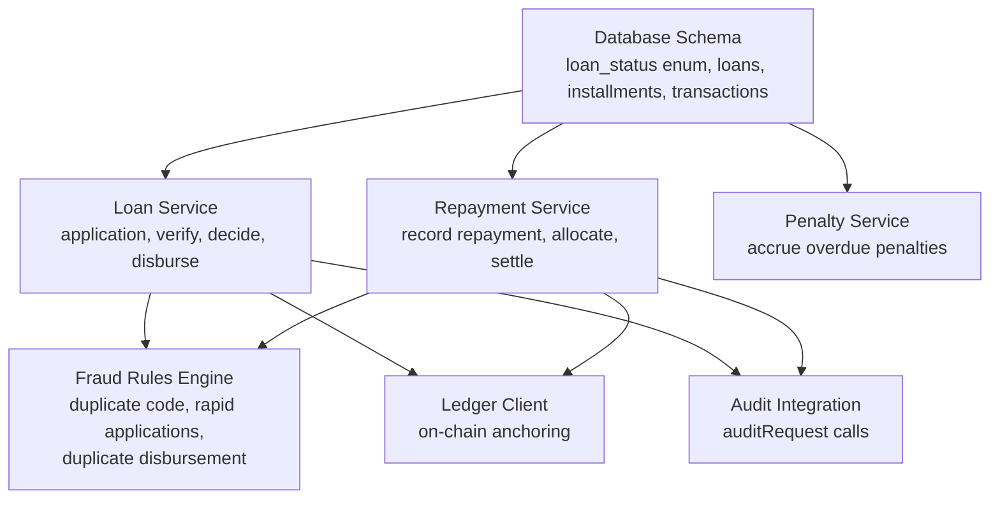
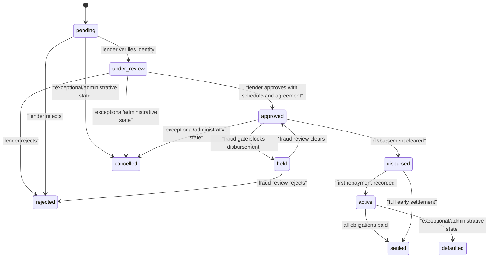
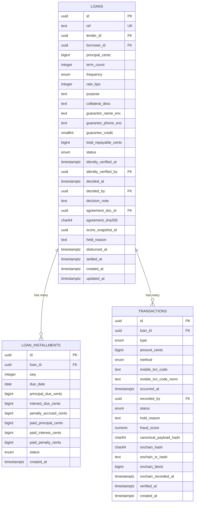
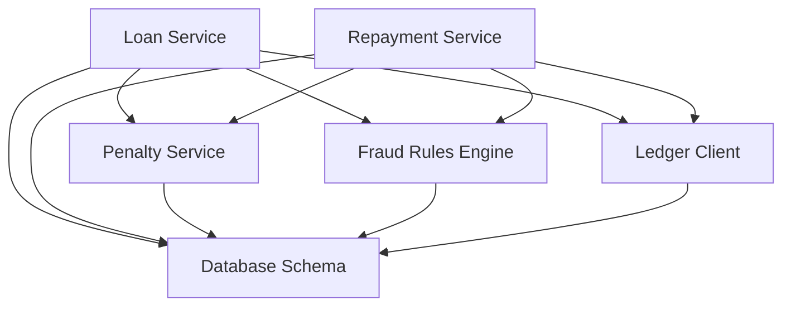

# Loan Status Lifecycle

<cite>
**Referenced Files in This Document**   
- [002_loans.sql](file://backend/src/db/migrations/002_loans.sql)
- [003_transactions_scoring.sql](file://backend/src/db/migrations/003_transactions_scoring.sql)
- [loan.service.ts](file://backend/src/modules/loans/loan.service.ts)
- [loan.schemas.ts](file://backend/src/modules/loans/loan.schemas.ts)
- [repayment.service.ts](file://backend/src/modules/repayments/repayment.service.ts)
- [penalty.service.ts](file://backend/src/modules/repayments/penalty.service.ts)
- [rules.engine.ts](file://backend/src/modules/fraud/rules.engine.ts)
- [chain.client.ts](file://backend/src/modules/ledger/chain.client.ts)
</cite>

## Table of Contents
1. [Introduction](#introduction)
2. [Project Structure](#project-structure)
3. [Core Components](#core-components)
4. [Architecture Overview](#architecture-overview)
5. [Detailed Component Analysis](#detailed-component-analysis)
6. [Dependency Analysis](#dependency-analysis)
7. [Performance Considerations](#performance-considerations)
8. [Troubleshooting Guide](#troubleshooting-guide)
9. [Conclusion](#conclusion)

## Introduction
This document explains the complete loan status lifecycle and state machine used by the system. It covers all ten loan states: `pending`, `under_review`, `approved`, `rejected`, `held`, `disbursed`, `active`, `settled`, `defaulted`, and `cancelled`. It documents valid transitions, triggering conditions, business rules, audit behavior, and integration points with fraud detection, repayment processing, penalties, and on-chain anchoring.

The repository defines the canonical set of loan statuses in the database schema and implements most explicit transitions through the loan and repayment services. Some terminal or exceptional states such as `defaulted` and `cancelled` are declared but do not have dedicated transition endpoints in the analyzed files; they remain part of the domain model and may be updated by future workflows or administrative processes.

## Project Structure
The loan lifecycle is primarily implemented in the backend modules:

- Database schema defines the loan status enum, installments, transactions, and related metadata.
- The loan service handles application creation, identity verification, approval/rejection, agreement generation, disbursement, and fraud-driven holds.
- The repayment service records repayments, allocates payments across penalties, interest, and principal, and transitions loans to `active` or `settled`.
- Penalty accrual updates overdue installments and can mark them overdue.
- Fraud rules raise flags that can hold disbursements or repayments.
- The ledger client anchors transaction hashes on-chain when enabled.

**Diagram sources**
- [002_loans.sql:5-16](file://backend/src/db/migrations/002_loans.sql#L5-L16)
- [loan.service.ts:23-31](file://backend/src/modules/loans/loan.service.ts#L23-L31)
- [repayment.service.ts:17-24](file://backend/src/modules/repayments/repayment.service.ts#L17-L24)
- [penalty.service.ts:5-14](file://backend/src/modules/repayments/penalty.service.ts#L5-L14)
- [rules.engine.ts:150-274](file://backend/src/modules/fraud/rules.engine.ts#L150-L274)
- [chain.client.ts:71-94](file://backend/src/modules/ledger/chain.client.ts#L71-L94)

**Section sources**
- [002_loans.sql:5-16](file://backend/src/db/migrations/002_loans.sql#L5-L16)
- [loan.service.ts:23-31](file://backend/src/modules/loans/loan.service.ts#L23-L31)
- [repayment.service.ts:17-24](file://backend/src/modules/repayments/repayment.service.ts#L17-L24)

## Core Components
- **Loan status enum**: Declares the ten canonical states and their intended meanings.
- **Loans table**: Stores loan metadata, current status, timestamps for key events, and fraud-related fields like `held_reason`.
- **Installments table**: Tracks scheduled repayments and per-installment payment progress.
- **Transactions table**: Records disbursements and repayments, including fraud checks, holds, and on-chain anchoring metadata.
- **Loan service**: Implements application submission, identity verification, decision making, agreement generation, disbursement, and fraud-gated holds.
- **Repayment service**: Validates repayment inputs, performs fraud checks, allocates payments, updates installments, and transitions loans to `active` or `settled`.
- **Penalty service**: Computes and applies overdue penalties idempotently.
- **Fraud rules engine**: Detects duplicate mobile-money references, malformed references, rapid applications, and duplicate disbursements.
- **Ledger client**: Anchors canonical transaction hashes on-chain when enabled.

**Section sources**
- [002_loans.sql:5-56](file://backend/src/db/migrations/002_loans.sql#L5-L56)
- [003_transactions_scoring.sql:5-35](file://backend/src/db/migrations/003_transactions_scoring.sql#L5-L35)
- [loan.service.ts:38-80](file://backend/src/modules/loans/loan.service.ts#L38-L80)
- [repayment.service.ts:25-43](file://backend/src/modules/repayments/repayment.service.ts#L25-L43)
- [penalty.service.ts:5-14](file://backend/src/modules/repayments/penalty.service.ts#L5-L14)
- [rules.engine.ts:150-274](file://backend/src/modules/fraud/rules.engine.ts#L150-L274)
- [chain.client.ts:71-94](file://backend/src/modules/ledger/chain.client.ts#L71-L94)

## Architecture Overview
The loan lifecycle follows a primary flow from application through settlement, with fraud gates and penalty accrual influencing intermediate states.

**Diagram sources**
- [loan.service.ts:23-31](file://backend/src/modules/loans/loan.service.ts#L23-L31)
- [loan.service.ts:474-496](file://backend/src/modules/loans/loan.service.ts#L474-L496)
- [loan.service.ts:551-645](file://backend/src/modules/loans/loan.service.ts#L551-L645)
- [loan.service.ts:654-767](file://backend/src/modules/loans/loan.service.ts#L654-L767)
- [repayment.service.ts:100-298](file://backend/src/modules/repayments/repayment.service.ts#L100-L298)

## Detailed Component Analysis

### State Definitions and Data Model
The database defines the loan status enum and core loan record fields:

- `loan_status`: `pending`, `under_review`, `approved`, `rejected`, `held`, `disbursed`, `active`, `settled`, `defaulted`, `cancelled`.
- Key timestamps: `identity_verified_at`, `decided_at`, `disbursed_at`, `settled_at`.
- Fraud field: `held_reason`.
- Installments track due amounts, paid amounts, penalties, and installment-level status.
- Transactions track money movements, fraud flags, holds, and on-chain anchoring.

**Diagram sources**
- [002_loans.sql:5-80](file://backend/src/db/migrations/002_loans.sql#L5-L80)
- [003_transactions_scoring.sql:5-35](file://backend/src/db/migrations/003_transactions_scoring.sql#L5-L35)

**Section sources**
- [002_loans.sql:5-56](file://backend/src/db/migrations/002_loans.sql#L5-L56)
- [003_transactions_scoring.sql:5-35](file://backend/src/db/migrations/003_transactions_scoring.sql#L5-L35)

### Valid Transitions and Business Rules

#### Pending
- **Meaning**: Borrower applied; awaiting lender review.
- **Entry**: Application creation sets status to `pending`.
- **Valid transitions**:
  - To `under_review`: Lender verifies identity.
  - To `rejected`: Lender rejects before or during review.
  - To `cancelled`: Exceptional/administrative cancellation (declared in schema; no explicit endpoint in analyzed files).

**Section sources**
- [loan.service.ts:285-352](file://backend/src/modules/loans/loan.service.ts#L285-L352)
- [loan.service.ts:474-496](file://backend/src/modules/loans/loan.service.ts#L474-L496)
- [loan.service.ts:551-574](file://backend/src/modules/loans/loan.service.ts#L551-L574)

#### Under Review
- **Meaning**: Lender opened the application; identity verification in progress.
- **Entry**: Identity verification transitions `pending` or `under_review` to `under_review`.
- **Valid transitions**:
  - To `approved`: Lender approves after identity verification; generates agreement and schedule.
  - To `rejected`: Lender rejects.
  - To `cancelled`: Exceptional/administrative cancellation (declared in schema; no explicit endpoint in analyzed files).

**Section sources**
- [loan.service.ts:474-496](file://backend/src/modules/loans/loan.service.ts#L474-L496)
- [loan.service.ts:551-645](file://backend/src/modules/loans/loan.service.ts#L551-L645)

#### Approved
- **Meaning**: Lender approved; agreement generated; not yet disbursed.
- **Entry**: Decision approve creates agreement PDF, stores SHA-256, builds schedule, and sets status to `approved`.
- **Valid transitions**:
  - To `disbursed`: Disbursement cleared after fraud checks pass.
  - To `held`: Fraud gate blocks disbursement; loan status becomes `held`.
  - To `rejected`: Not directly supported by the analyzed decision path; typically handled earlier.
  - To `cancelled`: Exceptional/administrative cancellation (declared in schema; no explicit endpoint in analyzed files).

**Section sources**
- [loan.service.ts:551-645](file://backend/src/modules/loans/loan.service.ts#L551-L645)
- [loan.service.ts:654-767](file://backend/src/modules/loans/loan.service.ts#L654-L767)

#### Rejected
- **Meaning**: Application denied.
- **Entry**: Lender rejects; decision sets status to `rejected`.
- **Valid transitions**: No further transitions defined in analyzed files.

**Section sources**
- [loan.service.ts:551-574](file://backend/src/modules/loans/loan.service.ts#L551-L574)

#### Held
- **Meaning**: Fraud gate blocked approval or disbursement.
- **Entry**: Disbursement or repayment triggers blocking fraud rules; loan status becomes `held` with a reason.
- **Valid transitions**:
  - To `approved`: After fraud review clears (conceptual; no explicit endpoint in analyzed files).
  - To `rejected`: After fraud review rejects (conceptual; no explicit endpoint in analyzed files).
  - To `disbursed`: If the hold was only on the transaction and later cleared (conceptual; analyzed code updates loan to `held` and transaction to `held`).

**Section sources**
- [loan.service.ts:654-767](file://backend/src/modules/loans/loan.service.ts#L654-L767)
- [repayment.service.ts:147-171](file://backend/src/modules/repayments/repayment.service.ts#L147-L171)

#### Disbursed
- **Meaning**: Money released; on-chain proof written when enabled.
- **Entry**: Disbursement cleared after fraud checks pass; loan status becomes `disbursed`.
- **Valid transitions**:
  - To `active`: First repayment recorded.
  - To `settled`: Full early settlement when outstanding balance reaches zero.

**Section sources**
- [loan.service.ts:654-767](file://backend/src/modules/loans/loan.service.ts#L654-L767)
- [repayment.service.ts:100-298](file://backend/src/modules/repayments/repayment.service.ts#L100-L298)

#### Active
- **Meaning**: At least one repayment recorded; still outstanding.
- **Entry**: Repayment allocation marks loan as `active` when not fully settled.
- **Valid transitions**:
  - To `settled`: All obligations paid.
  - To `defaulted`: Exceptional/administrative state (declared in schema; no explicit endpoint in analyzed files).

**Section sources**
- [repayment.service.ts:173-241](file://backend/src/modules/repayments/repayment.service.ts#L173-L241)

#### Settled
- **Meaning**: All obligations paid.
- **Entry**: Repayment allocation results in paid >= due; loan status becomes `settled` and `settled_at` is recorded.
- **Valid transitions**: No further transitions defined in analyzed files.

**Section sources**
- [repayment.service.ts:222-241](file://backend/src/modules/repayments/repayment.service.ts#L222-L241)

#### Defaulted
- **Meaning**: Exceptional state indicating failure to meet obligations.
- **Definition**: Declared in schema; no explicit transition logic found in analyzed files.
- **Implication**: Can be used by future workflows or administrative processes.

**Section sources**
- [002_loans.sql:5-16](file://backend/src/db/migrations/002_loans.sql#L5-L16)

#### Cancelled
- **Meaning**: Exceptional state indicating cancellation.
- **Definition**: Declared in schema; no explicit transition logic found in analyzed files.
- **Implication**: Can be used by future workflows or administrative processes.

**Section sources**
- [002_loans.sql:5-16](file://backend/src/db/migrations/002_loans.sql#L5-L16)

### Transition Triggers and Conditions

#### Identity Verification
- **Trigger**: Lender calls identity verification.
- **Conditions**:
  - Actor must be lender.
  - Loan must be `pending` or `under_review`.
- **Result**: Sets `identity_verified_at`, `identity_verified_by`, and status to `under_review`.

**Section sources**
- [loan.service.ts:474-496](file://backend/src/modules/loans/loan.service.ts#L474-L496)

#### Approval
- **Trigger**: Lender decides to approve.
- **Conditions**:
  - Actor must be lender.
  - Loan must be `pending` or `under_review`.
  - Identity must be verified.
  - Rate provided when approving.
- **Result**: Generates agreement PDF, computes schedule, stores SHA-256, sets status to `approved`.

**Section sources**
- [loan.service.ts:551-645](file://backend/src/modules/loans/loan.service.ts#L551-L645)

#### Rejection
- **Trigger**: Lender decides to reject.
- **Conditions**:
  - Actor must be lender.
  - Loan must be `pending` or `under_review`.
- **Result**: Sets status to `rejected`, records decision timestamp and note.

**Section sources**
- [loan.service.ts:551-574](file://backend/src/modules/loans/loan.service.ts#L551-L574)

#### Disbursement
- **Trigger**: Lender initiates disbursement.
- **Conditions**:
  - Actor must be lender.
  - Loan must be `approved`.
  - Mobile-money reference validated if applicable.
- **Fraud checks**:
  - Duplicate disbursement detection.
  - Reference issues (duplicate or malformed mobile-money codes).
- **Results**:
  - If blocking fraud flags: transaction and loan become `held`; audit event logged.
  - Else: transaction cleared, optional on-chain anchor, loan becomes `disbursed`; audit event logged.

**Section sources**
- [loan.service.ts:654-767](file://backend/src/modules/loans/loan.service.ts#L654-L767)
- [rules.engine.ts:150-274](file://backend/src/modules/fraud/rules.engine.ts#L150-L274)
- [chain.client.ts:71-94](file://backend/src/modules/ledger/chain.client.ts#L71-L94)

#### Repayment Recording
- **Trigger**: Repayment recorded.
- **Conditions**:
  - Loan must be `disbursed` or `active`.
  - Amount must not exceed outstanding balance.
  - Occurred-at cannot be in the future or predate disbursement beyond allowed window.
- **Fraud checks**:
  - Reference issues for mobile-money repayments.
- **Allocation**:
  - Payments allocated to penalty, then interest, then principal across installments in order.
- **Settlement**:
  - If paid >= due, loan becomes `settled`; otherwise `active`.
- **On-chain anchoring**:
  - Transaction hash anchored when enabled; failures are non-fatal.

**Section sources**
- [repayment.service.ts:100-298](file://backend/src/modules/repayments/repayment.service.ts#L100-L298)
- [penalty.service.ts:5-43](file://backend/src/modules/repayments/penalty.service.ts#L5-L43)
- [chain.client.ts:71-94](file://backend/src/modules/ledger/chain.client.ts#L71-L94)

### Common Scenarios

#### Early Settlement
- **Flow**:
  - Loan is `disbursed` or `active`.
  - Borrower submits a repayment equal to or greater than outstanding balance.
  - System allocates payment across penalties, interest, and principal.
  - If paid >= due, loan transitions to `settled` and `settled_at` is recorded.
- **Key behaviors**:
  - Overdue penalties accrued before allocation.
  - Fraud checks apply to repayment references.
  - On-chain anchoring occurs after successful commit.

**Section sources**
- [repayment.service.ts:100-298](file://backend/src/modules/repayments/repayment.service.ts#L100-L298)
- [penalty.service.ts:5-43](file://backend/src/modules/repayments/penalty.service.ts#L5-L43)

#### Default Handling
- **Current implementation**:
  - `defaulted` is a declared state but no explicit transition logic is present in analyzed files.
  - Overdue installments are tracked via installment status and penalty accrual.
- **Recommended extension**:
  - Define thresholds (e.g., number of overdue installments, time since last payment) to transition to `defaulted`.
  - Add administrative or automated workflow to update loan status and notify stakeholders.

**Section sources**
- [002_loans.sql:5-16](file://backend/src/db/migrations/002_loans.sql#L5-L16)
- [penalty.service.ts:5-43](file://backend/src/modules/repayments/penalty.service.ts#L5-L43)

#### Loan Cancellation
- **Current implementation**:
  - `cancelled` is a declared state but no explicit transition logic is present in analyzed files.
- **Recommended extension**:
  - Allow cancellation for `pending`, `under_review`, or `approved` loans under specific conditions (e.g., borrower request, compliance hold).
  - Ensure agreements and schedules are preserved and audited.

**Section sources**
- [002_loans.sql:5-16](file://backend/src/db/migrations/002_loans.sql#L5-L16)

### Audit and System Integration

#### Audit Logging
- Every major action logs an audit event:
  - Application submitted.
  - Identity verified.
  - Loan approved or rejected.
  - Disbursement held or disbursed.
  - Repayment held or recorded.
  - Agreement issued or downloaded.
- Audit entries include actor context, loan reference, relevant amounts, and sometimes payload hashes.

**Section sources**
- [loan.service.ts:342-352](file://backend/src/modules/loans/loan.service.ts#L342-L352)
- [loan.service.ts:489-496](file://backend/src/modules/loans/loan.service.ts#L489-L496)
- [loan.service.ts:568-574](file://backend/src/modules/loans/loan.service.ts#L568-L574)
- [loan.service.ts:629-645](file://backend/src/modules/loans/loan.service.ts#L629-L645)
- [loan.service.ts:707-713](file://backend/src/modules/loans/loan.service.ts#L707-L713)
- [loan.service.ts:751-767](file://backend/src/modules/loans/loan.service.ts#L751-L767)
- [repayment.service.ts:158-171](file://backend/src/modules/repayments/repayment.service.ts#L158-L171)
- [repayment.service.ts:280-298](file://backend/src/modules/repayments/repayment.service.ts#L280-L298)

#### Fraud Detection Integration
- Fraud rules evaluate:
  - Duplicate mobile-money references.
  - Malformed references.
  - Rapid repeated applications.
  - Duplicate disbursement attempts.
- Blocking severity levels (`high` or `critical`) cause holds on transactions and loans.

**Section sources**
- [rules.engine.ts:150-274](file://backend/src/modules/fraud/rules.engine.ts#L150-L274)
- [loan.service.ts:690-713](file://backend/src/modules/loans/loan.service.ts#L690-L713)
- [repayment.service.ts:147-171](file://backend/src/modules/repayments/repayment.service.ts#L147-L171)

#### On-Chain Anchoring
- Disbursements and repayments generate canonical payload hashes.
- When enabled, hashes are anchored on-chain; failures are logged but do not roll back real money movements.
- Transaction records store on-chain metadata for verification.

**Section sources**
- [loan.service.ts:720-736](file://backend/src/modules/loans/loan.service.ts#L720-L736)
- [loan.service.ts:738-767](file://backend/src/modules/loans/loan.service.ts#L738-L767)
- [repayment.service.ts:251-278](file://backend/src/modules/repayments/repayment.service.ts#L251-L278)
- [chain.client.ts:71-94](file://backend/src/modules/ledger/chain.client.ts#L71-L94)

## Dependency Analysis

**Diagram sources**
- [loan.service.ts:1-21](file://backend/src/modules/loans/loan.service.ts#L1-L21)
- [repayment.service.ts:1-15](file://backend/src/modules/repayments/repayment.service.ts#L1-L15)
- [penalty.service.ts:1-4](file://backend/src/modules/repayments/penalty.service.ts#L1-L4)
- [rules.engine.ts:1-10](file://backend/src/modules/fraud/rules.engine.ts#L1-L10)
- [chain.client.ts:1-10](file://backend/src/modules/ledger/chain.client.ts#L1-L10)

**Section sources**
- [loan.service.ts:1-21](file://backend/src/modules/loans/loan.service.ts#L1-L21)
- [repayment.service.ts:1-15](file://backend/src/modules/repayments/repayment.service.ts#L1-L15)
- [penalty.service.ts:1-4](file://backend/src/modules/repayments/penalty.service.ts#L1-L4)
- [rules.engine.ts:1-10](file://backend/src/modules/fraud/rules.engine.ts#L1-L10)
- [chain.client.ts:1-10](file://backend/src/modules/ledger/chain.client.ts#L1-L10)

## Performance Considerations
- **Idempotent penalty accrual**: Uses `GREATEST(old, new)` to avoid double-charging and tolerate missing nightly jobs.
- **Transaction locking**: Repayment allocation uses row-level locks to prevent concurrent overpayments.
- **Indexing**: Database indexes support queries by loan, status, and mobile transaction codes.
- **Non-fatal chain operations**: On-chain anchoring failures are logged without rolling back successful financial operations.

**Section sources**
- [penalty.service.ts:5-14](file://backend/src/modules/repayments/penalty.service.ts#L5-L14)
- [repayment.service.ts:175-241](file://backend/src/modules/repayments/repayment.service.ts#L175-L241)
- [002_loans.sql:58-60](file://backend/src/db/migrations/002_loans.sql#L58-L60)
- [003_transactions_scoring.sql:37-39](file://backend/src/db/migrations/003_transactions_scoring.sql#L37-L39)

## Troubleshooting Guide
- **Cannot verify identity**: Ensure loan is `pending` or `under_review` and actor is lender.
- **Cannot approve without identity verification**: Complete identity verification before approval.
- **Disbursement held**: Check fraud flags for duplicate references, malformed codes, or duplicate disbursements; resolve and reprocess.
- **Repayment rejected**: Allocation failed; transaction marked rejected; investigate outstanding balance and allocation logic.
- **On-chain anchor missing**: Chain connectivity or contract interaction may have failed; verify ledger configuration and retry anchoring.

**Section sources**
- [loan.service.ts:474-496](file://backend/src/modules/loans/loan.service.ts#L474-L496)
- [loan.service.ts:576-578](file://backend/src/modules/loans/loan.service.ts#L576-L578)
- [loan.service.ts:690-713](file://backend/src/modules/loans/loan.service.ts#L690-L713)
- [repayment.service.ts:242-249](file://backend/src/modules/repayments/repayment.service.ts#L242-L249)
- [repayment.service.ts:251-278](file://backend/src/modules/repayments/repayment.service.ts#L251-L278)

## Conclusion
The loan status lifecycle is centered around a well-defined state machine with explicit transitions for application, verification, approval, rejection, disbursement, repayment, and settlement. Fraud detection integrates at critical points to hold suspicious flows, while penalties ensure overdue costs are captured. On-chain anchoring provides verifiable proofs for money movements. States `defaulted` and `cancelled` are part of the domain model and should be integrated through additional workflows to complete the lifecycle coverage.