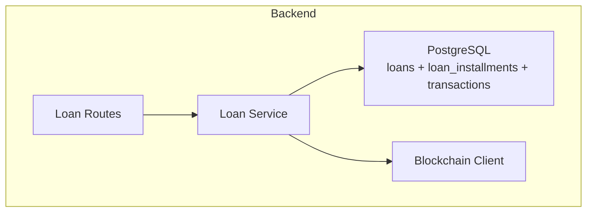
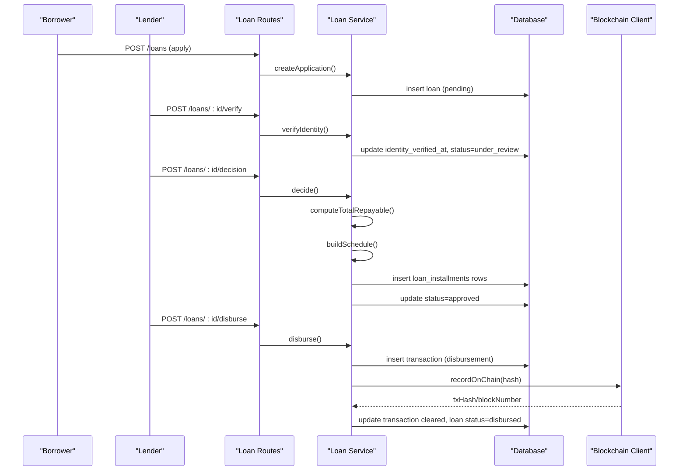
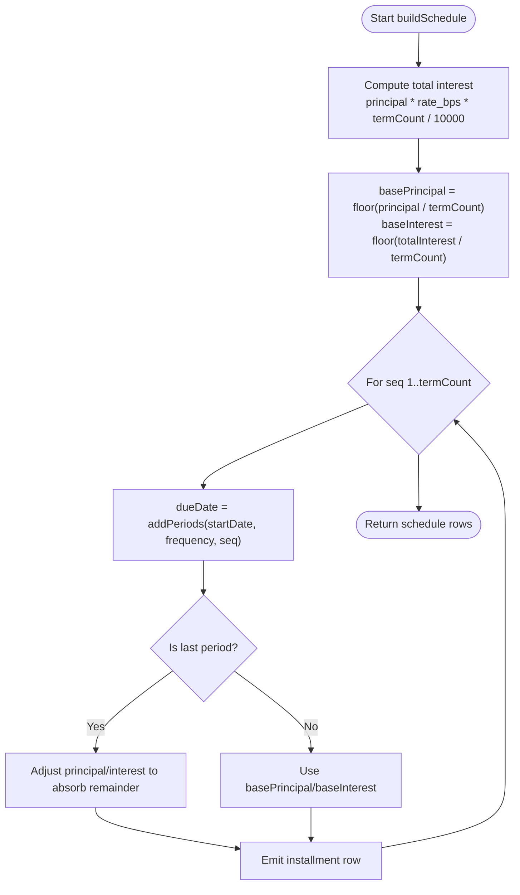
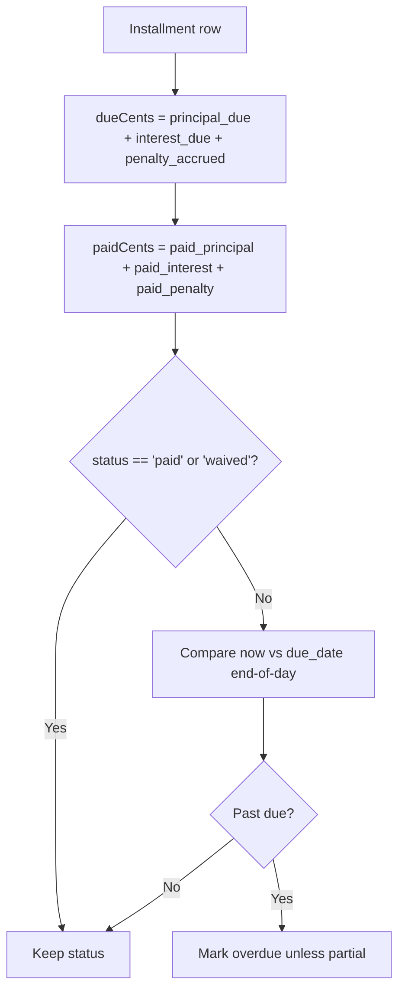
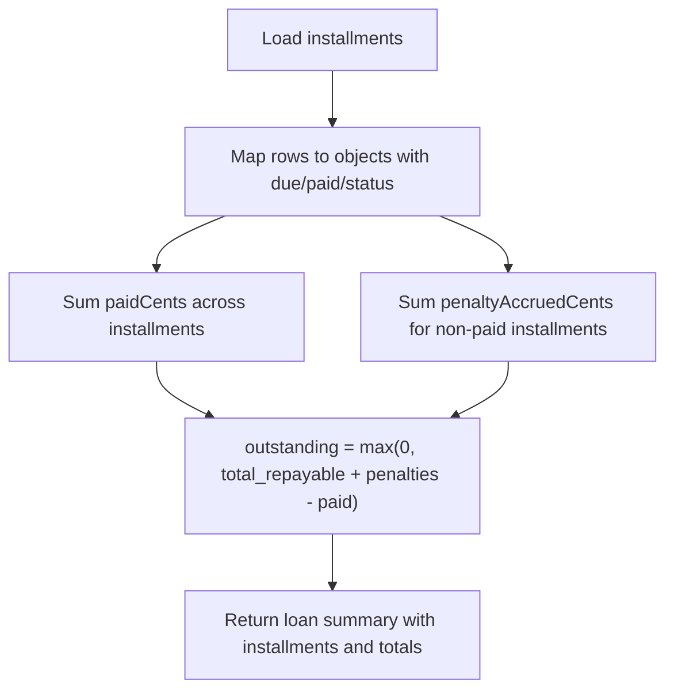
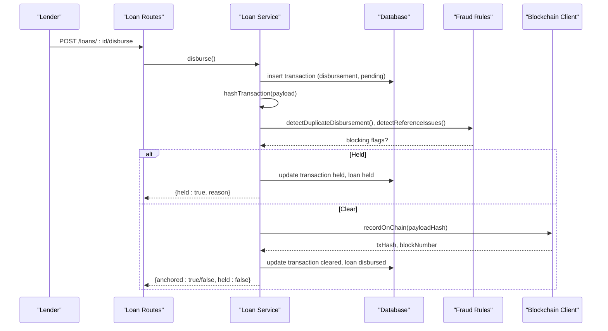
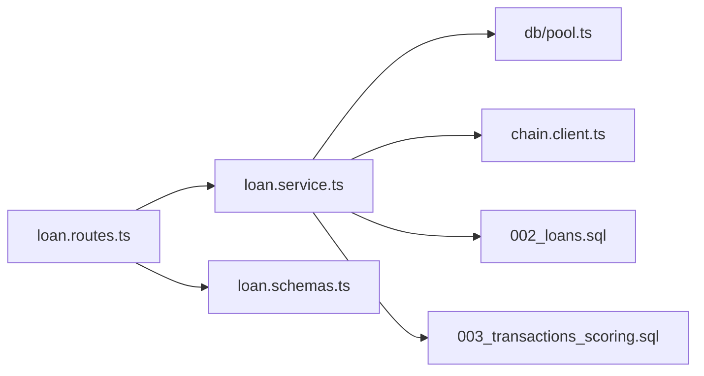

# Repayment Scheduling & Tracking

<cite>
**Referenced Files in This Document**
- [loan.service.ts](file://backend/src/modules/loans/loan.service.ts)
- [002_loans.sql](file://backend/src/db/migrations/002_loans.sql)
- [003_transactions_scoring.sql](file://backend/src/db/migrations/003_transactions_scoring.sql)
- [chain.client.ts](file://backend/src/modules/ledger/chain.client.ts)
- [loan.schemas.ts](file://backend/src/modules/loans/loan.schemas.ts)
- [loan.routes.ts](file://backend/src/modules/loans/loan.routes.ts)
</cite>

## Table of Contents
1. [Introduction](#introduction)
2. [Project Structure](#project-structure)
3. [Core Components](#core-components)
4. [Architecture Overview](#architecture-overview)
5. [Detailed Component Analysis](#detailed-component-analysis)
6. [Dependency Analysis](#dependency-analysis)
7. [Performance Considerations](#performance-considerations)
8. [Troubleshooting Guide](#troubleshooting-guide)
9. [Conclusion](#conclusion)

## Introduction
This document explains the repayment scheduling and tracking system for loans. It covers how installments are generated from principal, interest rate in basis points, term count, and frequency; how due dates, payment statuses, and penalties are tracked; how partial payments are represented; and how disbursement is anchored on-chain before a loan transitions from disbursed to active once repayments begin.

## Project Structure
The repayment system lives primarily in the backend loan module:
- Database schema defines loan lifecycle, installment records, and transaction records.
- Loan service implements schedule generation, status logic, agreement issuance, and disbursement with blockchain anchoring.
- Routes expose endpoints for application, decision, disbursement, and retrieval.
- Ledger client writes hashes to an on-chain ledger contract when enabled.

**Diagram sources**
- [loan.routes.ts:1-98](file://backend/src/modules/loans/loan.routes.ts#L1-L98)
- [loan.service.ts:1-790](file://backend/src/modules/loans/loan.service.ts#L1-L790)
- [002_loans.sql:1-100](file://backend/src/db/migrations/002_loans.sql#L1-L100)
- [003_transactions_scoring.sql:1-26](file://backend/src/db/migrations/003_transactions_scoring.sql#L1-L26)
- [chain.client.ts:1-152](file://backend/src/modules/ledger/chain.client.ts#L1-L152)

**Section sources**
- [loan.routes.ts:1-98](file://backend/src/modules/loans/loan.routes.ts#L1-L98)
- [loan.service.ts:1-790](file://backend/src/modules/loans/loan.service.ts#L1-L790)
- [002_loans.sql:1-100](file://backend/src/db/migrations/002_loans.sql#L1-L100)
- [003_transactions_scoring.sql:1-26](file://backend/src/db/migrations/003_transactions_scoring.sql#L1-L26)
- [chain.client.ts:1-152](file://backend/src/modules/ledger/chain.client.ts#L1-L152)

## Core Components
- Loan lifecycle states include pending, under_review, approved, rejected, held, disbursed, active, settled, defaulted, cancelled.
- Installment statuses include pending, partial, paid, overdue, waived.
- Frequency supports daily, weekly, monthly periods.
- Interest is flat per period based on original principal and rate_bps.
- Disbursement is recorded as a transaction and optionally anchored on-chain; loan becomes disbursed after successful processing.
- Active status is reached when at least one repayment is recorded while the loan remains outstanding.

Key data structures:
- Loans table stores principal_cents, term_count, frequency, rate_bps, total_repayable_cents, and status.
- Loan installments table stores per-period due amounts, accrued penalties, paid amounts, and status.
- Transactions table stores disbursements and repayments with method, codes, canonical hash, and on-chain fields.

**Section sources**
- [002_loans.sql:5-20](file://backend/src/db/migrations/002_loans.sql#L5-L20)
- [002_loans.sql:25-80](file://backend/src/db/migrations/002_loans.sql#L25-L80)
- [003_transactions_scoring.sql:11-26](file://backend/src/db/migrations/003_transactions_scoring.sql#L11-L26)
- [loan.service.ts:22-47](file://backend/src/modules/loans/loan.service.ts#L22-L47)
- [loan.service.ts:81-108](file://backend/src/modules/loans/loan.service.ts#L81-L108)

## Architecture Overview
The repayment flow spans application approval, schedule generation, disbursement, and ongoing repayment tracking.

**Diagram sources**
- [loan.routes.ts:42-88](file://backend/src/modules/loans/loan.routes.ts#L42-L88)
- [loan.service.ts:284-351](file://backend/src/modules/loans/loan.service.ts#L284-L351)
- [loan.service.ts:470-492](file://backend/src/modules/loans/loan.service.ts#L470-L492)
- [loan.service.ts:547-641](file://backend/src/modules/loans/loan.service.ts#L547-L641)
- [loan.service.ts:650-763](file://backend/src/modules/loans/loan.service.ts#L650-L763)
- [chain.client.ts:71-94](file://backend/src/modules/ledger/chain.client.ts#L71-L94)

## Detailed Component Analysis

### Schedule Generation Algorithm
The system generates equal installments across the agreed term count. The last installment absorbs integer-division remainders to ensure totals match exactly.

Algorithm steps:
- Compute total interest using flat rate per period over the full principal and term count.
- Derive base principal and base interest by dividing totals by term count using floor division.
- For each period, calculate due date by adding periods according to frequency.
- Assign principal and interest to each row; the final row adjusts for rounding differences.

**Diagram sources**
- [loan.service.ts:144-179](file://backend/src/modules/loans/loan.service.ts#L144-L179)

Formulas:
- Total repayable = principal + round((principal × rate_bps × termCount) / 10000).
- Per-period principal ≈ floor(principal / termCount), adjusted on last period.
- Per-period interest ≈ floor(totalInterest / termCount), adjusted on last period.

Complexity:
- Time O(termCount) to generate rows.
- Space O(termCount) for the schedule array.

Frequency handling:
- Daily adds 1 day per period.
- Weekly adds 7 days per period.
- Monthly advances month and clamps to end-of-month if needed.

**Section sources**
- [loan.service.ts:122-179](file://backend/src/modules/loans/loan.service.ts#L122-L179)

### Installment Tracking and Overdue Logic
Each installment tracks:
- Due date and due amounts for principal, interest, and penalty.
- Paid amounts for principal, interest, and penalty.
- Status among pending, partial, paid, overdue, waived.

Overdue determination:
- If status is paid or waived, never overdue.
- Otherwise, compare current time with due date end-of-day UTC.

Status mapping during retrieval:
- If overdue and not already partial, mark as overdue.
- Partial remains partial even if past due until fully paid.

**Diagram sources**
- [loan.service.ts:181-200](file://backend/src/modules/loans/loan.service.ts#L181-L200)

Penalty accrual:
- Each installment has penalty_accrued_cents.
- Outstanding calculation includes unpaid penalties except for paid installments.

Partial payments:
- Represented via separate paid_principal_cents, paid_interest_cents, paid_penalty_cents columns.
- Status can be partial when any but not all due components are paid.

**Section sources**
- [002_loans.sql:66-80](file://backend/src/db/migrations/002_loans.sql#L66-L80)
- [loan.service.ts:181-200](file://backend/src/modules/loans/loan.service.ts#L181-L200)
- [loan.service.ts:411-467](file://backend/src/modules/loans/loan.service.ts#L411-L467)

### Payment Calculation and Outstanding Summary
Outstanding amount:
- Scheduled loans: max(0, total_repayable_cents + unpaid penalties - total paid across installments).
- Unpaid penalties are summed excluding paid installments.

Summary fields:
- totalRepayableCents, paidCents, accruedPenaltyCents, outstandingCents, installmentsPaid, installmentsTotal.

**Diagram sources**
- [loan.service.ts:411-467](file://backend/src/modules/loans/loan.service.ts#L411-L467)

**Section sources**
- [loan.service.ts:411-467](file://backend/src/modules/loans/loan.service.ts#L411-L467)

### Disbursement, Blockchain Anchoring, and Status Transition
Disbursement workflow:
- Validate lender role and approved loan state.
- Normalize mobile money code if applicable and validate format.
- Insert disbursement transaction with status pending.
- Compute canonical payload hash for anchoring.
- Run fraud rules; high/critical severity blocks move loan to held.
- If clear, attempt to anchor hash on-chain; failures are logged but do not prevent clearing.
- Update transaction to cleared and loan to disbursed.

Transition to active:
- The database type defines active as “at least one repayment recorded, still outstanding.”
- While the service does not explicitly set active here, the schema definition indicates that recording a repayment moves the loan into active when there is remaining balance.

**Diagram sources**
- [loan.routes.ts:79-88](file://backend/src/modules/loans/loan.routes.ts#L79-L88)
- [loan.service.ts:650-763](file://backend/src/modules/loans/loan.service.ts#L650-L763)
- [chain.client.ts:71-94](file://backend/src/modules/ledger/chain.client.ts#L71-L94)

Notes:
- On-chain anchoring is optional; if disabled or unavailable, the system continues with off-chain records marked as not anchored.
- The canonical payload hash is stored alongside on-chain metadata for verification.

**Section sources**
- [loan.service.ts:650-763](file://backend/src/modules/loans/loan.service.ts#L650-L763)
- [chain.client.ts:24-30](file://backend/src/modules/ledger/chain.client.ts#L24-L30)
- [chain.client.ts:71-94](file://backend/src/modules/ledger/chain.client.ts#L71-L94)
- [002_loans.sql:5-16](file://backend/src/db/migrations/002_loans.sql#L5-L16)

### Input Validation and Rate Handling
- Borrowers cannot set interest rate, totals, or status; these are derived server-side.
- Decision endpoint requires rate_bps when approving; borrower applications use lender default rate if not provided.
- Term count must be between 1 and 365; principal has min/max bounds.

**Section sources**
- [loan.schemas.ts:4-10](file://backend/src/modules/loans/loan.schemas.ts#L4-L10)
- [loan.schemas.ts:11-25](file://backend/src/modules/loans/loan.schemas.ts#L11-L25)
- [loan.schemas.ts:29-40](file://backend/src/modules/loans/loan.schemas.ts#L29-L40)
- [loan.service.ts:309-310](file://backend/src/modules/loans/loan.service.ts#L309-L310)
- [loan.service.ts:576-584](file://backend/src/modules/loans/loan.service.ts#L576-L584)

## Dependency Analysis
High-level dependencies:
- Routes depend on service functions for business logic.
- Service depends on database pool for queries and transactions.
- Service uses ledger client for on-chain anchoring.
- Schema validation ensures safe inputs.

**Diagram sources**
- [loan.routes.ts:1-98](file://backend/src/modules/loans/loan.routes.ts#L1-L98)
- [loan.service.ts:1-20](file://backend/src/modules/loans/loan.service.ts#L1-L20)
- [chain.client.ts:1-20](file://backend/src/modules/ledger/chain.client.ts#L1-L20)
- [loan.schemas.ts:1-10](file://backend/src/modules/loans/loan.schemas.ts#L1-L10)
- [002_loans.sql:1-20](file://backend/src/db/migrations/002_loans.sql#L1-L20)
- [003_transactions_scoring.sql:1-10](file://backend/src/db/migrations/003_transactions_scoring.sql#L1-L10)

**Section sources**
- [loan.routes.ts:1-98](file://backend/src/modules/loans/loan.routes.ts#L1-L98)
- [loan.service.ts:1-20](file://backend/src/modules/loans/loan.service.ts#L1-L20)
- [chain.client.ts:1-20](file://backend/src/modules/ledger/chain.client.ts#L1-L20)
- [loan.schemas.ts:1-10](file://backend/src/modules/loans/loan.schemas.ts#L1-L10)
- [002_loans.sql:1-20](file://backend/src/db/migrations/002_loans.sql#L1-L20)
- [003_transactions_scoring.sql:1-10](file://backend/src/db/migrations/003_transactions_scoring.sql#L1-L10)

## Performance Considerations
- Schedule generation is linear in term count; for very long terms, consider batching or streaming responses.
- Outstanding calculations aggregate paid amounts and penalties; indexing on loan_id and due_date helps query performance.
- Blockchain anchoring is asynchronous to user-facing operations; network latency should be handled gracefully.
- Flat interest avoids amortization complexity but may differ from APR-based models; ensure alignment with business policy.

[No sources needed since this section provides general guidance]

## Troubleshooting Guide
Common issues:
- Mobile money reference invalid: normalize and validate before disbursement.
- Duplicate disbursement or reference reuse: fraud rules hold the transaction and loan for review.
- Blockchain unavailable: anchoring fails but disbursement still clears; check chain configuration and RPC settings.
- Agreement missing: ensure decision path rendered and persisted the PDF and SHA-256.

Operational checks:
- Verify CHAIN_MODE and LEDGER_CONTRACT_ADDRESS are configured for anchoring.
- Confirm loan status progression aligns with expected workflow.
- Inspect transaction canonical_payload_hash and onchain_hash fields for verification.

**Section sources**
- [loan.service.ts:659-665](file://backend/src/modules/loans/loan.service.ts#L659-L665)
- [loan.service.ts:686-710](file://backend/src/modules/loans/loan.service.ts#L686-L710)
- [loan.service.ts:716-732](file://backend/src/modules/loans/loan.service.ts#L716-L732)
- [chain.client.ts:24-30](file://backend/src/modules/ledger/chain.client.ts#L24-L30)

## Conclusion
The repayment scheduling system generates deterministic, equal installments based on principal, rate_bps, term count, and frequency. It tracks due dates, partial payments, penalties, and overdue status, while supporting fraud holds and optional blockchain anchoring for disbursement proof. The loan lifecycle clearly separates approval, disbursement, and active repayment phases, ensuring auditable and verifiable records both off-chain and on-chain where available.

[No sources needed since this section summarizes without analyzing specific files]