# Project Overview

<cite>
**Referenced Files in This Document**
- [package.json](file://package.json)
- [backend/package.json](file://backend/package.json)
- [frontend/package.json](file://frontend/package.json)
- [backend/src/app.ts](file://backend/src/app.ts)
- [backend/src/server.ts](file://backend/src/server.ts)
- [backend/src/modules/ledger/chain.client.ts](file://backend/src/modules/ledger/chain.client.ts)
- [backend/src/modules/audit/audit.service.ts](file://backend/src/modules/audit/audit.service.ts)
- [backend/src/modules/fraud/rules.engine.ts](file://backend/src/modules/fraud/rules.engine.ts)
- [frontend/src/App.tsx](file://frontend/src/App.tsx)
- [frontend/src/lib/auth.tsx](file://frontend/src/lib/auth.tsx)
- [frontend/src/pages/borrower/BorrowerDashboard.tsx](file://frontend/src/pages/borrower/BorrowerDashboard.tsx)
- [frontend/src/pages/lender/LenderDashboard.tsx](file://frontend/src/pages/lender/LenderDashboard.tsx)
- [frontend/src/pages/auditor/AuditorDashboard.tsx](file://frontend/src/pages/auditor/AuditorDashboard.tsx)
</cite>

## Table of Contents
1. [Introduction](#introduction)
2. [Project Structure](#project-structure)
3. [Core Components](#core-components)
4. [Architecture Overview](#architecture-overview)
5. [Detailed Component Analysis](#detailed-component-analysis)
6. [Dependency Analysis](#dependency-analysis)
7. [Performance Considerations](#performance-considerations)
8. [Troubleshooting Guide](#troubleshooting-guide)
9. [Conclusion](#conclusion)

## Introduction
SecureMicrofinance is a security-focused university project that implements a blockchain-backed microfinance platform for private moneylenders. Its purpose is to make informal lending safer, more transparent, and auditable by combining a secure Express.js backend, a React-based web client, a PostgreSQL database, and Ethereum blockchain verification through an on-chain ledger contract. The system emphasizes data protection, tamper-evident audit trails, fraud detection, and clear separation of borrower, lender, and auditor workflows.

Key objectives include:
- Providing a SecureMicrofinance prototype where loan records, payments, and audit events are protected against tampering.
- Enabling blockchain verification so disbursements and repayments can be independently proven without exposing sensitive data.
- Supporting private moneylenders with identity checks, advisory scoring, signed agreements, and a fraud review queue.
- Giving forensic auditors read-only access to an append-only, hash-chained audit trail and integrity checks.
- Maintaining a development-friendly stack suitable for a university project while using production-grade security patterns such as rate limiting, CORS control, helmet headers, encrypted fields, and role-based routing.

The repository root describes the project as a “Blockchain-backed microfinance prototype for private moneylenders (security-focused university project),” and the workspace includes backend, frontend, and contracts workspaces.

**Section sources**
- [package.json:1-10](file://package.json#L1-L10)

## Project Structure
SecureMicrofinance is organized as a monorepo with three main workspaces:
- `backend`: Express.js API with TypeScript, PostgreSQL migrations, middleware, modules for authentication, users, audit, fraud rules, and Ethereum ledger integration.
- `frontend`: React + Vite + Tailwind application with role-based pages for borrowers, lenders, and auditors.
- `contracts`: Ethereum smart contract workspace referenced by the top-level scripts.

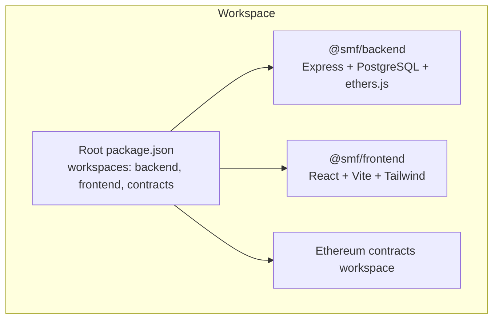

**Diagram sources**
- [package.json:1-10](file://package.json#L1-L10)
- [backend/package.json:1-10](file://backend/package.json#L1-L10)
- [frontend/package.json:1-10](file://frontend/package.json#L1-L10)

**Section sources**
- [package.json:1-30](file://package.json#L1-L30)
- [backend/package.json:1-17](file://backend/package.json#L1-L17)
- [frontend/package.json:1-12](file://frontend/package.json#L1-L12)

## Core Components
SecureMicrofinance’s core components are:
- Express.js backend API providing REST endpoints, security middleware, OpenAPI documentation, and module routes.
- React frontend with role-aware routing, session management, and dashboards for borrowers, lenders, and auditors.
- PostgreSQL database storing users, profiles, loans, transactions, fraud flags, alerts, and an append-only audit log.
- Ethereum blockchain integration via ethers.js to write hashes and timestamps to a LoanLedger contract, enabling blockchain verification.

Technology highlights:
- Backend dependencies include Express, PostgreSQL driver, JSON Web Tokens, bcryptjs, ethers.js, helmet, cors, rate limiting, and Zod validation.
- Frontend uses React, React Router, Vite, Tailwind CSS, and TypeScript.
- The root workspace provides scripts for database lifecycle, API/web development, contract deployment/testing, smoke tests, and type checking.

**Section sources**
- [backend/package.json:18-33](file://backend/package.json#L18-L33)
- [frontend/package.json:13-27](file://frontend/package.json#L13-L27)
- [package.json:11-30](file://package.json#L11-L30)

## Architecture Overview
At a high level, SecureMicrofinance follows a layered architecture:
- The React frontend authenticates users, manages sessions, and renders role-specific dashboards.
- The Express backend enforces security headers, CORS, request context, rate limits, and route authorization.
- Business logic is split into modules: auth, users, audit, fraud rules, and ledger.
- PostgreSQL stores relational data and the immutable audit chain.
- The Ethereum ledger client writes hashes and timestamps to a deployed contract when enabled, allowing independent verification.

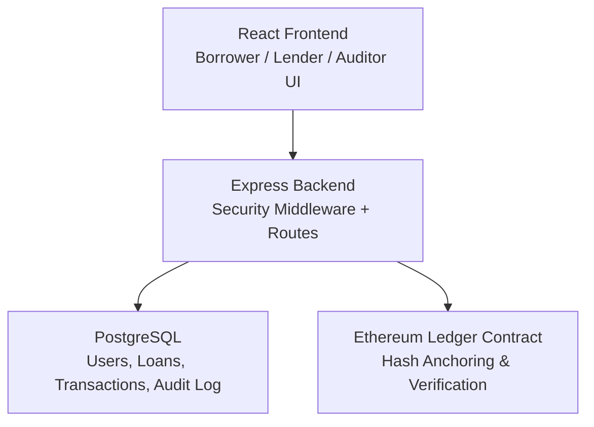

**Diagram sources**
- [backend/src/app.ts:23-92](file://backend/src/app.ts#L23-L92)
- [backend/src/modules/ledger/chain.client.ts:1-30](file://backend/src/modules/ledger/chain.client.ts#L1-L30)
- [frontend/src/App.tsx:39-62](file://frontend/src/App.tsx#L39-L62)

## Detailed Component Analysis

### SecureMicrofinance Platform Purpose and Security Focus
SecureMicrofinance is designed as a microfinance platform tailored for private moneylenders who need stronger controls over identity verification, loan approvals, payment integrity, and dispute resolution. It combines traditional database reliability with blockchain verification to ensure that critical financial events cannot be silently altered.

Security and compliance features visible in the codebase include:
- Helmet and CORS configuration to harden HTTP responses and restrict origins.
- Rate limiting and request context propagation for traceability.
- Encrypted personal data with masked views for staff and auditors.
- Append-only audit trail with per-row hashing and previous-hash linking.
- Fraud rule engine detecting duplicate receipts, malformed references, identity conflicts, rapid applications, and duplicate disbursements.
- Optional Ethereum anchoring of transaction hashes and timestamps for public verification.

These characteristics align with the project’s description as a security-focused university prototype for blockchain-backed microfinance.

**Section sources**
- [package.json:1-6](file://package.json#L1-L6)
- [backend/src/app.ts:23-63](file://backend/src/app.ts#L23-L63)
- [backend/src/modules/audit/audit.service.ts:7-14](file://backend/src/modules/audit/audit.service.ts#L7-L14)
- [backend/src/modules/fraud/rules.engine.ts:4-10](file://backend/src/modules/fraud/rules.engine.ts#L4-L10)
- [backend/src/modules/ledger/chain.client.ts:5-11](file://backend/src/modules/ledger/chain.client.ts#L5-L11)

### Technology Stack Summary
- Backend: Express.js, TypeScript, PostgreSQL, ethers.js, JWT, bcryptjs, helmet, cors, express-rate-limit, zod, swagger-ui-express.
- Frontend: React, React Router, Vite, Tailwind CSS, TypeScript.
- Blockchain: Ethereum-compatible RPC endpoint with a LoanLedger ABI for recording and verifying hashes.
- Development tooling: concurrently, embedded-postgres, vitest, supertest, tsx, tsc.

This stack supports a modern, testable, and secure development workflow while keeping the prototype approachable for academic use.

**Section sources**
- [backend/package.json:18-49](file://backend/package.json#L18-L49)
- [frontend/package.json:13-27](file://frontend/package.json#L13-L27)
- [backend/src/modules/ledger/chain.client.ts:1-20](file://backend/src/modules/ledger/chain.client.ts#L1-L20)

### Target Users and Workflows

#### Borrowers
Borrowers use the SecureMicrofinance platform to prepare their profile, apply for loans, view repayment schedules, and see blockchain-verified receipts. The borrower dashboard shows profile completeness, income information, and explains how records are protected.

Typical borrower workflow:
1. Register or log in through the frontend.
2. Complete identity and income fields required by lenders.
3. Submit a loan application (planned feature page).
4. Receive lender decisions and repayment schedules.
5. Make repayments; each receipt is hashed and anchored on-chain when enabled.

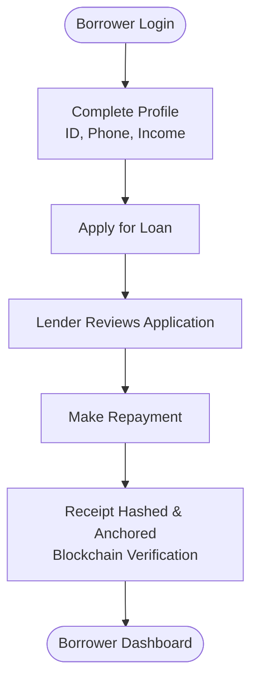

[No sources needed since this diagram shows conceptual workflow, not actual code structure]

**Section sources**
- [frontend/src/pages/borrower/BorrowerDashboard.tsx:6-10](file://frontend/src/pages/borrower/BorrowerDashboard.tsx#L6-L10)
- [frontend/src/pages/borrower/BorrowerDashboard.tsx:15-21](file://frontend/src/pages/borrower/BorrowerDashboard.tsx#L15-L21)
- [frontend/src/pages/borrower/BorrowerDashboard.tsx:56-70](file://frontend/src/pages/borrower/BorrowerDashboard.tsx#L56-L70)

#### Lenders
Lenders manage their book of loans, review applications, verify identities, set interest rates, generate signed agreements, and handle fraud flags. The lender dashboard summarizes default rate, maximum principal, and open fraud flags, and links to applications and fraud queues.

Typical lender workflow:
1. Log in and access the lender dashboard.
2. Review pending applications and perform identity checks.
3. Approve or reject applications with interest terms.
4. Monitor fraud flags and held payments.
5. Use audit visibility to confirm every action is recorded immutably.

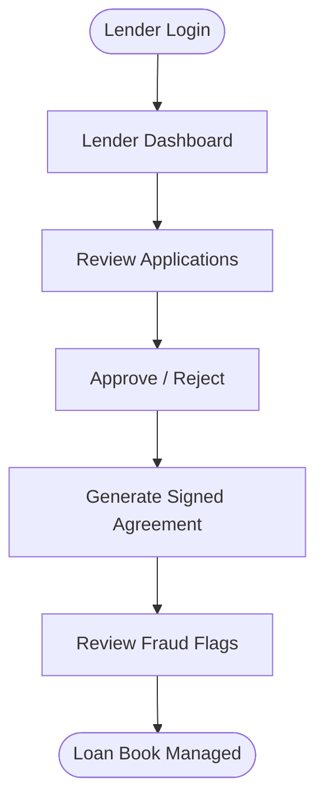

[No sources needed since this diagram shows conceptual workflow, not actual code structure]

**Section sources**
- [frontend/src/pages/lender/LenderDashboard.tsx:6-11](file://frontend/src/pages/lender/LenderDashboard.tsx#L6-L11)
- [frontend/src/pages/lender/LenderDashboard.tsx:23-27](file://frontend/src/pages/lender/LenderDashboard.tsx#L23-L27)
- [frontend/src/pages/lender/LenderDashboard.tsx:29-64](file://frontend/src/pages/lender/LenderDashboard.tsx#L29-L64)

#### Auditors
Auditors have read-only access to the forensic overview, audit log, timeline, and integrity checks. They rely on the hash-chained audit trail, on-chain proofs, and encrypted identity storage to investigate disputes and verify platform integrity.

Typical auditor workflow:
1. Access the auditor dashboard.
2. Check API health and ledger mode.
3. Search the audit log for actors, actions, entities, and dates.
4. Rebuild timelines for loans or borrowers.
5. Run integrity checks to detect tampering or broken hash chains.

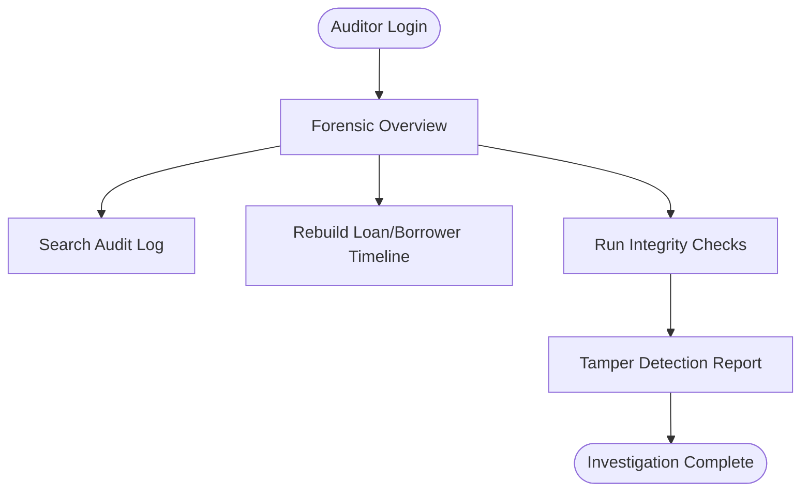

[No sources needed since this diagram shows conceptual workflow, not actual code structure]

**Section sources**
- [frontend/src/pages/auditor/AuditorDashboard.tsx:13-17](file://frontend/src/pages/auditor/AuditorDashboard.tsx#L13-L17)
- [frontend/src/pages/auditor/AuditorDashboard.tsx:44-53](file://frontend/src/pages/auditor/AuditorDashboard.tsx#L44-L53)
- [frontend/src/pages/auditor/AuditorDashboard.tsx:55-80](file://frontend/src/pages/auditor/AuditorDashboard.tsx#L55-L80)

### Backend API and Security Layer
The Express application factory configures security headers, CORS, body parsing, cookie parsing, request context, global rate limiting, health endpoint, OpenAPI docs, and route mounts. The server starts the API, logs environment details, and handles graceful shutdown while closing the PostgreSQL pool.

Key behaviors:
- Disables `X-Powered-By` and trusts one proxy hop for correct client IP handling.
- Uses helmet with carefully tuned policies for Swagger UI compatibility.
- Restricts CORS origins to configured web origin and local development URLs.
- Exposes `/api/health` with service name, chain mode, and timestamp.
- Mounts OpenAPI documentation at `/api/docs` and serves `/api/openapi.yaml`.
- Mounts authentication and user routes under `/api/v1`.

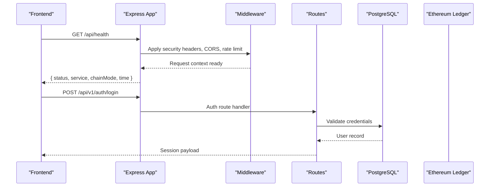

**Diagram sources**
- [backend/src/app.ts:23-92](file://backend/src/app.ts#L23-L92)
- [backend/src/server.ts:6-12](file://backend/src/server.ts#L6-L12)

**Section sources**
- [backend/src/app.ts:16-22](file://backend/src/app.ts#L16-L22)
- [backend/src/app.ts:23-92](file://backend/src/app.ts#L23-L92)
- [backend/src/server.ts:1-26](file://backend/src/server.ts#L1-L26)

### Blockchain Verification and Ledger Integration
The ledger client wraps ethers.js interactions with a LoanLedger contract. It only writes hashes and timestamps on-chain, preserving privacy while enabling verification. When the chain is disabled or unconfigured, the API continues to operate with off-chain records marked as not anchored.

Important capabilities:
- Determine chain RPC URL based on chain mode.
- Enable/disable chain writes depending on configuration.
- Record disbursement or repayment hashes on-chain.
- Read and verify on-chain records.
- Anchor audit roots for periodic integrity proofs.
- Provide chain status including mode, RPC, chain ID, contract address, enabled flag, live connectivity, latest block, and record count.

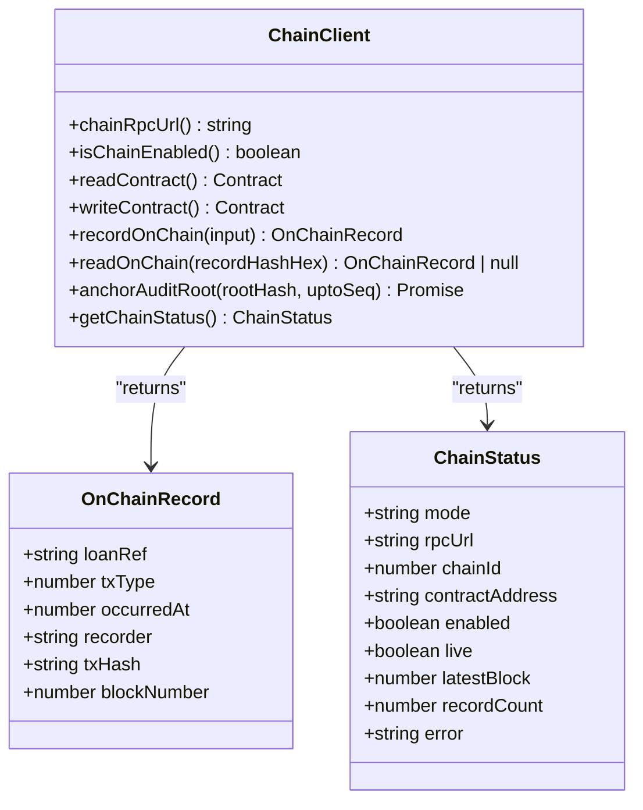

**Diagram sources**
- [backend/src/modules/ledger/chain.client.ts:1-30](file://backend/src/modules/ledger/chain.client.ts#L1-L30)
- [backend/src/modules/ledger/chain.client.ts:62-152](file://backend/src/modules/ledger/chain.client.ts#L62-L152)

**Section sources**
- [backend/src/modules/ledger/chain.client.ts:5-11](file://backend/src/modules/ledger/chain.client.ts#L5-L11)
- [backend/src/modules/ledger/chain.client.ts:24-60](file://backend/src/modules/ledger/chain.client.ts#L24-L60)
- [backend/src/modules/ledger/chain.client.ts:71-116](file://backend/src/modules/ledger/chain.client.ts#L71-L116)
- [backend/src/modules/ledger/chain.client.ts:118-152](file://backend/src/modules/ledger/chain.client.ts#L118-L152)

### Audit Trail and Tamper Detection
The audit service implements an append-only, hash-chained audit trail stored in PostgreSQL. Each row includes actor context, action, entity type, entity ID, detail, IP, user agent, request ID, before/after hashes, previous hash, and computed row hash. An advisory lock serializes concurrent writers to prevent chain forks.

Core properties:
- Deterministic row hashing ensures any silent edit changes the row hash.
- Previous-hash linking means editing one row breaks subsequent links.
- `verifyAuditChain` recomputes hashes and detects mismatches or broken links.
- `auditRequest` conveniently captures request context automatically.

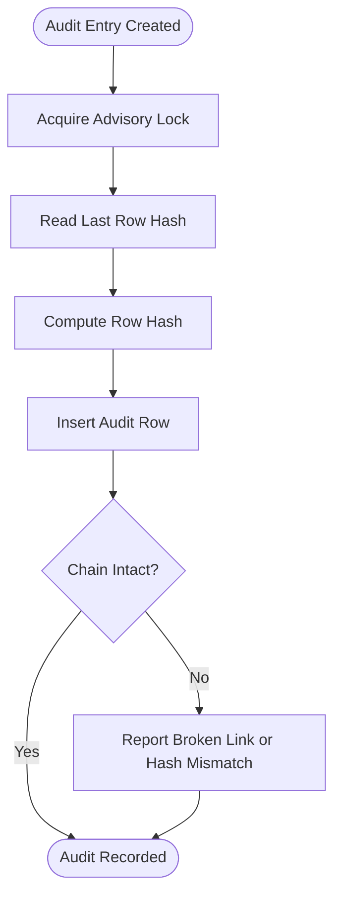

**Diagram sources**
- [backend/src/modules/audit/audit.service.ts:34-94](file://backend/src/modules/audit/audit.service.ts#L34-L94)
- [backend/src/modules/audit/audit.service.ts:142-190](file://backend/src/modules/audit/audit.service.ts#L142-L190)

**Section sources**
- [backend/src/modules/audit/audit.service.ts:7-14](file://backend/src/modules/audit/audit.service.ts#L7-L14)
- [backend/src/modules/audit/audit.service.ts:34-94](file://backend/src/modules/audit/audit.service.ts#L34-L94)
- [backend/src/modules/audit/audit.service.ts:120-190](file://backend/src/modules/audit/audit.service.ts#L120-L190)

### Fraud Detection Rules Engine
The fraud rules engine performs deterministic, explainable checks for microfinance risks. It normalizes mobile-money codes, validates reference formats, detects duplicates across loans, identifies identity conflicts using blind indexes, flags rapid repeated applications, and prevents duplicate disbursements.

Rule highlights:
- Duplicate transaction code detection raises critical or high severity flags.
- Malformed references are rejected early with clear reasons.
- Identity conflict detection compares blind indexes without decrypting sensitive data.
- Rapid application detection uses configurable windows and thresholds.
- Duplicate disbursement detection prevents multiple payouts for the same loan.

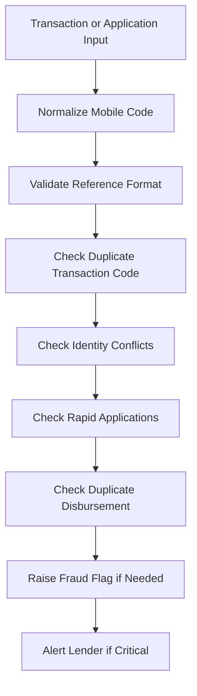

**Diagram sources**
- [backend/src/modules/fraud/rules.engine.ts:34-52](file://backend/src/modules/fraud/rules.engine.ts#L34-L52)
- [backend/src/modules/fraud/rules.engine.ts:94-143](file://backend/src/modules/fraud/rules.engine.ts#L94-L143)
- [backend/src/modules/fraud/rules.engine.ts:145-214](file://backend/src/modules/fraud/rules.engine.ts#L145-L214)
- [backend/src/modules/fraud/rules.engine.ts:216-275](file://backend/src/modules/fraud/rules.engine.ts#L216-L275)

**Section sources**
- [backend/src/modules/fraud/rules.engine.ts:4-10](file://backend/src/modules/fraud/rules.engine.ts#L4-L10)
- [backend/src/modules/fraud/rules.engine.ts:34-52](file://backend/src/modules/fraud/rules.engine.ts#L34-L52)
- [backend/src/modules/fraud/rules.engine.ts:94-143](file://backend/src/modules/fraud/rules.engine.ts#L94-L143)
- [backend/src/modules/fraud/rules.engine.ts:145-214](file://backend/src/modules/fraud/rules.engine.ts#L145-L214)
- [backend/src/modules/fraud/rules.engine.ts:216-275](file://backend/src/modules/fraud/rules.engine.ts#L216-L275)

### Frontend Authentication and Role Routing
The React application manages session state, login, registration, logout, and profile loading. It blocks unauthenticated users from protected routes and enforces role-based access for borrower, lender, and auditor screens.

Key behaviors:
- Silent session bootstrap using httpOnly cookies.
- Access token never stored in localStorage or sessionStorage.
- Role-based home routing and navigation guards.
- Dashboards render role-appropriate metrics and links.

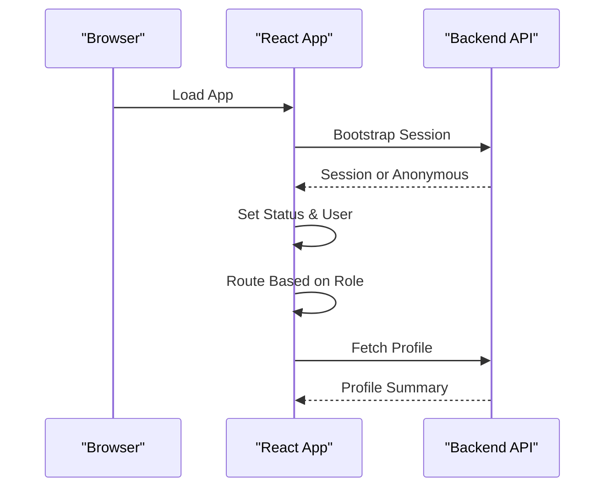

**Diagram sources**
- [frontend/src/lib/auth.tsx:12-18](file://frontend/src/lib/auth.tsx#L12-L18)
- [frontend/src/lib/auth.tsx:47-92](file://frontend/src/lib/auth.tsx#L47-L92)
- [frontend/src/lib/auth.tsx:94-135](file://frontend/src/lib/auth.tsx#L94-L135)
- [frontend/src/App.tsx:15-37](file://frontend/src/App.tsx#L15-L37)

**Section sources**
- [frontend/src/lib/auth.tsx:12-18](file://frontend/src/lib/auth.tsx#L12-L18)
- [frontend/src/lib/auth.tsx:47-135](file://frontend/src/lib/auth.tsx#L47-L135)
- [frontend/src/App.tsx:15-37](file://frontend/src/App.tsx#L15-L37)
- [frontend/src/App.tsx:39-62](file://frontend/src/App.tsx#L39-L62)

## Dependency Analysis
SecureMicrofinance has clear layering and limited coupling:
- The frontend depends on the backend API for authentication, profile data, and domain operations.
- The backend depends on PostgreSQL for persistence and on the Ethereum ledger client for optional blockchain anchoring.
- The ledger client depends on ethers.js and environment configuration.
- The audit and fraud modules depend on the database pool and shared utilities.

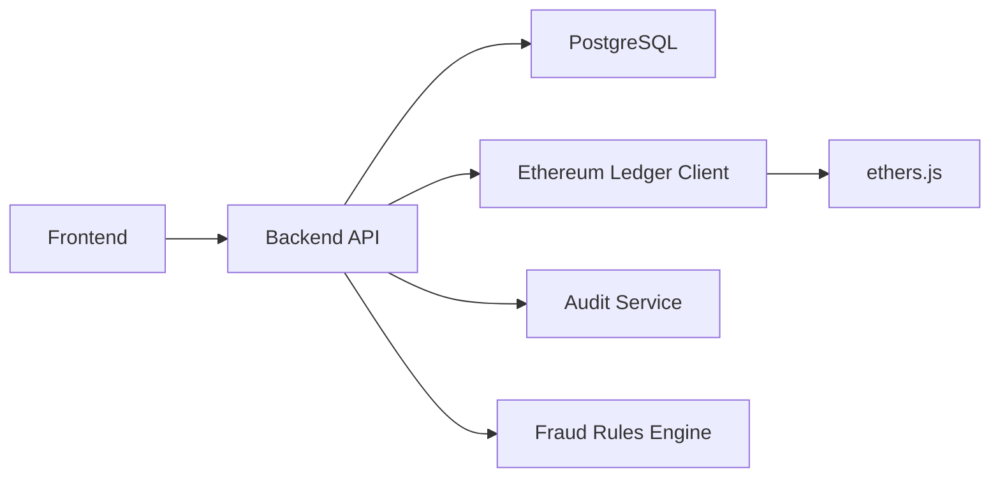

**Diagram sources**
- [backend/src/app.ts:13-14](file://backend/src/app.ts#L13-L14)
- [backend/src/modules/audit/audit.service.ts:1-5](file://backend/src/modules/audit/audit.service.ts#L1-L5)
- [backend/src/modules/fraud/rules.engine.ts:1-3](file://backend/src/modules/fraud/rules.engine.ts#L1-L3)
- [backend/src/modules/ledger/chain.client.ts:1-3](file://backend/src/modules/ledger/chain.client.ts#L1-L3)

**Section sources**
- [backend/src/app.ts:13-14](file://backend/src/app.ts#L13-L14)
- [backend/src/modules/audit/audit.service.ts:1-5](file://backend/src/modules/audit/audit.service.ts#L1-L5)
- [backend/src/modules/fraud/rules.engine.ts:1-3](file://backend/src/modules/fraud/rules.engine.ts#L1-L3)
- [backend/src/modules/ledger/chain.client.ts:1-3](file://backend/src/modules/ledger/chain.client.ts#L1-L3)

## Performance Considerations
For a university prototype focused on security and compliance, performance considerations should balance correctness, auditability, and clarity:
- Keep blockchain anchoring optional and lightweight by writing only hashes and timestamps.
- Use advisory locks for audit chain serialization to avoid race conditions.
- Prefer deterministic fraud rules for explainability and low computational cost.
- Limit request bodies and enable rate limiting to protect the API.
- Avoid unnecessary encryption or heavy computations in hot paths until necessary.
- Use pagination and filtering for audit logs and fraud queues as datasets grow.

[No sources needed since this section provides general guidance]

## Troubleshooting Guide
Common issues and where to look:
- Blockchain unavailable: check chain mode, RPC URL, contract address, and recorder private key. The ledger client throws a specific error when chain configuration is missing.
- API unreachable: use the health endpoint to inspect service status, chain mode, and timestamp.
- Audit chain mismatch: run integrity verification to detect broken links or hash mismatches.
- Fraud false positives: review rule IDs and dedupe keys to understand why a flag was raised.
- Frontend authentication failures: verify session bootstrap and that tokens are handled via httpOnly cookies rather than localStorage.

Operational hints:
- The server logs API port, environment, docs URL, and ledger mode.
- The auditor dashboard fetches `/api/health` and displays reachable/unreachable status.
- The ledger client exposes chain status including live connectivity and record counts.

**Section sources**
- [backend/src/modules/ledger/chain.client.ts:28-41](file://backend/src/modules/ledger/chain.client.ts#L28-L41)
- [backend/src/server.ts:8-12](file://backend/src/server.ts#L8-L12)
- [backend/src/modules/audit/audit.service.ts:142-190](file://backend/src/modules/audit/audit.service.ts#L142-L190)
- [frontend/src/pages/auditor/AuditorDashboard.tsx:19-32](file://frontend/src/pages/auditor/AuditorDashboard.tsx#L19-L32)

## Conclusion
SecureMicrofinance is a security-first microfinance platform prototype that brings together Express.js, React, PostgreSQL, and Ethereum blockchain verification to support private moneylenders. It protects sensitive data, enforces tamper-evident audit trails, detects fraud through deterministic rules, and allows independent verification of financial events on-chain. The platform clearly separates borrower, lender, and auditor workflows, making it suitable for academic study, compliance demonstrations, and future production hardening.

[No sources needed since this section summarizes without analyzing specific files]