# API Security & Input Validation

<cite>
**Referenced Files in This Document**
- [app.ts](file://backend/src/app.ts)
- [server.ts](file://backend/src/server.ts)
- [env.ts](file://backend/src/config/env.ts)
- [rateLimit.ts](file://backend/src/middleware/rateLimit.ts)
- [validate.ts](file://backend/src/middleware/validate.ts)
- [error.ts](file://backend/src/middleware/error.ts)
- [auth.routes.ts](file://backend/src/modules/auth/auth.routes.ts)
- [users.routes.ts](file://backend/src/modules/users/users.routes.ts)
- [errors.ts](file://backend/src/lib/errors.ts)
- [crypto.ts](file://backend/src/lib/crypto.ts)
- [cookies.ts](file://backend/src/lib/cookies.ts)
- [pool.ts](file://backend/src/db/pool.ts)
</cite>

## Table of Contents
1. [Introduction](#introduction)
2. [Project Structure](#project-structure)
3. [Core Components](#core-components)
4. [Architecture Overview](#architecture-overview)
5. [Detailed Component Analysis](#detailed-component-analysis)
6. [Dependency Analysis](#dependency-analysis)
7. [Performance Considerations](#performance-considerations)
8. [Troubleshooting Guide](#troubleshooting-guide)
9. [Conclusion](#conclusion)

## Introduction
This document explains how the backend secures its APIs and validates inputs. It covers rate limiting, request validation with Zod schemas, error handling, CORS configuration, security headers, input sanitization, protected endpoints, CSRF protections through cookie settings, SQL injection prevention, XSS prevention, logging strategies for security events, and the standardized error response format.

## Project Structure
The security-relevant parts live under `backend/src`:
- Application bootstrap and middleware pipeline: `app.ts`
- Server startup and graceful shutdown: `server.ts`
- Configuration and environment validation: `config/env.ts`
- Middleware: rate limiting, validation, error handling, authentication context
- Modules: authentication routes and user profile routes
- Shared libraries: typed errors, cryptographic helpers, cookie utilities
- Database layer: parameterized query helpers

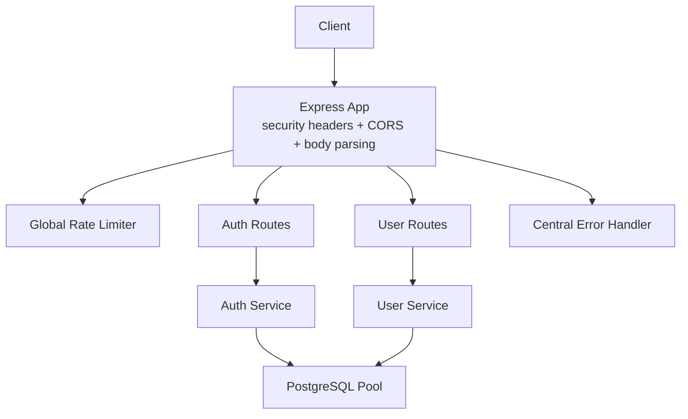

**Diagram sources**
- [app.ts:24-94](file://backend/src/app.ts#L24-L94)
- [auth.routes.ts:51-120](file://backend/src/modules/auth/auth.routes.ts#L51-L120)
- [users.routes.ts:38-107](file://backend/src/modules/users/users.routes.ts#L38-L107)
- [pool.ts:27-41](file://backend/src/db/pool.ts#L27-L41)

**Section sources**
- [app.ts:17-94](file://backend/src/app.ts#L17-L94)
- [server.ts:6-25](file://backend/src/server.ts#L6-L25)

## Core Components
- Security headers via Helmet are applied early; some policies are tuned for Swagger UI while the API itself serves JSON only.
- CORS is configured with an allow-listed origin set derived from configuration and local development origins. Credentials are allowed, specific methods and headers are permitted, and a short cache age is used.
- Request body size is limited to reduce resource exhaustion risk.
- A global rate limiter protects against abuse, with stricter per-endpoint limiters for authentication and write operations.
- All incoming data is validated using Zod schemas before reaching route handlers. Unknown keys are stripped by default, providing mass-assignment defense.
- Errors are normalized into a stable JSON shape with a `requestId`, avoiding leakage of internal details.
- Database access uses parameterized queries exclusively, preventing SQL injection.
- Sensitive fields are encrypted at rest and blind-indexed for duplicate detection without exposing plaintext.
- Refresh tokens are stored in secure, httpOnly cookies with SameSite=Strict to mitigate CSRF.

**Section sources**
- [app.ts:27-64](file://backend/src/app.ts#L27-L64)
- [rateLimit.ts:14-47](file://backend/src/middleware/rateLimit.ts#L14-L47)
- [validate.ts:6-39](file://backend/src/middleware/validate.ts#L6-L39)
- [error.ts:6-76](file://backend/src/middleware/error.ts#L6-L76)
- [pool.ts:4-8](file://backend/src/db/pool.ts#L4-L8)
- [crypto.ts:4-19](file://backend/src/lib/crypto.ts#L4-L19)
- [cookies.ts:4-18](file://backend/src/lib/cookies.ts#L4-L18)

## Architecture Overview
The request lifecycle enforces security at multiple layers:

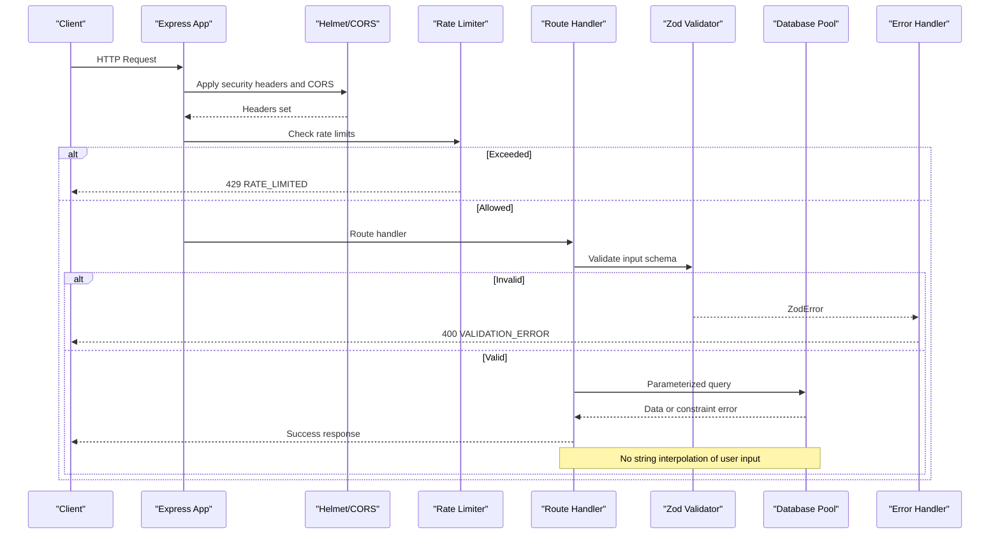

**Diagram sources**
- [app.ts:31-64](file://backend/src/app.ts#L31-L64)
- [rateLimit.ts:14-47](file://backend/src/middleware/rateLimit.ts#L14-L47)
- [validate.ts:11-25](file://backend/src/middleware/validate.ts#L11-L25)
- [pool.ts:27-41](file://backend/src/db/pool.ts#L27-L41)
- [error.ts:19-76](file://backend/src/middleware/error.ts#L19-L76)

## Detailed Component Analysis

### Security Headers and CORS
- Helmet is enabled with content security policy disabled to support Swagger UI; other headers are applied. Referrer policy is set to no-referrer.
- CORS allows only configured origins, credentials, explicit methods, and headers. The `X-Request-Id` header is exposed to clients.
- The application disables server version exposure and trusts one proxy hop for accurate client IP resolution.

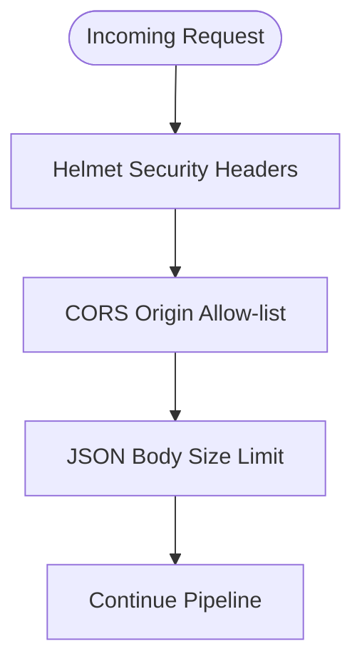

**Diagram sources**
- [app.ts:27-64](file://backend/src/app.ts#L27-L64)

**Section sources**
- [app.ts:27-64](file://backend/src/app.ts#L27-L64)

### Rate Limiting
Three limiters protect different surfaces:
- Global limiter: broad protection against scraping and spam.
- Auth limiter: tighter bucket keyed by IP plus submitted email to slow brute-force attempts.
- Write limiter: per-user or per-IP write throttling for state-changing operations.

In test mode, all limiters become pass-throughs to keep tests deterministic.

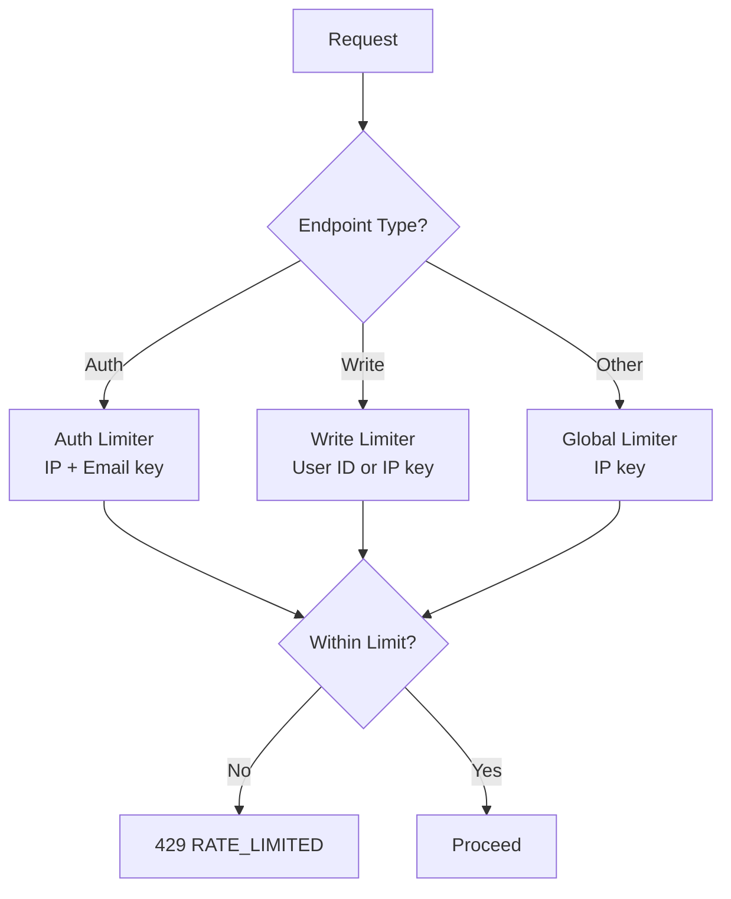

**Diagram sources**
- [rateLimit.ts:14-47](file://backend/src/middleware/rateLimit.ts#L14-L47)

**Section sources**
- [rateLimit.ts:5-50](file://backend/src/middleware/rateLimit.ts#L5-L50)

### Input Validation with Zod
Validation middleware:
- Parses and coerces input according to a Zod schema.
- Replaces the source (`body`, `query`, or `params`) with validated data so controllers never see raw untrusted values.
- Strips unknown keys by default, defending against mass-assignment.
- Passes validation errors to the central error handler.

Shared primitives include UUID, money (cents), and pagination schemas.

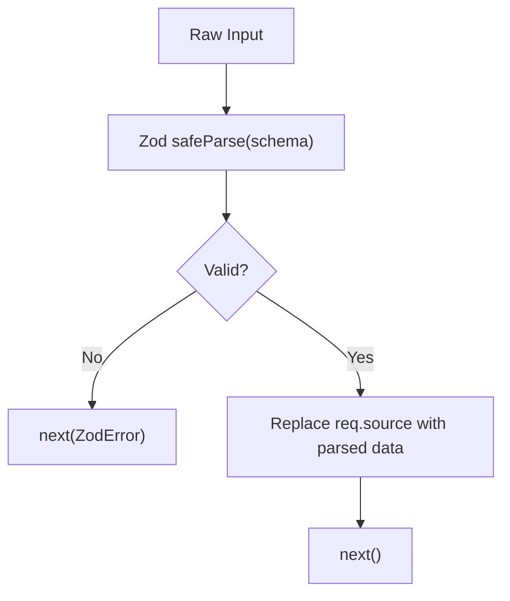

**Diagram sources**
- [validate.ts:11-25](file://backend/src/middleware/validate.ts#L11-L25)

**Section sources**
- [validate.ts:6-39](file://backend/src/middleware/validate.ts#L6-L39)

### Protected Endpoints and Authorization
Authentication routes:
- Registration and login use strict email/password schemas and auth-specific rate limiting.
- Refresh endpoint rotates refresh tokens and issues new access tokens.
- Logout clears the refresh cookie.
- Profile read requires authentication.
- Password change requires authentication and validates current/new password.

User profile routes:
- Read profile requires authentication.
- Update profile requires authentication, denies auditor writes, applies write rate limiting, and validates the update schema.
- Only borrower roles can update borrower profiles.

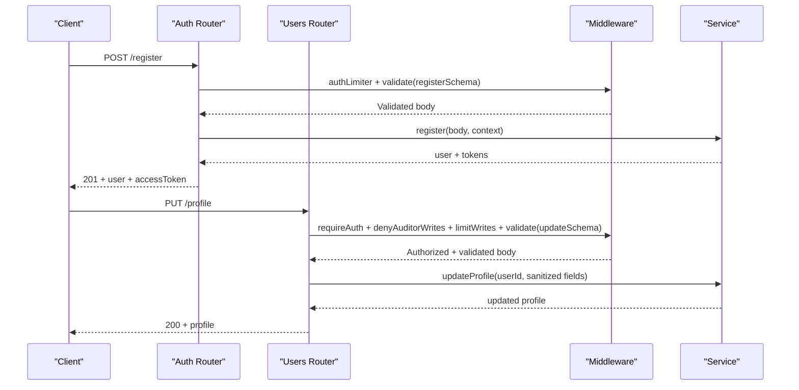

**Diagram sources**
- [auth.routes.ts:51-120](file://backend/src/modules/auth/auth.routes.ts#L51-L120)
- [users.routes.ts:38-107](file://backend/src/modules/users/users.routes.ts#L38-L107)

**Section sources**
- [auth.routes.ts:15-120](file://backend/src/modules/auth/auth.routes.ts#L15-L120)
- [users.routes.ts:19-107](file://backend/src/modules/users/users.routes.ts#L19-L107)

### Error Handling and Response Format
Central error handler normalizes responses:
- Application errors return their status, code, message, optional details, and requestId.
- Zod validation errors return 400 with field-level issues.
- PostgreSQL unique violations map to 409 DUPLICATE.
- Constraint violations map to 422 CONSTRAINT_VIOLATION.
- Append-only constraints map to 409 APPEND_ONLY.
- Unknown errors return 500 INTERNAL_ERROR; production hides internal hints.

Not found handler returns 404 NOT_FOUND without leaking route information.

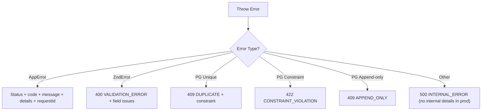

**Diagram sources**
- [error.ts:6-76](file://backend/src/middleware/error.ts#L6-L76)
- [errors.ts:8-39](file://backend/src/lib/errors.ts#L8-L39)

**Section sources**
- [error.ts:6-76](file://backend/src/middleware/error.ts#L6-L76)
- [errors.ts:1-40](file://backend/src/lib/errors.ts#L1-L40)

### SQL Injection Prevention
All database interactions go through parameterized query helpers. There is no string interpolation of user input in SQL statements. Column names are constructed from an allow-list within the route logic, not from user input.

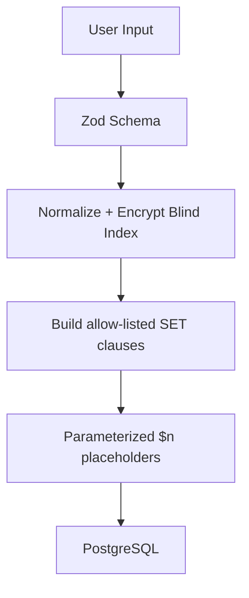

**Diagram sources**
- [pool.ts:4-8](file://backend/src/db/pool.ts#L4-L8)
- [users.routes.ts:52-101](file://backend/src/modules/users/users.routes.ts#L52-L101)

**Section sources**
- [pool.ts:4-8](file://backend/src/db/pool.ts#L4-L8)
- [users.routes.ts:52-101](file://backend/src/modules/users/users.routes.ts#L52-L101)

### XSS Prevention and Output Safety
- The API serves JSON only; Helmet’s CSP is disabled only to support Swagger UI, not because the API renders HTML.
- Sensitive fields are masked when returned in summaries, reducing accidental exposure.
- Refresh tokens are kept in httpOnly cookies, preventing JavaScript access even if XSS occurs.

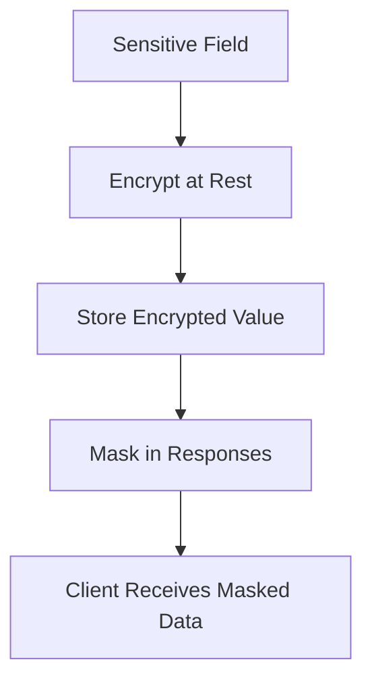

**Diagram sources**
- [crypto.ts:79-84](file://backend/src/lib/crypto.ts#L79-L84)
- [cookies.ts:4-18](file://backend/src/lib/cookies.ts#L4-L18)

**Section sources**
- [crypto.ts:79-84](file://backend/src/lib/crypto.ts#L79-L84)
- [cookies.ts:4-18](file://backend/src/lib/cookies.ts#L4-L18)

### CSRF Protection Mechanisms
- Refresh token cookie is httpOnly, secure in production, SameSite=Strict, and scoped to the auth path.
- Access tokens are sent explicitly via Authorization headers rather than cookies, reducing CSRF surface.
- The same-site restriction on the refresh cookie blocks cross-site requests from automatically including it.

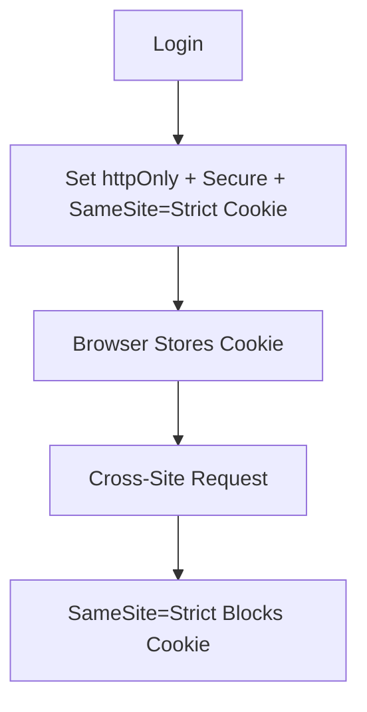

**Diagram sources**
- [cookies.ts:4-18](file://backend/src/lib/cookies.ts#L4-L18)

**Section sources**
- [cookies.ts:4-18](file://backend/src/lib/cookies.ts#L4-L18)

### Input Sanitization Techniques
- Email addresses are trimmed, length-limited, and validated with a regex pattern.
- Passwords must meet minimum length and character class requirements.
- National IDs and phone numbers are normalized before encryption and blind indexing.
- Dates are validated against a strict YYYY-MM-DD pattern.
- Numeric amounts are constrained to integer cents with upper bounds.

**Section sources**
- [auth.routes.ts:20-49](file://backend/src/modules/auth/auth.routes.ts#L20-L49)
- [users.routes.ts:26-36](file://backend/src/modules/users/users.routes.ts#L26-L36)
- [crypto.ts:56-77](file://backend/src/lib/crypto.ts#L56-L77)

### Logging Strategies for Security Events
- Central error handler logs method, original URL, and error details to the server console, including requestId for correlation.
- Authentication and profile updates emit audit records with actor context and changed fields.
- Environment configuration includes log level control.

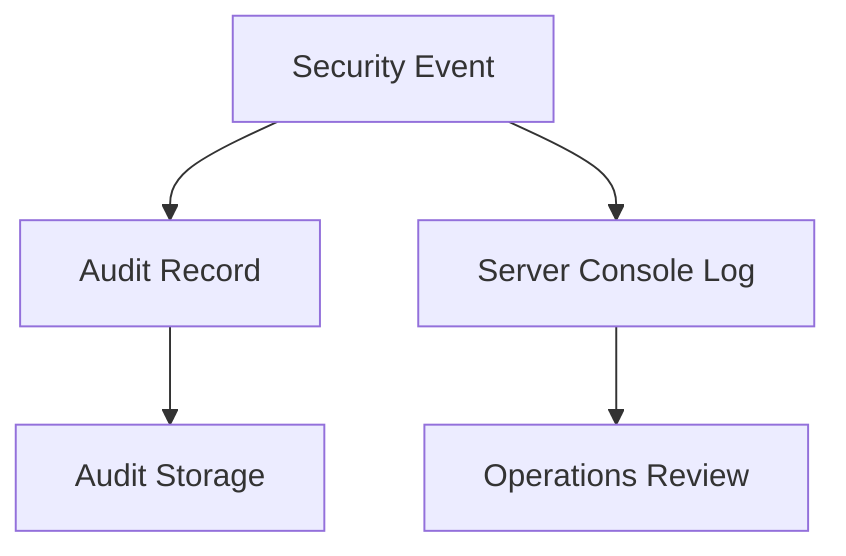

**Diagram sources**
- [error.ts:66-75](file://backend/src/middleware/error.ts#L66-L75)
- [users.routes.ts:103-103](file://backend/src/modules/users/users.routes.ts#L103-L103)
- [env.ts:32-32](file://backend/src/config/env.ts#L32-L32)

**Section sources**
- [error.ts:66-75](file://backend/src/middleware/error.ts#L66-L75)
- [users.routes.ts:103-103](file://backend/src/modules/users/users.routes.ts#L103-L103)
- [env.ts:32-32](file://backend/src/config/env.ts#L32-L32)

## Dependency Analysis
Key dependencies and relationships:
- `app.ts` wires Helmet, CORS, body parser, rate limiter, routers, and error handlers.
- `auth.routes.ts` depends on validation, rate limiting, authentication middleware, and services.
- `users.routes.ts` depends on validation, authorization, rate limiting, crypto helpers, and fraud rules.
- `pool.ts` provides parameterized queries and transaction helpers.
- `crypto.ts` provides encryption, normalization, blind indexes, masking, and timing-safe comparison.
- `cookies.ts` sets secure refresh cookies.
- `env.ts` validates configuration and exposes runtime flags like `isProduction`.

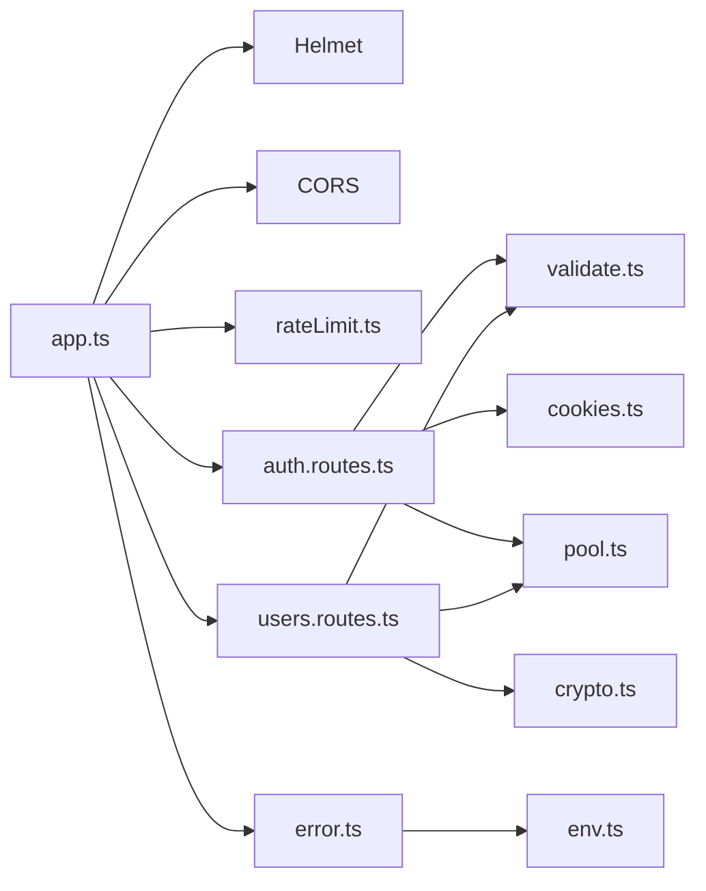

**Diagram sources**
- [app.ts:1-15](file://backend/src/app.ts#L1-L15)
- [rateLimit.ts:1-47](file://backend/src/middleware/rateLimit.ts#L1-L47)
- [validate.ts:1-39](file://backend/src/middleware/validate.ts#L1-L39)
- [auth.routes.ts:1-120](file://backend/src/modules/auth/auth.routes.ts#L1-L120)
- [users.routes.ts:1-107](file://backend/src/modules/users/users.routes.ts#L1-L107)
- [pool.ts:1-41](file://backend/src/db/pool.ts#L1-L41)
- [crypto.ts:1-96](file://backend/src/lib/crypto.ts#L1-L96)
- [cookies.ts:1-28](file://backend/src/lib/cookies.ts#L1-L28)
- [error.ts:1-76](file://backend/src/middleware/error.ts#L1-L76)
- [env.ts:1-106](file://backend/src/config/env.ts#L1-L106)

**Section sources**
- [app.ts:1-15](file://backend/src/app.ts#L1-L15)
- [env.ts:28-106](file://backend/src/config/env.ts#L28-L106)

## Performance Considerations
- Rate limit windows and limits should be tuned based on traffic patterns and abuse signals.
- Connection pool sizing and timeouts should match expected concurrency and latency targets.
- Avoid heavy synchronous operations in middleware; keep validation and hashing asynchronous where possible.
- Use pagination schemas to bound result sizes and prevent large payloads.
- Consider caching for read-heavy endpoints behind proper invalidation and authorization checks.

[No sources needed since this section provides general guidance]

## Troubleshooting Guide
Common issues and resolutions:
- 429 RATE_LIMITED: Reduce request frequency or adjust rate limit configuration for the affected endpoint.
- 400 VALIDATION_ERROR: Inspect the field-level issues in the response details and correct the payload.
- 409 DUPLICATE: Ensure unique fields like email or national ID are not already registered.
- 422 CONSTRAINT_VIOLATION: Correct data that violates database constraints.
- 401 UNAUTHORIZED: Verify access token presence and validity; ensure refresh flow is working.
- 403 FORBIDDEN: Confirm role permissions; auditors cannot perform writes.
- 500 INTERNAL_ERROR: Use the provided requestId when contacting support; check server logs for stack traces.

**Section sources**
- [error.ts:19-76](file://backend/src/middleware/error.ts#L19-L76)
- [errors.ts:8-39](file://backend/src/lib/errors.ts#L8-L39)

## Conclusion
The backend implements layered security: strict headers, controlled CORS, robust rate limiting, comprehensive input validation, centralized error handling, parameterized queries, encrypted storage, masked outputs, and CSRF-resistant cookies. Together, these measures protect against common threats such as SQL injection, XSS, credential stuffing, and CSRF, while providing clear, secure error responses and actionable logging for security events.

[No sources needed since this section summarizes without analyzing specific files]