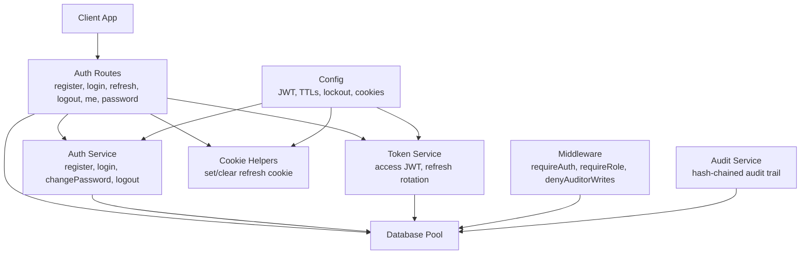
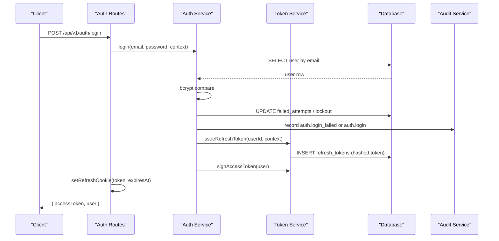
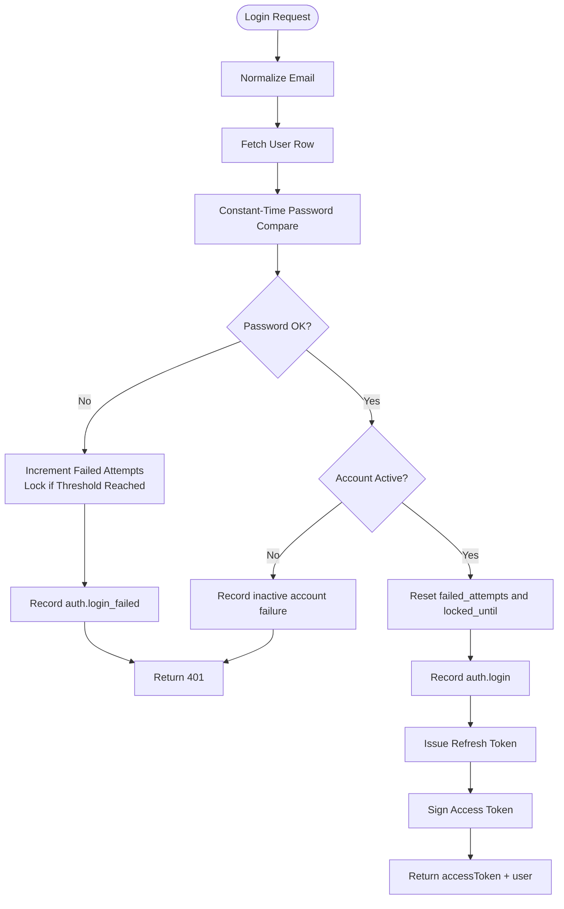
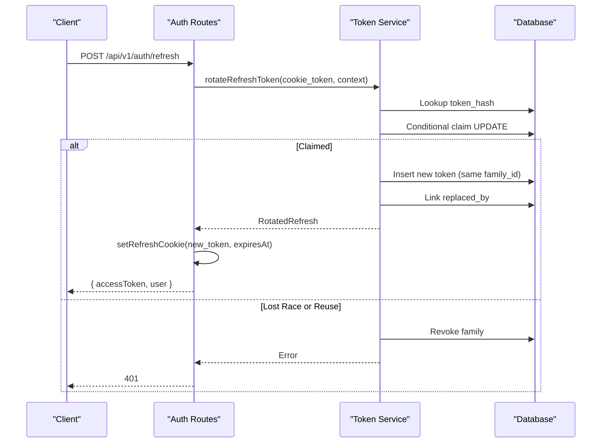
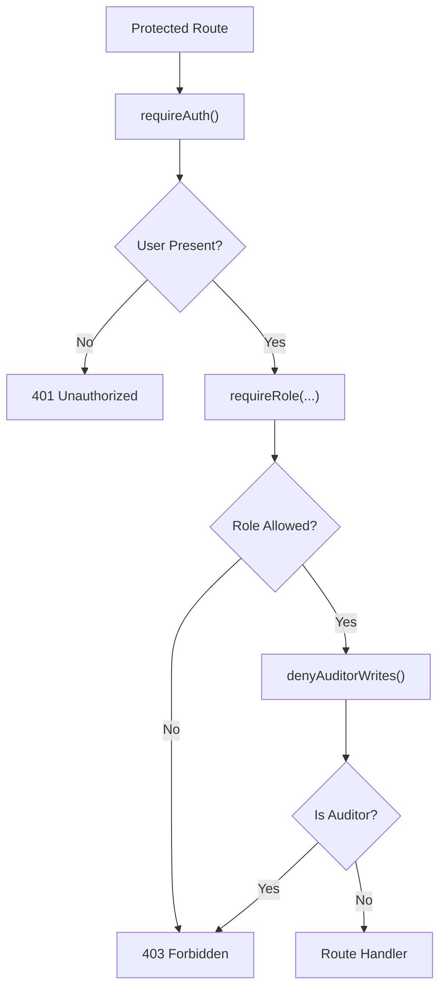
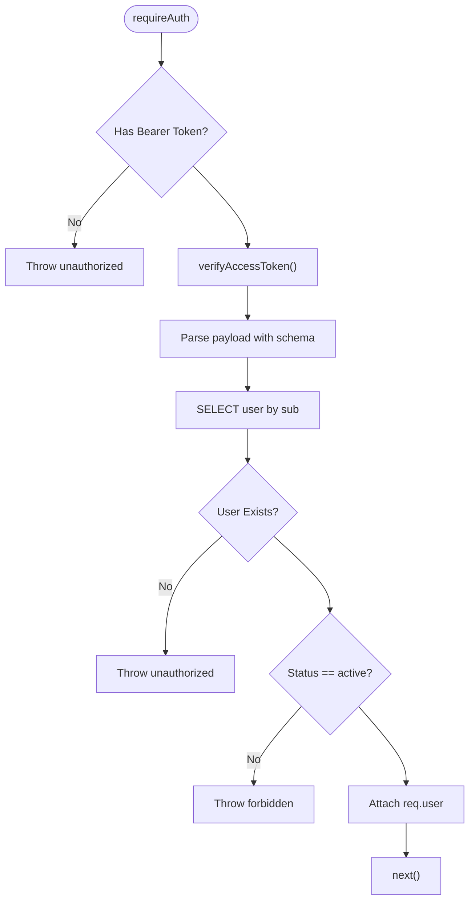
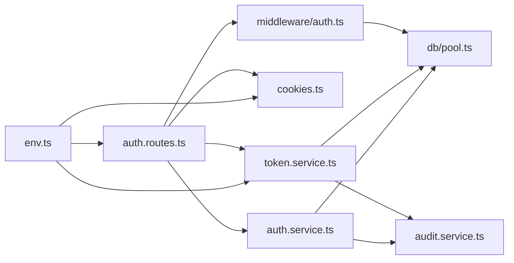

# Authentication & Authorization

<cite>
**Referenced Files in This Document**
- [auth.service.ts](file://backend/src/modules/auth/auth.service.ts)
- [token.service.ts](file://backend/src/modules/auth/token.service.ts)
- [auth.routes.ts](file://backend/src/modules/auth/auth.routes.ts)
- [auth.ts](file://backend/src/middleware/auth.ts)
- [cookies.ts](file://backend/src/lib/cookies.ts)
- [env.ts](file://backend/src/config/env.ts)
- [001_core_auth.sql](file://backend/src/db/migrations/001_core_auth.sql)
- [users.service.ts](file://backend/src/modules/users/users.service.ts)
- [audit.service.ts](file://backend/src/modules/audit/audit.service.ts)
- [auth.test.ts](file://backend/test/auth.test.ts)
- [rbac.test.ts](file://backend/test/rbac.test.ts)
</cite>

## Table of Contents
1. [Introduction](#introduction)
2. [Project Structure](#project-structure)
3. [Core Components](#core-components)
4. [Architecture Overview](#architecture-overview)
5. [Detailed Component Analysis](#detailed-component-analysis)
6. [Dependency Analysis](#dependency-analysis)
7. [Performance Considerations](#performance-considerations)
8. [Troubleshooting Guide](#troubleshooting-guide)
9. [Conclusion](#conclusion)

## Introduction
This document explains the backend authentication and authorization system for the finance application. It covers:
- JWT-based access tokens
- Rotating refresh tokens stored securely in an HTTP-only cookie
- Role-based access control with auditor read-only restrictions
- Session handling, token rotation, reuse detection, and family revocation
- Middleware implementations for authentication, role checks, and auditor write denial
- Database-backed user validation and account status enforcement
- Security considerations for token storage, cookies, and session management

The implementation is designed so that short-lived access tokens carry minimal claims, while long-lived sessions are managed server-side through hashed refresh tokens. Every sensitive action is audited into a hash-chained audit log.

## Project Structure
The authentication and authorization logic is split across modules, middleware, configuration, database migrations, and tests:

**Diagram sources**
- [auth.routes.ts:53-121](file://backend/src/modules/auth/auth.routes.ts#L53-L121)
- [auth.service.ts:61-261](file://backend/src/modules/auth/auth.service.ts#L61-L261)
- [token.service.ts:28-205](file://backend/src/modules/auth/token.service.ts#L28-L205)
- [cookies.ts:11-28](file://backend/src/lib/cookies.ts#L11-L28)
- [env.ts:28-100](file://backend/src/config/env.ts#L28-L100)
- [001_core_auth.sql:17-95](file://backend/src/db/migrations/001_core_auth.sql#L17-L95)
- [audit.service.ts:37-94](file://backend/src/modules/audit/audit.service.ts#L37-L94)

**Section sources**
- [auth.routes.ts:1-121](file://backend/src/modules/auth/auth.routes.ts#L1-L121)
- [auth.service.ts:1-262](file://backend/src/modules/auth/auth.service.ts#L1-L262)
- [token.service.ts:1-206](file://backend/src/modules/auth/token.service.ts#L1-L206)
- [auth.ts:1-69](file://backend/src/middleware/auth.ts#L1-L69)
- [cookies.ts:1-29](file://backend/src/lib/cookies.ts#L1-L29)
- [env.ts:1-101](file://backend/src/config/env.ts#L1-L101)
- [001_core_auth.sql:1-95](file://backend/src/db/migrations/001_core_auth.sql#L1-L95)
- [audit.service.ts:1-191](file://backend/src/modules/audit/audit.service.ts#L1-L191)

## Core Components
- **Authentication service**: Handles registration, login, password changes, and logout. It hashes passwords, enforces lockout, validates account status, issues access tokens, and manages refresh tokens.
- **Token service**: Signs and verifies short-lived JWT access tokens and implements rotating refresh tokens with reuse detection and family revocation.
- **Middleware**: Provides `requireAuth`, `requireRole`, and `denyAuditorWrites` to protect routes.
- **Cookie helpers**: Set and clear the refresh token cookie with secure flags.
- **Configuration**: Loads environment variables for JWT secrets, token TTLs, lockout behavior, and cookie settings.
- **Database schema**: Defines users, profiles, and rotating refresh tokens.
- **Audit service**: Records tamper-evident audit entries for authentication events.

**Section sources**
- [auth.service.ts:15-261](file://backend/src/modules/auth/auth.service.ts#L15-L261)
- [token.service.ts:10-205](file://backend/src/modules/auth/token.service.ts#L10-L205)
- [auth.ts:13-68](file://backend/src/middleware/auth.ts#L13-L68)
- [cookies.ts:4-28](file://backend/src/lib/cookies.ts#L4-L28)
- [env.ts:28-100](file://backend/src/config/env.ts#L28-L100)
- [001_core_auth.sql:17-95](file://backend/src/db/migrations/001_core_auth.sql#L17-L95)
- [audit.service.ts:7-94](file://backend/src/modules/audit/audit.service.ts#L7-L94)

## Architecture Overview
The authentication flow uses two layers of protection:
- Access tokens are short-lived JWTs sent via the `Authorization` header.
- Refresh tokens are opaque values stored in an HTTP-only cookie and rotated on every use.

**Diagram sources**
- [auth.routes.ts:64-73](file://backend/src/modules/auth/auth.routes.ts#L64-L73)
- [auth.service.ts:114-197](file://backend/src/modules/auth/auth.service.ts#L114-L197)
- [token.service.ts:28-34](file://backend/src/modules/auth/token.service.ts#L28-L34)
- [token.service.ts:64-76](file://backend/src/modules/auth/token.service.ts#L64-L76)
- [cookies.ts:11-18](file://backend/src/lib/cookies.ts#L11-L18)
- [audit.service.ts:37-94](file://backend/src/modules/audit/audit.service.ts#L37-L94)

## Detailed Component Analysis

### JWT-Based Authentication Flow
- Registration creates a user, hashes the password, inserts profile data, records an audit entry, issues a refresh token, and returns an access token.
- Login normalizes the email, performs constant-time password comparison, enforces lockout, checks account status, resets failed attempts, records audit entries, issues a refresh token, and returns an access token.
- The access token is a short-lived JWT signed with a secret and validated against issuer and audience.

**Diagram sources**
- [auth.service.ts:114-197](file://backend/src/modules/auth/auth.service.ts#L114-L197)
- [token.service.ts:28-34](file://backend/src/modules/auth/token.service.ts#L28-L34)
- [token.service.ts:64-76](file://backend/src/modules/auth/token.service.ts#L64-L76)

**Section sources**
- [auth.service.ts:61-112](file://backend/src/modules/auth/auth.service.ts#L61-L112)
- [auth.service.ts:114-197](file://backend/src/modules/auth/auth.service.ts#L114-L197)
- [token.service.ts:28-46](file://backend/src/modules/auth/token.service.ts#L28-L46)

### Rotating Refresh Tokens and Session Management
- Refresh tokens are random opaque values; only their SHA-256 hash is stored in the database.
- Each refresh rotates the token and links the old token to the new one via `replaced_by`.
- Concurrent double-submits within a grace window are tolerated; outside the window, reuse is treated as theft and the entire token family is revoked.
- Logout revokes the specific refresh token; changing a password revokes all sessions for the user.

**Diagram sources**
- [auth.routes.ts:75-96](file://backend/src/modules/auth/auth.routes.ts#L75-L96)
- [token.service.ts:154-195](file://backend/src/modules/auth/token.service.ts#L154-L195)
- [token.service.ts:64-76](file://backend/src/modules/auth/token.service.ts#L64-L76)
- [cookies.ts:11-18](file://backend/src/lib/cookies.ts#L11-L18)

**Section sources**
- [token.service.ts:64-76](file://backend/src/modules/auth/token.service.ts#L64-L76)
- [token.service.ts:104-145](file://backend/src/modules/auth/token.service.ts#L104-L145)
- [token.service.ts:154-205](file://backend/src/modules/auth/token.service.ts#L154-L205)
- [auth.service.ts:245-261](file://backend/src/modules/auth/auth.service.ts#L245-L261)

### Role-Based Access Control (RBAC)
- Roles include borrower, lender, and auditor.
- `requireRole(...roles)` ensures only allowed roles can proceed.
- `denyAuditorWrites` blocks any state-changing operation for auditors.
- Protected routes combine these middlewares to enforce fine-grained permissions.

**Diagram sources**
- [auth.ts:18-68](file://backend/src/middleware/auth.ts#L18-L68)

**Section sources**
- [auth.ts:43-68](file://backend/src/middleware/auth.ts#L43-L68)
- [rbac.test.ts:12-73](file://backend/test/rbac.test.ts#L12-L73)

### Middleware Implementations

#### requireAuth
- Validates the `Authorization: Bearer` header.
- Verifies the JWT using the configured secret, issuer, and audience.
- Parses and validates payload structure.
- Reloads the user from the database to enforce current role and active status immediately.

**Diagram sources**
- [auth.ts:18-41](file://backend/src/middleware/auth.ts#L18-L41)
- [token.service.ts:36-46](file://backend/src/modules/auth/token.service.ts#L36-L46)

**Section sources**
- [auth.ts:18-41](file://backend/src/middleware/auth.ts#L18-L41)

#### requireRole
- Ensures the request has an authenticated user.
- Checks whether the user’s role is included in the allowed list.
- Returns 401 if no user, 403 if role not allowed.

**Section sources**
- [auth.ts:43-56](file://backend/src/middleware/auth.ts#L43-L56)

#### denyAuditorWrites
- Blocks any request where the authenticated user has the auditor role.
- Enforced at the middleware layer to guarantee auditors cannot modify data.

**Section sources**
- [auth.ts:58-68](file://backend/src/middleware/auth.ts#L58-L68)

### Token Verification Process
- Access tokens are verified with strict issuer and audience validation.
- Invalid, expired, or tampered tokens throw unauthorized errors.
- Payload parsing enforces expected fields such as subject, role, and type.

**Section sources**
- [token.service.ts:28-46](file://backend/src/modules/auth/token.service.ts#L28-L46)
- [auth.ts:7-11](file://backend/src/middleware/auth.ts#L7-L11)

### User Validation Against Database and Account Status Checking
- On protected routes, the middleware reloads the user from the database to ensure the latest role and status are enforced.
- Inactive accounts are rejected even if they hold a valid access token.
- Profile endpoints return masked sensitive data based on role.

**Section sources**
- [auth.ts:29-37](file://backend/src/middleware/auth.ts#L29-L37)
- [users.service.ts:19-59](file://backend/src/modules/users/users.service.ts#L19-L59)

### Protected Routes, Role-Based Permissions, and Auditor Restrictions
- Authentication endpoints: register, login, refresh, logout, get profile, change password.
- Protected profile endpoints use `requireAuth` and role-specific middlewares.
- Auditors are explicitly blocked from writing operations.

Examples:
- GET `/api/v1/auth/me` requires authentication and returns the current user and profile summary.
- PATCH `/api/v1/auth/password` requires authentication and clears all refresh tokens.
- PUT `/api/v1/me/profile` should be protected by `requireAuth`, `requireRole('borrower')`, and `denyAuditorWrites`.

**Section sources**
- [auth.routes.ts:53-121](file://backend/src/modules/auth/auth.routes.ts#L53-L121)
- [rbac.test.ts:39-72](file://backend/test/rbac.test.ts#L39-L72)

### Security Considerations

#### Token Storage
- Access tokens are short-lived JWTs intended for memory-only client storage; they are never persisted in localStorage.
- Refresh tokens are stored in an HTTP-only cookie to prevent JavaScript access and mitigate XSS risks.

**Section sources**
- [token.service.ts:10-19](file://backend/src/modules/auth/token.service.ts#L10-L19)
- [cookies.ts:4-8](file://backend/src/lib/cookies.ts#L4-L8)

#### Cookie Configuration
- Refresh cookie is set with:
  - `httpOnly: true`
  - `secure: config.isProduction`
  - `sameSite: 'strict'`
  - Scoped path `/api/v1/auth`
- Clearing the cookie occurs on logout and after password changes.

**Section sources**
- [cookies.ts:11-28](file://backend/src/lib/cookies.ts#L11-L28)
- [env.ts:93-100](file://backend/src/config/env.ts#L93-L100)

#### Session Management
- Refresh tokens are rotated on every successful refresh.
- Concurrency grace window allows safe double-submits; outside it, reuse is treated as theft and the whole family is revoked.
- Changing a password revokes all sessions for the user.

**Section sources**
- [token.service.ts:104-195](file://backend/src/modules/auth/token_service.ts#L104-L195)
- [auth.service.ts:230-243](file://backend/src/modules/auth/auth.service.ts#L230-L243)

#### Password Security and Lockout
- Passwords are hashed with bcrypt at a configurable cost.
- Generic error messages prevent account enumeration.
- After repeated failures, accounts are temporarily locked.

**Section sources**
- [auth.service.ts:15-24](file://backend/src/modules/auth/auth.service.ts#L15-L24)
- [auth.service.ts:150-177](file://backend/src/modules/auth/auth.service.ts#L150-L177)
- [env.ts:44-46](file://backend/src/config/env.ts#L44-L46)

#### Audit Trail
- Authentication events are recorded in a hash-chained audit log.
- Audit entries include actor identity, IP, user agent, request ID, and contextual details.

**Section sources**
- [audit.service.ts:7-94](file://backend/src/modules/audit/audit.service.ts#L7-L94)
- [auth.service.ts:86-101](file://backend/src/modules/auth/auth.service.ts#L86-L101)
- [auth.service.ts:180-190](file://backend/src/modules/auth/auth.service.ts#L180-L190)

## Dependency Analysis
The following diagram shows key dependencies among authentication components:

**Diagram sources**
- [env.ts:28-100](file://backend/src/config/env.ts#L28-L100)
- [auth.routes.ts:1-121](file://backend/src/modules/auth/auth.routes.ts#L1-L121)
- [auth.service.ts:1-262](file://backend/src/modules/auth/auth.service.ts#L1-L262)
- [token.service.ts:1-206](file://backend/src/modules/auth/token.service.ts#L1-L206)
- [auth.ts:1-69](file://backend/src/middleware/auth.ts#L1-L69)
- [audit.service.ts:1-191](file://backend/src/modules/audit/audit.service.ts#L1-L191)

**Section sources**
- [auth.routes.ts:1-121](file://backend/src/modules/auth/auth.routes.ts#L1-L121)
- [auth.service.ts:1-262](file://backend/src/modules/auth/auth.service.ts#L1-L262)
- [token.service.ts:1-206](file://backend/src/modules/auth/token.service.ts#L1-L206)
- [auth.ts:1-69](file://backend/src/middleware/auth.ts#L1-L69)
- [audit.service.ts:1-191](file://backend/src/modules/audit/audit.service.ts#L1-L191)

## Performance Considerations
- Short-lived access tokens reduce exposure risk and limit the impact of token leakage.
- Refresh token rotation adds database writes but provides strong replay protection.
- Database reads on protected routes ensure immediate enforcement of role and status changes without waiting for token expiry.
- Audit logging introduces additional writes; consider batching or asynchronous processing if throughput becomes constrained.

[No sources needed since this section provides general guidance]

## Troubleshooting Guide
Common issues and how to diagnose them:

- Missing bearer token:
  - Ensure requests include `Authorization: Bearer <accessToken>`.
  - Verify the frontend attaches the token correctly.

- Invalid or expired token:
  - Check JWT signing secret and issuer/audience configuration.
  - Confirm the token has not expired and was issued by this server.

- Account inactive:
  - The middleware rejects inactive accounts regardless of token validity.
  - Update the user’s status in the database or re-enable the account.

- Refresh token reuse detected:
  - Indicates potential theft or concurrent misuse outside the grace window.
  - All tokens in the family are revoked; force re-authentication.

- Auditor write attempt blocked:
  - Auditors have read-only access; verify route protections include `denyAuditorWrites`.

- Password change invalidates sessions:
  - Changing a password revokes all refresh tokens; clients must log in again.

**Section sources**
- [auth.ts:18-41](file://backend/src/middleware/auth.ts#L18-L41)
- [token.service.ts:154-195](file://backend/src/modules/auth/token.service.ts#L154-L195)
- [auth.service.ts:230-243](file://backend/src/modules/auth/auth.service.ts#L230-L243)
- [auth.test.ts:65-153](file://backend/test/auth.test.ts#L65-L153)
- [rbac.test.ts:39-72](file://backend/test/rbac.test.ts#L39-L72)

## Conclusion
The authentication and authorization system combines short-lived JWT access tokens with rotating refresh tokens stored securely in HTTP-only cookies. It enforces RBAC through middleware, immediately validates user status and role against the database, and protects auditors from writing data. Token rotation and reuse detection provide robust session security, while comprehensive audit logging ensures accountability. Proper configuration of secrets, cookie flags, and environment variables is essential to maintain security in production.

[No sources needed since this section summarizes without analyzing specific files]