# Data Protection & Encryption

<cite>
**Referenced Files in This Document**
- [crypto.ts](file://backend/src/lib/crypto.ts)
- [canonical.ts](file://backend/src/lib/canonical.ts)
- [env.ts](file://backend/src/config/env.ts)
- [users.service.ts](file://backend/src/modules/users/users.service.ts)
- [audit.service.ts](file://backend/src/modules/audit/audit.service.ts)
- [rules.engine.ts](file://backend/src/modules/fraud/rules.engine.ts)
- [004_fraud_audit.sql](file://backend/src/db/migrations/004_fraud_audit.sql)
- [encryption.test.ts](file://backend/test/encryption.test.ts)
</cite>

## Table of Contents
1. [Introduction](#introduction)
2. [Project Structure](#project-structure)
3. [Core Components](#core-components)
4. [Architecture Overview](#architecture-overview)
5. [Detailed Component Analysis](#detailed-component-analysis)
6. [Dependency Analysis](#dependency-analysis)
7. [Performance Considerations](#performance-considerations)
8. [Troubleshooting Guide](#troubleshooting-guide)
9. [Conclusion](#conclusion)

## Introduction
This document explains the data protection and encryption mechanisms used to secure sensitive financial user data. It covers:

- AES-256-GCM field-level encryption for personal identifiers such as national IDs and phone numbers.
- HMAC-SHA256 blind indexes that allow secure duplicate detection without exposing plaintext.
- Canonical JSON serialization and SHA-256 hashing for transaction payloads and an append-only, hash-chained audit trail.
- Key management through validated environment variables.
- Data sanitization strategies including normalization, masking, and timing-safe comparisons.
- Examples of encrypting personal information, generating HMAC signatures, and performing secure data comparison.
- Best practices, key rotation guidance, and compliance considerations for financial data protection.

## Project Structure
The relevant security logic is concentrated in backend libraries and modules:

- Cryptographic primitives and helpers live in `backend/src/lib/crypto.ts`.
- Canonical serialization and hashing utilities live in `backend/src/lib/canonical.ts`.
- Configuration and secret validation live in `backend/src/config/env.ts`.
- Profile retrieval applies decryption and masking in `backend/src/modules/users/users.service.ts`.
- Audit trail creation and verification live in `backend/src/modules/audit/audit.service.ts` with schema enforcement in `backend/src/db/migrations/004_fraud_audit.sql`.
- Blind index usage for fraud rules lives in `backend/src/modules/fraud/rules.engine.ts`.
- End-to-end behavior is validated by `backend/test/encryption.test.ts`.

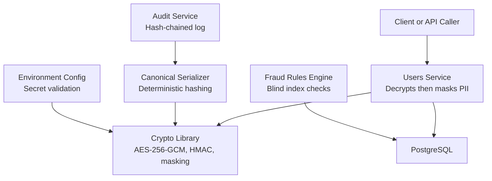

**Diagram sources**
- [users.service.ts:19-58](file://backend/src/modules/users/users.service.ts#L19-L58)
- [crypto.ts:18-96](file://backend/src/lib/crypto.ts#L18-L96)
- [canonical.ts:12-116](file://backend/src/lib/canonical.ts#L12-L116)
- [audit.service.ts:37-94](file://backend/src/modules/audit/audit.service.ts#L37-L94)
- [env.ts:24-50](file://backend/src/config/env.ts#L24-L50)

**Section sources**
- [crypto.ts:1-96](file://backend/src/lib/crypto.ts#L1-L96)
- [canonical.ts:1-116](file://backend/src/lib/canonical.ts#L1-L116)
- [env.ts:1-101](file://backend/src/config/env.ts#L1-L101)
- [users.service.ts:1-60](file://backend/src/modules/users/users.service.ts#L1-L60)
- [audit.service.ts:1-191](file://backend/src/modules/audit/audit.service.ts#L1-L191)
- [004_fraud_audit.sql:63-135](file://backend/src/db/migrations/004_fraud_audit.sql#L63-L135)
- [rules.engine.ts:94-143](file://backend/src/modules/fraud/rules.engine.ts#L94-L143)
- [encryption.test.ts:1-115](file://backend/test/encryption.test.ts#L1-L115)

## Core Components
- Field-level encryption: AES-256-GCM with a versioned ciphertext format containing initialization vector, authentication tag, and base64-encoded ciphertext.
- Blind indexes: HMAC-SHA256 over normalized values so duplicates can be detected without decrypting stored data.
- Canonicalization: Deterministic JSON serialization for consistent hashing across systems.
- Hashing utilities: SHA-256 for payload hashes and audit chain links.
- Masking: Sensitive fields are masked before being returned via API responses.
- Timing-safe comparison: Constant-time equality check for tokens and hashes.
- Key configuration: Hex-encoded secrets validated at startup.

**Section sources**
- [crypto.ts:4-48](file://backend/src/lib/crypto.ts#L4-L48)
- [crypto.ts:50-96](file://backend/src/lib/crypto.ts#L50-L96)
- [canonical.ts:11-24](file://backend/src/lib/canonical.ts#L11-L24)
- [env.ts:24-50](file://backend/src/config/env.ts#L24-L50)

## Architecture Overview
The system protects sensitive data at rest while still enabling secure search and auditing:

- Personal identifiers are encrypted at rest using AES-256-GCM.
- Blind indexes enable duplicate detection without exposing plaintext.
- Transaction payloads and audit rows are hashed deterministically to support tamper-evident logs.
- API endpoints return only masked values; decryption occurs only within trusted service code.
- Environment configuration enforces secret shape and presence.

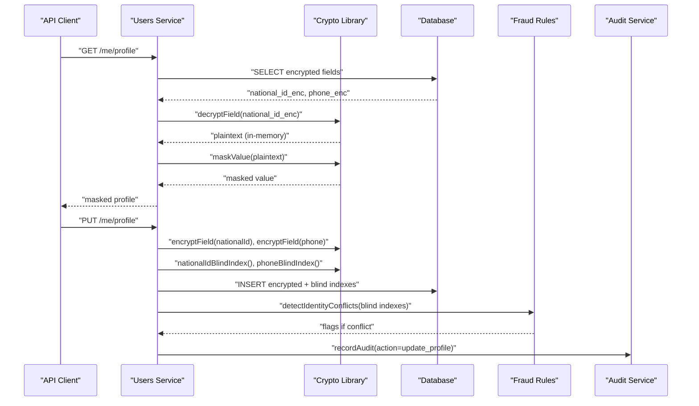

**Diagram sources**
- [users.service.ts:19-58](file://backend/src/modules/users/users.service.ts#L19-L58)
- [crypto.ts:29-48](file://backend/src/lib/crypto.ts#L29-L48)
- [crypto.ts:71-77](file://backend/src/lib/crypto.ts#L71-L77)
- [rules.engine.ts:94-143](file://backend/src/modules/fraud/rules.engine.ts#L94-L143)
- [audit.service.ts:37-94](file://backend/src/modules/audit/audit.service.ts#L37-L94)

## Detailed Component Analysis

### AES-256-GCM Field-Level Encryption
Sensitive fields such as national IDs and phone numbers are stored as AES-256-GCM ciphertexts. The implementation:

- Generates a random 12-byte IV per encryption operation.
- Uses Node’s `aes-256-gcm` cipher with a 32-byte key loaded from environment configuration.
- Produces an authentication tag to detect tampering.
- Serializes ciphertext as a version-prefixed string containing base64-encoded IV, tag, and ciphertext.

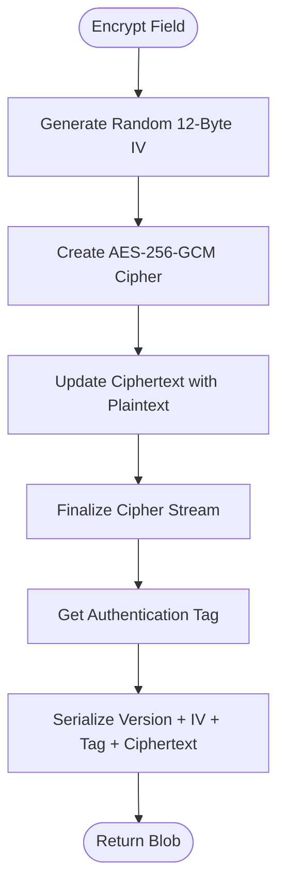

**Diagram sources**
- [crypto.ts:29-35](file://backend/src/lib/crypto.ts#L29-L35)

Decryption validates the blob structure, reconstructs the decipher with the correct IV and tag, and throws on malformed input. This ensures tampered ciphertext fails loudly rather than returning garbage.

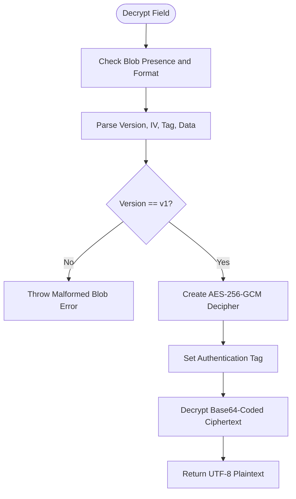

**Diagram sources**
- [crypto.ts:37-48](file://backend/src/lib/crypto.ts#L37-L48)

**Section sources**
- [crypto.ts:4-48](file://backend/src/lib/crypto.ts#L4-L48)
- [encryption.test.ts:14-45](file://backend/test/encryption.test.ts#L14-L45)

### Blind Index Creation for Secure Searching
Blind indexes allow duplicate detection without storing or decrypting sensitive values:

- National ID blind index normalizes the identifier and computes HMAC-SHA256 with a dedicated key.
- Phone number blind index normalizes multiple formats into a canonical form before HMAC computation.
- Blind indexes are deterministic and keyed, preventing trivial collision discovery.

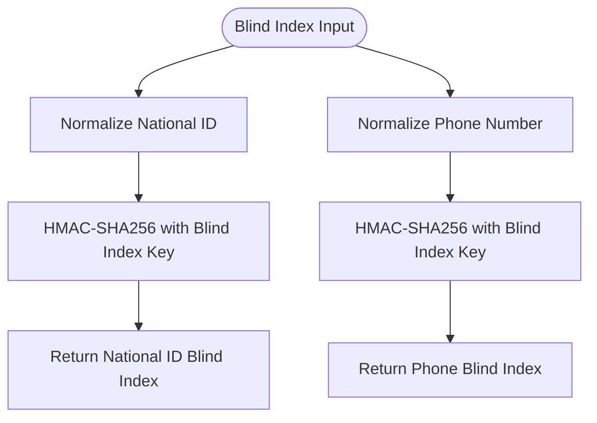

**Diagram sources**
- [crypto.ts:50-77](file://backend/src/lib/crypto.ts#L50-L77)

Blind indexes are used by the fraud rules engine to detect identity conflicts without decrypting stored profiles.

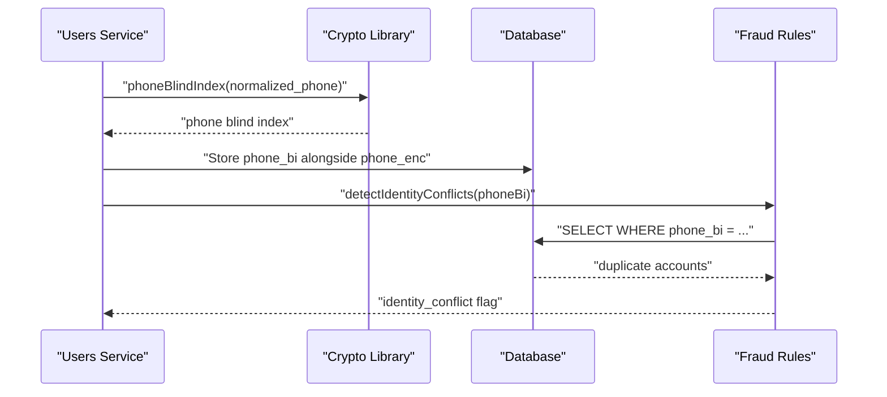

**Diagram sources**
- [crypto.ts:75-77](file://backend/src/lib/crypto.ts#L75-L77)
- [rules.engine.ts:94-143](file://backend/src/modules/fraud/rules.engine.ts#L94-L143)

**Section sources**
- [crypto.ts:50-77](file://backend/src/lib/crypto.ts#L50-L77)
- [rules.engine.ts:94-143](file://backend/src/modules/fraud/rules.engine.ts#L94-L143)
- [encryption.test.ts:38-45](file://backend/test/encryption.test.ts#L38-L45)

### Canonicalization and Consistent Hashing
Canonical JSON serialization ensures deterministic output regardless of object key ordering. This is essential for:

- Transaction payload hashing.
- Audit row hashing.
- Any future integrity checks where byte-for-byte consistency matters.

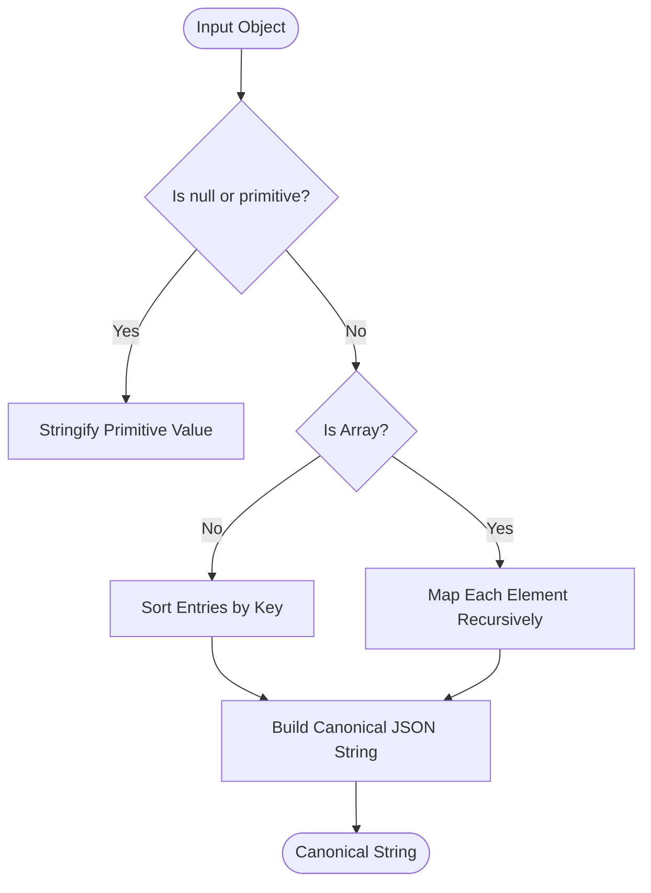

**Diagram sources**
- [canonical.ts:11-24](file://backend/src/lib/canonical.ts#L11-L24)

Transaction payloads are constructed with a version tag and pipe-separated fields, then hashed with SHA-256. Audit rows include sequence numbers, previous hashes, actor context, action metadata, detail hashes, IP, and timestamps, forming a hash chain.

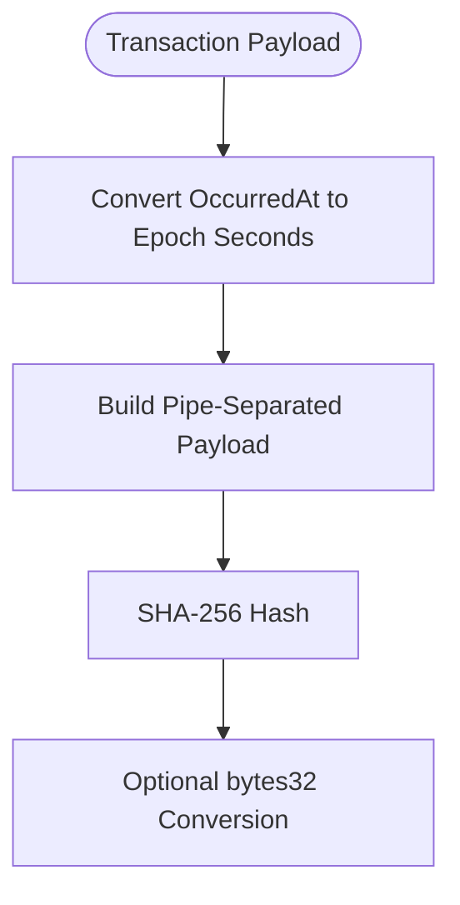

**Diagram sources**
- [canonical.ts:44-68](file://backend/src/lib/canonical.ts#L44-L68)

Audit row hashing includes a detail sub-hash and prev_hash linkage.

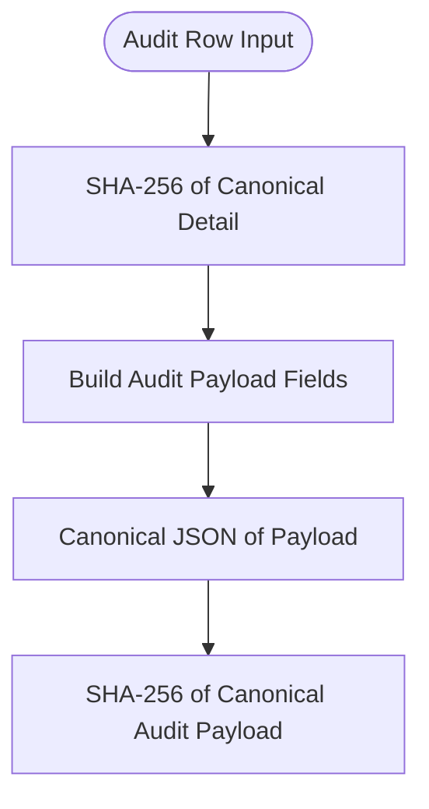

**Diagram sources**
- [canonical.ts:96-113](file://backend/src/lib/canonical.ts#L96-L113)

**Section sources**
- [canonical.ts:11-24](file://backend/src/lib/canonical.ts#L11-L24)
- [canonical.ts:44-68](file://backend/src/lib/canonical.ts#L44-L68)
- [canonical.ts:96-116](file://backend/src/lib/canonical.ts#L96-L116)

### Cryptographic Hash Generation for Audit Trails
The audit trail is append-only and cryptographically chained:

- Each audit row stores `prev_hash` and `row_hash`.
- `row_hash` is computed from canonicalized fields including the previous hash.
- A database trigger prevents updates, deletes, and truncation.
- Verification recomputes every row hash and checks link continuity.

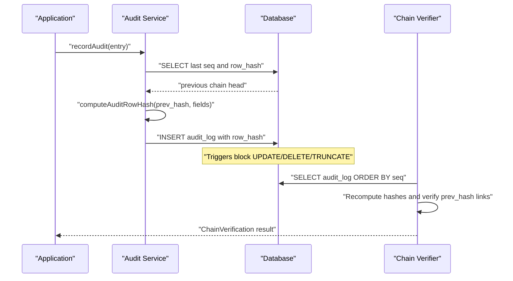

**Diagram sources**
- [audit.service.ts:37-94](file://backend/src/modules/audit/audit.service.ts#L37-L94)
- [audit.service.ts:142-190](file://backend/src/modules/audit/audit.service.ts#L142-L190)
- [004_fraud_audit.sql:93-111](file://backend/src/db/migrations/004_fraud_audit.sql#L93-L111)

**Section sources**
- [audit.service.ts:1-191](file://backend/src/modules/audit/audit.service.ts#L1-L191)
- [canonical.ts:96-116](file://backend/src/lib/canonical.ts#L96-L116)
- [004_fraud_audit.sql:63-135](file://backend/src/db/migrations/004_fraud_audit.sql#L63-L135)

### Encryption Key Management
Encryption keys are loaded from environment variables and validated:

- `FIELD_ENCRYPTION_KEY` must be exactly 64 hexadecimal characters representing 32 bytes.
- `BLIND_INDEX_KEY` has the same constraint and is used for HMAC blind indexes.
- Invalid configuration causes the application to fail fast during startup.

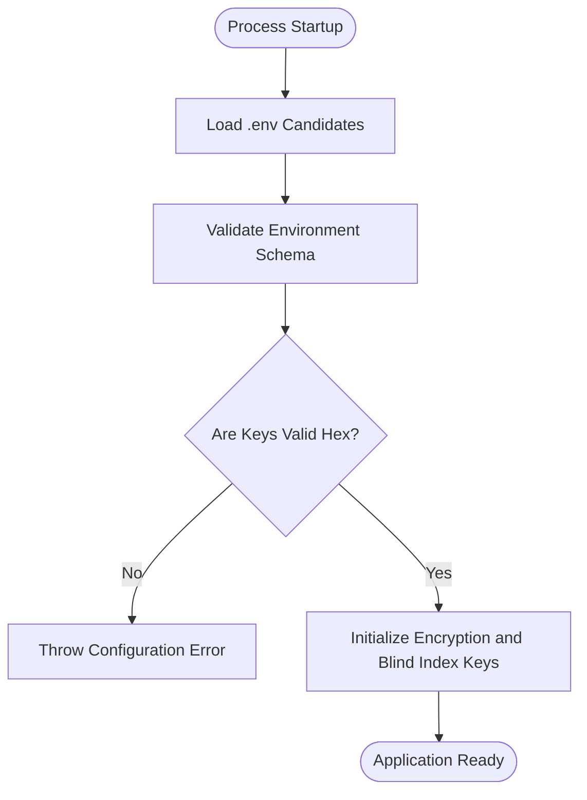

**Diagram sources**
- [env.ts:13-22](file://backend/src/config/env.ts#L13-L22)
- [env.ts:24-50](file://backend/src/config/env.ts#L24-L50)
- [env.ts:76-84](file://backend/src/config/env.ts#L76-L84)
- [crypto.ts:18-19](file://backend/src/lib/crypto.ts#L18-L19)

**Section sources**
- [env.ts:1-101](file://backend/src/config/env.ts#L1-L101)
- [crypto.ts:18-19](file://backend/src/lib/crypto.ts#L18-L19)

### Data Sanitization Strategies
Sanitization occurs at multiple layers:

- Normalization:
  - National ID normalization removes non-alphanumeric characters and uppercases the result.
  - Phone normalization collapses various formats into a single canonical representation.
  - Mobile code normalization trims whitespace and uppercases receipts.
- Masking:
  - Sensitive values are masked before API responses.
  - Emails in fraud details are partially masked to limit exposure.
- Timing-safe comparison:
  - Opaque tokens and hashes are compared using constant-time equality to mitigate timing attacks.

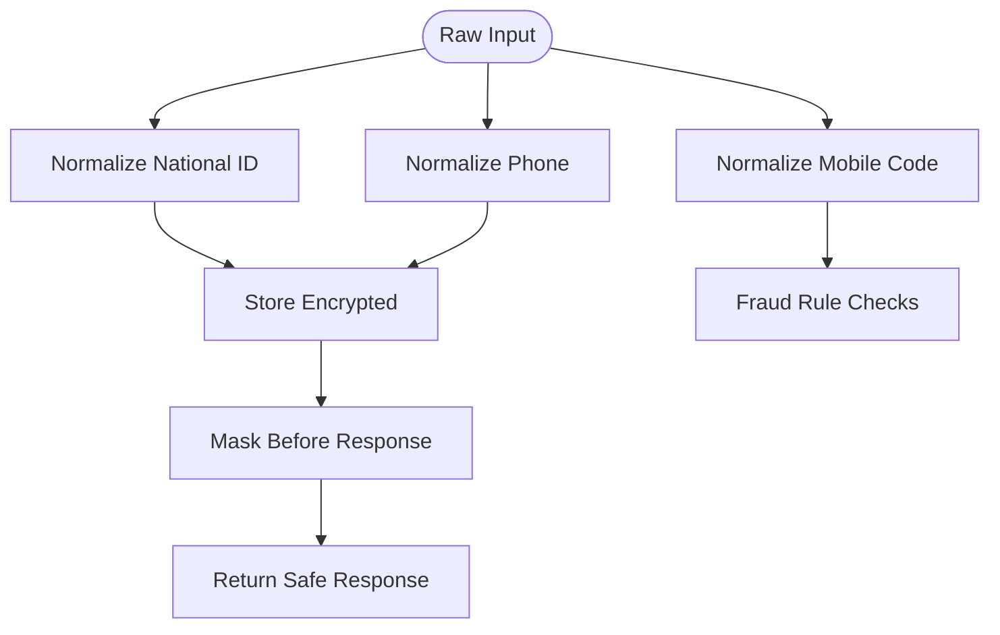

**Diagram sources**
- [crypto.ts:50-65](file://backend/src/lib/crypto.ts#L50-L65)
- [crypto.ts:80-84](file://backend/src/lib/crypto.ts#L80-L84)
- [crypto.ts:90-96](file://backend/src/lib/crypto.ts#L90-L96)
- [rules.engine.ts:40-42](file://backend/src/modules/fraud/rules.engine.ts#L40-L42)
- [rules.engine.ts:129-134](file://backend/src/modules/fraud/rules.engine.ts#L129-L134)

**Section sources**
- [crypto.ts:50-96](file://backend/src/lib/crypto.ts#L50-L96)
- [rules.engine.ts:40-42](file://backend/src/modules/fraud/rules.engine.ts#L40-L42)
- [rules.engine.ts:129-134](file://backend/src/modules/fraud/rules.engine.ts#L129-L134)

### Examples of Secure Operations

#### Encrypting Personal Information
- Use the field encryption function to store national IDs and phone numbers.
- The resulting blob contains a version prefix, IV, authentication tag, and ciphertext.
- Tests assert that stored values do not contain plaintext and round-trip correctly.

**Section sources**
- [crypto.ts:29-35](file://backend/src/lib/crypto.ts#L29-L35)
- [encryption.test.ts:14-45](file://backend/test/encryption.test.ts#L14-L45)

#### Generating HMAC Signatures
- Use the HMAC-SHA256 helper with the blind index key to generate deterministic but keyed hashes.
- Blind indexes for national IDs and phones use this mechanism.

**Section sources**
- [crypto.ts:25-27](file://backend/src/lib/crypto.ts#L25-L27)
- [crypto.ts:71-77](file://backend/src/lib/crypto.ts#L71-L77)

#### Implementing Secure Data Comparison
- Use timing-safe equality for opaque tokens and hashes.
- This avoids leaking information through response time differences.

**Section sources**
- [crypto.ts:90-96](file://backend/src/lib/crypto.ts#L90-L96)

## Dependency Analysis
The following diagram shows how core security components depend on each other:

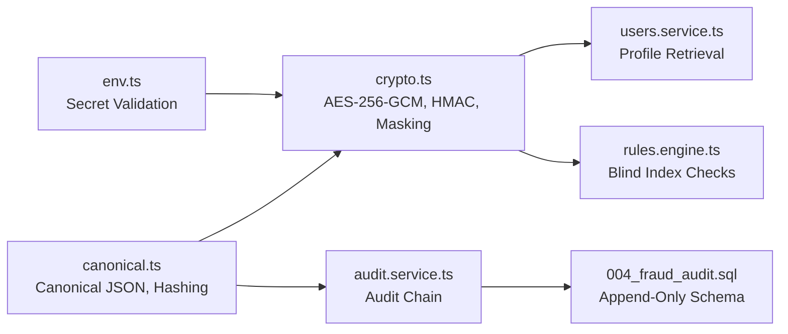

**Diagram sources**
- [env.ts:24-50](file://backend/src/config/env.ts#L24-L50)
- [crypto.ts:18-96](file://backend/src/lib/crypto.ts#L18-L96)
- [users.service.ts:19-58](file://backend/src/modules/users/users.service.ts#L19-L58)
- [rules.engine.ts:94-143](file://backend/src/modules/fraud/rules.engine.ts#L94-L143)
- [canonical.ts:11-116](file://backend/src/lib/canonical.ts#L11-L116)
- [audit.service.ts:37-94](file://backend/src/modules/audit/audit.service.ts#L37-L94)
- [004_fraud_audit.sql:63-135](file://backend/src/db/migrations/004_fraud_audit.sql#L63-L135)

**Section sources**
- [crypto.ts:1-96](file://backend/src/lib/crypto.ts#L1-L96)
- [canonical.ts:1-116](file://backend/src/lib/canonical.ts#L1-L116)
- [env.ts:1-101](file://backend/src/config/env.ts#L1-L101)
- [users.service.ts:1-60](file://backend/src/modules/users/users.service.ts#L1-L60)
- [audit.service.ts:1-191](file://backend/src/modules/audit/audit.service.ts#L1-L191)
- [rules.engine.ts:1-228](file://backend/src/modules/fraud/rules.engine.ts#L1-L228)
- [004_fraud_audit.sql:63-135](file://backend/src/db/migrations/004_fraud_audit.sql#L63-L135)

## Performance Considerations
- AES-256-GCM encryption and decryption are CPU-bound operations; avoid encrypting large payloads unnecessarily.
- Blind indexes are lightweight HMAC computations and suitable for frequent duplicate checks.
- Canonical JSON serialization recursively processes objects; keep audit detail payloads small and structured.
- Audit chain verification scans all rows; schedule verification jobs off-peak or paginate results for large datasets.
- Masking and normalization are inexpensive string operations and should be applied consistently at input boundaries.

[No sources needed since this section provides general guidance]

## Troubleshooting Guide
Common issues and resolutions:

- Malformed ciphertext blob:
  - Cause: Corrupted or incorrectly formatted stored ciphertext.
  - Resolution: Validate blob structure and ensure version prefix matches expected format.
- Duplicate identity flags not firing:
  - Cause: Inconsistent normalization or incorrect blind index inputs.
  - Resolution: Ensure normalization functions are applied before computing blind indexes.
- Audit chain mismatches:
  - Cause: Direct database edits or inconsistent canonicalization.
  - Resolution: Use the audit verification function to identify broken links and mismatched hashes.
- Configuration errors:
  - Cause: Missing or invalid hex keys.
  - Resolution: Provide valid 64-character hex keys for both encryption and blind index secrets.

**Section sources**
- [crypto.ts:37-48](file://backend/src/lib/crypto.ts#L37-L48)
- [rules.engine.ts:94-143](file://backend/src/modules/fraud/rules.engine.ts#L94-L143)
- [audit.service.ts:142-190](file://backend/src/modules/audit/audit.service.ts#L142-L190)
- [env.ts:76-84](file://backend/src/config/env.ts#L76-L84)

## Conclusion
The system implements robust data protection through:

- AES-256-GCM field-level encryption for sensitive personal data.
- HMAC-based blind indexes enabling secure duplicate detection without plaintext exposure.
- Canonical JSON serialization ensuring deterministic hashing for transactions and audit trails.
- Append-only, hash-chained audit logs enforced by database triggers.
- Strict environment-based key validation and safe cryptographic operations.
- Comprehensive sanitization including normalization, masking, and timing-safe comparisons.

These mechanisms collectively support strong confidentiality, integrity, and auditability requirements for financial data protection. For production deployments, consider additional controls such as centralized key management, automated key rotation policies, and regular compliance audits aligned with financial regulations.

[No sources needed since this section summarizes without analyzing specific files]