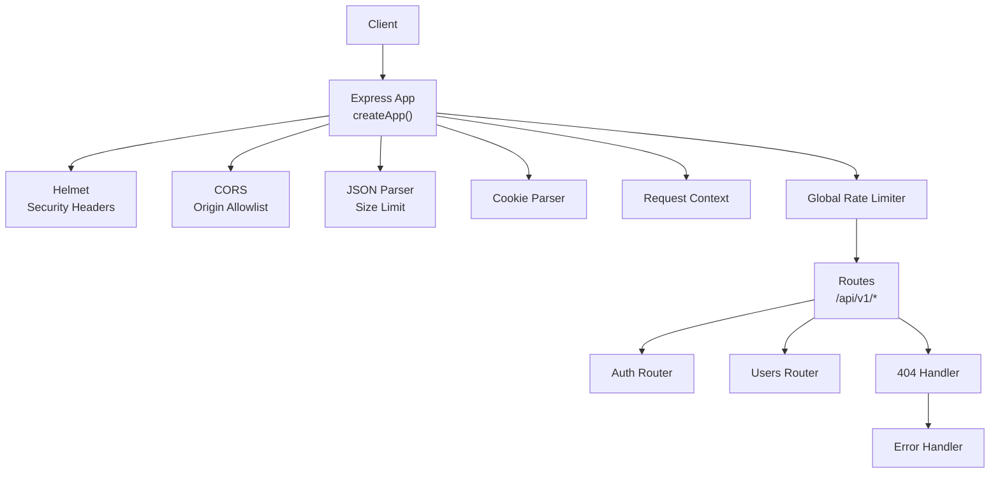
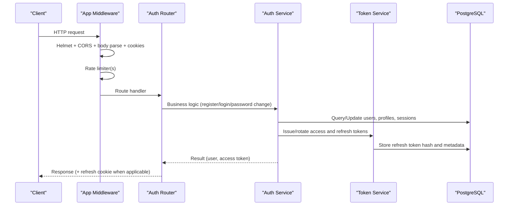
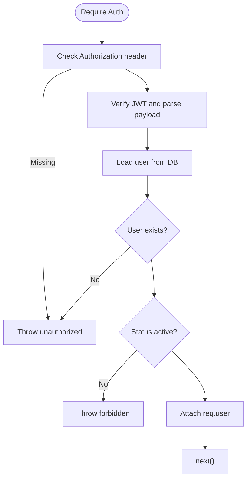
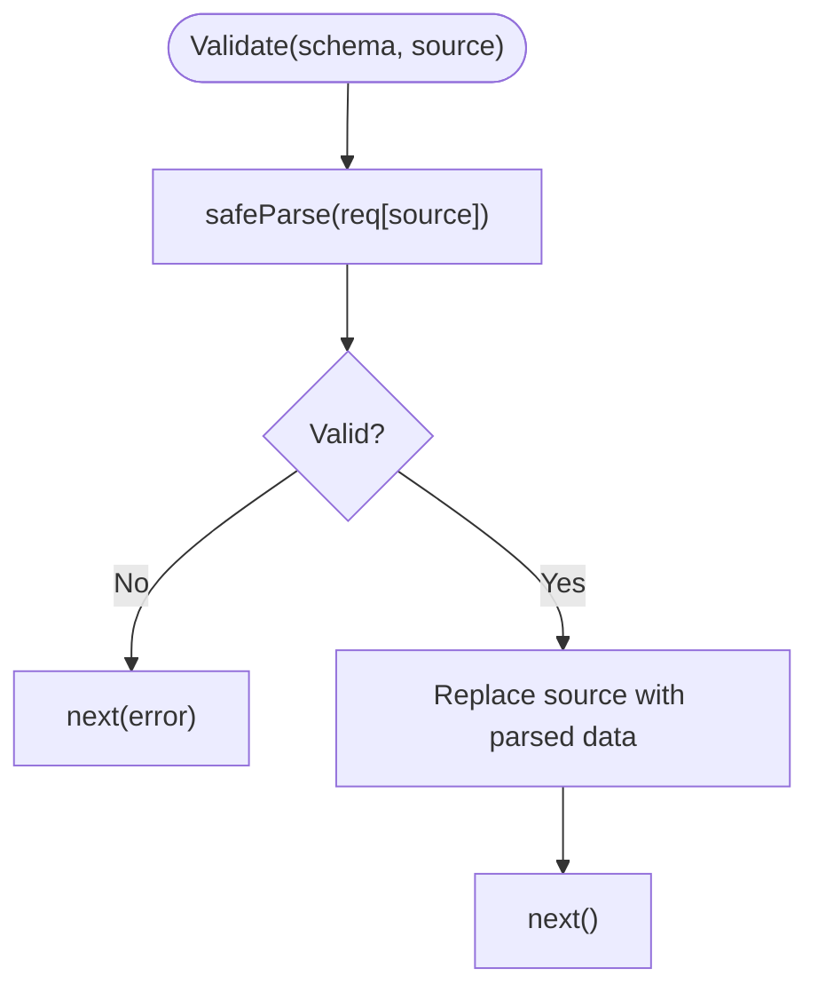
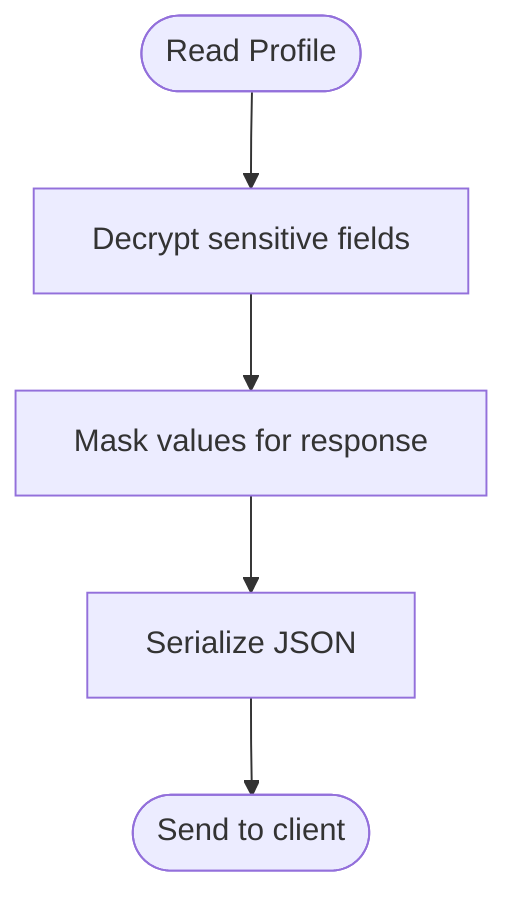
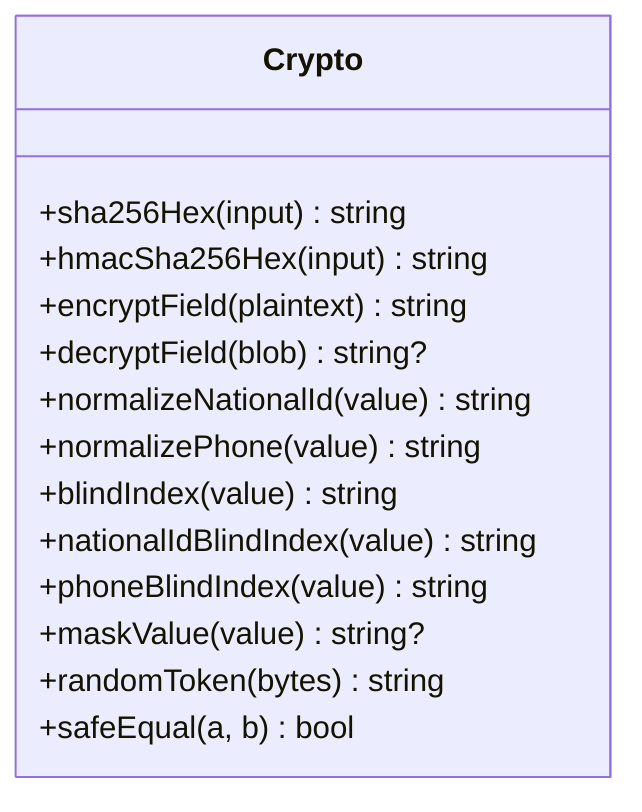
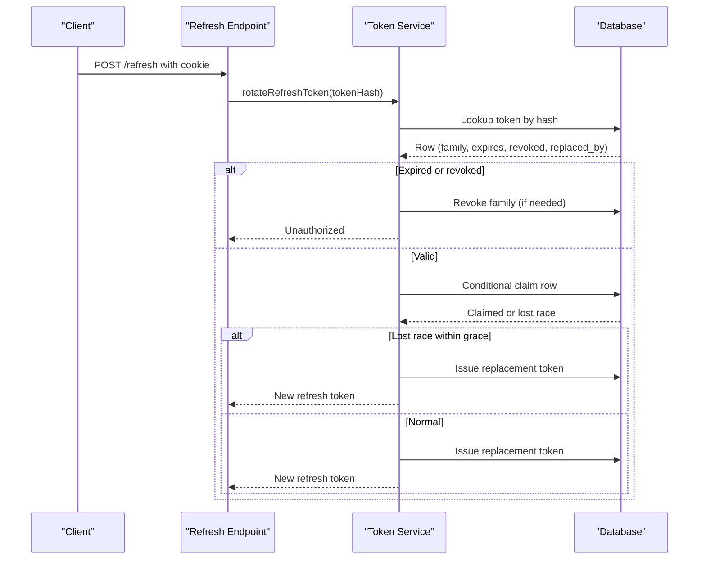
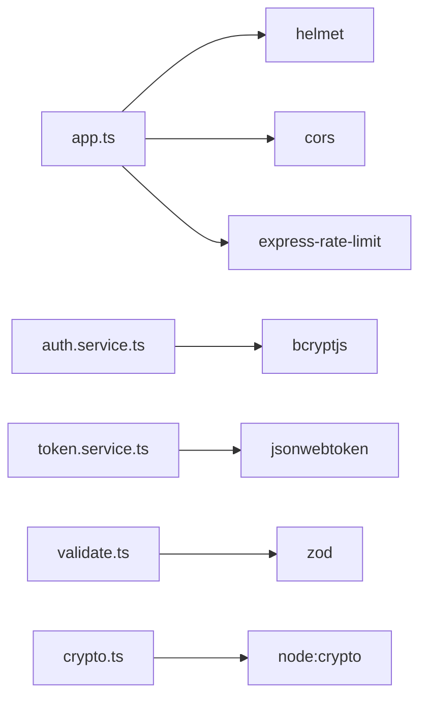

# Security Implementation

<cite>
**Referenced Files in This Document**
- [app.ts](file://backend/src/app.ts)
- [server.ts](file://backend/src/server.ts)
- [env.ts](file://backend/src/config/env.ts)
- [auth.ts](file://backend/src/middleware/auth.ts)
- [rateLimit.ts](file://backend/src/middleware/rateLimit.ts)
- [error.ts](file://backend/src/middleware/error.ts)
- [validate.ts](file://backend/src/middleware/validate.ts)
- [crypto.ts](file://backend/src/lib/crypto.ts)
- [cookies.ts](file://backend/src/lib/cookies.ts)
- [auth.routes.ts](file://backend/src/modules/auth/auth.routes.ts)
- [auth.service.ts](file://backend/src/modules/auth/auth.service.ts)
- [token.service.ts](file://backend/src/modules/auth/token.service.ts)
- [users.routes.ts](file://backend/src/modules/users/users.routes.ts)
- [users.service.ts](file://backend/src/modules/users/users.service.ts)
- [001_core_auth.sql](file://backend/src/db/migrations/001_core_auth.sql)
- [004_fraud_audit.sql](file://backend/src/db/migrations/004_fraud_audit.sql)
</cite>

## Table of Contents
1. Introduction
2. Project Structure
3. Core Components
4. Architecture Overview
5. Detailed Component Analysis
6. Dependency Analysis
7. Performance Considerations
8. Troubleshooting Guide
9. Conclusion

## Introduction
This document describes the security implementation for SecureMicrofinance. It explains the multi-layered approach covering authentication, authorization, input validation, output sanitization, data protection, and operational hardening. It also documents middleware implementations for security headers, CORS configuration, rate limiting, and error handling, along with encryption strategies, secure cookie configuration, CSRF mitigation, and compliance-oriented controls such as audit logging and append-only integrity.

## Project Structure
The backend is an Express application that composes security through a strict middleware pipeline:
- Security headers via Helmet
- Strict CORS policy
- Body size limits and cookie parsing
- Request context propagation
- Global and endpoint-specific rate limiters
- Centralized error handling and validation



**Diagram sources**
- [app.ts:23-92](file://backend/src/app.ts#L23-L92)

**Section sources**
- [app.ts:16-92](file://backend/src/app.ts#L16-L92)
- [server.ts:1-26](file://backend/src/server.ts#L1-L26)

## Core Components
- Authentication: Bearer access tokens (short-lived JWT), httpOnly refresh tokens stored as hashes, rotation with reuse detection, account lockout, generic error messages to prevent enumeration.
- Authorization: Role-based access control with read-only auditor enforcement on state-changing routes.
- Input Validation: Zod schemas replace request bodies/query/params with allow-listed, coerced values; unknown keys are stripped.
- Output Sanitization: Sensitive fields are decrypted only at the API edge and immediately masked before being sent to clients.
- Data Protection: Field-level AES-256-GCM encryption at rest, HMAC blind indexes for duplicate checks without decryption, timing-safe comparisons.
- Session Security: httpOnly, SameSite=Strict cookies scoped to auth endpoints; token rotation and family revocation.
- Operational Hardening: CORS allowlist, Helmet headers, global and per-endpoint rate limiting, structured error responses, append-only audit log with hash chain.

**Section sources**
- [auth.ts:13-68](file://backend/src/middleware/auth.ts#L13-L68)
- [validate.ts:6-39](file://backend/src/middleware/validate.ts#L6-L39)
- [crypto.ts:4-97](file://backend/src/lib/crypto.ts#L4-L97)
- [cookies.ts:4-28](file://backend/src/lib/cookies.ts#L4-L28)
- [error.ts:6-76](file://backend/src/middleware/error.ts#L6-L76)
- [rateLimit.ts:5-50](file://backend/src/middleware/rateLimit.ts#L5-L50)

## Architecture Overview
The system enforces defense-in-depth across layers:



**Diagram sources**
- [app.ts:30-63](file://backend/src/app.ts#L30-L63)
- [auth.routes.ts:53-103](file://backend/src/modules/auth/auth.routes.ts#L53-L103)
- [auth.service.ts:61-112](file://backend/src/modules/auth/auth.service.ts#L61-L112)
- [token.service.ts:64-76](file://backend/src/modules/auth/token.service.ts#L64-L76)
- [001_core_auth.sql:78-95](file://backend/src/db/migrations/001_core_auth.sql#L78-L95)

## Detailed Component Analysis

### Authentication and Authorization
- Access tokens: Short-lived JWTs signed with a secret, validated by issuer and audience. Payload includes user id and role.
- Refresh tokens: Opaque random tokens set in an httpOnly, SameSite=Strict cookie scoped to the auth path. Only their SHA-256 hash is persisted. Rotation is atomic; reuse outside a grace window revokes the entire token family.
- Account lockout: Failed login attempts increment counters and can lock accounts temporarily; successful login resets counters.
- Generic errors: Login failures return uniform messages to avoid account enumeration.
- Authorization: requireAuth validates bearer tokens and reloads the user from the database to enforce immediate suspension effects. requireRole restricts routes by role. denyAuditorWrites blocks auditors from mutating data.



**Diagram sources**
- [auth.ts:18-41](file://backend/src/middleware/auth.ts#L18-L41)

**Section sources**
- [auth.ts:13-68](file://backend/src/middleware/auth.ts#L13-L68)
- [auth.routes.ts:53-121](file://backend/src/modules/auth/auth.routes.ts#L53-L121)
- [auth.service.ts:15-262](file://backend/src/modules/auth/auth.service.ts#L15-L262)
- [token.service.ts:10-206](file://backend/src/modules/auth/token.service.ts#L10-L206)
- [001_core_auth.sql:17-31](file://backend/src/db/migrations/001_core_auth.sql#L17-L31)

### Input Validation and Mass-Assignment Defense
- All inputs are validated against Zod schemas. The middleware replaces the original source with parsed, coerced data and strips unknown keys.
- Shared primitives include UUID, money (cents), and pagination schemas.
- Endpoints define explicit schemas for register, login, password change, and profile updates.



**Diagram sources**
- [validate.ts:11-25](file://backend/src/middleware/validate.ts#L11-L25)

**Section sources**
- [validate.ts:1-40](file://backend/src/middleware/validate.ts#L1-L40)
- [auth.routes.ts:20-49](file://backend/src/modules/auth/auth.routes.ts#L20-L49)
- [users.routes.ts:26-36](file://backend/src/modules/users/users.routes.ts#L26-L36)

### Output Sanitization and PII Handling
- Sensitive fields (national ID, phone, date of birth, address) are encrypted at rest using AES-256-GCM.
- Blind indexes (HMAC-SHA256) enable duplicate detection without decrypting rows.
- On read paths, sensitive values are decrypted only at the API boundary and immediately masked before serialization.



**Diagram sources**
- [users.service.ts:19-59](file://backend/src/modules/users/users.service.ts#L19-L59)
- [crypto.ts:29-48](file://backend/src/lib/crypto.ts#L29-L48)
- [crypto.ts:79-84](file://backend/src/lib/crypto.ts#L79-L84)

**Section sources**
- [users.service.ts:1-60](file://backend/src/modules/users/users.service.ts#L1-L60)
- [crypto.ts:4-97](file://backend/src/lib/crypto.ts#L4-L97)

### Encryption Strategy and Cryptographic Utilities
- AES-256-GCM field encryption with randomized IV and authenticated tag; versioned blob format supports key rotation.
- HMAC blind indexes for national ID and phone normalization to detect duplicates across accounts.
- Timing-safe comparison utility for opaque tokens/hashes.
- Random token generation for refresh tokens.



**Diagram sources**
- [crypto.ts:21-97](file://backend/src/lib/crypto.ts#L21-L97)

**Section sources**
- [crypto.ts:1-97](file://backend/src/lib/crypto.ts#L1-L97)

### Secure Cookie Configuration and CSRF Mitigation
- Refresh token cookie:
  - Name configured via environment.
  - httpOnly to prevent JavaScript access.
  - SameSite=Strict to block cross-site requests.
  - secure flag enabled in production.
  - Path scoped to /api/v1/auth.
- CSRF mitigation:
  - SameSite=Strict on refresh/logout endpoints prevents cross-site request forgery for those flows.
  - Access tokens are sent explicitly via Authorization header rather than cookies.

**Section sources**
- [cookies.ts:4-28](file://backend/src/lib/cookies.ts#L4-L28)
- [env.ts:93-100](file://backend/src/config/env.ts#L93-L100)
- [auth.routes.ts:75-103](file://backend/src/modules/auth/auth.routes.ts#L75-L103)

### Middleware: Security Headers, CORS, Rate Limiting, Error Handling
- Security headers: Helmet applied with referrer policy; inline script restrictions disabled only for Swagger UI; API itself serves JSON.
- CORS: Explicit allowlist including configured web origin and local dev origins; credentials allowed; limited methods and headers; maxAge set.
- Rate limiting:
  - Global limiter by IP.
  - Tighter auth limiter keyed by IP + email to slow brute force.
  - Write limiter keyed by authenticated user id or IP.
  - Test mode bypasses all limiters for deterministic tests.
- Error handling:
  - 404 never leaks route table.
  - Structured error responses with requestId.
  - Zod validation errors mapped to 400 with field details.
  - PostgreSQL constraint codes mapped to specific business errors (duplicate, constraint violation, append-only).
  - Internal errors hide stack traces in production.

```mermaid
flowchart TD
Req(["Incoming Request"]) --> Headers["Helmet + CORS"]
Headers --> Body["JSON parser + cookies"]
Body --> Ctx["Request context"]
Ctx --> Limiter["Rate limiter(s)"]
Limiter --> Route["Route handler"]
Route --> |Success| Res["Structured success response"]
Route --> |Error| Err["Central error handler"]
Err --> Map["Map to safe status + code"]
Map --> Out(["Response with requestId")]
```

**Diagram sources**
- [app.ts:30-63](file://backend/src/app.ts#L30-L63)
- [rateLimit.ts:14-47](file://backend/src/middleware/rateLimit.ts#L14-L47)
- [error.ts:6-76](file://backend/src/middleware/error.ts#L6-L76)

**Section sources**
- [app.ts:30-63](file://backend/src/app.ts#L30-L63)
- [rateLimit.ts:1-51](file://backend/src/middleware/rateLimit.ts#L1-L51)
- [error.ts:1-77](file://backend/src/middleware/error.ts#L1-L77)

### Data Protection and Database Schema
- Encrypted borrower profile columns: national_id_enc, phone_enc, date_of_birth_enc, address_enc.
- Blind index columns: national_id_bi, phone_bi with dedicated indexes for duplicate detection.
- Refresh tokens table stores only token_hash, family_id, expiration, revocation, and optional IP/user-agent metadata.
- Append-only audit log with hash chain enforced by triggers; mutations blocked.

```mermaid
erDiagram
USERS {
uuid id PK
text email UK
text password_hash
enum role
text full_name
enum status
int failed_attempts
timestamptz locked_until
timestamptz last_login_at
timestamptz created_at
timestamptz updated_at
}
BORROWER_PROFILES {
uuid user_id PK FK
text national_id_enc
text national_id_bi
text phone_enc
text phone_bi
text date_of_birth_enc
text address_enc
text occupation
bigint monthly_income_cents
jsonb consent_flags
timestamptz created_at
timestamptz updated_at
}
REFRESH_TOKENS {
uuid id PK
uuid user_id FK
char token_hash UK
uuid family_id
uuid replaced_by FK
timestamptz expires_at
timestamptz revoked_at
inet ip
text user_agent
timestamptz created_at
}
AUDIT_LOG {
bigserial id PK
bigint seq UK
uuid actor_user_id
text actor_role
text action
text entity_type
text entity_id
inet ip
text user_agent
text request_id
char before_hash
char after_hash
jsonb detail
char prev_hash
char row_hash UK
timestamptz created_at
}
USERS ||--o{ BORROWER_PROFILES : "has"
USERS ||--o{ REFRESH_TOKENS : "issues"
USERS ||--o{ AUDIT_LOG : "performs"
```

**Diagram sources**
- [001_core_auth.sql:17-95](file://backend/src/db/migrations/001_core_auth.sql#L17-L95)
- [004_fraud_audit.sql:67-111](file://backend/src/db/migrations/004_fraud_audit.sql#L67-L111)

**Section sources**
- [001_core_auth.sql:1-95](file://backend/src/db/migrations/001_core_auth.sql#L1-L95)
- [004_fraud_audit.sql:1-136](file://backend/src/db/migrations/004_fraud_audit.sql#L1-L136)

### Token Lifecycle and Replay Protection
- Access token signing and verification use a secret with issuer and audience constraints.
- Refresh token issuance persists only the SHA-256 hash and associates it with a family identifier.
- Rotation uses conditional UPDATE to claim the row; concurrent double-submits within a grace window are benign and receive a new token.
- Reuse outside the grace window revokes the entire family and audits the event.



**Diagram sources**
- [token.service.ts:154-195](file://backend/src/modules/auth/token.service.ts#L154-L195)
- [auth.routes.ts:75-96](file://backend/src/modules/auth/auth.routes.ts#L75-L96)

**Section sources**
- [token.service.ts:10-206](file://backend/src/modules/auth/token.service.ts#L10-L206)
- [auth.routes.ts:75-103](file://backend/src/modules/auth/auth.routes.ts#L75-L103)

### Compliance and Audit Controls
- Every authentication event (register, login, logout, password change, failures) is recorded in the audit log with actor, action, entity, IP, user agent, and request id.
- Audit log is append-only with cryptographic chaining; mutation is blocked by triggers.
- Fraud flags and alerts tables support detection workflows and review processes.

**Section sources**
- [auth.service.ts:86-101](file://backend/src/modules/auth/auth.service.ts#L86-L101)
- [auth.service.ts:136-190](file://backend/src/modules/auth/auth.service.ts#L136-L190)
- [auth.service.ts:232-242](file://backend/src/modules/auth/auth.service.ts#L232-L242)
- [auth.service.ts:245-261](file://backend/src/modules/auth/auth.service.ts#L245-L261)
- [004_fraud_audit.sql:21-54](file://backend/src/db/migrations/004_fraud_audit.sql#L21-L54)
- [004_fraud_audit.sql:67-111](file://backend/src/db/migrations/004_fraud_audit.sql#L67-L111)

## Dependency Analysis
Key security dependencies and their roles:
- helmet: Security headers.
- cors: Cross-origin policy.
- express-rate-limit: Rate limiting.
- bcryptjs: Password hashing.
- jsonwebtoken: JWT access tokens.
- zod: Input validation.
- node:crypto: Encryption, hashing, random tokens, timing-safe compare.



**Diagram sources**
- [app.ts:3-12](file://backend/src/app.ts#L3-L12)
- [auth.service.ts:1-6](file://backend/src/modules/auth/auth.service.ts#L1-L6)
- [token.service.ts:1-8](file://backend/src/modules/auth/token.service.ts#L1-L8)
- [validate.ts:1-3](file://backend/src/middleware/validate.ts#L1-L3)
- [crypto.ts:1-2](file://backend/src/lib/crypto.ts#L1-L2)

**Section sources**
- [app.ts:3-12](file://backend/src/app.ts#L3-L12)
- [auth.service.ts:1-6](file://backend/src/modules/auth/auth.service.ts#L1-L6)
- [token.service.ts:1-8](file://backend/src/modules/auth/token.service.ts#L1-L8)
- [validate.ts:1-3](file://backend/src/middleware/validate.ts#L1-L3)
- [crypto.ts:1-2](file://backend/src/lib/crypto.ts#L1-L2)

## Performance Considerations
- Rate limiters reduce load during abuse and protect sensitive endpoints like authentication and writes.
- Database queries are parameterized and constrained; blind indexes avoid decrypting rows for duplicate checks.
- Access tokens are short-lived to minimize exposure; refresh tokens are rotated to limit replay windows.
- Error responses are compact and structured to reduce bandwidth while preserving diagnostic information via requestId.

[No sources needed since this section provides general guidance]

## Troubleshooting Guide
- Unknown endpoint: Returns 404 with a stable message and requestId; do not expose route details.
- Validation failure: Returns 400 with field-level issues; check Zod schema definitions.
- Duplicate record: Returns 409 with constraint details; ensure unique business rules are enforced.
- Constraint violation: Returns 422 for foreign key or check constraint violations.
- Append-only violation: Returns 409 indicating immutable records.
- Internal error: Returns 500 with sanitized details; in non-production environments, hints may be included.

Operational tips:
- Use requestId from logs to trace requests across middleware and services.
- In test mode, rate limiters are bypassed; if behavior differs between environments, verify NODE_ENV.
- For session issues, inspect refresh token revocation and family linkage in the database.

**Section sources**
- [error.ts:6-76](file://backend/src/middleware/error.ts#L6-L76)
- [rateLimit.ts:45-47](file://backend/src/middleware/rateLimit.ts#L45-L47)

## Conclusion
SecureMicrofinance implements a comprehensive security model combining strong authentication, fine-grained authorization, strict input validation, careful output sanitization, and robust data protection. Middleware hardens the transport layer, while cryptographic utilities and database design ensure confidentiality and integrity of sensitive financial data. Audit logging and append-only chains provide forensic capabilities aligned with compliance requirements for financial applications.

[No sources needed since this section summarizes without analyzing specific files]