# Backend Architecture

<cite>
**Referenced Files in This Document**
- [app.ts](file://backend/src/app.ts)
- [server.ts](file://backend/src/server.ts)
- [env.ts](file://backend/src/config/env.ts)
- [pool.ts](file://backend/src/db/pool.ts)
- [auth.ts](file://backend/src/middleware/auth.ts)
- [error.ts](file://backend/src/middleware/error.ts)
- [rateLimit.ts](file://backend/src/middleware/rateLimit.ts)
- [requestContext.ts](file://backend/src/middleware/requestContext.ts)
- [validate.ts](file://backend/src/middleware/validate.ts)
- [auth.routes.ts](file://backend/src/modules/auth/auth.routes.ts)
- [auth.service.ts](file://backend/src/modules/auth/auth.service.ts)
- [token.service.ts](file://backend/src/modules/auth/token.service.ts)
- [users.routes.ts](file://backend/src/modules/users/users.routes.ts)
- [users.service.ts](file://backend/src/modules/users/users.service.ts)
- [rules.engine.ts](file://backend/src/modules/fraud/rules.engine.ts)
- [audit.service.ts](file://backend/src/modules/audit/audit.service.ts)
</cite>

## Table of Contents
1. [Introduction](#introduction)
2. [Project Structure](#project-structure)
3. [Core Components](#core-components)
4. [Architecture Overview](#architecture-overview)
5. [Detailed Component Analysis](#detailed-component-analysis)
6. [Dependency Analysis](#dependency-analysis)
7. [Performance Considerations](#performance-considerations)
8. [Troubleshooting Guide](#troubleshooting-guide)
9. [Conclusion](#conclusion)

## Introduction
This document explains the backend architecture of SecureMicrofinance. It covers the Express.js server setup, modular service design for authentication, users, fraud detection, and audit logging, the middleware pipeline for security and validation, request flow from HTTP endpoints to business logic, dependency injection patterns, configuration management, database connection pooling and transactions, and error propagation. The goal is to make the system understandable for both developers and stakeholders with limited technical background.

## Project Structure
The backend is organized by feature modules under `src/modules`, shared infrastructure under `src/middleware`, `src/lib`, and `src/db`, and application wiring under `src/app.ts` and `src/server.ts`. Configuration is centralized in `src/config/env.ts`.

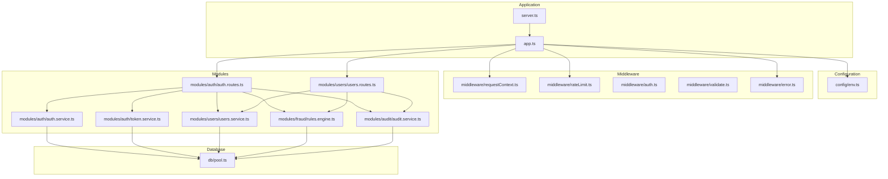

**Diagram sources**
- [server.ts:1-26](file://backend/src/server.ts#L1-L26)
- [app.ts:1-98](file://backend/src/app.ts#L1-L98)
- [env.ts:1-106](file://backend/src/config/env.ts#L1-L106)
- [pool.ts:1-62](file://backend/src/db/pool.ts#L1-L62)
- [requestContext.ts:1-29](file://backend/src/middleware/requestContext.ts#L1-L29)
- [rateLimit.ts:1-51](file://backend/src/middleware/rateLimit.ts#L1-L51)
- [auth.ts:1-69](file://backend/src/middleware/auth.ts#L1-L69)
- [validate.ts:1-40](file://backend/src/middleware/validate.ts#L1-L40)
- [error.ts:1-77](file://backend/src/middleware/error.ts#L1-L77)
- [auth.routes.ts:1-121](file://backend/src/modules/auth/auth.routes.ts#L1-L121)
- [auth.service.ts:1-262](file://backend/src/modules/auth/auth.service.ts#L1-L262)
- [token.service.ts:1-206](file://backend/src/modules/auth/token.service.ts#L1-L206)
- [users.routes.ts:1-108](file://backend/src/modules/users/users.routes.ts#L1-L108)
- [users.service.ts:1-60](file://backend/src/modules/users/users.service.ts#L1-L60)
- [rules.engine.ts:1-275](file://backend/src/modules/fraud/rules.engine.ts#L1-L275)
- [audit.service.ts:1-191](file://backend/src/modules/audit/audit.service.ts#L1-L191)

**Section sources**
- [server.ts:1-26](file://backend/src/server.ts#L1-L26)
- [app.ts:1-98](file://backend/src/app.ts#L1-L98)

## Core Components
- Application factory: Creates the Express app, configures security headers, CORS, body parsing, request context, rate limiting, routes, and global error handling.
- Server bootstrap: Starts the HTTP server, logs environment details, and handles graceful shutdown including database pool teardown.
- Configuration: Loads `.env`, validates all settings with strict schemas, exposes typed configuration, and derives runtime helpers such as test flags and storage paths.
- Database layer: Provides a shared connection pool, parameterized query helpers, and transaction wrappers that roll back on errors.
- Middleware pipeline: Adds correlation IDs, enforces rate limits, validates requests against Zod schemas, authenticates access tokens, checks roles, and centralizes error responses.
- Modules:
  - Auth: Registration, login, refresh/logout, password change, token signing/verification, and session rotation.
  - Users: Profile retrieval and secure profile updates with encrypted fields and blind indexes.
  - Fraud: Deterministic rule-based checks for identity conflicts, duplicate references, rapid applications, and duplicate disbursements.
  - Audit: Append-only, hash-chained audit log with advisory locking and chain verification.

**Section sources**
- [app.ts:18-98](file://backend/src/app.ts#L18-L98)
- [server.ts:1-26](file://backend/src/server.ts#L1-L26)
- [env.ts:6-106](file://backend/src/config/env.ts#L6-L106)
- [pool.ts:4-62](file://backend/src/db/pool.ts#L4-L62)
- [requestContext.ts:4-29](file://backend/src/middleware/requestContext.ts#L4-L29)
- [rateLimit.ts:5-51](file://backend/src/middleware/rateLimit.ts#L5-L51)
- [validate.ts:6-40](file://backend/src/middleware/validate.ts#L6-L40)
- [auth.ts:13-69](file://backend/src/middleware/auth.ts#L13-L69)
- [error.ts:6-77](file://backend/src/middleware/error.ts#L6-L77)
- [auth.routes.ts:15-121](file://backend/src/modules/auth/auth.routes.ts#L15-L121)
- [auth.service.ts:15-262](file://backend/src/modules/auth/auth.service.ts#L15-L262)
- [token.service.ts:10-206](file://backend/src/modules/auth/token.service.ts#L10-L206)
- [users.routes.ts:19-108](file://backend/src/modules/users/users.routes.ts#L19-L108)
- [users.service.ts:5-60](file://backend/src/modules/users/users.service.ts#L5-L60)
- [rules.engine.ts:4-275](file://backend/src/modules/fraud/rules.engine.ts#L4-L275)
- [audit.service.ts:7-191](file://backend/src/modules/audit/audit.service.ts#L7-L191)

## Architecture Overview
The API follows a layered structure:
- HTTP layer (Express routers) receives requests, applies middleware, and delegates to services.
- Service layer encapsulates business logic, performs data access via the database layer, and coordinates cross-cutting concerns like auditing and fraud checks.
- Infrastructure provides configuration, database connectivity, and shared utilities.

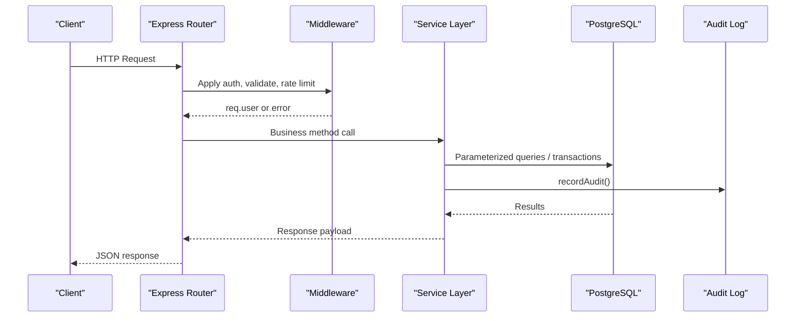

**Diagram sources**
- [app.ts:62-94](file://backend/src/app.ts#L62-L94)
- [auth.routes.ts:53-121](file://backend/src/modules/auth/auth.routes.ts#L53-L121)
- [auth.service.ts:61-262](file://backend/src/modules/auth/auth.service.ts#L61-L262)
- [pool.ts:27-57](file://backend/src/db/pool.ts#L27-L57)
- [audit.service.ts:37-118](file://backend/src/modules/audit/audit.service.ts#L37-L118)

## Detailed Component Analysis

### Express Server Setup and Middleware Pipeline
- Security and CORS: Helmet with safe defaults, CORS restricted to configured origins, credentials enabled.
- Body parsing and cookies: JSON body parser with size limit, cookie parser for refresh tokens.
- Request context: Generates a unique request ID, attaches it to the response header, and exposes helper functions for IP and user agent.
- Rate limiting: Global limiter, stricter limiter for authentication endpoints, and write limiter keyed by authenticated user when available.
- Routes: Mounts `/api/v1/auth`, `/api/v1/me`, loans, and repayments routers.
- Error handling: Centralized handler maps application errors, validation errors, PostgreSQL constraint violations, and unknown errors to consistent JSON responses.

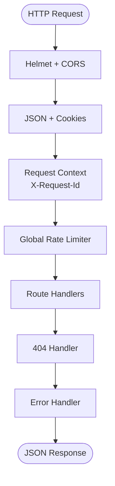

**Diagram sources**
- [app.ts:32-94](file://backend/src/app.ts#L32-L94)
- [requestContext.ts:9-29](file://backend/src/middleware/requestContext.ts#L9-L29)
- [rateLimit.ts:14-51](file://backend/src/middleware/rateLimit.ts#L14-L51)
- [error.ts:6-77](file://backend/src/middleware/error.ts#L6-L77)

**Section sources**
- [app.ts:18-98](file://backend/src/app.ts#L18-L98)
- [requestContext.ts:4-29](file://backend/src/middleware/requestContext.ts#L4-L29)
- [rateLimit.ts:5-51](file://backend/src/middleware/rateLimit.ts#L5-L51)
- [error.ts:6-77](file://backend/src/middleware/error.ts#L6-L77)

### Authentication Module
- Routes: Register, login, refresh, logout, get current user, and change password. Each route validates input and applies appropriate rate limits.
- Services:
  - Registration hashes passwords, creates user and profile rows within a transaction, records an audit entry, issues a refresh token, and signs an access token.
  - Login normalizes email, performs constant-time comparison behavior, enforces lockout policy, resets failed attempts on success, audits events, and issues tokens.
  - Password change verifies current password, updates hash, revokes all sessions, and audits the action.
  - Logout revokes the provided refresh token and audits the event.
- Tokens:
  - Access tokens are short-lived JWTs signed with a secret and validated with issuer/audience checks.
  - Refresh tokens are opaque values stored only as SHA-256 hashes; they rotate on use and support replay detection across concurrent tabs using a grace window and family linkage.

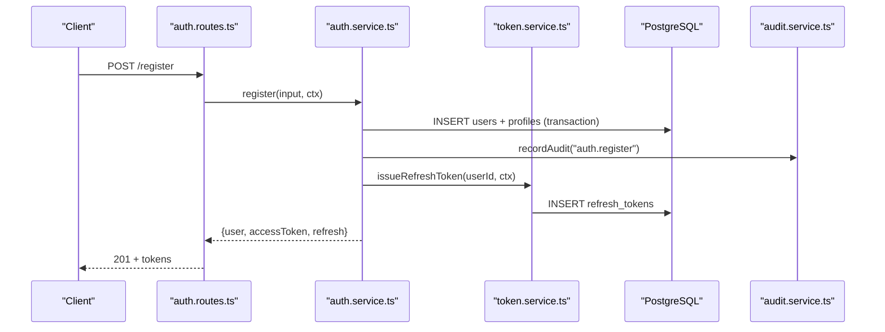

**Diagram sources**
- [auth.routes.ts:53-62](file://backend/src/modules/auth/auth.routes.ts#L53-L62)
- [auth.service.ts:61-112](file://backend/src/modules/auth/auth.service.ts#L61-L112)
- [token.service.ts:64-76](file://backend/src/modules/auth/token.service.ts#L64-L76)
- [audit.service.ts:37-94](file://backend/src/modules/audit/audit.service.ts#L37-L94)

**Section sources**
- [auth.routes.ts:15-121](file://backend/src/modules/auth/auth.routes.ts#L15-L121)
- [auth.service.ts:15-262](file://backend/src/modules/auth/auth.service.ts#L15-L262)
- [token.service.ts:10-206](file://backend/src/modules/auth/token.service.ts#L10-L206)

### Users Module
- Routes: Provide read-only profile summary and secure update endpoint for borrowers. Updates encrypt sensitive fields and compute blind indexes for duplicate detection.
- Service: Returns role-aware profile summaries, decrypting and masking sensitive fields before returning them to clients.

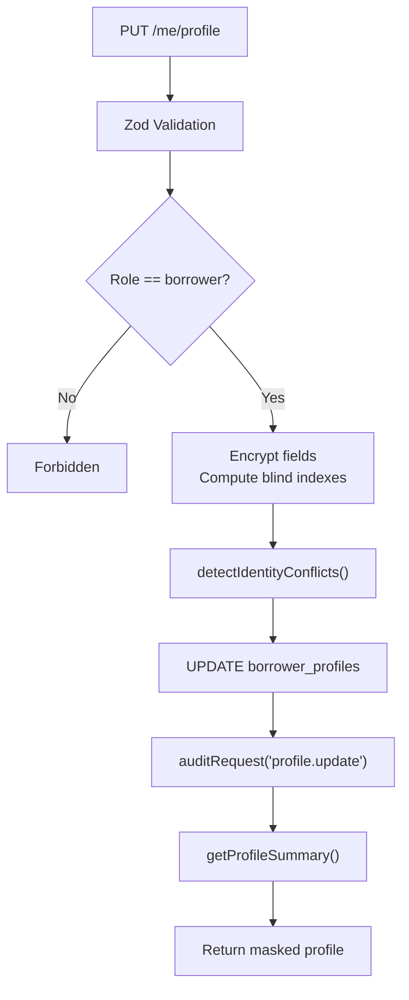

**Diagram sources**
- [users.routes.ts:45-107](file://backend/src/modules/users/users.routes.ts#L45-L107)
- [users.service.ts:19-59](file://backend/src/modules/users/users.service.ts#L19-L59)
- [rules.engine.ts:98-143](file://backend/src/modules/fraud/rules.engine.ts#L98-L143)

**Section sources**
- [users.routes.ts:19-108](file://backend/src/modules/users/users.routes.ts#L19-L108)
- [users.service.ts:5-60](file://backend/src/modules/users/users.service.ts#L5-L60)

### Fraud Detection Module
- Rule engine implements deterministic checks:
  - Identity conflict detection using blind indexes without decryption.
  - Payment reference validation and duplicate mobile-money receipt detection.
  - Rapid application detection based on configurable windows and thresholds.
  - Duplicate disbursement detection per loan.
- Flags are inserted with deduplication keys and can trigger lender alerts.

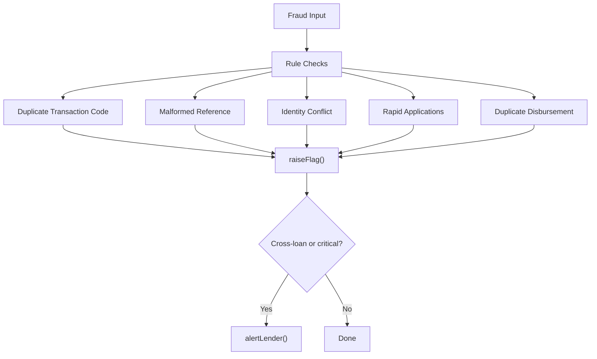

**Diagram sources**
- [rules.engine.ts:54-92](file://backend/src/modules/fraud/rules.engine.ts#L54-L92)
- [rules.engine.ts:98-275](file://backend/src/modules/fraud/rules.engine.ts#L98-L275)

**Section sources**
- [rules.engine.ts:4-275](file://backend/src/modules/fraud/rules.engine.ts#L4-L275)

### Audit Logging Module
- Append-only, hash-chained audit trail ensures tamper evidence.
- Uses an advisory transaction lock to serialize writers and maintain chain integrity.
- Provides utilities to record entries, wrap request-scoped auditing, and verify chain integrity.

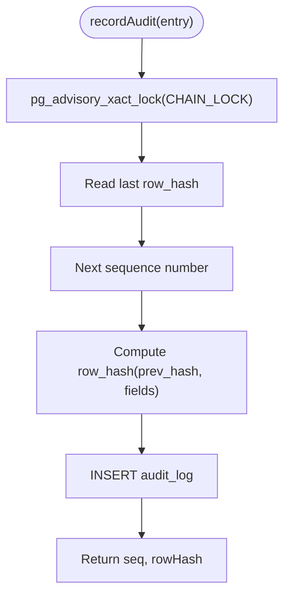

**Diagram sources**
- [audit.service.ts:37-94](file://backend/src/modules/audit/audit.service.ts#L37-L94)

**Section sources**
- [audit.service.ts:7-191](file://backend/src/modules/audit/audit.service.ts#L7-L191)

### Database Connection Pooling and Transactions
- Shared connection pool with bounded size, timeouts, and idle error handling.
- Parameterized query helpers prevent SQL injection.
- Transaction wrapper ensures atomicity and rollback on failure, releasing connections in all cases.

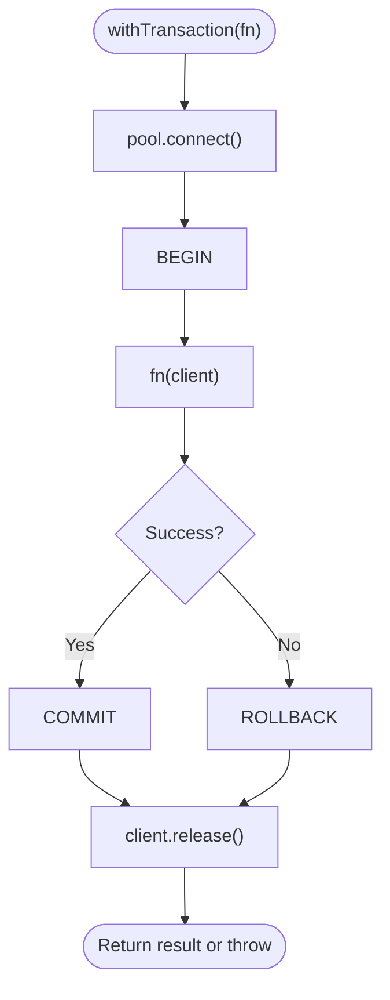

**Diagram sources**
- [pool.ts:44-57](file://backend/src/db/pool.ts#L44-L57)

**Section sources**
- [pool.ts:4-62](file://backend/src/db/pool.ts#L4-L62)

### Dependency Injection Pattern and Configuration Management
- Dependency injection pattern:
  - Routers depend on services rather than importing database or crypto internals directly.
  - Services import shared infrastructure (pool, config, audit) but remain decoupled from Express.
  - Middleware is composed declaratively in route definitions.
- Configuration management:
  - Environment variables are loaded from `.env` candidates and validated with strict schemas.
  - Derived properties include test mode flag, database URL selection, cookie name, and storage directory.
  - Sensitive secrets are required and validated (e.g., hex encryption keys).

**Section sources**
- [env.ts:6-106](file://backend/src/config/env.ts#L6-L106)
- [auth.routes.ts:1-121](file://backend/src/modules/auth/auth.routes.ts#L1-L121)
- [auth.service.ts:1-262](file://backend/src/modules/auth/auth.service.ts#L1-L262)

### Request Flow Examples

#### Authentication Flow
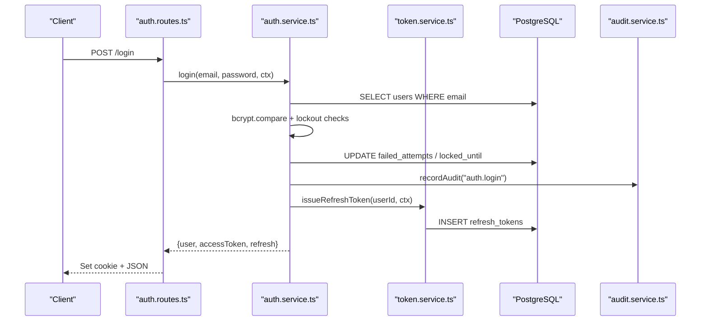

**Diagram sources**
- [auth.routes.ts:64-73](file://backend/src/modules/auth/auth.routes.ts#L64-L73)
- [auth.service.ts:114-198](file://backend/src/modules/auth/auth.service.ts#L114-L198)
- [token.service.ts:64-76](file://backend/src/modules/auth/token.service.ts#L64-L76)
- [audit.service.ts:37-94](file://backend/src/modules/audit/audit.service.ts#L37-L94)

#### User Profile Update Flow
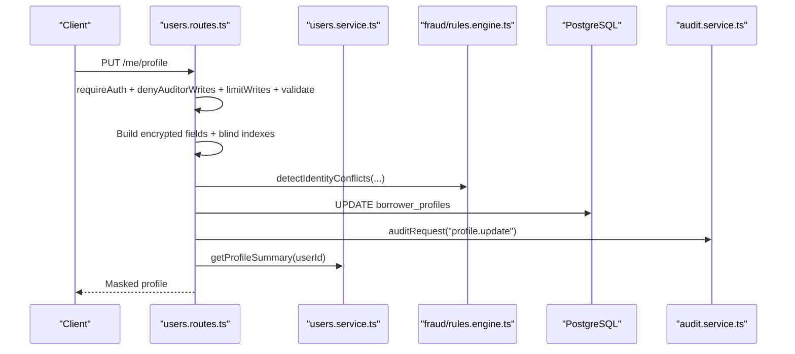

**Diagram sources**
- [users.routes.ts:45-107](file://backend/src/modules/users/users.routes.ts#L45-L107)
- [users.service.ts:19-59](file://backend/src/modules/users/users.service.ts#L19-L59)
- [rules.engine.ts:98-143](file://backend/src/modules/fraud/rules.engine.ts#L98-L143)
- [audit.service.ts:97-118](file://backend/src/modules/audit/audit.service.ts#L97-L118)

## Dependency Analysis
The following diagram shows module-level dependencies and coupling.

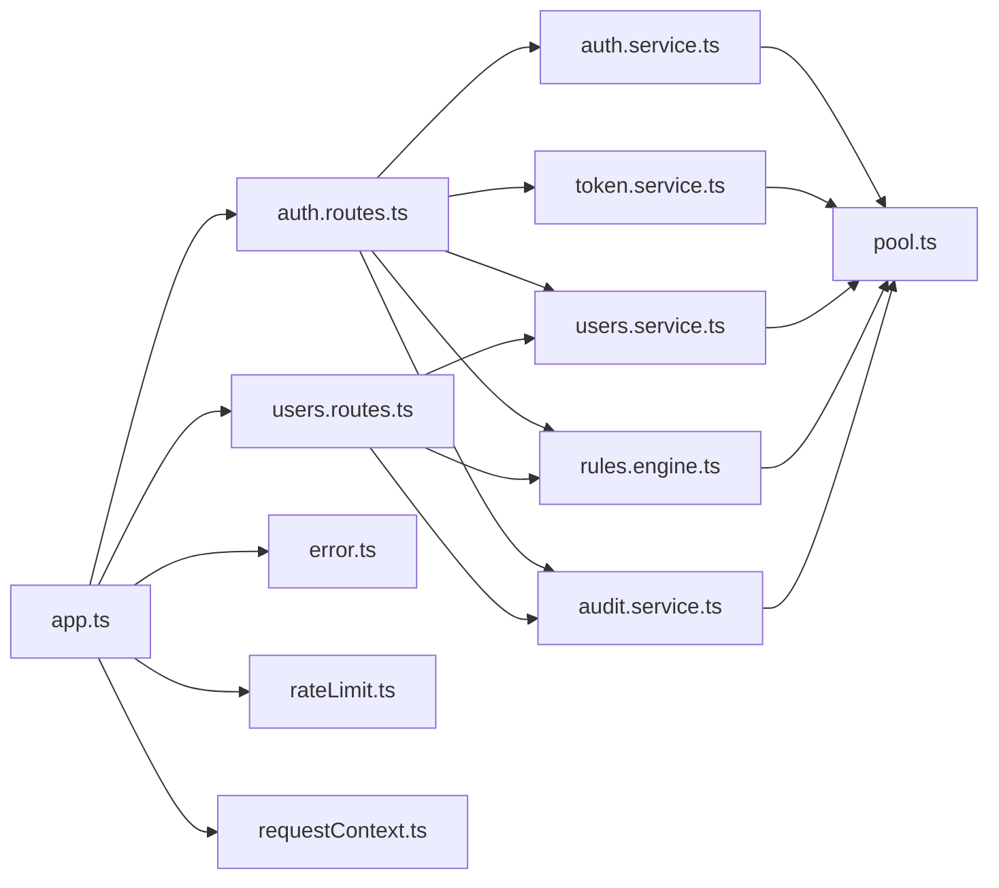

**Diagram sources**
- [app.ts:88-94](file://backend/src/app.ts#L88-L94)
- [auth.routes.ts:1-121](file://backend/src/modules/auth/auth.routes.ts#L1-L121)
- [users.routes.ts:1-108](file://backend/src/modules/users/users.routes.ts#L1-L108)
- [pool.ts:1-62](file://backend/src/db/pool.ts#L1-L62)

**Section sources**
- [app.ts:88-94](file://backend/src/app.ts#L88-L94)
- [auth.routes.ts:1-121](file://backend/src/modules/auth/auth.routes.ts#L1-L121)
- [users.routes.ts:1-108](file://backend/src/modules/users/users.routes.ts#L1-L108)
- [pool.ts:1-62](file://backend/src/db/pool.ts#L1-L62)

## Performance Considerations
- Connection pooling: A single shared pool with bounded size reduces overhead and prevents resource exhaustion.
- Query safety: All queries are parameterized, avoiding expensive string interpolation and preventing SQL injection.
- Token strategy: Short-lived access tokens reduce exposure; refresh tokens rotate and detect reuse to minimize replay risk.
- Validation: Zod schemas replace ad-hoc checks and provide fast, structured validation with clear error reporting.
- Rate limiting: Global and scoped limiters protect against abuse while being bypassed in tests for determinism.
- Audit chain: Advisory locks serialize writes to avoid contention spikes during high-volume auditing.

[No sources needed since this section provides general guidance]

## Troubleshooting Guide
- Unknown endpoint: The 404 handler returns a generic message with the request ID for tracing.
- Validation failures: Zod errors map to 400 responses with field-level details.
- Duplicate records: Unique constraint violations map to 409 with constraint metadata.
- Constraint violations: Foreign key or check constraints map to 422 with a generic message.
- Internal errors: Unexpected exceptions return 500 with production-safe messages; non-production may include hints.
- Authentication failures: Missing or invalid bearer tokens, inactive accounts, and expired tokens produce standardized unauthorized/forbidden responses.
- Rate limiting: Clients receive a rate-limited error when exceeding limits; in tests, limiters are disabled.

**Section sources**
- [error.ts:6-77](file://backend/src/middleware/error.ts#L6-L77)
- [auth.ts:18-69](file://backend/src/middleware/auth.ts#L18-L69)
- [rateLimit.ts:14-51](file://backend/src/middleware/rateLimit.ts#L14-L51)

## Conclusion
SecureMicrofinance’s backend uses a clean separation between routing, middleware, services, and infrastructure. Security is enforced at multiple layers: strict configuration validation, robust authentication and token rotation, input validation, role-based authorization, rate limiting, and an append-only, hash-chained audit trail. Database interactions are centralized through a pooled connection manager with transaction support, ensuring consistency and reliability. The modular design makes it straightforward to extend functionality while maintaining strong operational guarantees.