# Data Architecture

<cite>
**Referenced Files in This Document**
- [pool.ts](file://backend/src/db/pool.ts)
- [migrate.ts](file://backend/src/db/migrate.ts)
- [seed.ts](file://backend/src/db/seed.ts)
- [env.ts](file://backend/src/config/env.ts)
- [canonical.ts](file://backend/src/lib/canonical.ts)
- [crypto.ts](file://backend/src/lib/crypto.ts)
- [chain.client.ts](file://backend/src/modules/ledger/chain.client.ts)
- [users.service.ts](file://backend/src/modules/users/users.service.ts)
- [audit.service.ts](file://backend/src/modules/audit/audit.service.ts)
- [token.service.ts](file://backend/src/modules/auth/token.service.ts)
- [001_core_auth.sql](file://backend/src/db/migrations/001_core_auth.sql)
- [002_loans.sql](file://backend/src/db/migrations/002_loans.sql)
- [003_transactions_scoring.sql](file://backend/src/db/migrations/003_transactions_scoring.sql)
- [004_fraud_audit.sql](file://backend/src/db/migrations/004_fraud_audit.sql)
</cite>

## Table of Contents
1. [Introduction](#introduction)
2. [Project Structure](#project-structure)
3. [Core Components](#core-components)
4. [Architecture Overview](#architecture-overview)
5. [Detailed Component Analysis](#detailed-component-analysis)
6. [Dependency Analysis](#dependency-analysis)
7. [Performance Considerations](#performance-considerations)
8. [Data Lifecycle, Backup, and Integrity Verification](#data-lifecycle-backup-and-integrity-verification)
9. [Troubleshooting Guide](#troubleshooting-guide)
10. [Conclusion](#conclusion)

## Introduction
This document describes the data architecture for a secure microfinance system with PostgreSQL as the primary datastore. It covers connection pooling, migration-driven schema evolution, encrypted field storage, blind indexes for searchability, canonical JSON serialization for blockchain anchoring, append-only audit hashing, transaction boundaries, and performance strategies. The design emphasizes security (PII encryption, token hashing), verifiability (on-chain hashes and audit chain integrity), and operational clarity (SQL-first migrations).

## Project Structure
The database-related code is concentrated under `backend/src/db`, with schema definitions as SQL migration files, a small migration runner, a seed script, and a shared connection pool. Cryptographic and canonicalization utilities live under `backend/src/lib`. Domain services that interact with the database are under `backend/src/modules`.

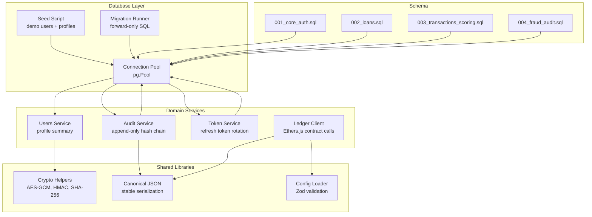

**Diagram sources**
- [pool.ts:1-62](file://backend/src/db/pool.ts#L1-L62)
- [migrate.ts:1-70](file://backend/src/db/migrate.ts#L1-L70)
- [seed.ts:1-157](file://backend/src/db/seed.ts#L1-L157)
- [users.service.ts:1-60](file://backend/src/modules/users/users.service.ts#L1-L60)
- [audit.service.ts:1-191](file://backend/src/modules/audit/audit.service.ts#L1-L191)
- [token.service.ts:1-206](file://backend/src/modules/auth/token.service.ts#L1-L206)
- [chain.client.ts:1-152](file://backend/src/modules/ledger/chain.client.ts#L1-L152)
- [crypto.ts:1-97](file://backend/src/lib/crypto.ts#L1-L97)
- [canonical.ts:1-117](file://backend/src/lib/canonical.ts#L1-L117)
- [env.ts:1-101](file://backend/src/config/env.ts#L1-L101)
- [001_core_auth.sql:1-95](file://backend/src/db/migrations/001_core_auth.sql#L1-L95)
- [002_loans.sql:1-100](file://backend/src/db/migrations/002_loans.sql#L1-L100)
- [003_transactions_scoring.sql:1-56](file://backend/src/db/migrations/003_transactions_scoring.sql#L1-L56)
- [004_fraud_audit.sql:1-136](file://backend/src/db/migrations/004_fraud_audit.sql#L1-L136)

**Section sources**
- [pool.ts:1-62](file://backend/src/db/pool.ts#L1-L62)
- [migrate.ts:1-70](file://backend/src/db/migrate.ts#L1-L70)
- [seed.ts:1-157](file://backend/src/db/seed.ts#L1-L157)

## Core Components
- Database connection pool: single shared `pg.Pool` with parameterized queries, bigint parsers, and a transaction helper.
- Migration system: forward-only, per-file transactions, recorded in `schema_migrations`.
- Data seeding: deterministic demo accounts with encrypted PII and blind indexes; audited creation.
- Encryption and blind indexes: AES-256-GCM for PII at rest; HMAC-SHA256 blind indexes for duplicate detection without plaintext exposure.
- Canonical serialization: stable JSON for on-chain transaction payloads and audit row hashes.
- Blockchain anchoring: only hashes and timestamps are written to an Ethereum-compatible ledger via Ethers.js.
- Append-only audit log: hash-chained rows with advisory locking to prevent forks.
- Refresh tokens: opaque values hashed before storage; family-based rotation and reuse detection.

**Section sources**
- [pool.ts:1-62](file://backend/src/db/pool.ts#L1-L62)
- [migrate.ts:1-70](file://backend/src/db/migrate.ts#L1-L70)
- [seed.ts:1-157](file://backend/src/db/seed.ts#L1-L157)
- [crypto.ts:1-97](file://backend/src/lib/crypto.ts#L1-L97)
- [canonical.ts:1-117](file://backend/src/lib/canonical.ts#L1-L117)
- [chain.client.ts:1-152](file://backend/src/modules/ledger/chain.client.ts#L1-L152)
- [audit.service.ts:1-191](file://backend/src/modules/audit/audit.service.ts#L1-L191)
- [token.service.ts:1-206](file://backend/src/modules/auth/token.service.ts#L1-L206)

## Architecture Overview
The application uses a layered approach:
- Configuration is validated at startup using Zod.
- Database access goes through a thin pool wrapper that centralizes query execution and transaction handling.
- Domain services encapsulate business logic and call the database directly with parameterized SQL.
- Security-sensitive operations use cryptographic helpers for encryption, hashing, and safe comparisons.
- Blockchain anchoring is optional and controlled by configuration; only hashes leave the database.

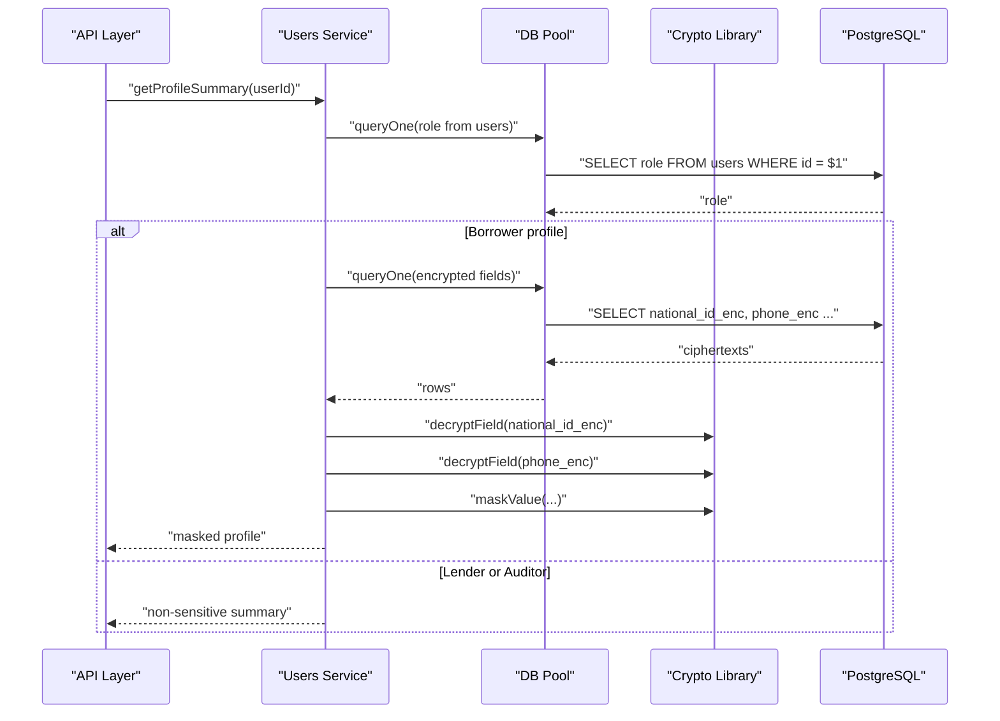

**Diagram sources**
- [users.service.ts:19-59](file://backend/src/modules/users/users.service.ts#L19-L59)
- [pool.ts:27-41](file://backend/src/db/pool.ts#L27-L41)
- [crypto.ts:29-48](file://backend/src/lib/crypto.ts#L29-L48)

## Detailed Component Analysis

### Database Connection Pooling Strategy
- A single shared `pg.Pool` is created once, configured with a maximum of 10 connections, idle timeout, and connection timeout.
- All queries are parameterized to prevent SQL injection.
- BigInt and numeric types are parsed into JavaScript numbers for clean JSON output.
- A `withTransaction` helper wraps functions in BEGIN/COMMIT and rolls back on errors, releasing the client in all paths.
- An error listener prevents pooled client failures from crashing the process.

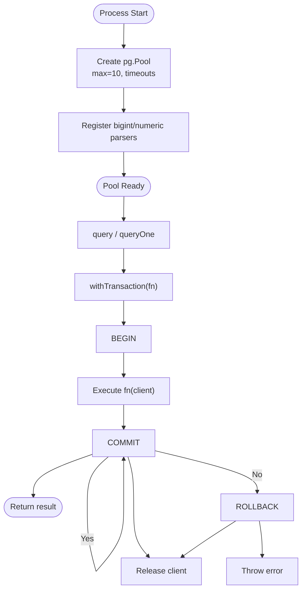

**Diagram sources**
- [pool.ts:9-25](file://backend/src/db/pool.ts#L9-L25)
- [pool.ts:27-57](file://backend/src/db/pool.ts#L27-L57)

**Section sources**
- [pool.ts:1-62](file://backend/src/db/pool.ts#L1-L62)

### Migration System Using SQL Files
- Forward-only migrations are applied from `src/db/migrations/*.sql`.
- Each file runs inside its own transaction; successful application records the filename in `schema_migrations`.
- A reset mode drops and recreates the public schema.
- Errors during migration rollback the individual file and surface a descriptive message.

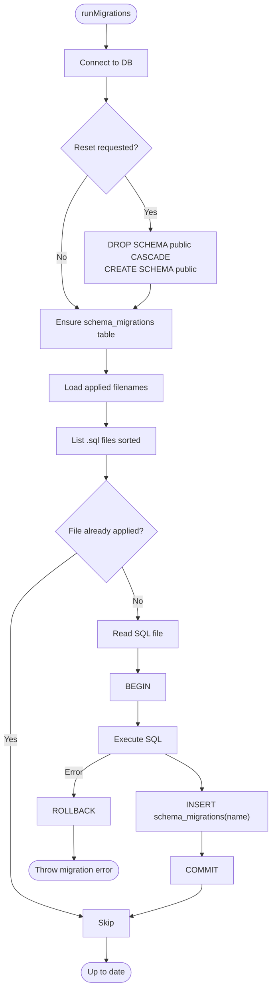

**Diagram sources**
- [migrate.ts:14-57](file://backend/src/db/migrate.ts#L14-L57)

**Section sources**
- [migrate.ts:1-70](file://backend/src/db/migrate.ts#L1-L70)

### Data Seeding Mechanisms
- Demo users include lender, borrower, and auditor roles.
- Passwords are hashed with bcrypt using a configurable cost.
- Borrower PII is stored encrypted; blind indexes are computed for national ID and phone.
- Each user creation is wrapped in a transaction and audited.

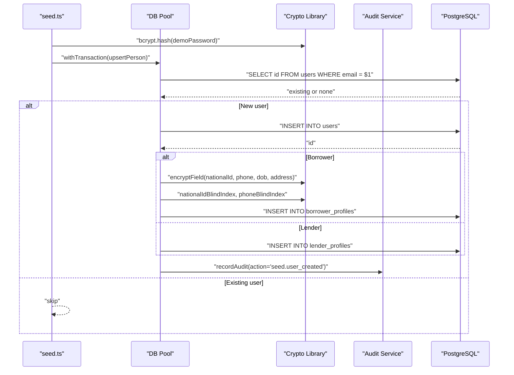

**Diagram sources**
- [seed.ts:75-137](file://backend/src/db/seed.ts#L75-L137)
- [crypto.ts:29-77](file://backend/src/lib/crypto.ts#L29-L77)
- [audit.service.ts:37-93](file://backend/src/modules/audit/audit.service.ts#L37-L93)

**Section sources**
- [seed.ts:1-157](file://backend/src/db/seed.ts#L1-L157)

### Canonical JSON Serialization and Blockchain Anchoring
- Canonical JSON recursively sorts object keys and serializes deterministically, preventing benign key reordering from breaking hashes.
- Transaction payloads are built as a versioned, pipe-separated string and then hashed with SHA-256.
- Hashes are converted to bytes32 format for Solidity contracts.
- The ledger client writes only hashes and timestamps to the blockchain; personal data never leaves the database.

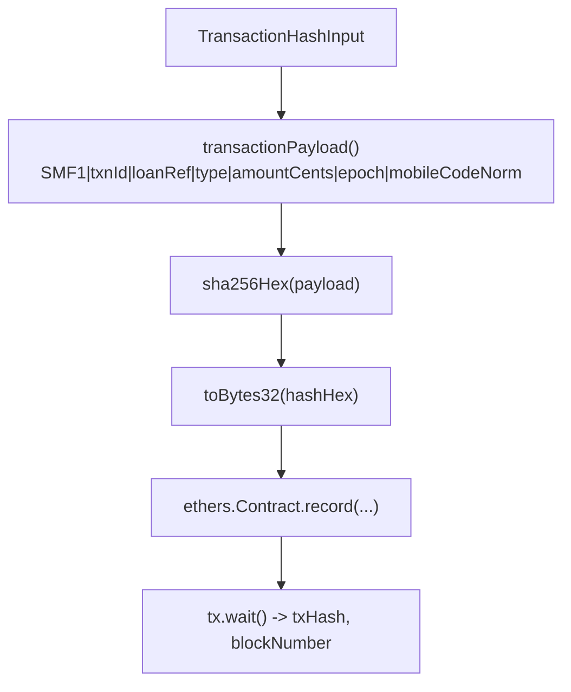

**Diagram sources**
- [canonical.ts:12-68](file://backend/src/lib/canonical.ts#L12-L68)
- [chain.client.ts:72-93](file://backend/src/modules/ledger/chain.client.ts#L72-L93)

**Section sources**
- [canonical.ts:1-117](file://backend/src/lib/canonical.ts#L1-L117)
- [chain.client.ts:1-152](file://backend/src/modules/ledger/chain.client.ts#L1-L152)

### Application Models and Database Schemas
- Identity and roles: `users` with role enum, status, login lockout fields, and lowercase email constraint.
- Borrower profiles: encrypted PII columns (`*_enc`) plus blind index columns (`*_bi`) for duplicate detection; consent flags stored as JSONB.
- Lender profiles: business settings and risk parameters.
- Loans: lifecycle states, guarantor PII encrypted, agreement document references and checksums.
- Installments: scheduled payments with partial payment tracking.
- Transactions: disbursements and repayments with mobile money normalization, fraud scores, and on-chain linkage fields.
- Credit scores: model outputs and explanations stored as JSONB.
- Fraud and audit: flags, alerts, append-only audit log with hash chaining, anchors, and integrity checks.

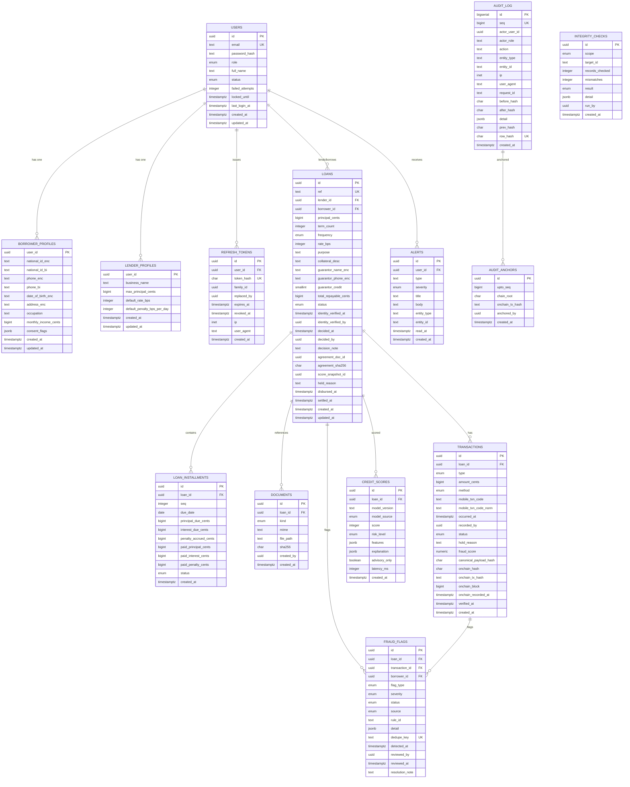

**Diagram sources**
- [001_core_auth.sql:5-95](file://backend/src/db/migrations/001_core_auth.sql#L5-L95)
- [002_loans.sql:5-100](file://backend/src/db/migrations/002_loans.sql#L5-L100)
- [003_transactions_scoring.sql:5-56](file://backend/src/db/migrations/003_transactions_scoring.sql#L5-L56)
- [004_fraud_audit.sql:5-136](file://backend/src/db/migrations/004_fraud_audit.sql#L5-L136)

**Section sources**
- [001_core_auth.sql:1-95](file://backend/src/db/migrations/001_core_auth.sql#L1-L95)
- [002_loans.sql:1-100](file://backend/src/db/migrations/002_loans.sql#L1-L100)
- [003_transactions_scoring.sql:1-56](file://backend/src/db/migrations/003_transactions_scoring.sql#L1-L56)
- [004_fraud_audit.sql:1-136](file://backend/src/db/migrations/004_fraud_audit.sql#L1-L136)

### Encrypted Field Storage and Blind Indexes
- PII such as national IDs, phone numbers, dates of birth, addresses, and guarantor details are stored as AES-256-GCM ciphertext blobs with a version prefix.
- Blind indexes use HMAC-SHA256 over normalized values to detect duplicates without exposing plaintext.
- Normalization ensures consistent indexing across formatting variations.
- API responses mask sensitive values after decryption.

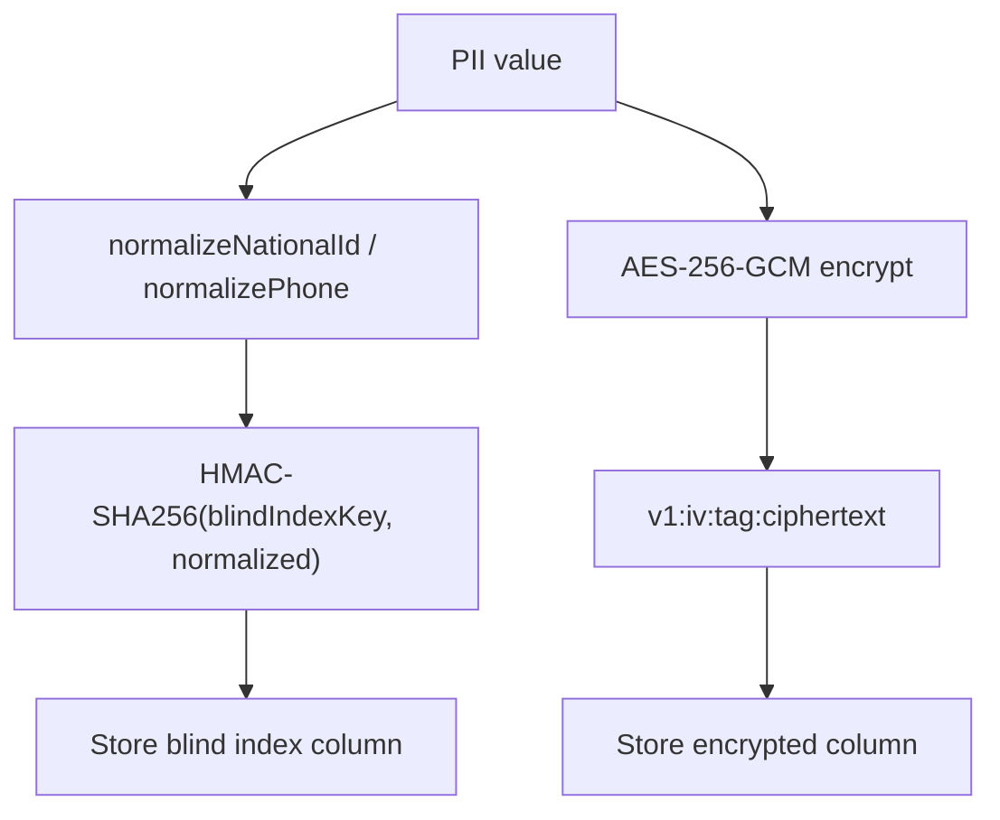

**Diagram sources**
- [crypto.ts:29-77](file://backend/src/lib/crypto.ts#L29-L77)
- [001_core_auth.sql:40-58](file://backend/src/db/migrations/001_core_auth.sql#L40-L58)

**Section sources**
- [crypto.ts:1-97](file://backend/src/lib/crypto.ts#L1-L97)
- [001_core_auth.sql:1-95](file://backend/src/db/migrations/001_core_auth.sql#L1-L95)
- [users.service.ts:19-59](file://backend/src/modules/users/users.service.ts#L19-L59)

### Data Consistency Patterns and Transaction Boundaries
- All domain writes go through `withTransaction`, ensuring atomicity and automatic rollback on exceptions.
- Audit logging uses an advisory lock to serialize writers and maintain a single linear chain.
- Refresh token rotation uses conditional updates to avoid race conditions and fork families.
- Schema constraints enforce business rules (e.g., non-negative amounts, distinct parties, mobile money codes required).

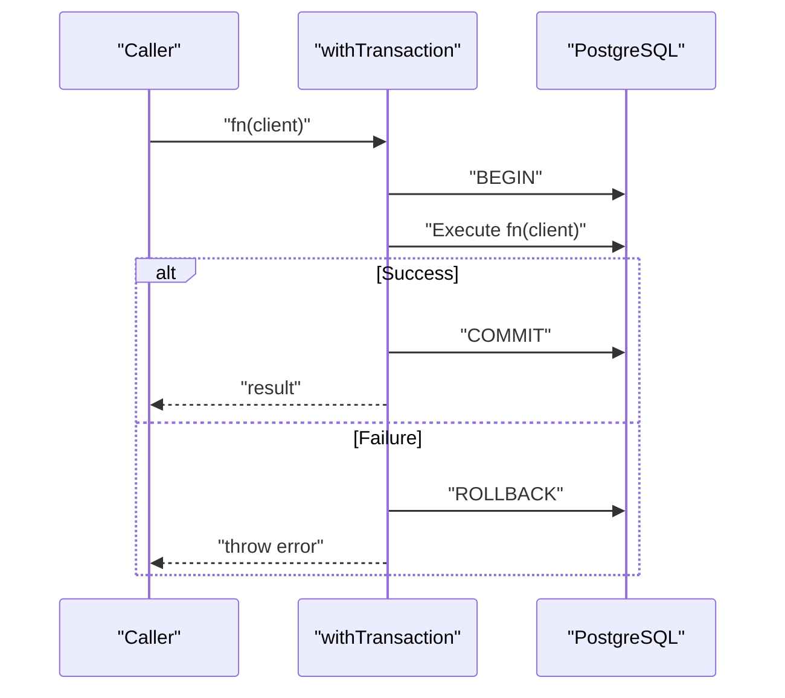

**Diagram sources**
- [pool.ts:43-57](file://backend/src/db/pool.ts#L43-L57)
- [audit.service.ts:37-93](file://backend/src/modules/audit/audit.service.ts#L37-L93)
- [token.service.ts:154-194](file://backend/src/modules/auth/token.service.ts#L154-L194)

**Section sources**
- [pool.ts:43-57](file://backend/src/db/pool.ts#L43-L57)
- [audit.service.ts:34-93](file://backend/src/modules/audit/audit.service.ts#L34-L93)
- [token.service.ts:154-194](file://backend/src/modules/auth/token.service.ts#L154-L194)

### Performance Optimization Strategies
- Connection pooling limits concurrent connections and sets timeouts to protect the database.
- Parameterized queries reduce parsing overhead and prevent injection.
- Type parsers convert database integers to JS numbers for efficient JSON serialization.
- Database indexes support common queries:
  - Borrower profile blind indexes for duplicate detection.
  - Loan and installment indexes for lender dashboards and repayment scheduling.
  - Transaction indexes for loan history and mobile code normalization lookups.
  - Audit log GIN index on JSONB detail for flexible querying.
- Enum types constrain values at the schema level, reducing validation overhead.

**Section sources**
- [pool.ts:9-25](file://backend/src/db/pool.ts#L9-L25)
- [001_core_auth.sql:57-58](file://backend/src/db/migrations/001_core_auth.sql#L57-L58)
- [002_loans.sql:58-82](file://backend/src/db/migrations/002_loans.sql#L58-L82)
- [003_transactions_scoring.sql:37-39](file://backend/src/db/migrations/003_transactions_scoring.sql#L37-L39)
- [004_fraud_audit.sql:88-91](file://backend/src/db/migrations/004_fraud_audit.sql#L88-L91)

## Dependency Analysis
The following diagram shows how modules depend on shared libraries and the database layer.

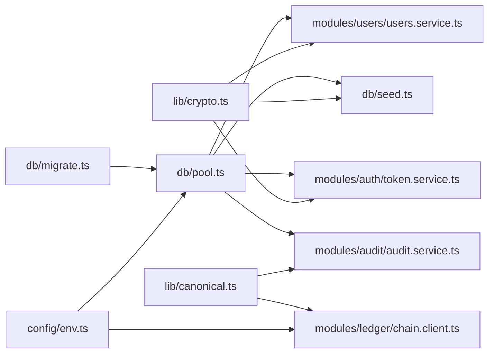

**Diagram sources**
- [env.ts:1-101](file://backend/src/config/env.ts#L1-L101)
- [pool.ts:1-62](file://backend/src/db/pool.ts#L1-L62)
- [crypto.ts:1-97](file://backend/src/lib/crypto.ts#L1-L97)
- [canonical.ts:1-117](file://backend/src/lib/canonical.ts#L1-L117)
- [chain.client.ts:1-152](file://backend/src/modules/ledger/chain.client.ts#L1-L152)
- [users.service.ts:1-60](file://backend/src/modules/users/users.service.ts#L1-L60)
- [audit.service.ts:1-191](file://backend/src/modules/audit/audit.service.ts#L1-L191)
- [token.service.ts:1-206](file://backend/src/modules/auth/token.service.ts#L1-L206)
- [migrate.ts:1-70](file://backend/src/db/migrate.ts#L1-L70)
- [seed.ts:1-157](file://backend/src/db/seed.ts#L1-L157)

**Section sources**
- [env.ts:1-101](file://backend/src/config/env.ts#L1-L101)
- [pool.ts:1-62](file://backend/src/db/pool.ts#L1-L62)
- [crypto.ts:1-97](file://backend/src/lib/crypto.ts#L1-L97)
- [canonical.ts:1-117](file://backend/src/lib/canonical.ts#L1-L117)
- [chain.client.ts:1-152](file://backend/src/modules/ledger/chain.client.ts#L1-L152)
- [users.service.ts:1-60](file://backend/src/modules/users/users.service.ts#L1-L60)
- [audit.service.ts:1-191](file://backend/src/modules/audit/audit.service.ts#L1-L191)
- [token.service.ts:1-206](file://backend/src/modules/auth/token.service.ts#L1-L206)
- [migrate.ts:1-70](file://backend/src/db/migrate.ts#L1-L70)
- [seed.ts:1-157](file://backend/src/db/seed.ts#L1-L157)

## Performance Considerations
- Keep the pool size aligned with expected concurrency; 10 connections is reasonable for moderate workloads.
- Prefer narrow SELECT projections to minimize payload sizes, especially when decrypting fields.
- Use blind indexes for equality searches on PII instead of scanning encrypted columns.
- Leverage existing indexes on loans, installments, transactions, and audit logs for dashboard and reporting queries.
- Avoid unnecessary JSON serialization of large objects; store structured metadata in JSONB where appropriate.
- Offload heavy computations (e.g., ML scoring) to external services while keeping results in `credit_scores`.

[No sources needed since this section provides general guidance]

## Data Lifecycle, Backup, and Integrity Verification

### Data Lifecycle Management
- User creation flows through seeded scripts or registration endpoints; passwords are hashed and sessions managed via refresh tokens.
- Borrower and lender profiles are created alongside users; PII is encrypted at rest.
- Loans progress through well-defined statuses; documents are linked with checksums.
- Transactions record financial movements and link to on-chain hashes.
- Fraud flags and alerts capture anomalies; audit log entries provide tamper-evident history.

**Section sources**
- [seed.ts:75-137](file://backend/src/db/seed.ts#L75-L137)
- [002_loans.sql:25-56](file://backend/src/db/migrations/002_loans.sql#L25-L56)
- [003_transactions_scoring.sql:11-35](file://backend/src/db/migrations/003_transactions_scoring.sql#L11-L35)
- [004_fraud_audit.sql:21-56](file://backend/src/db/migrations/004_fraud_audit.sql#L21-L56)

### Backup Considerations
- Back up both the database and off-chain artifacts (documents, reports) referenced by schemas.
- Ensure environment variables containing encryption keys and secrets are backed up securely; without them, encrypted fields cannot be decrypted.
- Validate backups by running integrity checks against the audit chain and verifying sample on-chain hashes.

[No sources needed since this section provides general guidance]

### Data Integrity Verification Mechanisms
- Audit chain verification recomputes every row hash and validates each `prev_hash` link, reporting mismatches and broken links.
- Advisory locking serializes audit writers to prevent chain forks.
- On-chain anchoring stores only hashes; discrepancies between database and chain indicate tampering or misrecording.
- Integrity checks table captures periodic validation results.

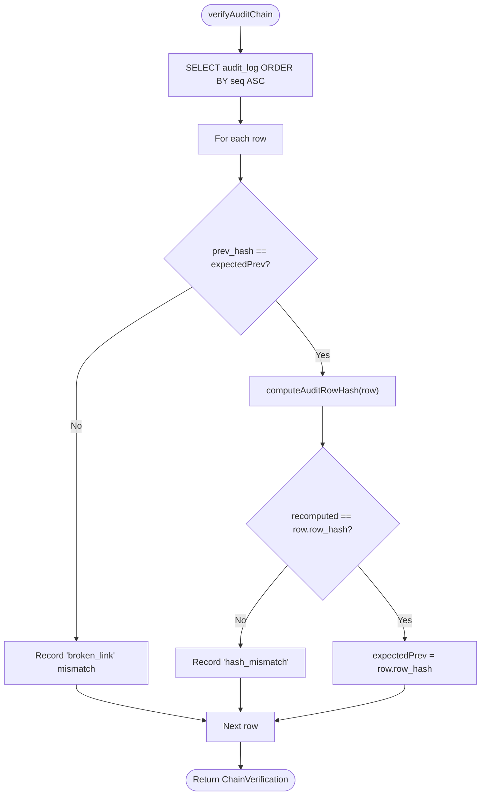

**Diagram sources**
- [audit.service.ts:142-190](file://backend/src/modules/audit/audit.service.ts#L142-L190)
- [canonical.ts:96-113](file://backend/src/lib/canonical.ts#L96-L113)

**Section sources**
- [audit.service.ts:120-191](file://backend/src/modules/audit/audit.service.ts#L120-L191)
- [canonical.ts:96-117](file://backend/src/lib/canonical.ts#L96-L117)
- [004_fraud_audit.sql:113-136](file://backend/src/db/migrations/004_fraud_audit.sql#L113-L136)

## Troubleshooting Guide
- Migration failures: check the specific migration file and ensure dependencies are satisfied; use reset mode cautiously as it drops the schema.
- Decryption errors: malformed ciphertext blobs will throw; verify encryption key configuration and blob format.
- Audit chain mismatches: run `verifyAuditChain` to identify broken links or hash mismatches; investigate direct DB edits or trigger issues.
- Blockchain anchoring unavailable: ensure `CHAIN_MODE` and `LEDGER_CONTRACT_ADDRESS` are set; private key must be configured for writing.
- Refresh token reuse: monitor audit events for reuse detection; revoke affected families if theft is suspected.

**Section sources**
- [migrate.ts:48-51](file://backend/src/db/migrate.ts#L48-L51)
- [crypto.ts:37-48](file://backend/src/lib/crypto.ts#L37-L48)
- [audit.service.ts:142-190](file://backend/src/modules/audit/audit.service.ts#L142-L190)
- [chain.client.ts:28-41](file://backend/src/modules/ledger/chain.client.ts#L28-L41)
- [token.service.ts:104-145](file://backend/src/modules/auth/token.service.ts#L104-L145)

## Conclusion
The data architecture combines strong security controls with clear, reviewable schema definitions. Encryption at rest and blind indexes protect PII while enabling necessary searches. Canonical serialization and on-chain anchoring provide verifiable integrity for financial events. The append-only, hash-chained audit log offers tamper evidence, and transaction boundaries ensure consistency. Operational practices around migrations, seeding, and integrity verification complete a robust, auditable data foundation suitable for a regulated financial application.

[No sources needed since this section summarizes without analyzing specific files]