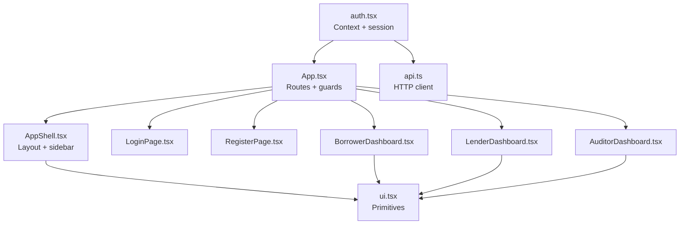
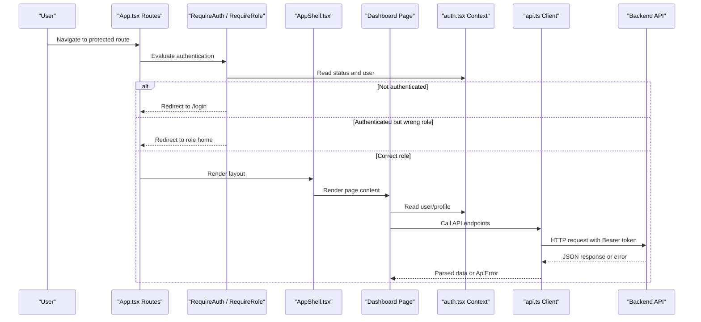
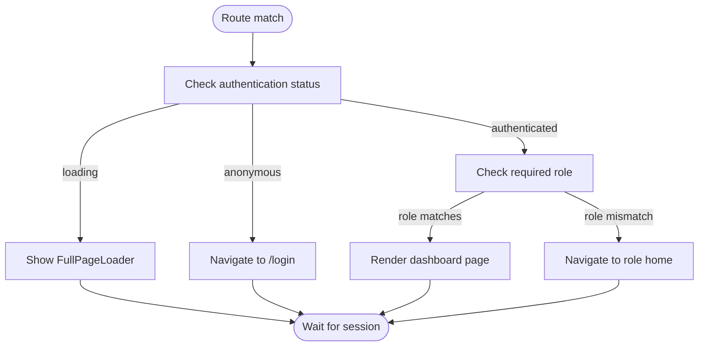
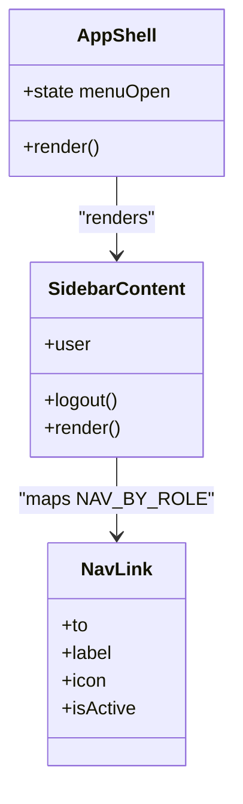
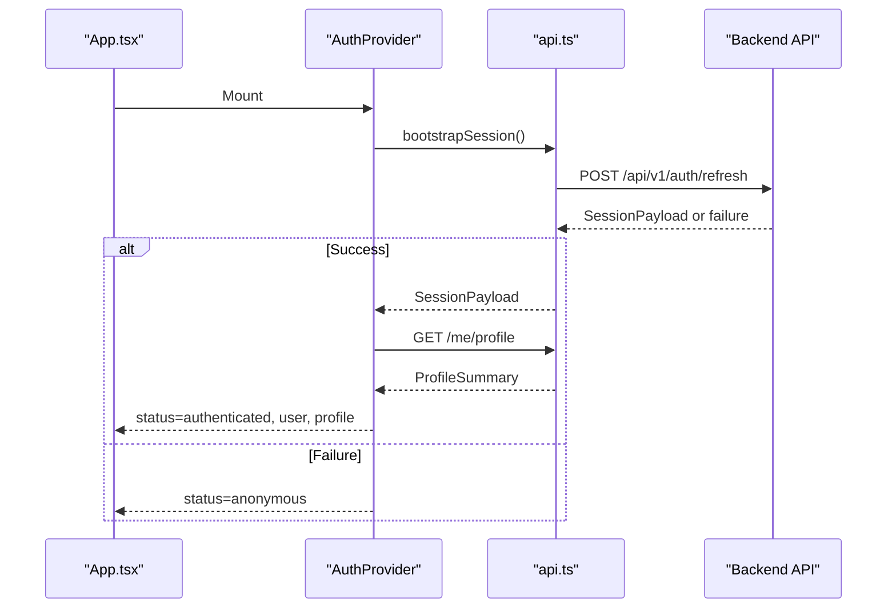
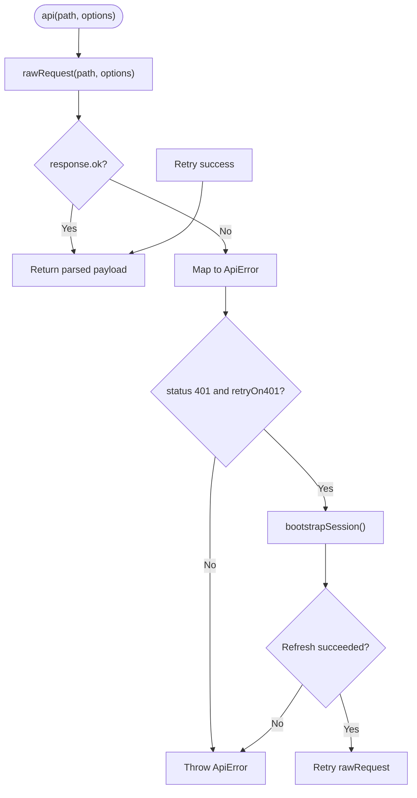
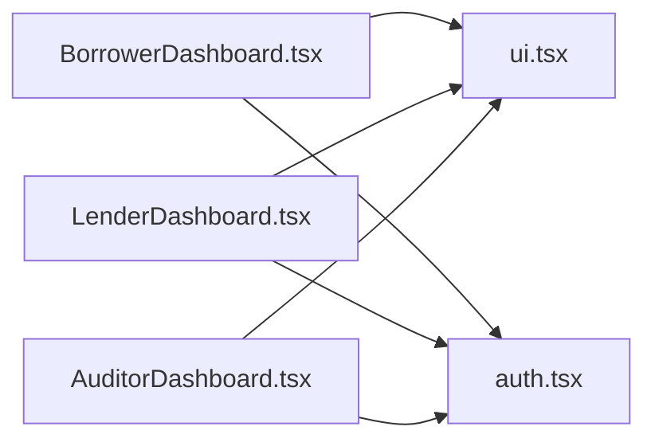
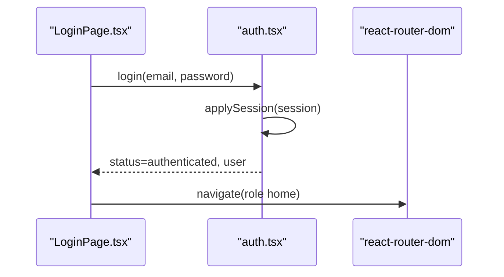
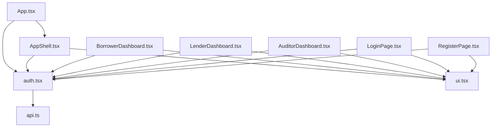

# Frontend Architecture

<cite>
**Referenced Files in This Document**
- [App.tsx](file://frontend/src/App.tsx)
- [AppShell.tsx](file://frontend/src/components/AppShell.tsx)
- [ui.tsx](file://frontend/src/components/ui.tsx)
- [api.ts](file://frontend/src/lib/api.ts)
- [auth.tsx](file://frontend/src/lib/auth.tsx)
- [BorrowerDashboard.tsx](file://frontend/src/pages/borrower/BorrowerDashboard.tsx)
- [LenderDashboard.tsx](file://frontend/src/pages/lender/LenderDashboard.tsx)
- [AuditorDashboard.tsx](file://frontend/src/pages/auditor/AuditorDashboard.tsx)
- [LoginPage.tsx](file://frontend/src/pages/auth/LoginPage.tsx)
- [RegisterPage.tsx](file://frontend/src/pages/auth/RegisterPage.tsx)
- [vite.config.ts](file://frontend/vite.config.ts)
- [tailwind.config.js](file://frontend/tailwind.config.js)
</cite>

## Table of Contents
1. [Introduction](#introduction)
2. [Project Structure](#project-structure)
3. [Core Components](#core-components)
4. [Architecture Overview](#architecture-overview)
5. [Detailed Component Analysis](#detailed-component-analysis)
6. [Dependency Analysis](#dependency-analysis)
7. [Performance Considerations](#performance-considerations)
8. [Troubleshooting Guide](#troubleshooting-guide)
9. [Conclusion](#conclusion)

## Introduction
This document explains the React frontend architecture for the SecureMicrofinance application. It focuses on the component hierarchy rooted at `AppShell`, the role-based routing for borrower, lender, and auditor dashboards, the API client with token refresh behavior, the authentication context provider, protected route components, state management patterns, UI composition, responsive design with Tailwind CSS, Vite build configuration, and how frontend components integrate with backend APIs.

The frontend is a single-page React application built with Vite, styled with Tailwind CSS, and organized around a small set of reusable UI primitives. Authentication uses an in-memory access token and an httpOnly refresh cookie, with automatic retry after silent session restoration. Routing enforces both authentication and role-based access control before rendering dashboard pages.

## Project Structure
The frontend source code is organized by feature area:

- `src/App.tsx` defines routes, protected wrappers, and redirects.
- `src/components/AppShell.tsx` provides the main layout shell and navigation.
- `src/components/ui.tsx` contains presentational primitives such as cards, badges, fields, alerts, and loaders.
- `src/lib/api.ts` implements the HTTP client, error class, token storage, and refresh flow.
- `src/lib/auth.tsx` exposes the authentication context, login/register/logout actions, profile loading, and role helpers.
- `src/pages/*` holds page components grouped by role and feature.
- `vite.config.ts` configures the dev server proxy and build output.
- `tailwind.config.js` extends Tailwind with brand colors, fonts, shadows, and content paths.

**Diagram sources**
- [App.tsx:39-204](file://frontend/src/App.tsx#L39-L204)
- [AppShell.tsx:116-174](file://frontend/src/components/AppShell.tsx#L116-L174)
- [ui.tsx:1-218](file://frontend/src/components/ui.tsx#L1-L218)
- [api.ts:1-144](file://frontend/src/lib/api.ts#L1-L144)
- [auth.tsx:47-136](file://frontend/src/lib/auth.tsx#L47-L136)

**Section sources**
- [App.tsx:1-205](file://frontend/src/App.tsx#L1-L205)
- [AppShell.tsx:1-194](file://frontend/src/components/AppShell.tsx#L1-L194)
- [ui.tsx:1-218](file://frontend/src/components/ui.tsx#L1-L218)
- [api.ts:1-144](file://frontend/src/lib/api.ts#L1-L144)
- [auth.tsx:1-161](file://frontend/src/lib/auth.tsx#L1-L161)

## Core Components
This section summarizes the most important architectural building blocks.

- **Routing and guards**: The root `App` component sets up public routes (`/login`, `/register`) and protected routes wrapped in `RequireAuth`. Role-specific routes are guarded by `RequireRole`, which redirects anonymous users to login and authenticated users with mismatched roles to their home dashboard.
- **Application shell**: `AppShell` renders a responsive sidebar on desktop and a mobile header with a slide-out drawer. Navigation items are derived from the authenticated user’s role.
- **Authentication context**: `AuthProvider` initializes session state, performs a silent refresh using the httpOnly cookie, loads the user profile, and exposes login, register, logout, and profile refresh functions.
- **API client**: The client wraps `fetch`, attaches the in-memory access token, throws typed `ApiError` instances, retries once after a successful token refresh on 401, and shares one in-flight refresh request.
- **UI primitives**: Presentational components like `Card`, `StatCard`, `Badge`, `Field`, `TextInput`, `Alert`, `Spinner`, and `FullPageLoader` keep pages readable and consistent.

Key responsibilities:
- `App.tsx`: Route definitions, redirect logic, and role guards.
- `AppShell.tsx`: Layout, responsive navigation, and user menu.
- `auth.tsx`: Session lifecycle, profile loading, and role helpers.
- `api.ts`: Token handling, error mapping, and refresh coordination.
- `ui.tsx`: Reusable UI building blocks.

**Section sources**
- [App.tsx:15-37](file://frontend/src/App.tsx#L15-L37)
- [AppShell.tsx:7-60](file://frontend/src/components/AppShell.tsx#L7-L60)
- [auth.tsx:47-136](file://frontend/src/lib/auth.tsx#L47-L136)
- [api.ts:17-94](file://frontend/src/lib/api.ts#L17-L94)
- [ui.tsx:8-195](file://frontend/src/components/ui.tsx#L8-L195)

## Architecture Overview
The frontend follows a layered approach:

- Presentation layer: Pages and UI primitives render data provided by the authentication context and local component state.
- State layer: `AuthProvider` owns session status, user object, and profile summary.
- Data layer: `api.ts` handles HTTP requests, token injection, error normalization, and token refresh.
- Routing layer: `react-router-dom` manages navigation, while custom guards enforce authentication and role-based access.

**Diagram sources**
- [App.tsx:15-37](file://frontend/src/App.tsx#L15-L37)
- [App.tsx:46-199](file://frontend/src/App.tsx#L46-L199)
- [AppShell.tsx:116-174](file://frontend/src/components/AppShell.tsx#L116-L174)
- [auth.tsx:47-136](file://frontend/src/lib/auth.tsx#L47-L136)
- [api.ts:50-94](file://frontend/src/lib/api.ts#L50-L94)

## Detailed Component Analysis

### Application Root and Routing
The root component defines:
- Public routes for login and registration.
- A wrapper that requires authentication for all app-shell routes.
- Role-scoped routes for borrower, lender, and auditor dashboards.
- Redirects for unknown routes.

Protected route behavior:
- `RequireAuth` shows a full-page loader while session status is loading, redirects anonymous users to login, and otherwise renders children inside `AppShell`.
- `RequireRole` checks the current user’s role and redirects to the appropriate home route if there is a mismatch.
- `RootRedirect` sends anonymous users to login and authenticated users to their role home.

**Diagram sources**
- [App.tsx:15-37](file://frontend/src/App.tsx#L15-L37)
- [App.tsx:46-199](file://frontend/src/App.tsx#L46-L199)

**Section sources**
- [App.tsx:15-37](file://frontend/src/App.tsx#L15-L37)
- [App.tsx:39-204](file://frontend/src/App.tsx#L39-L204)

### AppShell Layout and Responsive Navigation
`AppShell` provides:
- A fixed desktop sidebar with role-based navigation links.
- A sticky mobile header with a hamburger toggle.
- A mobile drawer overlay that closes when navigation changes.
- An outlet area where role-specific pages render.

Navigation is driven by `NAV_BY_ROLE`, which maps each role to its allowed destinations. The sidebar also displays the user’s initials, full name, role label, and a sign-out action.

**Diagram sources**
- [AppShell.tsx:41-60](file://frontend/src/components/AppShell.tsx#L41-L60)
- [AppShell.tsx:62-114](file://frontend/src/components/AppShell.tsx#L62-L114)
- [AppShell.tsx:116-174](file://frontend/src/components/AppShell.tsx#L116-L174)

**Section sources**
- [AppShell.tsx:7-60](file://frontend/src/components/AppShell.tsx#L7-L60)
- [AppShell.tsx:116-174](file://frontend/src/components/AppShell.tsx#L116-L174)

### Authentication Context Provider
`AuthProvider` manages:
- Session status: `loading`, `authenticated`, or `anonymous`.
- Current user object and profile summary.
- Silent session bootstrap using the refresh endpoint.
- Login, register, logout, and profile refresh operations.
- Access token storage in memory only.

On mount, it attempts a silent refresh. If successful, it sets the user and status to authenticated and loads the profile; otherwise, it marks the user as anonymous. Login and register apply the returned session, while logout clears in-memory state and resets status.

**Diagram sources**
- [auth.tsx:47-82](file://frontend/src/lib/auth.tsx#L47-L82)
- [api.ts:122-143](file://frontend/src/lib/api.ts#L122-L143)

**Section sources**
- [auth.tsx:19-43](file://frontend/src/lib/auth.tsx#L19-L43)
- [auth.tsx:47-136](file://frontend/src/lib/auth.tsx#L47-L136)
- [auth.tsx:144-160](file://frontend/src/lib/auth.tsx#L144-L160)

### API Client and Error Handling
The API client:
- Stores the access token in module-level memory.
- Adds `Authorization: Bearer <token>` when available.
- Uses relative `/api/v1` paths so the Vite dev proxy can forward requests to the backend.
- Throws `ApiError` with status, code, message, and optional details.
- Retries once after refreshing the access token when receiving a 401, except for auth endpoints.
- Shares one in-flight refresh request to avoid concurrent token rotation.

**Diagram sources**
- [api.ts:50-94](file://frontend/src/lib/api.ts#L50-L94)
- [api.ts:117-143](file://frontend/src/lib/api.ts#L117-L143)

**Section sources**
- [api.ts:1-144](file://frontend/src/lib/api.ts#L1-L144)

### Protected Route Components
Two guard components protect routes:

- `RequireAuth`: Shows a loader during session initialization, redirects unauthenticated users to login, and allows authenticated users to proceed.
- `RequireRole`: Ensures the current user has the required role; otherwise, it redirects to login or the user’s role home.

These components compose cleanly with React Router and keep route definitions declarative.

**Section sources**
- [App.tsx:15-30](file://frontend/src/App.tsx#L15-L30)

### Dashboard Pages
Each dashboard composes UI primitives and reads user data from the authentication context.

- **BorrowerDashboard**: Displays profile completeness, income, active loans, verification checklist, and security guarantees.
- **LenderDashboard**: Shows default rate, maximum principal, fraud flags, platform capabilities, and controls.
- **AuditorDashboard**: Reads a health endpoint directly via fetch, shows service status, ledger mode, and audit chain information.

**Diagram sources**
- [BorrowerDashboard.tsx:1-76](file://frontend/src/pages/borrower/BorrowerDashboard.tsx#L1-L76)
- [LenderDashboard.tsx:1-70](file://frontend/src/pages/lender/LenderDashboard.tsx#L1-L70)
- [AuditorDashboard.tsx:1-85](file://frontend/src/pages/auditor/AuditorDashboard.tsx#L1-L85)
- [ui.tsx:8-195](file://frontend/src/components/ui.tsx#L8-L195)
- [auth.tsx:47-136](file://frontend/src/lib/auth.tsx#L47-L136)

**Section sources**
- [BorrowerDashboard.tsx:1-76](file://frontend/src/pages/borrower/BorrowerDashboard.tsx#L1-L76)
- [LenderDashboard.tsx:1-70](file://frontend/src/pages/lender/LenderDashboard.tsx#L1-L70)
- [AuditorDashboard.tsx:1-85](file://frontend/src/pages/auditor/AuditorDashboard.tsx#L1-L85)

### Authentication Pages
Login and registration pages use `AuthLayout` from `AppShell`, form primitives from `ui.tsx`, and the authentication context for submission and redirection.

- **LoginPage**: Submits credentials through `auth.login`, navigates to the appropriate role route, and displays field-level errors.
- **RegisterPage**: Collects role, personal details, optional business name, password confirmation, submits through `auth.register`, and navigates accordingly.

**Diagram sources**
- [LoginPage.tsx:14-45](file://frontend/src/pages/auth/LoginPage.tsx#L14-L45)
- [auth.tsx:84-103](file://frontend/src/lib/auth.tsx#L84-L103)

**Section sources**
- [LoginPage.tsx:1-117](file://frontend/src/pages/auth/LoginPage.tsx#L1-L117)
- [RegisterPage.tsx:1-165](file://frontend/src/pages/auth/RegisterPage.tsx#L1-L165)

### UI Component Library Usage
The UI library centralizes styling and improves readability:

- `PageHeader` standardizes titles, subtitles, and action buttons.
- `Card` groups related content with optional headers and actions.
- `StatCard` presents metrics with tone variants.
- `Badge` and `VerifiedBadge` communicate status and on-chain verification.
- `Field`, `TextInput`, and `Select` provide accessible form inputs.
- `Alert` communicates danger, warning, or informational messages.
- `EmptyState`, `Spinner`, and `FullPageLoader` handle empty and loading states.
- `LogoMark` and `ShieldIcon` provide consistent branding and icons.

Pages compose these primitives instead of scattering Tailwind classes, keeping JSX focused on business presentation.

**Section sources**
- [ui.tsx:8-195](file://frontend/src/components/ui.tsx#L8-L195)

## Dependency Analysis
The following diagram shows how core modules depend on each other:

**Diagram sources**
- [App.tsx:1-205](file://frontend/src/App.tsx#L1-L205)
- [AppShell.tsx:1-194](file://frontend/src/components/AppShell.tsx#L1-L194)
- [ui.tsx:1-218](file://frontend/src/components/ui.tsx#L1-L218)
- [api.ts:1-144](file://frontend/src/lib/api.ts#L1-L144)
- [auth.tsx:1-161](file://frontend/src/lib/auth.tsx#L1-L161)
- [BorrowerDashboard.tsx:1-76](file://frontend/src/pages/borrower/BorrowerDashboard.tsx#L1-L76)
- [LenderDashboard.tsx:1-70](file://frontend/src/pages/lender/LenderDashboard.tsx#L1-L70)
- [AuditorDashboard.tsx:1-85](file://frontend/src/pages/auditor/AuditorDashboard.tsx#L1-L85)
- [LoginPage.tsx:1-117](file://frontend/src/pages/auth/LoginPage.tsx#L1-L117)
- [RegisterPage.tsx:1-165](file://frontend/src/pages/auth/RegisterPage.tsx#L1-L165)

**Section sources**
- [App.tsx:1-205](file://frontend/src/App.tsx#L1-L205)
- [auth.tsx:1-161](file://frontend/src/lib/auth.tsx#L1-L161)
- [api.ts:1-144](file://frontend/src/lib/api.ts#L1-L144)

## Performance Considerations
- **Token refresh deduplication**: The API client shares one in-flight refresh request, preventing multiple concurrent rotations that could cause token reuse issues.
- **Minimal credential exposure**: The access token is stored only in memory, reducing XSS risk compared to localStorage.
- **Profile loading isolation**: Missing or failed profile data does not block the app; pages gracefully show hints when profile fields are absent.
- **Responsive layout**: Desktop sidebar and mobile drawer reduce layout complexity and avoid heavy conditional rendering.
- **Build configuration**: Development uses a proxy to a single origin, simplifying cookie handling; production builds disable sourcemaps for smaller bundles.

[No sources needed since this section provides general guidance]

## Troubleshooting Guide
Common issues and resolutions:

- **401 Unauthorized after initial load**: The client automatically attempts a silent refresh. If the refresh fails, the user becomes anonymous and should be redirected to login.
- **Multiple 401s during page load**: Only one refresh request runs at a time; subsequent calls share the same promise until completion.
- **Profile missing**: The profile fetch is best-effort. Pages should display partial data and prompts to complete the profile.
- **Dev server cannot reach backend**: Ensure the Vite dev server proxies `/api` to the backend target and that the backend is running on the configured port.
- **Styling not applied**: Verify Tailwind content paths include HTML and TSX files, and that custom brand colors and fonts are extended correctly.

**Section sources**
- [api.ts:81-94](file://frontend/src/lib/api.ts#L81-L94)
- [api.ts:117-143](file://frontend/src/lib/api.ts#L117-L143)
- [auth.tsx:52-60](file://frontend/src/lib/auth.tsx#L52-L60)
- [vite.config.ts:4-18](file://frontend/vite.config.ts#L4-L18)
- [tailwind.config.js:1-36](file://frontend/tailwind.config.js#L1-L36)

## Conclusion
The frontend architecture centers on a clear separation between routing, layout, authentication, API communication, and presentation. `AppShell` provides a responsive, role-aware layout, while `App.tsx` enforces authentication and role-based access. `AuthProvider` manages session state and profile data, and `api.ts` ensures secure, resilient communication with the backend. The UI library promotes consistency and readability across dashboards. Together, these pieces create a maintainable, secure, and user-friendly microfinance application interface.

[No sources needed since this section summarizes without analyzing specific files]