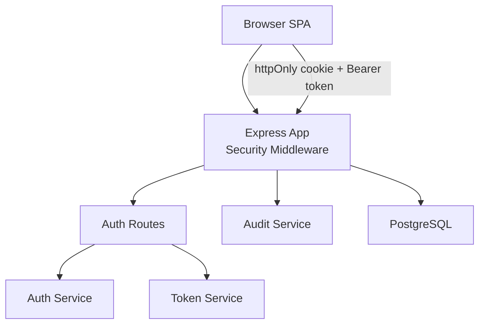
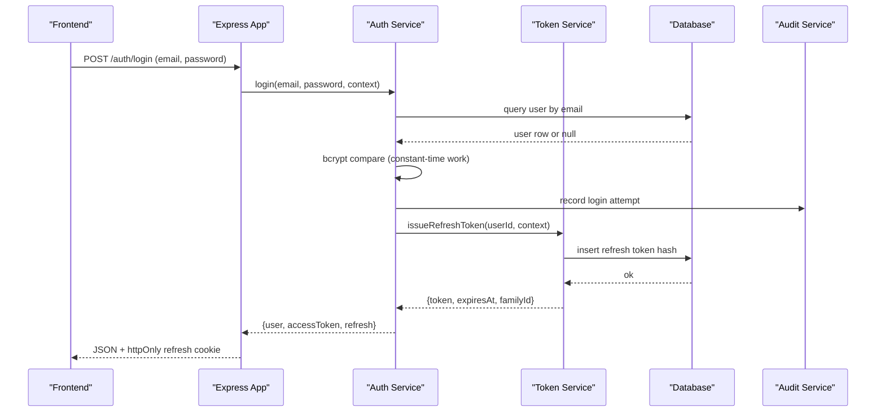
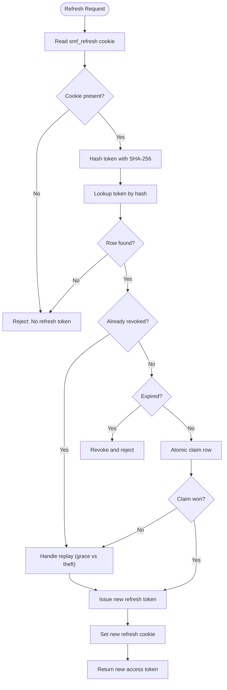
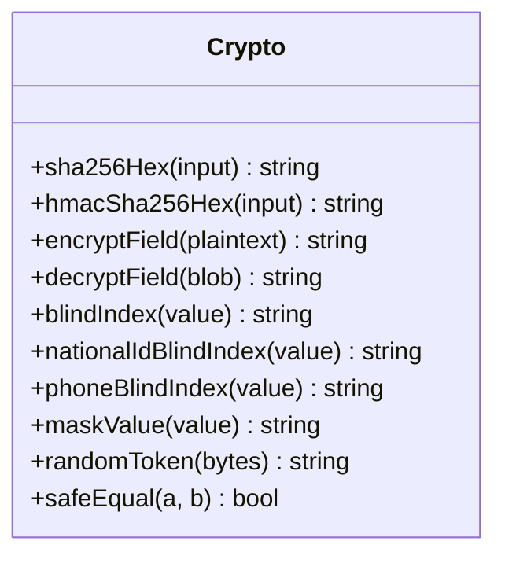
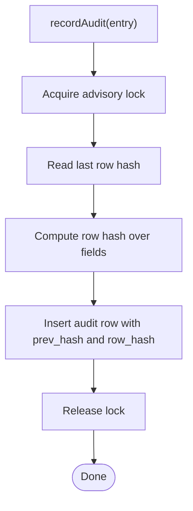
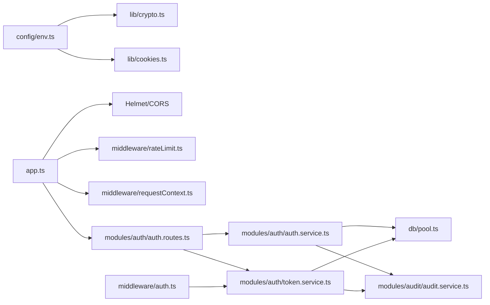

# Security Architecture

<cite>
**Referenced Files in This Document**
- [app.ts](file://backend/src/app.ts)
- [server.ts](file://backend/src/server.ts)
- [env.ts](file://backend/src/config/env.ts)
- [crypto.ts](file://backend/src/lib/crypto.ts)
- [cookies.ts](file://backend/src/lib/cookies.ts)
- [errors.ts](file://backend/src/lib/errors.ts)
- [canonical.ts](file://backend/src/lib/canonical.ts)
- [auth.ts](file://backend/src/middleware/auth.ts)
- [rateLimit.ts](file://backend/src/middleware/rateLimit.ts)
- [requestContext.ts](file://backend/src/middleware/requestContext.ts)
- [validate.ts](file://backend/src/middleware/validate.ts)
- [auth.routes.ts](file://backend/src/modules/auth/auth.routes.ts)
- [auth.service.ts](file://backend/src/modules/auth/auth.service.ts)
- [token.service.ts](file://backend/src/modules/auth/token.service.ts)
- [audit.service.ts](file://backend/src/modules/audit/audit.service.ts)
- [express.d.ts](file://backend/src/types/express.d.ts)
- [api.ts](file://frontend/src/lib/api.ts)
- [auth.tsx](file://frontend/src/lib/auth.tsx)
</cite>

## Table of Contents
1. [Introduction](#introduction)
2. [Project Structure](#project-structure)
3. [Core Components](#core-components)
4. [Architecture Overview](#architecture-overview)
5. [Detailed Component Analysis](#detailed-component-analysis)
6. [Dependency Analysis](#dependency-analysis)
7. [Performance Considerations](#performance-considerations)
8. [Troubleshooting Guide](#troubleshooting-guide)
9. [Conclusion](#conclusion)

## Introduction
This document describes the multi-layered security architecture for the secure microfinance application. It covers authentication and session management, cryptographic utilities, input validation and output sanitization, CORS and rate limiting, request context tracking, security headers, and secure frontend-to-backend communication patterns. The design emphasizes defense-in-depth: short-lived access tokens, rotating refresh tokens stored securely, strict cookie policies, bcrypt password hashing, AES-256-GCM field encryption, HMAC blind indexes, SHA-256 audit chain integrity, and robust middleware controls.

## Project Structure
The backend is an Express application with layered modules:
- Application bootstrap and security middleware are configured at the app level.
- Authentication routes delegate to services that implement business and security logic.
- Shared cryptography, cookies, errors, and validation utilities are reused across modules.
- An append-only, hash-chained audit trail records security-relevant events.
- The frontend manages session state without storing sensitive tokens in browser storage.

**Diagram sources**
- [app.ts:24-94](file://backend/src/app.ts#L24-L94)
- [auth.routes.ts:51-120](file://backend/src/modules/auth/auth.routes.ts#L51-L120)
- [auth.service.ts:61-197](file://backend/src/modules/auth/auth.service.ts#L61-L197)
- [token.service.ts:28-205](file://backend/src/modules/auth/token.service.ts#L28-L205)
- [audit.service.ts:37-94](file://backend/src/modules/audit/audit.service.ts#L37-L94)

**Section sources**
- [app.ts:17-94](file://backend/src/app.ts#L17-L94)
- [server.ts:1-26](file://backend/src/server.ts#L1-L26)

## Core Components
- JWT access tokens: short-lived, signed with a dedicated secret, validated by middleware, and never persisted in the browser.
- Refresh tokens: opaque random values stored in httpOnly, SameSite=Strict cookies; server-side only hashed and rotated on use with replay detection.
- Passwords: hashed with bcrypt using a configurable cost factor; login attempts are rate-limited and accounts can be temporarily locked.
- Cryptographic utilities: AES-256-GCM for field-level encryption, HMAC-SHA256 for blind indexes, SHA-256 for hashes, timing-safe comparison for tokens.
- Input validation: Zod schemas validate and sanitize all inputs, stripping unknown keys to prevent mass-assignment.
- Output sanitization: masked representations for sensitive fields in responses.
- CORS: allowlist-based origins with credentials enabled for same-origin flows.
- Rate limiting: global, auth-specific, and write-specific limits.
- Request context: correlation IDs, client IP, and user agent propagated to audit logs.
- Security headers: Helmet configured with safe defaults and explicit referrer policy.
- Session management: silent refresh via httpOnly cookie; logout revokes refresh tokens and clears cookies.
- Secure frontend patterns: access token kept in memory; bootstrap session uses httpOnly cookie; no localStorage/sessionStorage for secrets.

**Section sources**
- [env.ts:24-105](file://backend/src/config/env.ts#L24-L105)
- [crypto.ts:1-97](file://backend/src/lib/crypto.ts#L1-L97)
- [cookies.ts:1-29](file://backend/src/lib/cookies.ts#L1-L29)
- [validate.ts:1-40](file://backend/src/middleware/validate.ts#L1-L40)
- [rateLimit.ts:1-51](file://backend/src/middleware/rateLimit.ts#L1-L51)
- [requestContext.ts:1-29](file://backend/src/middleware/requestContext.ts#L1-L29)
- [auth.ts:1-69](file://backend/src/middleware/auth.ts#L1-L69)
- [auth.routes.ts:1-121](file://backend/src/modules/auth/auth.routes.ts#L1-L121)
- [auth.service.ts:1-262](file://backend/src/modules/auth/auth.service.ts#L1-L262)
- [token.service.ts:1-206](file://backend/src/modules/auth/token.service.ts#L1-L206)
- [audit.service.ts:1-191](file://backend/src/modules/audit/audit.service.ts#L1-L191)
- [auth.tsx:1-161](file://frontend/src/lib/auth.tsx#L1-L161)

## Architecture Overview
The system enforces security through layered controls:
- Transport and headers: HTTPS enforced by deployment; Helmet sets safe headers; CORS restricts origins.
- Authentication: Bearer JWT access tokens plus rotating refresh tokens in secure cookies.
- Authorization: Role-based checks and auditor read-only enforcement.
- Data protection: bcrypt for passwords, AES-256-GCM for PII at rest, HMAC blind indexes for duplicate detection, SHA-256 for audit integrity.
- Resilience: rate limiting, account lockout, graceful concurrent refresh handling.
- Observability: per-request correlation IDs and comprehensive audit logging.

**Diagram sources**
- [auth.routes.ts:64-73](file://backend/src/modules/auth/auth.routes.ts#L64-L73)
- [auth.service.ts:114-197](file://backend/src/modules/auth/auth.service.ts#L114-L197)
- [token.service.ts:64-76](file://backend/src/modules/auth/token.service.ts#L64-L76)
- [audit.service.ts:37-94](file://backend/src/modules/audit/audit.service.ts#L37-L94)

## Detailed Component Analysis

### JWT Authentication Flow with Rotating Refresh Tokens
- Access tokens:
  - Signed with a dedicated secret, issuer, and audience.
  - Short TTL configured via environment variables.
  - Verified by middleware; payload validated against a strict schema.
  - Principal reloaded from database to enforce immediate suspension.
- Refresh tokens:
  - Opaque random tokens stored in httpOnly, SameSite=Strict cookies scoped to auth endpoints.
  - Server stores only SHA-256 hashes; rotation is atomic and race-safe.
  - Replay detection treats benign double-submit within a grace window differently from theft; theft revokes the entire token family.
- Logout:
  - Revokes the provided refresh token and clears the cookie.
  - All sessions revoked on password change.

**Diagram sources**
- [auth.routes.ts:75-96](file://backend/src/modules/auth/auth.routes.ts#L75-L96)
- [token.service.ts:154-195](file://backend/src/modules/auth/token.service.ts#L154-L195)
- [cookies.ts:11-19](file://backend/src/lib/cookies.ts#L11-L19)

**Section sources**
- [token.service.ts:10-205](file://backend/src/modules/auth/token.service.ts#L10-L205)
- [auth.routes.ts:75-103](file://backend/src/modules/auth/auth.routes.ts#L75-L103)
- [auth.service.ts:245-261](file://backend/src/modules/auth/auth.service.ts#L245-L261)
- [cookies.ts:1-29](file://backend/src/lib/cookies.ts#L1-L29)

### Secure Cookie Handling
- Refresh token cookie:
  - httpOnly to prevent XSS access.
  - SameSite=Strict to mitigate CSRF for cookie-based flows.
  - Path-scoped to auth endpoints.
  - secure flag set in production to require HTTPS.
- Clearing cookies on logout and password change.

**Section sources**
- [cookies.ts:1-29](file://backend/src/lib/cookies.ts#L1-L29)
- [auth.routes.ts:98-103](file://backend/src/modules/auth/auth.routes.ts#L98-L103)
- [auth.routes.ts:110-120](file://backend/src/modules/auth/auth.routes.ts#L110-L120)

### Password Encryption with bcrypt
- Registration and login use bcrypt with a configurable cost factor.
- Login implements constant-ish work even when the user does not exist to avoid enumeration.
- Failed attempts increment counters and may lock the account temporarily.
- Successful login resets failure counters and last login timestamp.
- Password changes revoke all sessions and require re-authentication.

**Section sources**
- [auth.service.ts:61-112](file://backend/src/modules/auth/auth.service.ts#L61-L112)
- [auth.service.ts:114-197](file://backend/src/modules/auth/auth.service.ts#L114-L197)
- [auth.service.ts:200-243](file://backend/src/modules/auth/auth.service.ts#L200-L243)
- [env.ts:37-46](file://backend/src/config/env.ts#L37-L46)

### Cryptographic Utilities
- AES-256-GCM encryption for field-level data at rest with versioned ciphertext format including IV and tag.
- HMAC-SHA256 blind indexes for duplicate detection without plaintext exposure.
- SHA-256 hashing for tokens and audit entries.
- Timing-safe comparison for opaque tokens/hashes.
- Random token generation for refresh tokens.

**Diagram sources**
- [crypto.ts:21-97](file://backend/src/lib/crypto.ts#L21-L97)

**Section sources**
- [crypto.ts:1-97](file://backend/src/lib/crypto.ts#L1-L97)

### Input Validation Strategy and Output Sanitization
- Zod schemas validate and coerce inputs; unknown keys are stripped to defend against mass-assignment.
- Shared primitives for UUIDs, money amounts, and pagination ensure consistent validation.
- Sensitive outputs are masked before being sent to clients.

**Section sources**
- [validate.ts:1-40](file://backend/src/middleware/validate.ts#L1-L40)
- [crypto.ts:79-84](file://backend/src/lib/crypto.ts#L79-L84)

### Protection Against Common Web Vulnerabilities
- CORS allowlist prevents unauthorized cross-origin requests while allowing credentials for trusted origins.
- Helmet configures safe headers and disables risky defaults where necessary.
- Rate limiting protects against brute force, credential stuffing, and abuse.
- Account lockout after repeated failed logins mitigates offline dictionary attacks.
- Auditor role enforced as read-only to reduce risk of accidental or malicious writes.

**Section sources**
- [app.ts:31-59](file://backend/src/app.ts#L31-L59)
- [rateLimit.ts:14-47](file://backend/src/middleware/rateLimit.ts#L14-L47)
- [auth.ts:43-68](file://backend/src/middleware/auth.ts#L43-L68)

### CORS Configuration
- Allowed origins include the configured web origin and local development URLs.
- Credentials enabled for cookie-based flows.
- Exposed headers include correlation ID for debugging.

**Section sources**
- [app.ts:40-59](file://backend/src/app.ts#L40-L59)

### Rate Limiting Implementation
- Global limiter throttles overall traffic.
- Auth limiter uses IP + email bucket to slow brute-force attempts.
- Write limiter constrains mutation operations per user or IP.
- Limits are bypassed in tests for deterministic behavior.

**Section sources**
- [rateLimit.ts:1-51](file://backend/src/middleware/rateLimit.ts#L1-L51)

### Request Context Tracking
- Every request receives a unique correlation ID returned in X-Request-Id.
- Client IP and user agent are captured safely behind proxies.
- Context is propagated to audit logs for end-to-end traceability.

**Section sources**
- [requestContext.ts:1-29](file://backend/src/middleware/requestContext.ts#L1-L29)

### Security Headers Configuration
- Helmet applied with safe defaults; inline script restrictions disabled only for OpenAPI docs.
- Referrer policy set to no-referrer.
- Powered-by header disabled.

**Section sources**
- [app.ts:27-38](file://backend/src/app.ts#L27-L38)

### Session Management
- Silent refresh flow restores sessions using httpOnly cookies without exposing secrets to JavaScript.
- Frontend maintains access token in memory only.
- Logout revokes refresh tokens and clears cookies.

**Section sources**
- [auth.tsx:62-82](file://frontend/src/lib/auth.tsx#L62-L82)
- [auth.tsx:119-128](file://frontend/src/lib/auth.tsx#L119-L128)
- [auth.routes.ts:98-103](file://backend/src/modules/auth/auth.routes.ts#L98-L103)

### Secure Communication Patterns Between Frontend and Backend
- Frontend calls API helpers that send Authorization headers with access tokens and rely on httpOnly cookies for refresh.
- Bootstrap session performs a silent refresh if possible; otherwise the user remains anonymous.
- Errors are surfaced consistently without leaking internal details.

**Section sources**
- [auth.tsx:1-161](file://frontend/src/lib/auth.tsx#L1-L161)
- [api.ts](file://frontend/src/lib/api.ts)

### Audit Trail Integrity with SHA-256
- Append-only audit log with advisory locks to serialize writers.
- Each row includes a computed hash based on sequence, previous hash, actor metadata, action, entity, detail, IP, and timestamp.
- Chain verification recomputes hashes and validates prev_hash links to detect tampering.

**Diagram sources**
- [audit.service.ts:37-94](file://backend/src/modules/audit/audit.service.ts#L37-L94)

**Section sources**
- [audit.service.ts:1-191](file://backend/src/modules/audit/audit.service.ts#L1-L191)
- [canonical.ts](file://backend/src/lib/canonical.ts)

## Dependency Analysis
The following diagram shows key dependencies among security-critical components.

**Diagram sources**
- [env.ts:98-105](file://backend/src/config/env.ts#L98-L105)
- [crypto.ts:1-97](file://backend/src/lib/crypto.ts#L1-L97)
- [cookies.ts:1-29](file://backend/src/lib/cookies.ts#L1-L29)
- [app.ts:24-94](file://backend/src/app.ts#L24-L94)
- [auth.routes.ts:1-121](file://backend/src/modules/auth/auth.routes.ts#L1-L121)
- [auth.service.ts:1-262](file://backend/src/modules/auth/auth.service.ts#L1-L262)
- [token.service.ts:1-206](file://backend/src/modules/auth/token.service.ts#L1-L206)
- [audit.service.ts:1-191](file://backend/src/modules/audit/audit.service.ts#L1-L191)
- [auth.ts:1-69](file://backend/src/middleware/auth.ts#L1-L69)

**Section sources**
- [app.ts:24-94](file://backend/src/app.ts#L24-L94)
- [auth.routes.ts:1-121](file://backend/src/modules/auth/auth.routes.ts#L1-L121)
- [auth.service.ts:1-262](file://backend/src/modules/auth/auth.service.ts#L1-L262)
- [token.service.ts:1-206](file://backend/src/modules/auth/token.service.ts#L1-L206)
- [audit.service.ts:1-191](file://backend/src/modules/audit/audit.service.ts#L1-L191)

## Performance Considerations
- bcrypt cost factor balances security and latency; tune according to workload.
- Refresh token rotation uses atomic SQL updates to minimize contention and prevent token family forking.
- Audit logging serializes writes via advisory locks; consider batching non-critical audits if throughput becomes constrained.
- Field encryption adds CPU overhead; apply selectively to high-sensitivity fields.
- Rate limiters are lightweight but should be tuned per environment; test mode bypasses them for deterministic suites.

[No sources needed since this section provides general guidance]

## Troubleshooting Guide
- Invalid or expired access token:
  - Verify JWT signature, issuer, audience, and expiration.
  - Ensure the principal still exists and is active.
- Refresh token reuse detected:
  - Indicates potential theft; all sessions in the family are revoked.
  - Review audit logs for the event and investigate source IP and user agent.
- Account locked:
  - Too many failed login attempts; wait until unlock time or reset via admin process.
- CORS errors:
  - Confirm the request origin is in the allowed list and credentials are enabled.
- Rate limited:
  - Reduce request frequency or adjust limits for the environment.
- Correlation ID missing:
  - Ensure requestContext middleware runs and X-Forwarded-For is handled correctly behind proxies.

**Section sources**
- [auth.ts:18-41](file://backend/src/middleware/auth.ts#L18-L41)
- [token.service.ts:104-145](file://backend/src/modules/auth/token.service.ts#L104-L145)
- [auth.service.ts:155-172](file://backend/src/modules/auth/auth.service.ts#L155-L172)
- [app.ts:46-59](file://backend/src/app.ts#L46-L59)
- [rateLimit.ts:14-47](file://backend/src/middleware/rateLimit.ts#L14-L47)
- [requestContext.ts:15-23](file://backend/src/middleware/requestContext.ts#L15-L23)

## Conclusion
The application implements a comprehensive, defense-in-depth security model:
- Strong authentication with short-lived JWTs and rotating refresh tokens in secure cookies.
- Robust password protection with bcrypt and account lockout.
- Field-level encryption and blind indexes for sensitive data.
- Strict input validation and safe output masking.
- Controlled CORS, rate limiting, and security headers.
- End-to-end audit trails with cryptographic integrity.
- Secure frontend practices that keep secrets out of browser storage.

These measures collectively protect against common threats such as token theft, replay attacks, brute force, CSRF, XSS, and tampering with audit data, while providing clear observability and recovery paths.