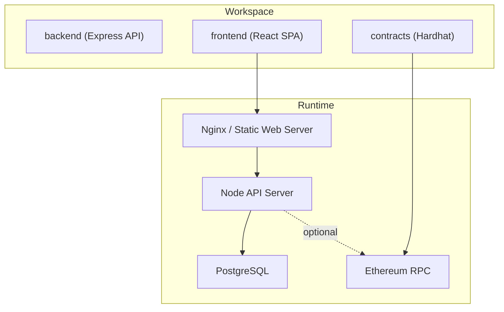
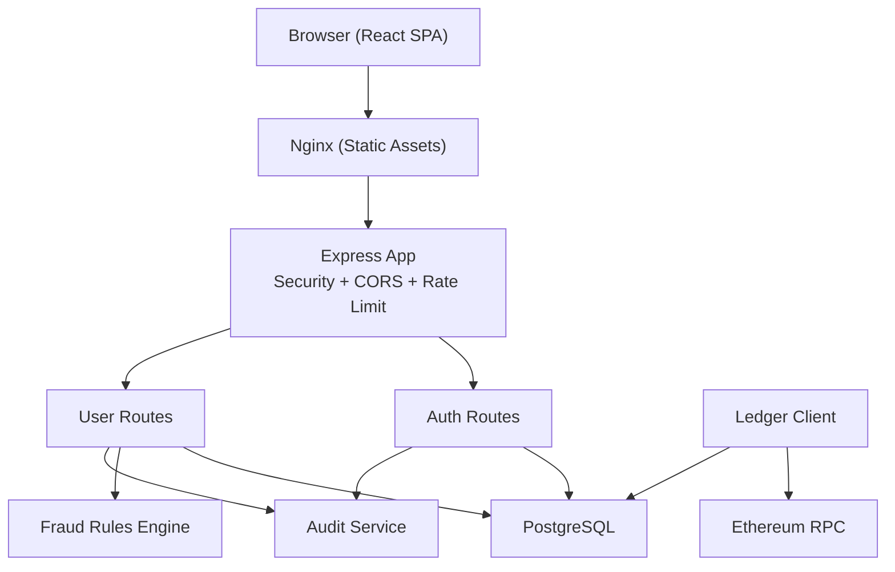
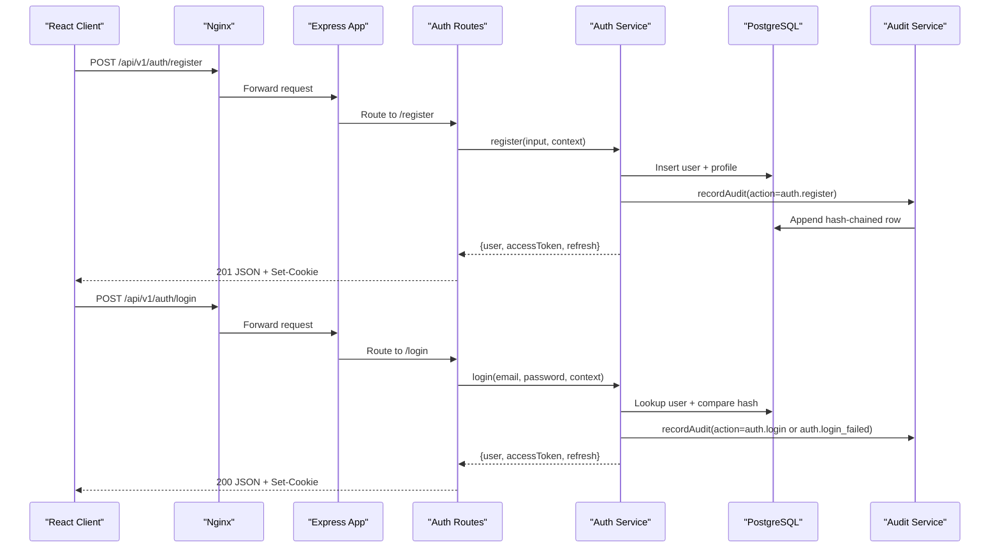
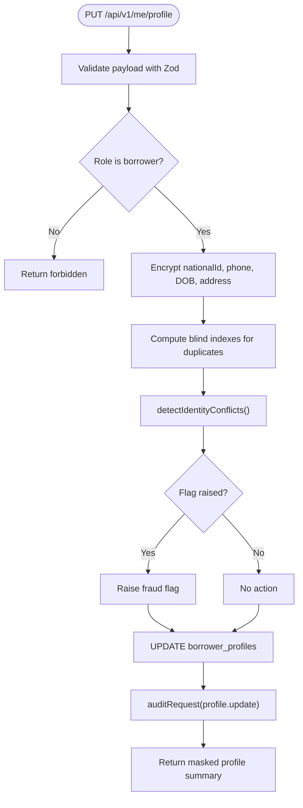
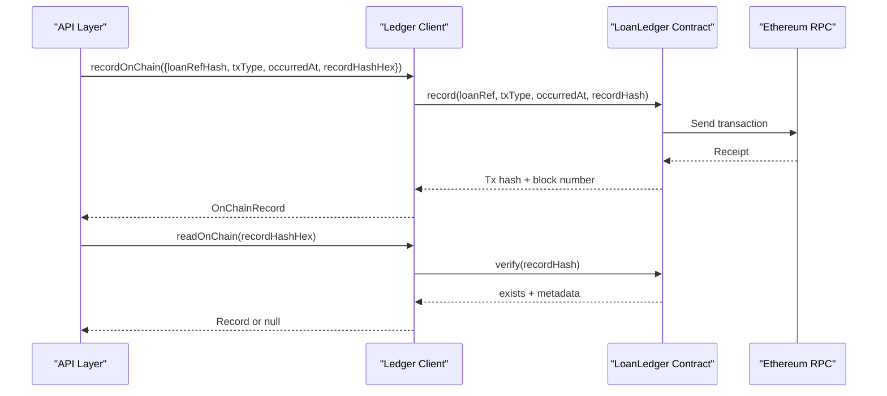
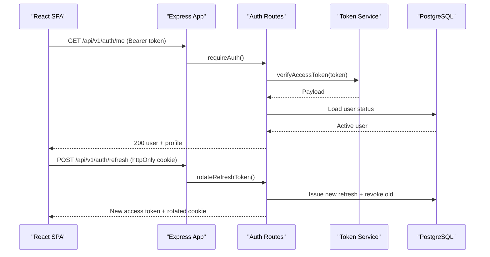
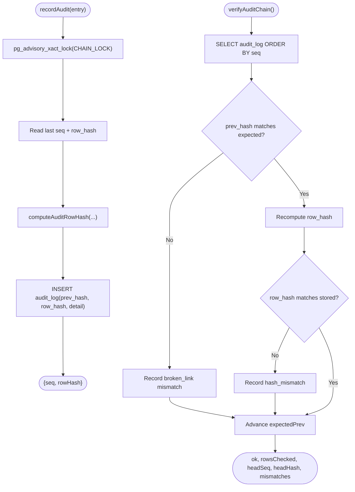
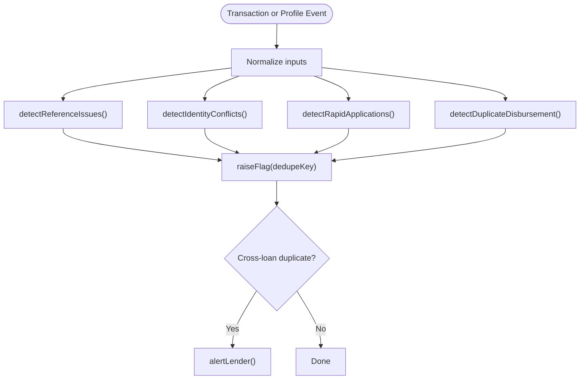
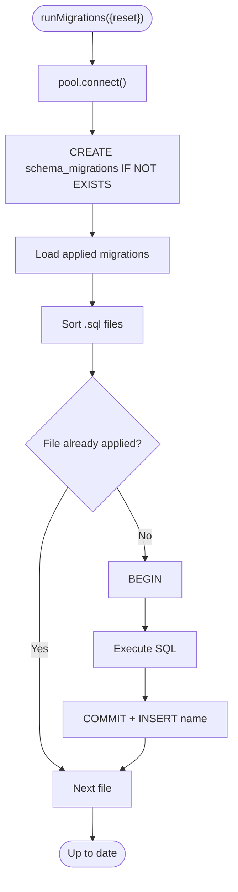
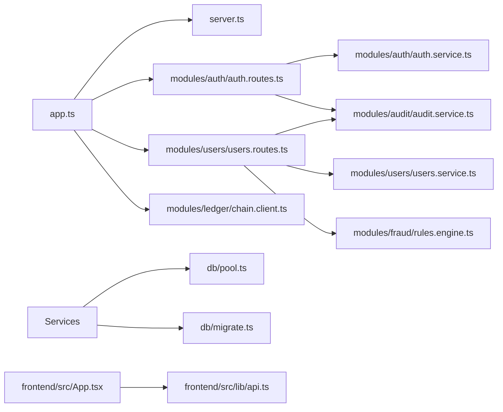

# System Architecture

<cite>
**Referenced Files in This Document**
- [app.ts](file://backend/src/app.ts)
- [server.ts](file://backend/src/server.ts)
- [openapi.yaml](file://backend/openapi.yaml)
- [auth.routes.ts](file://backend/src/modules/auth/auth.routes.ts)
- [auth.service.ts](file://backend/src/modules/auth/auth.service.ts)
- [users.routes.ts](file://backend/src/modules/users/users.routes.ts)
- [users.service.ts](file://backend/src/modules/users/users.service.ts)
- [chain.client.ts](file://backend/src/modules/ledger/chain.client.ts)
- [audit.service.ts](file://backend/src/modules/audit/audit.service.ts)
- [rules.engine.ts](file://backend/src/modules/fraud/rules.engine.ts)
- [pool.ts](file://backend/src/db/pool.ts)
- [migrate.ts](file://backend/src/db/migrate.ts)
- [App.tsx](file://frontend/src/App.tsx)
- [api.ts](file://frontend/src/lib/api.ts)
- [docker-compose.yml](file://docker-compose.yml)
- [package.json](file://package.json)
</cite>

## Table of Contents
1. [Introduction](#introduction)
2. [Project Structure](#project-structure)
3. [Core Components](#core-components)
4. [Architecture Overview](#architecture-overview)
5. [Detailed Component Analysis](#detailed-component-analysis)
6. [Dependency Analysis](#dependency-analysis)
7. [Performance Considerations](#performance-considerations)
8. [Troubleshooting Guide](#troubleshooting-guide)
9. [Conclusion](#conclusion)

## Introduction
SecureMicrofinance is a modular monolith that combines an Express.js backend API, a React frontend, and optional Ethereum blockchain integration. The system stores sensitive borrower data off-chain in PostgreSQL with encryption and blind indexes, while only transaction hashes and timestamps are anchored on-chain for tamper-evident proof. Cross-cutting concerns include JWT-based authentication, append-only hash-chained audit logging, and rule-based fraud detection. Deployment uses Docker Compose to run PostgreSQL, the API server, and a static web server serving the React application.

## Project Structure
The repository is organized as a Node.js workspace containing three main packages:
- `backend`: Express.js API with modules for authentication, users, ledger, audit, and fraud.
- `frontend`: React application with role-based pages and an API client.
- `contracts`: Hardhat project for the LoanLedger smart contract used by the backend.

**Diagram sources**
- [docker-compose.yml:1-52](file://docker-compose.yml#L1-L52)
- [package.json:1-37](file://package.json#L1-L37)

**Section sources**
- [package.json:1-37](file://package.json#L1-L37)
- [docker-compose.yml:1-52](file://docker-compose.yml#L1-L52)

## Core Components
- Express application factory configures security headers, CORS, body parsing, request context, rate limiting, OpenAPI documentation, and route mounting.
- Authentication routes implement registration, login, refresh, logout, profile access, and password change with token rotation and session revocation.
- User profile routes encrypt sensitive fields before storage and mask them on read; they also integrate fraud identity checks.
- Ledger client integrates with an Ethereum smart contract to record hashes and verify existence.
- Audit service writes an append-only, hash-chained log with advisory locking and integrity verification.
- Fraud rules engine detects duplicate receipts, malformed references, identity conflicts, rapid applications, and duplicate disbursements.
- Database layer provides connection pooling, transactions, and migration execution.
- Frontend app defines protected routes per role and manages short-lived access tokens with cookie-backed refresh.

**Section sources**
- [app.ts:16-93](file://backend/src/app.ts#L16-L93)
- [auth.routes.ts:15-121](file://backend/src/modules/auth/auth.routes.ts#L15-L121)
- [users.routes.ts:19-108](file://backend/src/modules/users/users.routes.ts#L19-L108)
- [chain.client.ts:5-151](file://backend/src/modules/ledger/chain.client.ts#L5-L151)
- [audit.service.ts:7-191](file://backend/src/modules/audit/audit.service.ts#L7-L191)
- [rules.engine.ts:4-275](file://backend/src/modules/fraud/rules.engine.ts#L4-L275)
- [pool.ts:37-61](file://backend/src/db/pool.ts#L37-L61)
- [migrate.ts:5-69](file://backend/src/db/migrate.ts#L5-L69)
- [App.tsx:15-205](file://frontend/src/App.tsx#L15-L205)
- [api.ts:1-144](file://frontend/src/lib/api.ts#L1-L144)

## Architecture Overview
The system follows a modular monolith pattern:
- Client boundary: React SPA served by Nginx.
- API boundary: Express server exposing versioned REST endpoints under `/api/v1`.
- Data boundary: PostgreSQL for relational data, encrypted profiles, audit logs, and fraud flags.
- Blockchain boundary: Optional Ethereum integration for anchoring transaction hashes and verifying existence.

**Diagram sources**
- [app.ts:23-93](file://backend/src/app.ts#L23-L93)
- [auth.routes.ts:51-121](file://backend/src/modules/auth/auth.routes.ts#L51-L121)
- [users.routes.ts:38-108](file://backend/src/modules/users/users.routes.ts#L38-L108)
- [audit.service.ts:37-118](file://backend/src/modules/audit/audit.service.ts#L37-L118)
- [rules.engine.ts:54-275](file://backend/src/modules/fraud/rules.engine.ts#L54-L275)
- [chain.client.ts:54-151](file://backend/src/modules/ledger/chain.client.ts#L54-L151)
- [docker-compose.yml:23-48](file://docker-compose.yml#L23-L48)

## Detailed Component Analysis

### Request Flow: Registration and Login
This sequence shows how the React client interacts with the API, middleware, services, database, and audit subsystem during account creation and login.

**Diagram sources**
- [auth.routes.ts:53-73](file://backend/src/modules/auth/auth.routes.ts#L53-L73)
- [auth.service.ts:61-112](file://backend/src/modules/auth/auth.service.ts#L61-L112)
- [auth.service.ts:114-198](file://backend/src/modules/auth/auth.service.ts#L114-L198)
- [audit.service.ts:37-94](file://backend/src/modules/audit/audit.service.ts#L37-L94)

**Section sources**
- [auth.routes.ts:53-73](file://backend/src/modules/auth/auth.routes.ts#L53-L73)
- [auth.service.ts:61-198](file://backend/src/modules/auth/auth.service.ts#L61-L198)
- [audit.service.ts:37-94](file://backend/src/modules/audit/audit.service.ts#L37-L94)

### Profile Update and Fraud Integration
Profile updates encrypt sensitive fields, create blind indexes, and trigger fraud checks for identity conflicts.

**Diagram sources**
- [users.routes.ts:45-108](file://backend/src/modules/users/users.routes.ts#L45-L108)
- [rules.engine.ts:94-143](file://backend/src/modules/fraud/rules.engine.ts#L94-L143)
- [users.service.ts:19-59](file://backend/src/modules/users/users.service.ts#L19-L59)

**Section sources**
- [users.routes.ts:45-108](file://backend/src/modules/users/users.routes.ts#L45-L108)
- [rules.engine.ts:94-143](file://backend/src/modules/fraud/rules.engine.ts#L94-L143)
- [users.service.ts:19-59](file://backend/src/modules/users/users.service.ts#L19-L59)

### Blockchain Ledger Integration
The ledger client optionally records hashes on Ethereum and verifies their existence.

**Diagram sources**
- [chain.client.ts:71-108](file://backend/src/modules/ledger/chain.client.ts#L71-L108)
- [chain.client.ts:130-151](file://backend/src/modules/ledger/chain.client.ts#L130-L151)

**Section sources**
- [chain.client.ts:5-151](file://backend/src/modules/ledger/chain.client.ts#L5-L151)

### Authentication Middleware and Token Refresh
The frontend holds a short-lived access token in memory and uses an httpOnly refresh cookie to rotate sessions.

**Diagram sources**
- [auth.routes.ts:75-108](file://backend/src/modules/auth/auth.routes.ts#L75-L108)
- [auth.service.ts:200-262](file://backend/src/modules/auth/auth.service.ts#L200-L262)
- [api.ts:81-144](file://frontend/src/lib/api.ts#L81-L144)

**Section sources**
- [auth.routes.ts:75-108](file://backend/src/modules/auth/auth.routes.ts#L75-L108)
- [auth.service.ts:200-262](file://backend/src/modules/auth/auth.service.ts#L200-L262)
- [api.ts:81-144](file://frontend/src/lib/api.ts#L81-L144)

### Audit Trail Integrity
The audit service ensures immutability through advisory locks and hash chaining, and supports integrity verification.

**Diagram sources**
- [audit.service.ts:37-94](file://backend/src/modules/audit/audit.service.ts#L37-L94)
- [audit.service.ts:142-191](file://backend/src/modules/audit/audit.service.ts#L142-L191)

**Section sources**
- [audit.service.ts:37-94](file://backend/src/modules/audit/audit.service.ts#L37-L94)
- [audit.service.ts:142-191](file://backend/src/modules/audit/audit.service.ts#L142-L191)

### Fraud Detection Rules
Rule-based detection raises flags for duplicate receipts, malformed references, identity conflicts, rapid applications, and duplicate disbursements.

**Diagram sources**
- [rules.engine.ts:54-92](file://backend/src/modules/fraud/rules.engine.ts#L54-L92)
- [rules.engine.ts:94-275](file://backend/src/modules/fraud/rules.engine.ts#L94-L275)

**Section sources**
- [rules.engine.ts:54-92](file://backend/src/modules/fraud/rules.engine.ts#L54-L92)
- [rules.engine.ts:94-275](file://backend/src/modules/fraud/rules.engine.ts#L94-L275)

### Database Schema Management
Migrations are forward-only SQL files executed inside transactions and recorded in `schema_migrations`.

**Diagram sources**
- [migrate.ts:14-58](file://backend/src/db/migrate.ts#L14-L58)

**Section sources**
- [migrate.ts:14-58](file://backend/src/db/migrate.ts#L14-L58)

## Dependency Analysis
The backend’s runtime depends on configuration, database pool, middleware, module routers, and optional chain client. The frontend depends on routing, authentication context, and the API client.

**Diagram sources**
- [app.ts:1-93](file://backend/src/app.ts#L1-L93)
- [server.ts:1-26](file://backend/src/server.ts#L1-L26)
- [auth.routes.ts:1-121](file://backend/src/modules/auth/auth.routes.ts#L1-L121)
- [users.routes.ts:1-108](file://backend/src/modules/users/users.routes.ts#L1-L108)
- [pool.ts:37-61](file://backend/src/db/pool.ts#L37-L61)
- [migrate.ts:1-69](file://backend/src/db/migrate.ts#L1-L69)
- [App.tsx:1-205](file://frontend/src/App.tsx#L1-L205)
- [api.ts:1-144](file://frontend/src/lib/api.ts#L1-L144)

**Section sources**
- [app.ts:1-93](file://backend/src/app.ts#L1-L93)
- [server.ts:1-26](file://backend/src/server.ts#L1-L26)
- [auth.routes.ts:1-121](file://backend/src/modules/auth/auth.routes.ts#L1-L121)
- [users.routes.ts:1-108](file://backend/src/modules/users/users.routes.ts#L1-L108)
- [pool.ts:37-61](file://backend/src/db/pool.ts#L37-L61)
- [migrate.ts:1-69](file://backend/src/db/migrate.ts#L1-L69)
- [App.tsx:1-205](file://frontend/src/App.tsx#L1-L205)
- [api.ts:1-144](file://frontend/src/lib/api.ts#L1-L144)

## Performance Considerations
- Connection pooling: Use the provided pool utilities for efficient database access and safe transaction handling.
- Rate limiting: Global and auth-specific limits protect against abuse; write endpoints use additional throttling.
- Body size limit: JSON payloads are limited to reduce memory pressure.
- Off-chain-first design: Only hashes go on-chain to minimize latency and cost.
- Hash chaining: Advisory locks serialize audit writers to prevent chain forks.
- Frontend token management: In-memory access tokens and deduplicated refresh requests avoid redundant network calls.

[No sources needed since this section provides general guidance]

## Troubleshooting Guide
- Health check: Use `/api/health` to confirm service status, chain mode, and timestamp.
- OpenAPI docs: Access `/api/docs` and `/api/openapi.yaml` for endpoint specifications.
- Chain availability: If `CHAIN_MODE=off` or no contract address is configured, chain writes are disabled; operations remain functional but unanchored.
- Authentication errors: Generic messages prevent enumeration; check audit logs for failed attempts and lockouts.
- Profile updates: Ensure required fields meet validation rules; encrypted fields are masked on read.
- Fraud flags: Review flags and alerts for duplicate receipts, identity conflicts, rapid applications, and duplicate disbursements.
- Audit integrity: Run integrity checks to detect hash mismatches or broken links in the audit trail.
- Database migrations: Use the migration runner to apply SQL files; failures roll back individual migrations.

**Section sources**
- [app.ts:65-84](file://backend/src/app.ts#L65-L84)
- [chain.client.ts:24-41](file://backend/src/modules/ledger/chain.client.ts#L24-L41)
- [auth.service.ts:114-198](file://backend/src/modules/auth/auth.service.ts#L114-L198)
- [users.routes.ts:45-108](file://backend/src/modules/users/users.routes.ts#L45-L108)
- [rules.engine.ts:54-275](file://backend/src/modules/fraud/rules.engine.ts#L54-L275)
- [audit.service.ts:142-191](file://backend/src/modules/audit/audit.service.ts#L142-L191)
- [migrate.ts:14-58](file://backend/src/db/migrate.ts#L14-L58)

## Conclusion
SecureMicrofinance implements a secure, auditable microfinance platform with clear separation between business logic, data persistence, and optional blockchain anchoring. The modular monolith architecture keeps deployment simple while supporting strong security controls, comprehensive auditing, and fraud detection. Docker Compose provides a consistent local and CI environment, and the system is designed to scale horizontally at the API layer with stateless nodes behind a reverse proxy, while PostgreSQL and Ethereum RPC serve as external dependencies.

[No sources needed since this section summarizes without analyzing specific files]