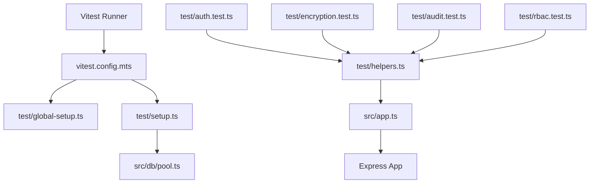
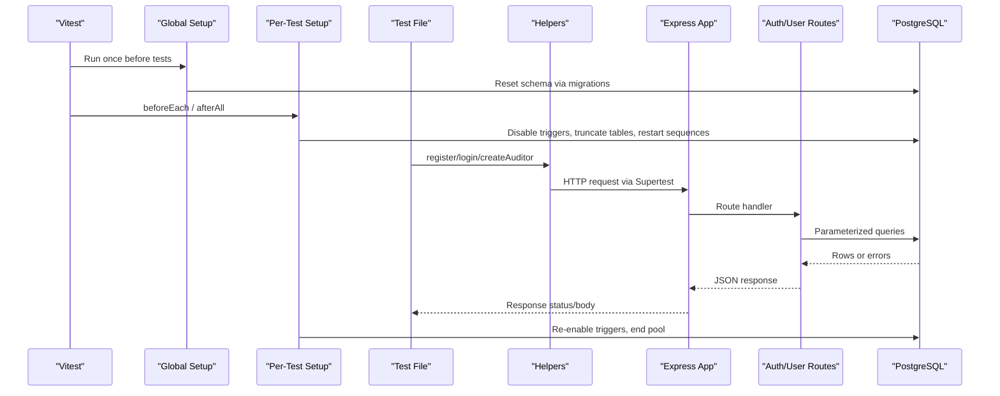
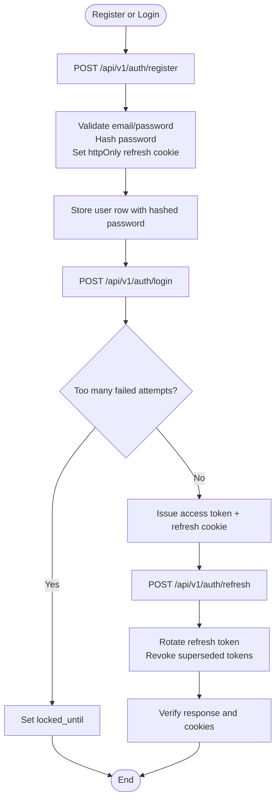
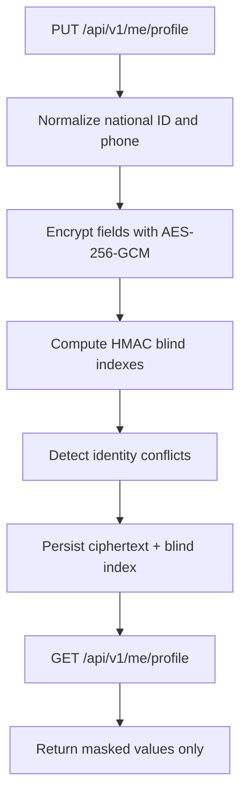
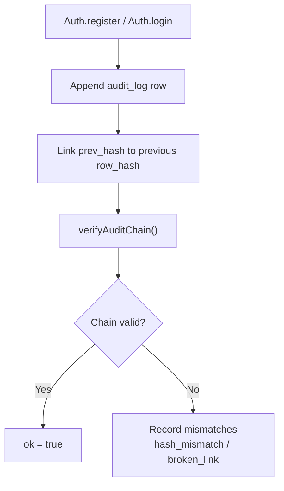
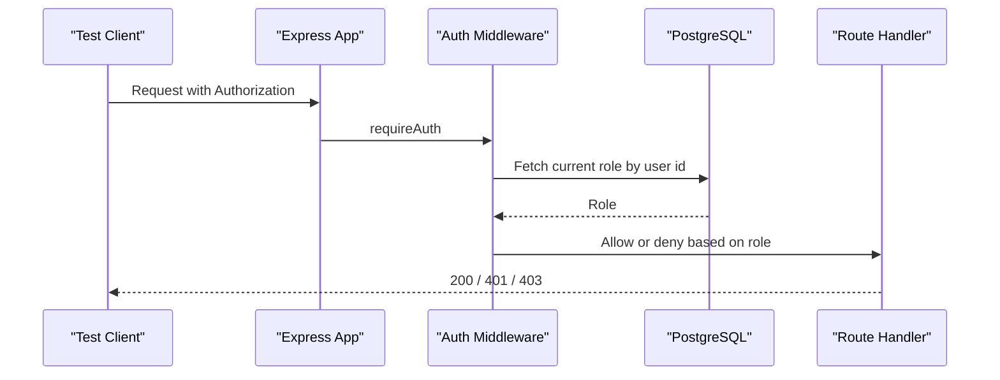
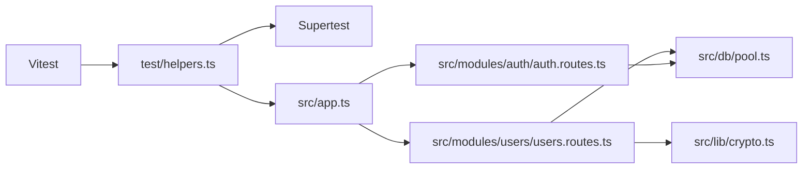

# Testing Strategy

<cite>
**Referenced Files in This Document**
- [backend/package.json](file://backend/package.json)
- [backend/vitest.config.mts](file://backend/vitest.config.mts)
- [backend/test/global-setup.ts](file://backend/test/global-setup.ts)
- [backend/test/setup.ts](file://backend/test/setup.ts)
- [backend/test/helpers.ts](file://backend/test/helpers.ts)
- [backend/test/auth.test.ts](file://backend/test/auth.test.ts)
- [backend/test/encryption.test.ts](file://backend/test/encryption.test.ts)
- [backend/test/audit.test.ts](file://backend/test/audit.test.ts)
- [backend/test/rbac.test.ts](file://backend/test/rbac.test.ts)
- [backend/src/db/pool.ts](file://backend/src/db/pool.ts)
- [backend/src/app.ts](file://backend/src/app.ts)
- [backend/src/modules/auth/auth.routes.ts](file://backend/src/modules/auth/auth.routes.ts)
- [backend/src/modules/users/users.routes.ts](file://backend/src/modules/users/users.routes.ts)
- [backend/src/lib/crypto.ts](file://backend/src/lib/crypto.ts)
</cite>

## Table of Contents
1. [Introduction](#introduction)
2. [Project Structure](#project-structure)
3. [Core Components](#core-components)
4. [Architecture Overview](#architecture-overview)
5. [Detailed Component Analysis](#detailed-component-analysis)
6. [Dependency Analysis](#dependency-analysis)
7. [Performance Considerations](#performance-considerations)
8. [Troubleshooting Guide](#troubleshooting-guide)
9. [Conclusion](#conclusion)

## Introduction
This document describes the testing strategy for the SecureMicrofinance backend. It covers unit, integration, and end-to-end testing approaches, the Vitest configuration, test organization, mocking and data management strategies, security and performance considerations, and continuous integration guidance. The tests are primarily integration-focused: they run against a real PostgreSQL database to validate append-only audit behavior, hash chains, blind indexes, encryption round-trips, authentication flows, refresh-token rotation, and role-based access control.

## Project Structure
The backend test suite lives under `backend/test` and is configured by `vitest.config.mts`. Tests use Vitest as the runner, Supertest for HTTP assertions, and a shared Express application instance created by `createApp()` so routes can be exercised without binding a network port.

**Diagram sources**
- [backend/vitest.config.mts:10-25](file://backend/vitest.config.mts#L10-L25)
- [backend/test/global-setup.ts:7-17](file://backend/test/global-setup.ts#L7-L17)
- [backend/test/setup.ts:29-41](file://backend/test/setup.ts#L29-L41)
- [backend/test/helpers.ts:10-10](file://backend/test/helpers.ts#L10-L10)
- [backend/src/app.ts:23-92](file://backend/src/app.ts#L23-L92)

**Section sources**
- [backend/package.json:7-16](file://backend/package.json#L7-L16)
- [backend/vitest.config.mts:1-27](file://backend/vitest.config.mts#L1-L27)
- [backend/test/global-setup.ts:1-18](file://backend/test/global-setup.ts#L1-L18)
- [backend/test/setup.ts:1-42](file://backend/test/setup.ts#L1-L42)
- [backend/test/helpers.ts:1-79](file://backend/test/helpers.ts#L1-L79)

## Core Components
- Test runner and configuration: Vitest with Node environment, file-scoped setup, global migration setup, disabled parallelism, and test-specific environment variables.
- Database lifecycle: Global migration reset before tests; per-test table truncation and sequence restart; pool teardown after all tests.
- Shared HTTP helpers: A single Express app instance, registration/login helpers, cookie extraction, auditor creation, authorization header builder, and role mutation helper.
- Domain test suites: Authentication, profile encryption, audit chain integrity, and RBAC.

Key responsibilities:
- `vitest.config.mts`: Defines test environment, include patterns, global and per-file setup files, parallelism settings, timeouts, and environment variables such as `BCRYPT_COST`.
- `global-setup.ts`: Runs once before any test file to rebuild the schema from migrations and close the pool.
- `setup.ts`: Disables the audit trigger only during cleanup, truncates core tables, restarts sequences, and ends the pool after all tests.
- `helpers.ts`: Provides `app`, `register`, `login`, `refreshCookie`, `createAuditor`, `authHeader`, and `setRole`.
- `pool.ts`: Exposes a parameterized query wrapper and transaction helper used by both application code and tests.

**Section sources**
- [backend/vitest.config.mts:10-25](file://backend/vitest.config.mts#L10-L25)
- [backend/test/global-setup.ts:7-17](file://backend/test/global-setup.ts#L7-L17)
- [backend/test/setup.ts:12-41](file://backend/test/setup.ts#L12-L41)
- [backend/test/helpers.ts:10-79](file://backend/test/helpers.ts#L10-L79)
- [backend/src/db/pool.ts:27-57](file://backend/src/db/pool.ts#L27-L57)

## Architecture Overview
The test architecture integrates Vitest, Supertest, the Express application factory, and a real PostgreSQL database. Tests do not mock the API layer; instead, they exercise real routes and verify database-level guarantees such as append-only audit logs, encrypted fields, blind indexes, and token rotation.

**Diagram sources**
- [backend/test/global-setup.ts:7-17](file://backend/test/global-setup.ts#L7-L17)
- [backend/test/setup.ts:29-41](file://backend/test/setup.ts#L29-L41)
- [backend/test/helpers.ts:28-53](file://backend/test/helpers.ts#L28-L53)
- [backend/src/app.ts:23-92](file://backend/src/app.ts#L23-L92)
- [backend/src/modules/auth/auth.routes.ts:53-121](file://backend/src/modules/auth/auth.routes.ts#L53-L121)
- [backend/src/modules/users/users.routes.ts:40-107](file://backend/src/modules/users/users.routes.ts#L40-L107)
- [backend/src/db/pool.ts:27-57](file://backend/src/db/pool.ts#L27-L57)

## Detailed Component Analysis

### Authentication Testing
Authentication tests cover registration, password hashing, cookie attributes, duplicate handling, weak passwords, generic error messages, lockout behavior, refresh-token rotation and reuse detection, concurrent double-submit tolerance, and session revocation on password change.

**Diagram sources**
- [backend/test/auth.test.ts:12-154](file://backend/test/auth.test.ts#L12-L154)
- [backend/src/modules/auth/auth.routes.ts:53-121](file://backend/src/modules/auth/auth.routes.ts#L53-L121)
- [backend/test/helpers.ts:28-53](file://backend/test/helpers.ts#L28-L53)

Key behaviors validated:
- Registration returns 201, normalizes email, sets an httpOnly refresh cookie, and stores a bcrypt hash.
- Auditor self-registration is rejected.
- Duplicate emails return conflict responses.
- Weak passwords are rejected.
- Unknown email and wrong password produce identical generic error messages.
- Account lockout occurs after repeated failures.
- Refresh-token rotation detects replay and revokes the entire token family.
- Concurrent refresh requests within a grace window are tolerated.
- Password changes revoke existing sessions.

**Section sources**
- [backend/test/auth.test.ts:1-155](file://backend/test/auth.test.ts#L1-L155)
- [backend/src/modules/auth/auth.routes.ts:53-121](file://backend/src/modules/auth/auth.routes.ts#L53-L121)
- [backend/test/helpers.ts:28-53](file://backend/test/helpers.ts#L28-L53)

### Encryption and Blind Index Testing
Encryption tests assert that sensitive fields are stored as versioned AES-GCM ciphertext, blind indexes are deterministic and keyed, API responses contain masked values, identity conflicts are detected without decryption, duplicate flags are deduplicated, and login continues to work.

**Diagram sources**
- [backend/test/encryption.test.ts:13-114](file://backend/test/encryption.test.ts#L13-L114)
- [backend/src/modules/users/users.routes.ts:45-107](file://backend/src/modules/users/users.routes.ts#L45-L107)
- [backend/src/lib/crypto.ts:29-88](file://backend/src/lib/crypto.ts#L29-L88)

Key behaviors validated:
- National ID and phone are stored as versioned ciphertext and never leaked in responses.
- Blind indexes enable duplicate detection across accounts.
- Identity conflicts are flagged with critical severity.
- Repeated saves do not create duplicate fraud flags.
- Encryption does not break authentication.

**Section sources**
- [backend/test/encryption.test.ts:1-115](file://backend/test/encryption.test.ts#L1-L115)
- [backend/src/modules/users/users.routes.ts:45-107](file://backend/src/modules/users/users.routes.ts#L45-L107)
- [backend/src/lib/crypto.ts:29-88](file://backend/src/lib/crypto.ts#L29-L88)

### Audit Chain Integrity Testing
Audit tests ensure every authentication event writes a chained row, UPDATE/DELETE/TRUNCATE are rejected at the database level, verification passes for an untouched chain, and tampering is detected even when an attacker disables the guard trigger.

**Diagram sources**
- [backend/test/audit.test.ts:16-92](file://backend/test/audit.test.ts#L16-L92)
- [backend/src/modules/audit/audit.service.ts:1-1](file://backend/src/modules/audit/audit.service.ts#L1-L1)

Key behaviors validated:
- Audit rows record actions and link hashes starting from genesis.
- Database triggers enforce append-only behavior.
- Verification reports mismatches and broken links when rows are edited outside the trigger.

**Section sources**
- [backend/test/audit.test.ts:1-93](file://backend/test/audit.test.ts#L1-L93)

### Role-Based Access Control Testing
RBAC tests verify unauthenticated access rejection, malformed or forged token rejection, borrower read access, auditor write denial, lender write denial, and server-side role revalidation.

**Diagram sources**
- [backend/test/rbac.test.ts:12-73](file://backend/test/rbac.test.ts#L12-L73)
- [backend/src/modules/auth/auth.routes.ts:105-121](file://backend/src/modules/auth/auth.routes.ts#L105-L121)
- [backend/src/modules/users/users.routes.ts:45-48](file://backend/src/modules/users/users.routes.ts#L45-L48)

Key behaviors validated:
- Missing or invalid tokens return 401.
- Borrowers can read their own profile.
- Auditors cannot write profiles.
- Lenders cannot write borrower profiles.
- Roles are reloaded from the database rather than trusting token claims alone.

**Section sources**
- [backend/test/rbac.test.ts:1-74](file://backend/test/rbac.test.ts#L1-L74)
- [backend/src/modules/auth/auth.routes.ts:105-121](file://backend/src/modules/auth/auth.routes.ts#L105-L121)
- [backend/src/modules/users/users.routes.ts:45-48](file://backend/src/modules/users/users.routes.ts#L45-L48)

## Dependency Analysis
The test suite depends on:
- Vitest for test execution and hooks.
- Supertest for HTTP assertions against the in-process Express app.
- The Express application factory to mount routes without a network socket.
- The database pool for parameterized queries and transactions.
- Cryptographic utilities for blind indexes and encryption validation.

**Diagram sources**
- [backend/test/helpers.ts:1-10](file://backend/test/helpers.ts#L1-L10)
- [backend/src/app.ts:23-92](file://backend/src/app.ts#L23-L92)
- [backend/src/modules/auth/auth.routes.ts:1-121](file://backend/src/modules/auth/auth.routes.ts#L1-L121)
- [backend/src/modules/users/users.routes.ts:1-108](file://backend/src/modules/users/users.routes.ts#L1-L108)
- [backend/src/lib/crypto.ts:1-97](file://backend/src/lib/crypto.ts#L1-L97)
- [backend/src/db/pool.ts:1-62](file://backend/src/db/pool.ts#L1-L62)

**Section sources**
- [backend/package.json:34-50](file://backend/package.json#L34-L50)
- [backend/vitest.config.mts:10-25](file://backend/vitest.config.mts#L10-L25)

## Performance Considerations
- The test suite disables file parallelism because it shares one PostgreSQL database. This avoids race conditions but means tests run sequentially.
- `BCRYPT_COST` is set to 10 in the test environment to speed up hashing while keeping realistic behavior.
- Per-test cleanup uses targeted table truncation and sequence restarts to keep datasets small and predictable.
- The database pool has bounded connection limits and timeouts to prevent resource exhaustion during long test runs.

Recommendations:
- Keep test data minimal and reuse fixtures through helpers where possible.
- Avoid heavy cryptographic operations in slow paths unless required by the assertion.
- Use explicit timeouts and hook timeouts to detect hangs early.

[No sources needed since this section provides general guidance]

## Troubleshooting Guide
Common issues and resolutions:
- Schema drift between migrations and tests: Ensure the global setup resets migrations before each run. If tests fail due to missing tables, confirm that `global-setup.ts` runs and completes successfully.
- Permission or trigger issues during cleanup: The per-test setup temporarily disables the audit trigger only for truncation and immediately re-enables it. If cleanup fails, check that the trigger name and table names match the current schema.
- Connection pool exhaustion: Confirm that `afterAll` closes the pool and that no test leaks connections.
- Flaky authentication tests: Because refresh-token rotation is tested, avoid sharing sessions across unrelated tests. Use the provided `register` and `login` helpers to isolate sessions.

Operational checks:
- Verify environment variables: `NODE_ENV=test` must be set before importing configuration.
- Verify database URL: Ensure the test database exists and is reachable.
- Verify bcrypt cost: `BCRYPT_COST=10` should be active in the test environment.

**Section sources**
- [backend/test/global-setup.ts:7-17](file://backend/test/global-setup.ts#L7-L17)
- [backend/test/setup.ts:29-41](file://backend/test/setup.ts#L29-L41)
- [backend/vitest.config.mts:20-24](file://backend/vitest.config.mts#L20-L24)
- [backend/src/db/pool.ts:59-62](file://backend/src/db/pool.ts#L59-L62)

## Conclusion
SecureMicrofinance’s backend tests are integration-first, leveraging a real PostgreSQL database to validate security-critical behaviors such as append-only audit chains, field-level encryption, blind indexes, authentication flows, refresh-token rotation, and role-based access control. The test framework is built around Vitest, Supertest, and a shared Express application factory. Test data is managed through global migration resets and per-test truncation, ensuring isolation and reproducibility. For CI, the same commands used locally should provision a test database, run migrations, and execute the test suite with the documented environment variables.

[No sources needed since this section summarizes without analyzing specific files]