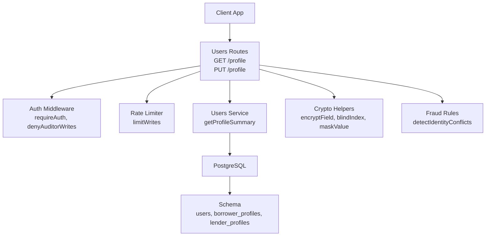
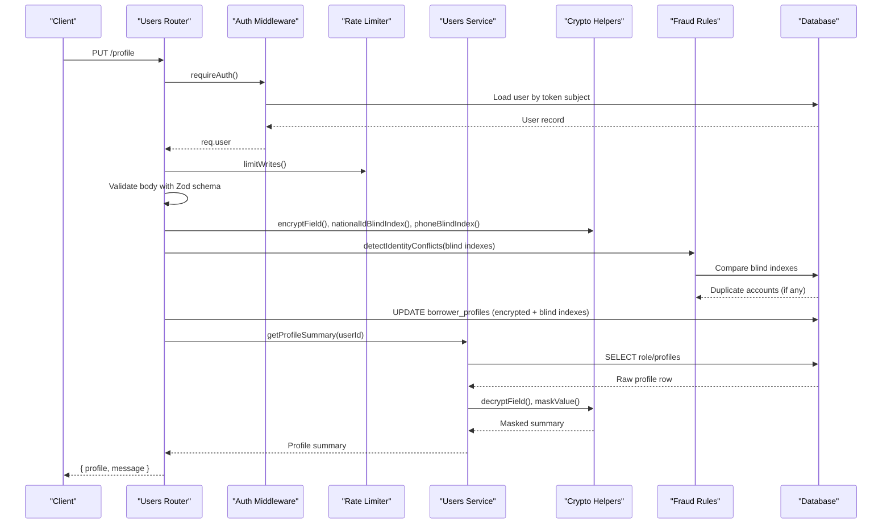
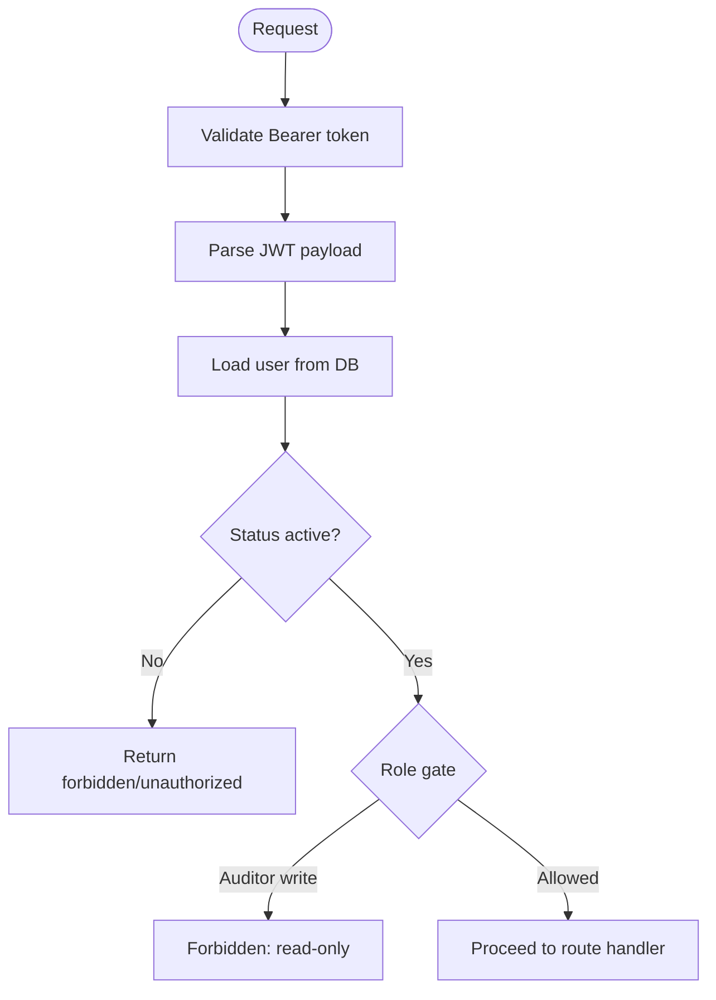
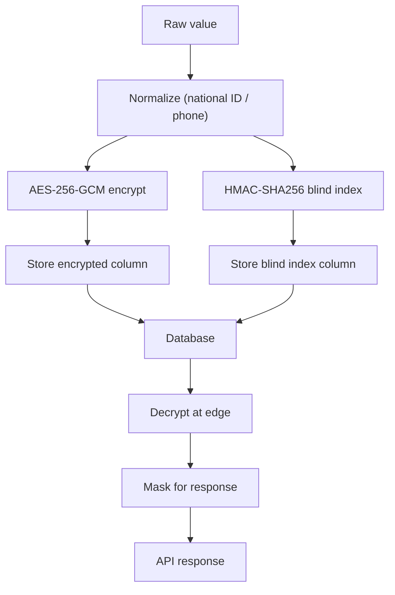
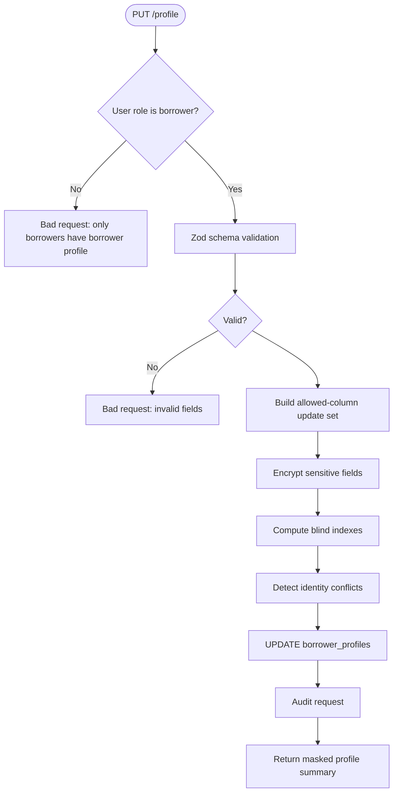
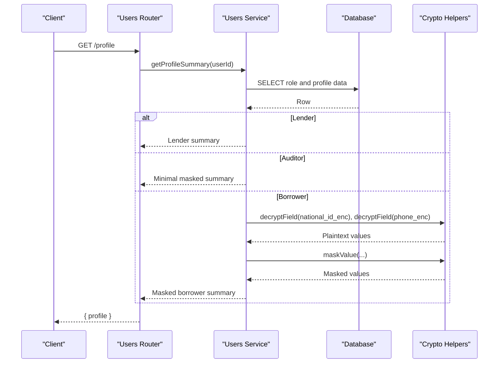
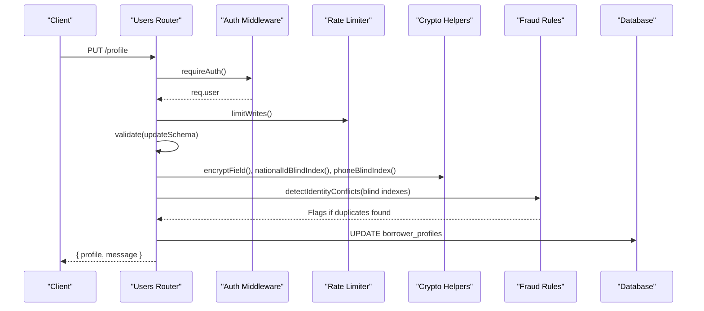
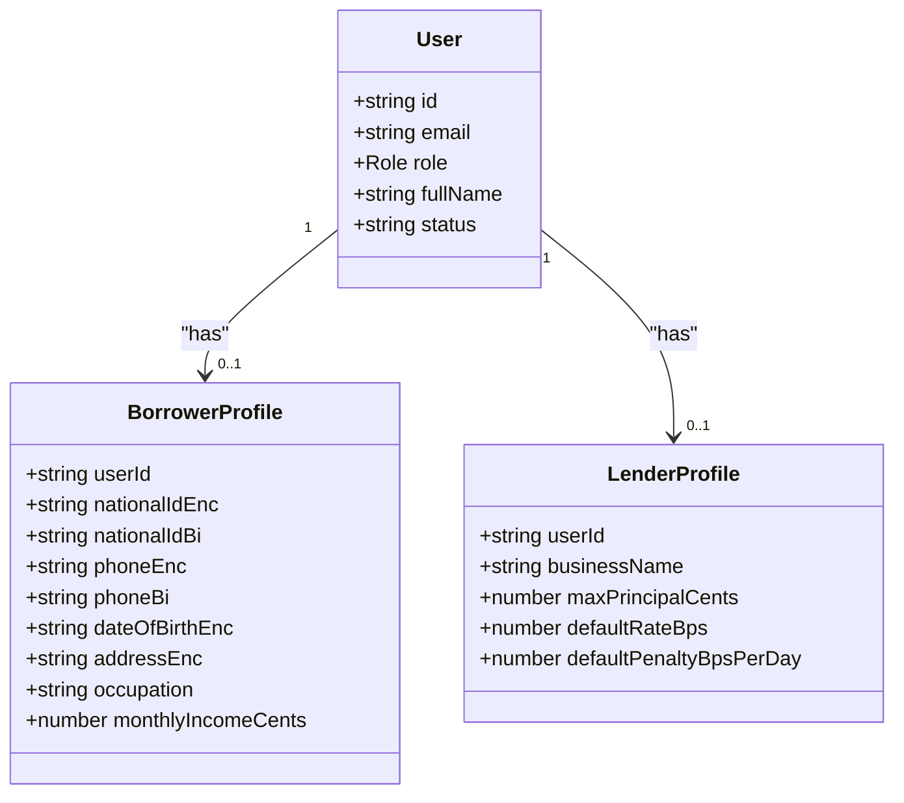
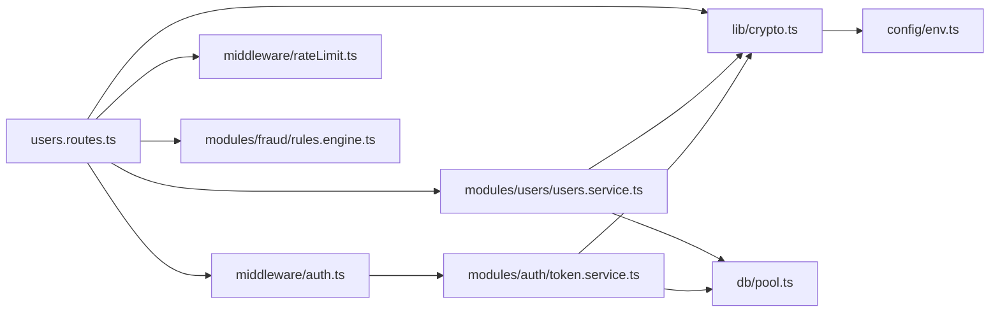

# User Management

<cite>
**Referenced Files in This Document**
- [users.service.ts](file://backend/src/modules/users/users.service.ts)
- [users.routes.ts](file://backend/src/modules/users/users.routes.ts)
- [001_core_auth.sql](file://backend/src/db/migrations/001_core_auth.sql)
- [crypto.ts](file://backend/src/lib/crypto.ts)
- [auth.ts](file://backend/src/middleware/auth.ts)
- [token.service.ts](file://backend/src/modules/auth/token.service.ts)
- [rules.engine.ts](file://backend/src/modules/fraud/rules.engine.ts)
- [express.d.ts](file://backend/src/types/express.d.ts)
- [errors.ts](file://backend/src/lib/errors.ts)
- [rateLimit.ts](file://backend/src/middleware/rateLimit.ts)
- [env.ts](file://backend/src/config/env.ts)
</cite>

## Table of Contents
1. [Introduction](#introduction)
2. [Project Structure](#project-structure)
3. [Core Components](#core-components)
4. [Architecture Overview](#architecture-overview)
5. [Detailed Component Analysis](#detailed-component-analysis)
6. [Dependency Analysis](#dependency-analysis)
7. [Performance Considerations](#performance-considerations)
8. [Troubleshooting Guide](#troubleshooting-guide)
9. [Conclusion](#conclusion)

## Introduction
This document explains the user management system for the finance application. It covers:
- The user data model and role assignments (borrower, lender, auditor).
- Profile management endpoints and validation rules.
- Encrypted storage of sensitive personal data using AES-256-GCM.
- Blind indexes that enable duplicate detection without decrypting stored values.
- Security constraints for data at rest and in transit.
- Concrete examples of user profile retrieval and updates.
- Data privacy considerations and compliance implications.

The system is designed so that sensitive fields are never readable from a database dump, auditors remain read-only, and identity conflicts are detected through cryptographic blind indexes rather than plaintext comparisons.

## Project Structure
User-related functionality is implemented in the backend under `modules/users`, with supporting logic in middleware, cryptography helpers, database migrations, and the fraud rule engine.



**Diagram sources**
- [users.routes.ts:1-108](file://backend/src/modules/users/users.routes.ts#L1-L108)
- [users.service.ts:1-60](file://backend/src/modules/users/users.service.ts#L1-L60)
- [auth.ts:1-69](file://backend/src/middleware/auth.ts#L1-L69)
- [rateLimit.ts:1-51](file://backend/src/middleware/rateLimit.ts#L1-L51)
- [crypto.ts:1-97](file://backend/src/lib/crypto.ts#L1-L97)
- [rules.engine.ts:94-143](file://backend/src/modules/fraud/rules.engine.ts#L94-L143)
- [001_core_auth.sql:17-72](file://backend/src/db/migrations/001_core_auth.sql#L17-L72)

**Section sources**
- [users.routes.ts:1-108](file://backend/src/modules/users/users.routes.ts#L1-L108)
- [users.service.ts:1-60](file://backend/src/modules/users/users.service.ts#L1-L60)
- [001_core_auth.sql:17-72](file://backend/src/db/migrations/001_core_auth.sql#L17-L72)

## Core Components
- Users routes define self-service profile endpoints for borrowers and return role-specific summaries for lenders and auditors.
- Users service reads role-appropriate profile data and masks sensitive values before returning them to clients.
- Database schema defines users, borrower profiles, and lender profiles, including encrypted columns and blind index columns.
- Cryptography module provides AES-256-GCM encryption, HMAC-based blind indexes, normalization helpers, masking, and timing-safe utilities.
- Authentication middleware validates access tokens, loads the current user, enforces active status, and applies role-based restrictions.
- Token service manages short-lived access tokens and rotating refresh tokens stored as hashes.
- Fraud rules detect identity conflicts by comparing blind indexes without decrypting PII.

**Section sources**
- [users.routes.ts:19-107](file://backend/src/modules/users/users.routes.ts#L19-L107)
- [users.service.ts:5-59](file://backend/src/modules/users/users.service.ts#L5-L59)
- [001_core_auth.sql:17-72](file://backend/src/db/migrations/001_core_auth.sql#L17-L72)
- [crypto.ts:4-97](file://backend/src/lib/crypto.ts#L4-L97)
- [auth.ts:13-68](file://backend/src/middleware/auth.ts#L13-L68)
- [token.service.ts:10-206](file://backend/src/modules/auth/token.service.ts#L10-L206)
- [rules.engine.ts:94-143](file://backend/src/modules/fraud/rules.engine.ts#L94-L143)

## Architecture Overview
The user management flow combines authentication, authorization, input validation, encryption, blind indexing, and audit logging.



**Diagram sources**
- [users.routes.ts:45-107](file://backend/src/modules/users/users.routes.ts#L45-L107)
- [auth.ts:18-41](file://backend/src/middleware/auth.ts#L18-L41)
- [rateLimit.ts:36-50](file://backend/src/middleware/rateLimit.ts#L36-L50)
- [crypto.ts:29-84](file://backend/src/lib/crypto.ts#L29-L84)
- [rules.engine.ts:98-143](file://backend/src/modules/fraud/rules.engine.ts#L98-L143)
- [users.service.ts:19-59](file://backend/src/modules/users/users.service.ts#L19-L59)

## Detailed Component Analysis

### User Data Model
The database schema defines three core entities:
- `users`: Identity, roles, account status, login security counters, and timestamps.
- `borrower_profiles`: Encrypted personal data plus non-sensitive fields like occupation and income; includes blind index columns for national ID and phone.
- `lender_profiles`: Business-oriented configuration such as business name, maximum principal, default rate, and penalty rate.

Key design points:
- Roles are enforced via an enum type.
- Personal data is stored encrypted; blind indexes are indexed for fast duplicate checks.
- Email uniqueness and lowercase enforcement are defined at the schema level.
- Timestamps are automatically updated via triggers.

```mermaid
erDiagram
USERS {
uuid id PK
text email UK
text password_hash
enum role
text full_name
enum status
int failed_attempts
timestamptz locked_until
timestamptz last_login_at
timestamptz created_at
timestamptz updated_at
}
BORROWER_PROFILES {
uuid user_id PK FK
text national_id_enc
text national_id_bi
text phone_enc
text phone_bi
text date_of_birth_enc
text address_enc
text occupation
bigint monthly_income_cents
jsonb consent_flags
timestamptz created_at
timestamptz updated_at
}
LENDER_PROFILES {
uuid user_id PK FK
text business_name
bigint max_principal_cents
int default_rate_bps
int default_penalty_bps_per_day
timestamptz created_at
timestamptz updated_at
}
USERS ||--o| BORROWER_PROFILES : "has"
USERS ||--o| LENDER_PROFILES : "has"
```

**Diagram sources**
- [001_core_auth.sql:17-72](file://backend/src/db/migrations/001_core_auth.sql#L17-L72)

**Section sources**
- [001_core_auth.sql:17-72](file://backend/src/db/migrations/001_core_auth.sql#L17-L72)

### Role Assignment and Access Control
Roles:
- Borrower: Can update their own borrower profile and use self-service features.
- Lender: Has a separate lender profile and can manage lending-related settings.
- Auditor: Read-only access to forensic data; writes are explicitly denied.

Authorization mechanisms:
- `requireAuth` validates the Bearer access token, verifies it against the configured issuer and audience, parses the payload, and reloads the user from the database to enforce immediate suspension effects.
- `denyAuditorWrites` blocks state-changing operations for auditors.
- Role types are declared in the Express type definitions and validated in the access token payload schema.



**Diagram sources**
- [auth.ts:18-68](file://backend/src/middleware/auth.ts#L18-L68)
- [express.d.ts:1-8](file://backend/src/types/express.d.ts#L1-L8)

**Section sources**
- [auth.ts:18-68](file://backend/src/middleware/auth.ts#L18-L68)
- [express.d.ts:1-8](file://backend/src/types/express.d.ts#L1-L8)

### Encryption and Blind Indexes
Encryption:
- Sensitive fields are encrypted with AES-256-GCM using a field-level key loaded from environment configuration.
- Ciphertext format includes version, IV, auth tag, and ciphertext base64-encoded segments.
- Decryption fails on malformed or tampered blobs due to GCM authentication tags.

Blind indexes:
- National ID and phone numbers are normalized before computing HMAC-SHA256 blind indexes.
- Blind indexes are stored alongside encrypted values and indexed for efficient duplicate detection.
- Duplicate detection compares blind indexes only; no decryption occurs during search.

Masking:
- API responses mask sensitive values to prevent accidental exposure.



**Diagram sources**
- [crypto.ts:29-84](file://backend/src/lib/crypto.ts#L29-L84)
- [users.routes.ts:63-93](file://backend/src/modules/users/users.routes.ts#L63-L93)

**Section sources**
- [crypto.ts:4-97](file://backend/src/lib/crypto.ts#L4-L97)
- [users.routes.ts:63-93](file://backend/src/modules/users/users.routes.ts#L63-L93)

### Validation Rules
Profile update inputs are validated with a strict schema:
- National ID: optional, trimmed, length between 5 and 32 characters.
- Phone: optional, trimmed, length between 9 and 20 characters.
- Occupation: optional, trimmed, max 80 characters.
- Monthly income: optional integer, range from 0 to 1,000,000,000 cents.
- Date of birth: optional, must match YYYY-MM-DD format.
- Address: optional, trimmed, max 200 characters.

Additional server-side validations:
- Only borrowers may update borrower profiles.
- Fields are updated via an allow-list; nothing from the request is interpolated into SQL.
- Blind indexes are computed and checked for duplicates before persisting changes.



**Diagram sources**
- [users.routes.ts:26-107](file://backend/src/modules/users/users.routes.ts#L26-L107)

**Section sources**
- [users.routes.ts:26-107](file://backend/src/modules/users/users.routes.ts#L26-L107)

### Security Constraints
- Field-level encryption ensures PII is unreadable from database dumps.
- Blind indexes provide searchable duplicate detection without exposing plaintext.
- Access tokens are short-lived and verified with strict issuer and audience claims.
- Refresh tokens are opaque, rotated on every use, and stored as SHA-256 hashes; reuse outside a grace window revokes the entire family.
- Auditors are restricted to read-only operations.
- Rate limiting protects against brute force, spam, and scraping.
- Errors are typed and sanitized; internal details do not leak to clients.

**Section sources**
- [crypto.ts:4-97](file://backend/src/lib/crypto.ts#L4-L97)
- [token.service.ts:10-206](file://backend/src/modules/auth/token.service.ts#L10-L206)
- [auth.ts:18-68](file://backend/src/middleware/auth.ts#L18-L68)
- [rateLimit.ts:1-51](file://backend/src/middleware/rateLimit.ts#L1-L51)
- [errors.ts:1-40](file://backend/src/lib/errors.ts#L1-L40)

### Concrete Examples

#### Retrieve Profile Summary
- Endpoint: GET `/profile`
- Authorization: Requires valid bearer token and active account.
- Behavior:
  - Loads user role.
  - For lenders: returns business name, default rate basis points, and maximum principal.
  - For auditors: returns a minimal masked summary.
  - For borrowers: decrypts and masks national ID and phone, then returns occupation and monthly income.



**Diagram sources**
- [users.routes.ts:40-43](file://backend/src/modules/users/users.routes.ts#L40-L43)
- [users.service.ts:19-59](file://backend/src/modules/users/users.service.ts#L19-L59)
- [crypto.ts:29-84](file://backend/src/lib/crypto.ts#L29-L84)

**Section sources**
- [users.routes.ts:40-43](file://backend/src/modules/users/users.routes.ts#L40-L43)
- [users.service.ts:19-59](file://backend/src/modules/users/users.service.ts#L19-L59)

#### Update Borrower Profile
- Endpoint: PUT `/profile`
- Authorization: Requires valid bearer token, active account, borrower role, and passes rate limiter.
- Behavior:
  - Validates input fields.
  - Encrypts sensitive fields and computes blind indexes.
  - Checks for identity conflicts across accounts.
  - Updates only allowed columns.
  - Audits the operation and returns a masked profile summary.



**Diagram sources**
- [users.routes.ts:45-107](file://backend/src/modules/users/users.routes.ts#L45-L107)
- [crypto.ts:29-84](file://backend/src/lib/crypto.ts#L29-L84)
- [rules.engine.ts:98-143](file://backend/src/modules/fraud/rules.engine.ts#L98-L143)

**Section sources**
- [users.routes.ts:45-107](file://backend/src/modules/users/users.routes.ts#L45-L107)

### Relationship Between Users and Roles
- Each user has exactly one role: borrower, lender, or auditor.
- Borrowers have a one-to-one borrower profile containing encrypted PII and non-sensitive attributes.
- Lenders have a one-to-one lender profile containing business configuration.
- Auditors do not have a dedicated profile table; they receive a minimal masked summary when reading profiles.



**Diagram sources**
- [001_core_auth.sql:17-72](file://backend/src/db/migrations/001_core_auth.sql#L17-L72)
- [express.d.ts:1-8](file://backend/src/types/express.d.ts#L1-L8)

**Section sources**
- [001_core_auth.sql:17-72](file://backend/src/db/migrations/001_core_auth.sql#L17-L72)
- [express.d.ts:1-8](file://backend/src/types/express.d.ts#L1-L8)

## Dependency Analysis
The user management subsystem depends on several cross-cutting modules:



**Diagram sources**
- [users.routes.ts:1-108](file://backend/src/modules/users/users.routes.ts#L1-L108)
- [users.service.ts:1-60](file://backend/src/modules/users/users.service.ts#L1-L60)
- [crypto.ts:1-97](file://backend/src/lib/crypto.ts#L1-L97)
- [auth.ts:1-69](file://backend/src/middleware/auth.ts#L1-L69)
- [token.service.ts:1-206](file://backend/src/modules/auth/token.service.ts#L1-L206)
- [env.ts:1-101](file://backend/src/config/env.ts#L1-L101)

**Section sources**
- [users.routes.ts:1-108](file://backend/src/modules/users/users.routes.ts#L1-L108)
- [users.service.ts:1-60](file://backend/src/modules/users/users.service.ts#L1-L60)
- [crypto.ts:1-97](file://backend/src/lib/crypto.ts#L1-L97)
- [auth.ts:1-69](file://backend/src/middleware/auth.ts#L1-L69)
- [token.service.ts:1-206](file://backend/src/modules/auth/token.service.ts#L1-L206)
- [env.ts:1-101](file://backend/src/config/env.ts#L1-L101)

## Performance Considerations
- Blind indexes are indexed in the database to avoid full-table scans when detecting duplicates.
- Encryption and decryption occur only at the application boundary; queries operate on encrypted and blind-index columns.
- Access token verification is followed by a deliberate database load to enforce immediate account status changes.
- Rate limiting reduces overhead from abuse while preserving legitimate traffic patterns.
- Masking is lightweight and applied just before serialization.

[No sources needed since this section provides general guidance]

## Troubleshooting Guide
Common issues and resolutions:
- Missing or invalid bearer token: Ensure the client sends a valid access token in the Authorization header.
- Account suspended or inactive: The middleware rejects requests for non-active accounts; contact support to review account status.
- Invalid profile fields: Validate input against the schema; ensure lengths, formats, and ranges are correct.
- Duplicate identity conflict: If a national ID or phone matches another account, a fraud flag is raised; investigate duplicate accounts and remediate.
- Malformed ciphertext: Decryption errors indicate corrupted or tampered data; investigate data integrity and key rotation procedures.
- Rate-limited requests: Reduce write frequency or adjust client retry behavior.

**Section sources**
- [auth.ts:18-41](file://backend/src/middleware/auth.ts#L18-L41)
- [users.routes.ts:45-107](file://backend/src/modules/users/users.routes.ts#L45-L107)
- [crypto.ts:37-48](file://backend/src/lib/crypto.ts#L37-L48)
- [errors.ts:1-40](file://backend/src/lib/errors.ts#L1-L40)

## Conclusion
The user management system implements strong privacy controls by encrypting sensitive fields at rest, using blind indexes for secure duplicate detection, and enforcing strict role-based access. Profiles are validated rigorously, auditors are read-only, and all sensitive data is masked in API responses. The architecture balances security, performance, and compliance by keeping PII unreadable in the database, auditing changes, and protecting sessions with short-lived access tokens and rotating refresh tokens.

[No sources needed since this section summarizes without analyzing specific files]