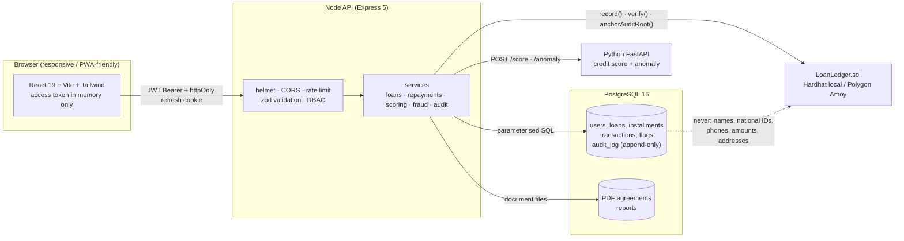

# SecureMicrofinance

A blockchain-backed microfinance prototype for **borrowers and staff loan officers**,
built as a security-focused university project. It records money movements on a public ledger as
**hashes and timestamps only**, keeps every piece of personal data off-chain and encrypted, and gives a
read-only forensic admin the tools to prove that the off-chain record has not been rewritten.

> Synthetic data only. Every account in the seed file is fictional and every number in this repository is
> generated for the demo.
>
> **Demo panel:** set `VITE_SHOW_DEMO_ACCOUNTS=true` and `VITE_DEMO_PASSWORD=<password>` in the frontend
> environment to show the clickable demo-account panel on the login page. Keep both unset or `false` in
> production. See [section 5.8](#58-frontend-environment-variables-vite_) for details.
>
> **Seeded accounts in production:** `npm run db:seed` refuses to run when `NODE_ENV=production` unless
> `ALLOW_DEMO_SEED=true` is explicitly set. If demo accounts were ever seeded into a live database, change
> their passwords or delete them before onboarding real borrowers.

---

## 1. What problem this solves

A staff member keeps a paper or spreadsheet ledger. Both sides of a dispute therefore depend on the
staff's own record: the borrower cannot prove a payment was made, and nobody can prove the record was not
edited afterwards. A licensed institution has auditors; a small office with twenty customers does not.

This institution-wide service provides the same three core properties at prototype scale:

| Property | Mechanism |
| --- | --- |
| **Existence** – this payment happened | SHA-256 of a canonical payload, written on-chain by the backend recorder wallet |
| **Integrity** – the record has not changed | The hash is recomputed from the row and compared with the stored hash *and* the ledger |
| **Accountability** – who did what | Append-only, hash-chained audit log; database triggers refuse UPDATE/DELETE/TRUNCATE |

The claim is deliberately narrow, and the UI repeats it: an on-chain hash proves *this exact row existed
in this state at this time*. It does not prove the money was really handed over, and it does not make a
fake record true. See [Known limitations](#10-known-limitations).

---

## 2. Roles and the seven modules

| Role | Sees | Cannot |
| --- | --- | --- |
| **Borrower** | Own applications, schedule, statement, score, flags on own loan, proof of own payments | See other borrowers, resolve flags, read the audit log |
| **Staff** | All institution applications, decisions, disbursements, repayments, fraud queue, alerts | Read the audit log or administer loan settings |
| **Forensic  # SecureMicrofinance

A blockchain-backed microfinance prototype for **borrowers and staff loan officers**,
built as a security-focused university project. It records money movements on a public ledger as
**hashes and timestamps only**, keeps every piece of personal data off-chain and encrypted, and gives a
read-only forensic admin the tools to prove that the off-chain record has not been rewritten.

> Synthetic data only. Every account in the seed file is fictional and every number in this repository is
> generated for the demo.
>
> **Demo panel:** set `VITE_SHOW_DEMO_ACCOUNTS=true` and `VITE_DEMO_PASSWORD=<password>` in the frontend
> environment to show the clickable demo-account panel on the login page. Keep both unset or `false` in
> production. See [section 5.8](#58-frontend-environment-variables-vite_) for details.
>
> **Seeded accounts in production:** `npm run db:seed` refuses to run when `NODE_ENV=production` unless
> `ALLOW_DEMO_SEED=true` is explicitly set. If demo accounts were ever seeded into a live database, change
> their passwords or delete them before onboarding real borrowers.

---

## 1. What problem this solves

A staff member keeps a paper or spreadsheet ledger. Both sides of a dispute therefore depend on the
staff's own record: the borrower cannot prove a payment was made, and nobody can prove the record was not
edited afterwards. A licensed institution has auditors; a small office with twenty customers does not.

This institution-wide service provides the same three core properties at prototype scale:

| Property | Mechanism |
| --- | --- |
| **Existence** – this payment happened | SHA-256 of a canonical payload, written on-chain by the backend recorder wallet |
| **Integrity** – the record has not changed | The hash is recomputed from the row and compared with the stored hash *and* the ledger |
| **Accountability** – who did what | Append-only, hash-chained audit log; database triggers refuse UPDATE/DELETE/TRUNCATE |

The claim is deliberately narrow, and the UI repeats it: an on-chain hash proves *this exact row existed
in this state at this time*. It does not prove the money was really handed over, and it does not make a
fake record true. See [Known limitations](#10-known-limitations).

---

## 2. Roles and the seven modules

| Role | Sees | Cannot |
| --- | --- | --- |
| **Borrower** | Own applications, schedule, statement, score, flags on own loan, proof of own payments | See other borrowers, resolve flags, read the audit log |
| **Staff** | All institution applications, decisions, disbursements, repayments, fraud queue, alerts | Read the audit log or administer loan settings |
| **Forensic admin** | Everything, read-only: audit log, timeline, integrity runs, all loans and flags | Write anything except the record of their own integrity run and export |

| Module | What it does | Where |
| --- | --- | --- |
| M1 Identity & access | bcrypt, JWT access + rotating refresh cookie, RBAC, lockout, encrypted PII + blind indexes, hash-chained audit | `backend/src/modules/auth`, `users`, `audit`, `lib/crypto.ts` |
| M2 Loans | Apply → verify identity → decide → PDF agreement (SHA-256 stored) → disburse | `backend/src/modules/loans` |
| M3 Repayments | Daily/weekly/monthly schedule, installment allocation, penalties, statements (PDF/CSV) | `backend/src/modules/repayments` |
| M4 Ledger | `LoanLedger.sol`: hash-only records, one write per payment, no update/delete, audit-root anchoring | `contracts/`, `backend/src/modules/ledger` |
| M5 Credit scoring | FastAPI + scikit-learn model, advisory score with per-feature explanation, deterministic JS fallback | `ml-service/`, `backend/src/modules/scoring` |
| M6 Fraud | Rules (R1–R5) → Isolation Forest anomaly score → human review; holds park money without moving it | `backend/src/modules/fraud`, `ml-service/app/anomaly.py` |
| M7 Forensics | Audit search, per-loan timeline, integrity checks vs the chain, CSV/PDF exports that carry their own verification state | `backend/src/modules/audit`, `frontend/src/pages/auditor` |

---

## 3. Architecture



Three boundaries are load-bearing:

1. **Nothing personal goes on-chain.** The chain stores a `bytes32` record hash, a `bytes32` loan-reference
   hash, a type byte, a timestamp and the recorder address. No amount, no name, no identifier.
2. **The chain cannot be written by the browser.** Only the backend's recorder wallet signs, and only the
   contract owner can add recorder wallets. A compromised API can append; it still cannot rewrite.
3. **The audit log is written by the application, protected by the database.** A trigger cannot know the
   actor or IP, so the app writes the row; the trigger makes it immutable; the row hash makes silent edits
   detectable.

### What happens when money moves

```mermaid
sequenceDiagram
  autonumber
  participant S as Staff
  participant API as Node API
  participant DB as PostgreSQL
  participant ML as ML service
  participant CH as LoanLedger

  L->>API: POST /loans/{id}/disburse
  API->>DB: BEGIN; insert transaction (pending)
  API->>API: Layer 1 rules R1–R5 (mobile receipt, duplicates)
  API->>ML: POST /anomaly (7 behavioural features)
  ML-->>API: is_anomaly, risk, severity, unusual features

  alt rules or high/critical anomaly
    API->>DB: transaction = held (+ hold_reason), flag, alert to staff
    API-->>S: 200 { held: true } — no money moved
    Note over S,DB: Staff review; release applies the movement<br/>with the same allocation code, reject keeps it as evidence
  else clear
    API->>DB: allocate installments under row locks, transaction = cleared
    API->>CH: record(loanRefHash, type, occurredAt, payloadHash)
    API->>DB: store onchain hash + block, loan = disbursed/active
    API-->>L: 200 { held: false, anchored: true }
  end
  API->>DB: audit row (hash-chained, seq N covers seq N-1)
```

---

## 4. Repository layout

```
Finance/
├── backend/                 Express 5 + TypeScript API
│   ├── src/
│   │   ├── config/env.ts    zod-validated environment (fails fast on bad config)
│   │   ├── db/              pool, migrations 001–004, seed, reset
│   │   ├── lib/             crypto (AES-GCM, HMAC), canonical hashing, PDF writer, errors
│   │   ├── middleware/      auth, RBAC, validation, rate limits, request id, errors
│   │   └── modules/         auth · users · loans · repayments · ledger · scoring · fraud · audit
│   ├── test/                vitest + supertest suites (10 files, 70 tests)
│   └── openapi.yaml         OpenAPI 3 spec served at /api/docs
├── contracts/               Hardhat project; contracts/LoanLedger.sol + tests
├── ml-service/              FastAPI; /score, /anomaly, training scripts, joblib artifacts
├── frontend/                React 19 + Vite + Tailwind SPA (role-based routing)
├── docs/                    ERD, DFD, STRIDE, deployment guide
├── scripts/                 embedded Postgres, smoke test
├── docker-compose.yml       postgres + api + web
└── .env.example             every variable, with the safe local defaults
```

---

## 5. Quick start

Prerequisites: **Node 20+** (developed on 22/26), **PostgreSQL 13+** *or* the bundled embedded Postgres,
and optionally **Python 3.11** for the ML service. Docker is optional.

### 5.1 Install dependencies

```powershell
npm install
```

### 5.2 Configure environment

```powershell
Copy-Item .env.example .env
```

The defaults work locally: database on `localhost:55432`, API on `4000`, web on `5173`, Hardhat on `8545`,
ML service on `8000`. In production, replace every secret — generate them with:

```powershell
node -e "console.log(require('crypto').randomBytes(32).toString('hex'))"
```

### 5.3 Database

```powershell
npm run db:up        # embedded PostgreSQL on port 55432 (no Docker needed)
npm run db:migrate   # applies 001–004
npm run db:seed      # demo accounts, see 5.7
```

Using your own PostgreSQL instead: point `DATABASE_URL` at it and run `npm run db:migrate` then `npm run db:seed`.

### 5.4 Blockchain (optional, but this is the point of the project)

```powershell
npm run dev:chain                     # terminal A: Hardhat node on 127.0.0.1:8545
npm run contract:deploy               # terminal B: deploys LoanLedger, prints the address
```

Copy the printed address into `.env` as `LEDGER_CONTRACT_ADDRESS`, then restart the API. With
`CHAIN_MODE=off` (or no address) the API degrades honestly: payments are recorded, and every proof is
reported as `unanchored` rather than "verified".

### 5.5 ML service (optional)

```powershell
cd ml-service
python -m venv .venv
.\.venv\Scripts\python.exe -m pip install -r requirements.txt
.\.venv\Scripts\python.exe training/train.py            # credit model
.\.venv\Scripts\python.exe training/train_anomaly.py    # isolation forest
.\.venv\Scripts\python.exe -m uvicorn app.main:app --host 127.0.0.1 --port 8000
```

Check `http://127.0.0.1:8000/health`: it reports the loaded model versions. If the service is down, both
callers fall back deterministically and the stored `model_source` says `fallback_heuristic` — the score is
never silently invented.

### 5.6 Run the app

```powershell
npm run dev:api     # terminal C: API on http://127.0.0.1:4000
npm run dev:web     # terminal D: SPA on http://localhost:5173
```

```powershell
Invoke-RestMethod http://127.0.0.1:4000/api/health
```

Docker instead of local processes: `docker compose up --build` (Postgres on 55432, API on 4000, web on 8080).

### 5.7 Demo accounts

Set `DEMO_SEED_PASSWORD` in `.env` before running `npm run db:seed` (see `.env.example`). All seeded accounts share that password.

| Email | Role | Notes |
| --- | --- | --- |
| `staff@smf.demo` | Staff | Amani Kariuki — reviews applications and manages disbursements |
| `borrower@smf.demo` | Borrower | Grace Wanjiku, complete profile |
| `borrower2@smf.demo` | Borrower | Peter Otieno — **shares a phone number with Grace on purpose**, to trigger the identity-conflict rule |
| `admin@smf.demo` | Admin | Read-only forensic desk |

Admins cannot self-register: the public API requires a staff invite code for Staff accounts and allows open registration only for Borrowers. The auditor account is provisioned by seed or by a database administrator.

> **Warning:** `db:seed` refuses to run when `NODE_ENV=production` unless `ALLOW_DEMO_SEED=true` is set.
> If demo accounts were ever seeded into a live database, change their passwords or delete them before
> onboarding real borrowers.

### 5.8 Frontend environment variables (`VITE_`)

Vite bakes `VITE_` variables into the browser bundle at build time. They are visible to anyone who
downloads the built JavaScript. Never put secrets in them. The demo password is intentionally low-value;
treat any `VITE_` value as public.

Frontend variables also require a full redeploy before they take effect — they are not read at runtime.
On Vercel, save the variable and then trigger a new deployment.

| Variable | Purpose | Production value |
| --- | --- | --- |
| `VITE_SHOW_DEMO_ACCOUNTS` | `"true"` shows the demo-account panel on the login page | unset or `"false"` |
| `VITE_DEMO_PASSWORD` | Password shown in the demo panel (auto-fills the form) | unset |

**Vercel setup for a demo deployment:**
1. Go to your Vercel project → Settings → Environment Variables.
2. Add `VITE_SHOW_DEMO_ACCOUNTS = true` scoped to **Preview** (not Production).
3. Add `VITE_DEMO_PASSWORD = <your demo password>` scoped to **Preview**.
4. Trigger a redeploy of the preview branch — the panel appears immediately.
5. Leave both variables unset on the **Production** environment.

---

## 6. Demo script (about ten minutes)

1. **Borrower applies.** Sign in as `borrower@smf.demo` → *Apply for a loan* → KES 5,000, 4 weekly terms.
   Open the loan: the advisory score card shows the model version, the score and the factor contributions.
2. **Staff verifies and approves.** Sign in as `staff@smf.demo` → *Applications* → verify identity →
   approve at 10%. The PDF agreement is generated and its SHA-256 is attached to the loan.
3. **Disburse.** The money path runs both fraud layers, then anchors the payment. On the loan page, open
   *Ledger proof*: the payment reads `verified` when Hardhat is running, `unanchored` when it is not.
4. **Borrower repays.** Record a repayment of KES 2,000. The schedule shows the allocation (penalty →
   interest → principal) and the loan moves to `active`. Download the statement as PDF and CSV.
5. **Trigger a hold.** As staff, disburse or repay with a forged-looking reference (e.g. `0000000000`),
   or submit the same M-Pesa code twice. The response is **202 with `held: true`**: the claim is recorded,
   the money has not moved, and an alert appears in the fraud queue.
6. **Review it.** In *Fraud queue*, read the detail (which rule, which values), write a note, then either
   *Release money* (applies the payment with the normal allocation code, then anchors it) or
   *Reject movement* (keeps the row as evidence). Clearing a flag alone never moves money — try it and watch
   the transaction stay `held`.
7. **Audit it.** Sign in as `admin@smf.demo` → *Audit log*: filter by action `repayment.*`, open a row to
   see the IP, request id, both record hashes and the chain link. Follow *Rebuild this loan's timeline*.
8. **Prove it.** *Integrity checks* → *Verify everything*. Then, to demo tamper detection, edit one audit
   row directly in the database with the guard trigger disabled and run the check again: the result is
   `tampered` with the exact rows and reasons.

---

## 7. Security controls

| Area | Control | Implemented in |
| --- | --- | --- |
| Passwords | bcrypt, cost from `BCRYPT_COST` (12), 10+ chars with letter and digit | `modules/auth`, `middleware/rateLimit` |
| Sessions | 15-minute access JWT in memory; refresh token in `httpOnly`, `SameSite=Strict` cookie; rotation with reuse detection; family revocation | `modules/auth/token.service.ts` |
| Authorisation | `requireAuth` + `requireRole` on every route, then an ownership re-check in the service; a foreign id returns 404, not 403 | `middleware/auth.ts`, all services |
| Input | zod schemas replace `body`/`query`/`params`, unknown keys stripped (mass-assignment defence) | `middleware/validate.ts` |
| SQL | Parameterised queries only; no string interpolation of user input | `db/pool.ts` and every module |
| PII at rest | AES-256-GCM for national ID, phone, date of birth, address, guarantor details; HMAC-SHA256 blind indexes for duplicate detection without decryption | `lib/crypto.ts` |
| Transport & headers | helmet, explicit CORS allow-list, HSTS in production, `X-Request-Id` correlation | `app.ts` |
| Abuse | Global and auth-specific rate limits, account lockout after 5 failures for 15 minutes | `middleware/rateLimit`, `auth.service` |
| Auditability | Append-only `audit_log`: per-row SHA-256 covering the previous hash, DB triggers rejecting UPDATE/DELETE/TRUNCATE, optional on-chain anchoring of the chain root | `modules/audit`, migration `004` |
| Ledger | Hash-only records; one write per payment; no update, no delete, no upgrade proxy; recorder allow-list | `contracts/contracts/LoanLedger.sol` |
| Money integrity | Amounts as integer cents; allocation inside a transaction with `SELECT … FOR UPDATE`; overpayment rejected with 422 | `modules/repayments/repayment.service.ts` |
| Fail-safe defaults | Rules fail closed (hold), ML fails open (log and continue); an unanchored payment is never reported as verified | `modules/fraud`, `modules/ledger` |

Threat model: [docs/STRIDE.md](docs/STRIDE.md). Data model: [docs/ERD.md](docs/ERD.md). Data flows:
[docs/DFD.md](docs/DFD.md).

---

## 8. Tests

```powershell
npm test              # backend API suite (70 tests)
npm run contract:test # LoanLedger (9 tests)
npm run typecheck     # backend + frontend
npm run build         # production build of both
```

The API suite runs against a real PostgreSQL database (schema rebuilt per run, tables truncated per test)
and stubs nothing except the two network seams: the ML service (`ML_FORCE_FALLBACK` or the test seam
`__setAnomalyScorer`) and the chain client (disabled, which is itself a tested state).

| Suite | Tests | What it proves |
| --- | --- | --- |
| `auth` | 9 | registration, login, lockout, refresh rotation and reuse detection, password change revoking sessions |
| `rbac` | 6 | no token / bad token rejected; admins cannot write; staff cannot edit borrower profiles; the role is re-read from the database, not trusted from the token |
| `encryption` | 5 | national ID and phone are ciphertext at rest, blind indexes detect duplicates, raw values never leave the API |
| `audit` | 4 | every auth event is chained; UPDATE/DELETE/TRUNCATE rejected by the database; an edited row is detected |
| `loans` | 11 | apply → verify → decide → agreement hash → disburse, including wrong-role and wrong-state attempts, and a download that refuses a swapped PDF |
| `repayments` | 8 | allocation order, penalties, overpayment refusal, settlement, statements |
| `scoring` | 5 | score stored and explained, risk ordering, visibility rules, re-scoring audited, a bad score never blocks approval |
| `ledger` | 7 | verified / unanchored / broken states; tampering with the amount, the hash or the loan reference is detected |
| `fraud` | 8 | model flag + stored risk, dedupe, release applies the money, reject keeps evidence, fail-open when the model is down |
| `forensics` | 7 | admin-only surfaces, log search and filters, timeline ordering, integrity runs, chain and payment tampering found, exports carry verification state |

The frontend is not unit-tested; it is covered by strict TypeScript, a production build, and the manual
script in section 6. The ML service is verified against its own HTTP contract (`/health`, `/model`,
`/model/anomaly`, `/score`, `/anomaly`).

---

## 9. API documentation

With the API running:

* Swagger UI — <http://127.0.0.1:4000/api/docs>
* Raw spec — <http://127.0.0.1:4000/api/openapi.yaml>

The spec covers all modules and documents the HTTP semantics that matter: `201` vs `202` on repayments
(applied vs held), `200` with `result: tampered` for an integrity finding, `404` instead of `403` for a
resource in someone else's account, and the `X-Document-SHA256` header on every document download.

---

## 10. Known limitations

Stated plainly, because a security project that oversells itself is worse than a simpler one:

* **The recorder wallet is a server secret.** A compromised API host can append bogus hashes. It cannot
  rewrite existing ones, which is the property being demonstrated — but "append-only" is not "truthful".
* **The chain proves the record, not the cash.** If staff claim a disbursement that never happened,
  the ledger faithfully records the claim.
* **No payment-rail integration.** M-Pesa codes are validated for shape and uniqueness, not verified with
  Safaricom; there is no money movement, only accounting.
* **Penalties are simple.** A pro-rata monthly rate after a grace period, not a real product schedule.
* **Single-region deployment, single database.** No read replicas, no sharding, no queue between API and
  ML service. The ML call is synchronous with a 3-second timeout.
* **Admin accounts are provisioned out-of-band** (seed or DBA). There is no admin UI.
* **Rate limiting is in-process**, so it does not survive a multi-instance deployment without a shared store.
* **Not legal advice, not a licensed lending product**, and not audited by a third party.

---

## 11. Further documentation

| Document | Contents |
| --- | --- |
| [docs/ERD.md](docs/ERD.md) | Entity-relationship diagram, column notes, enum values, why each hash exists |
| [docs/DFD.md](docs/DFD.md) | Context and level-1 data flow diagrams, trust boundaries, where PII is allowed to go |
| [docs/STRIDE.md](docs/STRIDE.md) | Threat table per element (spoofing → elevation), control, residual risk |
| [docs/DEPLOYMENT.md](docs/DEPLOYMENT.md) | AWS EC2 + RDS walkthrough, Polygon Amoy, nginx/TLS, systemd, backups, hardening checklist |
.Value -creplace 'auditor', 'admin' -creplace 'Auditor', 'Admin' ** | Everything, read-only: audit log, timeline, integrity runs, all loans and flags | Write anything except the record of their own integrity run and export |

| Module | What it does | Where |
| --- | --- | --- |
| M1 Identity & access | bcrypt, JWT access + rotating refresh cookie, RBAC, lockout, encrypted PII + blind indexes, hash-chained audit | `backend/src/modules/auth`, `users`, `audit`, `lib/crypto.ts` |
| M2 Loans | Apply → verify identity → decide → PDF agreement (SHA-256 stored) → disburse | `backend/src/modules/loans` |
| M3 Repayments | Daily/weekly/monthly schedule, installment allocation, penalties, statements (PDF/CSV) | `backend/src/modules/repayments` |
| M4 Ledger | `LoanLedger.sol`: hash-only records, one write per payment, no update/delete, audit-root anchoring | `contracts/`, `backend/src/modules/ledger` |
| M5 Credit scoring | FastAPI + scikit-learn model, advisory score with per-feature explanation, deterministic JS fallback | `ml-service/`, `backend/src/modules/scoring` |
| M6 Fraud | Rules (R1–R5) → Isolation Forest anomaly score → human review; holds park money without moving it | `backend/src/modules/fraud`, `ml-service/app/anomaly.py` |
| M7 Forensics | Audit search, per-loan timeline, integrity checks vs the chain, CSV/PDF exports that carry their own verification state | `backend/src/modules/audit`, `frontend/src/pages/ # SecureMicrofinance

A blockchain-backed microfinance prototype for **borrowers and staff loan officers**,
built as a security-focused university project. It records money movements on a public ledger as
**hashes and timestamps only**, keeps every piece of personal data off-chain and encrypted, and gives a
read-only forensic admin the tools to prove that the off-chain record has not been rewritten.

> Synthetic data only. Every account in the seed file is fictional and every number in this repository is
> generated for the demo.
>
> **Demo panel:** set `VITE_SHOW_DEMO_ACCOUNTS=true` and `VITE_DEMO_PASSWORD=<password>` in the frontend
> environment to show the clickable demo-account panel on the login page. Keep both unset or `false` in
> production. See [section 5.8](#58-frontend-environment-variables-vite_) for details.
>
> **Seeded accounts in production:** `npm run db:seed` refuses to run when `NODE_ENV=production` unless
> `ALLOW_DEMO_SEED=true` is explicitly set. If demo accounts were ever seeded into a live database, change
> their passwords or delete them before onboarding real borrowers.

---

## 1. What problem this solves

A staff member keeps a paper or spreadsheet ledger. Both sides of a dispute therefore depend on the
staff's own record: the borrower cannot prove a payment was made, and nobody can prove the record was not
edited afterwards. A licensed institution has auditors; a small office with twenty customers does not.

This institution-wide service provides the same three core properties at prototype scale:

| Property | Mechanism |
| --- | --- |
| **Existence** – this payment happened | SHA-256 of a canonical payload, written on-chain by the backend recorder wallet |
| **Integrity** – the record has not changed | The hash is recomputed from the row and compared with the stored hash *and* the ledger |
| **Accountability** – who did what | Append-only, hash-chained audit log; database triggers refuse UPDATE/DELETE/TRUNCATE |

The claim is deliberately narrow, and the UI repeats it: an on-chain hash proves *this exact row existed
in this state at this time*. It does not prove the money was really handed over, and it does not make a
fake record true. See [Known limitations](#10-known-limitations).

---

## 2. Roles and the seven modules

| Role | Sees | Cannot |
| --- | --- | --- |
| **Borrower** | Own applications, schedule, statement, score, flags on own loan, proof of own payments | See other borrowers, resolve flags, read the audit log |
| **Staff** | All institution applications, decisions, disbursements, repayments, fraud queue, alerts | Read the audit log or administer loan settings |
| **Forensic admin** | Everything, read-only: audit log, timeline, integrity runs, all loans and flags | Write anything except the record of their own integrity run and export |

| Module | What it does | Where |
| --- | --- | --- |
| M1 Identity & access | bcrypt, JWT access + rotating refresh cookie, RBAC, lockout, encrypted PII + blind indexes, hash-chained audit | `backend/src/modules/auth`, `users`, `audit`, `lib/crypto.ts` |
| M2 Loans | Apply → verify identity → decide → PDF agreement (SHA-256 stored) → disburse | `backend/src/modules/loans` |
| M3 Repayments | Daily/weekly/monthly schedule, installment allocation, penalties, statements (PDF/CSV) | `backend/src/modules/repayments` |
| M4 Ledger | `LoanLedger.sol`: hash-only records, one write per payment, no update/delete, audit-root anchoring | `contracts/`, `backend/src/modules/ledger` |
| M5 Credit scoring | FastAPI + scikit-learn model, advisory score with per-feature explanation, deterministic JS fallback | `ml-service/`, `backend/src/modules/scoring` |
| M6 Fraud | Rules (R1–R5) → Isolation Forest anomaly score → human review; holds park money without moving it | `backend/src/modules/fraud`, `ml-service/app/anomaly.py` |
| M7 Forensics | Audit search, per-loan timeline, integrity checks vs the chain, CSV/PDF exports that carry their own verification state | `backend/src/modules/audit`, `frontend/src/pages/auditor` |

---

## 3. Architecture


Three boundaries are load-bearing:

1. **Nothing personal goes on-chain.** The chain stores a `bytes32` record hash, a `bytes32` loan-reference
   hash, a type byte, a timestamp and the recorder address. No amount, no name, no identifier.
2. **The chain cannot be written by the browser.** Only the backend's recorder wallet signs, and only the
   contract owner can add recorder wallets. A compromised API can append; it still cannot rewrite.
3. **The audit log is written by the application, protected by the database.** A trigger cannot know the
   actor or IP, so the app writes the row; the trigger makes it immutable; the row hash makes silent edits
   detectable.

### What happens when money moves

```mermaid
sequenceDiagram
  autonumber
  participant S as Staff
  participant API as Node API
  participant DB as PostgreSQL
  participant ML as ML service
  participant CH as LoanLedger

  L->>API: POST /loans/{id}/disburse
  API->>DB: BEGIN; insert transaction (pending)
  API->>API: Layer 1 rules R1–R5 (mobile receipt, duplicates)
  API->>ML: POST /anomaly (7 behavioural features)
  ML-->>API: is_anomaly, risk, severity, unusual features

  alt rules or high/critical anomaly
    API->>DB: transaction = held (+ hold_reason), flag, alert to staff
    API-->>S: 200 { held: true } — no money moved
    Note over S,DB: Staff review; release applies the movement<br/>with the same allocation code, reject keeps it as evidence
  else clear
    API->>DB: allocate installments under row locks, transaction = cleared
    API->>CH: record(loanRefHash, type, occurredAt, payloadHash)
    API->>DB: store onchain hash + block, loan = disbursed/active
    API-->>L: 200 { held: false, anchored: true }
  end
  API->>DB: audit row (hash-chained, seq N covers seq N-1)
```

---

## 4. Repository layout

```
Finance/
├── backend/                 Express 5 + TypeScript API
│   ├── src/
│   │   ├── config/env.ts    zod-validated environment (fails fast on bad config)
│   │   ├── db/              pool, migrations 001–004, seed, reset
│   │   ├── lib/             crypto (AES-GCM, HMAC), canonical hashing, PDF writer, errors
│   │   ├── middleware/      auth, RBAC, validation, rate limits, request id, errors
│   │   └── modules/         auth · users · loans · repayments · ledger · scoring · fraud · audit
│   ├── test/                vitest + supertest suites (10 files, 70 tests)
│   └── openapi.yaml         OpenAPI 3 spec served at /api/docs
├── contracts/               Hardhat project; contracts/LoanLedger.sol + tests
├── ml-service/              FastAPI; /score, /anomaly, training scripts, joblib artifacts
├── frontend/                React 19 + Vite + Tailwind SPA (role-based routing)
├── docs/                    ERD, DFD, STRIDE, deployment guide
├── scripts/                 embedded Postgres, smoke test
├── docker-compose.yml       postgres + api + web
└── .env.example             every variable, with the safe local defaults
```

---

## 5. Quick start

Prerequisites: **Node 20+** (developed on 22/26), **PostgreSQL 13+** *or* the bundled embedded Postgres,
and optionally **Python 3.11** for the ML service. Docker is optional.

### 5.1 Install dependencies

```powershell
npm install
```

### 5.2 Configure environment

```powershell
Copy-Item .env.example .env
```

The defaults work locally: database on `localhost:55432`, API on `4000`, web on `5173`, Hardhat on `8545`,
ML service on `8000`. In production, replace every secret — generate them with:

```powershell
node -e "console.log(require('crypto').randomBytes(32).toString('hex'))"
```

### 5.3 Database

```powershell
npm run db:up        # embedded PostgreSQL on port 55432 (no Docker needed)
npm run db:migrate   # applies 001–004
npm run db:seed      # demo accounts, see 5.7
```

Using your own PostgreSQL instead: point `DATABASE_URL` at it and run `npm run db:migrate` then `npm run db:seed`.

### 5.4 Blockchain (optional, but this is the point of the project)

```powershell
npm run dev:chain                     # terminal A: Hardhat node on 127.0.0.1:8545
npm run contract:deploy               # terminal B: deploys LoanLedger, prints the address
```

Copy the printed address into `.env` as `LEDGER_CONTRACT_ADDRESS`, then restart the API. With
`CHAIN_MODE=off` (or no address) the API degrades honestly: payments are recorded, and every proof is
reported as `unanchored` rather than "verified".

### 5.5 ML service (optional)

```powershell
cd ml-service
python -m venv .venv
.\.venv\Scripts\python.exe -m pip install -r requirements.txt
.\.venv\Scripts\python.exe training/train.py            # credit model
.\.venv\Scripts\python.exe training/train_anomaly.py    # isolation forest
.\.venv\Scripts\python.exe -m uvicorn app.main:app --host 127.0.0.1 --port 8000
```

Check `http://127.0.0.1:8000/health`: it reports the loaded model versions. If the service is down, both
callers fall back deterministically and the stored `model_source` says `fallback_heuristic` — the score is
never silently invented.

### 5.6 Run the app

```powershell
npm run dev:api     # terminal C: API on http://127.0.0.1:4000
npm run dev:web     # terminal D: SPA on http://localhost:5173
```

```powershell
Invoke-RestMethod http://127.0.0.1:4000/api/health
```

Docker instead of local processes: `docker compose up --build` (Postgres on 55432, API on 4000, web on 8080).

### 5.7 Demo accounts

Set `DEMO_SEED_PASSWORD` in `.env` before running `npm run db:seed` (see `.env.example`). All seeded accounts share that password.

| Email | Role | Notes |
| --- | --- | --- |
| `staff@smf.demo` | Staff | Amani Kariuki — reviews applications and manages disbursements |
| `borrower@smf.demo` | Borrower | Grace Wanjiku, complete profile |
| `borrower2@smf.demo` | Borrower | Peter Otieno — **shares a phone number with Grace on purpose**, to trigger the identity-conflict rule |
| `admin@smf.demo` | Admin | Read-only forensic desk |

Admins cannot self-register: the public API requires a staff invite code for Staff accounts and allows open registration only for Borrowers. The auditor account is provisioned by seed or by a database administrator.

> **Warning:** `db:seed` refuses to run when `NODE_ENV=production` unless `ALLOW_DEMO_SEED=true` is set.
> If demo accounts were ever seeded into a live database, change their passwords or delete them before
> onboarding real borrowers.

### 5.8 Frontend environment variables (`VITE_`)

Vite bakes `VITE_` variables into the browser bundle at build time. They are visible to anyone who
downloads the built JavaScript. Never put secrets in them. The demo password is intentionally low-value;
treat any `VITE_` value as public.

Frontend variables also require a full redeploy before they take effect — they are not read at runtime.
On Vercel, save the variable and then trigger a new deployment.

| Variable | Purpose | Production value |
| --- | --- | --- |
| `VITE_SHOW_DEMO_ACCOUNTS` | `"true"` shows the demo-account panel on the login page | unset or `"false"` |
| `VITE_DEMO_PASSWORD` | Password shown in the demo panel (auto-fills the form) | unset |

**Vercel setup for a demo deployment:**
1. Go to your Vercel project → Settings → Environment Variables.
2. Add `VITE_SHOW_DEMO_ACCOUNTS = true` scoped to **Preview** (not Production).
3. Add `VITE_DEMO_PASSWORD = <your demo password>` scoped to **Preview**.
4. Trigger a redeploy of the preview branch — the panel appears immediately.
5. Leave both variables unset on the **Production** environment.

---

## 6. Demo script (about ten minutes)

1. **Borrower applies.** Sign in as `borrower@smf.demo` → *Apply for a loan* → KES 5,000, 4 weekly terms.
   Open the loan: the advisory score card shows the model version, the score and the factor contributions.
2. **Staff verifies and approves.** Sign in as `staff@smf.demo` → *Applications* → verify identity →
   approve at 10%. The PDF agreement is generated and its SHA-256 is attached to the loan.
3. **Disburse.** The money path runs both fraud layers, then anchors the payment. On the loan page, open
   *Ledger proof*: the payment reads `verified` when Hardhat is running, `unanchored` when it is not.
4. **Borrower repays.** Record a repayment of KES 2,000. The schedule shows the allocation (penalty →
   interest → principal) and the loan moves to `active`. Download the statement as PDF and CSV.
5. **Trigger a hold.** As staff, disburse or repay with a forged-looking reference (e.g. `0000000000`),
   or submit the same M-Pesa code twice. The response is **202 with `held: true`**: the claim is recorded,
   the money has not moved, and an alert appears in the fraud queue.
6. **Review it.** In *Fraud queue*, read the detail (which rule, which values), write a note, then either
   *Release money* (applies the payment with the normal allocation code, then anchors it) or
   *Reject movement* (keeps the row as evidence). Clearing a flag alone never moves money — try it and watch
   the transaction stay `held`.
7. **Audit it.** Sign in as `admin@smf.demo` → *Audit log*: filter by action `repayment.*`, open a row to
   see the IP, request id, both record hashes and the chain link. Follow *Rebuild this loan's timeline*.
8. **Prove it.** *Integrity checks* → *Verify everything*. Then, to demo tamper detection, edit one audit
   row directly in the database with the guard trigger disabled and run the check again: the result is
   `tampered` with the exact rows and reasons.

---

## 7. Security controls

| Area | Control | Implemented in |
| --- | --- | --- |
| Passwords | bcrypt, cost from `BCRYPT_COST` (12), 10+ chars with letter and digit | `modules/auth`, `middleware/rateLimit` |
| Sessions | 15-minute access JWT in memory; refresh token in `httpOnly`, `SameSite=Strict` cookie; rotation with reuse detection; family revocation | `modules/auth/token.service.ts` |
| Authorisation | `requireAuth` + `requireRole` on every route, then an ownership re-check in the service; a foreign id returns 404, not 403 | `middleware/auth.ts`, all services |
| Input | zod schemas replace `body`/`query`/`params`, unknown keys stripped (mass-assignment defence) | `middleware/validate.ts` |
| SQL | Parameterised queries only; no string interpolation of user input | `db/pool.ts` and every module |
| PII at rest | AES-256-GCM for national ID, phone, date of birth, address, guarantor details; HMAC-SHA256 blind indexes for duplicate detection without decryption | `lib/crypto.ts` |
| Transport & headers | helmet, explicit CORS allow-list, HSTS in production, `X-Request-Id` correlation | `app.ts` |
| Abuse | Global and auth-specific rate limits, account lockout after 5 failures for 15 minutes | `middleware/rateLimit`, `auth.service` |
| Auditability | Append-only `audit_log`: per-row SHA-256 covering the previous hash, DB triggers rejecting UPDATE/DELETE/TRUNCATE, optional on-chain anchoring of the chain root | `modules/audit`, migration `004` |
| Ledger | Hash-only records; one write per payment; no update, no delete, no upgrade proxy; recorder allow-list | `contracts/contracts/LoanLedger.sol` |
| Money integrity | Amounts as integer cents; allocation inside a transaction with `SELECT … FOR UPDATE`; overpayment rejected with 422 | `modules/repayments/repayment.service.ts` |
| Fail-safe defaults | Rules fail closed (hold), ML fails open (log and continue); an unanchored payment is never reported as verified | `modules/fraud`, `modules/ledger` |

Threat model: [docs/STRIDE.md](docs/STRIDE.md). Data model: [docs/ERD.md](docs/ERD.md). Data flows:
[docs/DFD.md](docs/DFD.md).

---

## 8. Tests

```powershell
npm test              # backend API suite (70 tests)
npm run contract:test # LoanLedger (9 tests)
npm run typecheck     # backend + frontend
npm run build         # production build of both
```

The API suite runs against a real PostgreSQL database (schema rebuilt per run, tables truncated per test)
and stubs nothing except the two network seams: the ML service (`ML_FORCE_FALLBACK` or the test seam
`__setAnomalyScorer`) and the chain client (disabled, which is itself a tested state).

| Suite | Tests | What it proves |
| --- | --- | --- |
| `auth` | 9 | registration, login, lockout, refresh rotation and reuse detection, password change revoking sessions |
| `rbac` | 6 | no token / bad token rejected; admins cannot write; staff cannot edit borrower profiles; the role is re-read from the database, not trusted from the token |
| `encryption` | 5 | national ID and phone are ciphertext at rest, blind indexes detect duplicates, raw values never leave the API |
| `audit` | 4 | every auth event is chained; UPDATE/DELETE/TRUNCATE rejected by the database; an edited row is detected |
| `loans` | 11 | apply → verify → decide → agreement hash → disburse, including wrong-role and wrong-state attempts, and a download that refuses a swapped PDF |
| `repayments` | 8 | allocation order, penalties, overpayment refusal, settlement, statements |
| `scoring` | 5 | score stored and explained, risk ordering, visibility rules, re-scoring audited, a bad score never blocks approval |
| `ledger` | 7 | verified / unanchored / broken states; tampering with the amount, the hash or the loan reference is detected |
| `fraud` | 8 | model flag + stored risk, dedupe, release applies the money, reject keeps evidence, fail-open when the model is down |
| `forensics` | 7 | admin-only surfaces, log search and filters, timeline ordering, integrity runs, chain and payment tampering found, exports carry verification state |

The frontend is not unit-tested; it is covered by strict TypeScript, a production build, and the manual
script in section 6. The ML service is verified against its own HTTP contract (`/health`, `/model`,
`/model/anomaly`, `/score`, `/anomaly`).

---

## 9. API documentation

With the API running:

* Swagger UI — <http://127.0.0.1:4000/api/docs>
* Raw spec — <http://127.0.0.1:4000/api/openapi.yaml>

The spec covers all modules and documents the HTTP semantics that matter: `201` vs `202` on repayments
(applied vs held), `200` with `result: tampered` for an integrity finding, `404` instead of `403` for a
resource in someone else's account, and the `X-Document-SHA256` header on every document download.

---

## 10. Known limitations

Stated plainly, because a security project that oversells itself is worse than a simpler one:

* **The recorder wallet is a server secret.** A compromised API host can append bogus hashes. It cannot
  rewrite existing ones, which is the property being demonstrated — but "append-only" is not "truthful".
* **The chain proves the record, not the cash.** If staff claim a disbursement that never happened,
  the ledger faithfully records the claim.
* **No payment-rail integration.** M-Pesa codes are validated for shape and uniqueness, not verified with
  Safaricom; there is no money movement, only accounting.
* **Penalties are simple.** A pro-rata monthly rate after a grace period, not a real product schedule.
* **Single-region deployment, single database.** No read replicas, no sharding, no queue between API and
  ML service. The ML call is synchronous with a 3-second timeout.
* **Admin accounts are provisioned out-of-band** (seed or DBA). There is no admin UI.
* **Rate limiting is in-process**, so it does not survive a multi-instance deployment without a shared store.
* **Not legal advice, not a licensed lending product**, and not audited by a third party.

---

## 11. Further documentation

| Document | Contents |
| --- | --- |
| [docs/ERD.md](docs/ERD.md) | Entity-relationship diagram, column notes, enum values, why each hash exists |
| [docs/DFD.md](docs/DFD.md) | Context and level-1 data flow diagrams, trust boundaries, where PII is allowed to go |
| [docs/STRIDE.md](docs/STRIDE.md) | Threat table per element (spoofing → elevation), control, residual risk |
| [docs/DEPLOYMENT.md](docs/DEPLOYMENT.md) | AWS EC2 + RDS walkthrough, Polygon Amoy, nginx/TLS, systemd, backups, hardening checklist |
.Value -creplace 'auditor', 'admin' -creplace 'Auditor', 'Admin' ` |

---

## 3. Architecture


Three boundaries are load-bearing:

1. **Nothing personal goes on-chain.** The chain stores a `bytes32` record hash, a `bytes32` loan-reference
   hash, a type byte, a timestamp and the recorder address. No amount, no name, no identifier.
2. **The chain cannot be written by the browser.** Only the backend's recorder wallet signs, and only the
   contract owner can add recorder wallets. A compromised API can append; it still cannot rewrite.
3. **The audit log is written by the application, protected by the database.** A trigger cannot know the
   actor or IP, so the app writes the row; the trigger makes it immutable; the row hash makes silent edits
   detectable.

### What happens when money moves

```mermaid
sequenceDiagram
  autonumber
  participant S as Staff
  participant API as Node API
  participant DB as PostgreSQL
  participant ML as ML service
  participant CH as LoanLedger

  L->>API: POST /loans/{id}/disburse
  API->>DB: BEGIN; insert transaction (pending)
  API->>API: Layer 1 rules R1–R5 (mobile receipt, duplicates)
  API->>ML: POST /anomaly (7 behavioural features)
  ML-->>API: is_anomaly, risk, severity, unusual features

  alt rules or high/critical anomaly
    API->>DB: transaction = held (+ hold_reason), flag, alert to staff
    API-->>S: 200 { held: true } — no money moved
    Note over S,DB: Staff review; release applies the movement<br/>with the same allocation code, reject keeps it as evidence
  else clear
    API->>DB: allocate installments under row locks, transaction = cleared
    API->>CH: record(loanRefHash, type, occurredAt, payloadHash)
    API->>DB: store onchain hash + block, loan = disbursed/active
    API-->>L: 200 { held: false, anchored: true }
  end
  API->>DB: audit row (hash-chained, seq N covers seq N-1)
```

---

## 4. Repository layout

```
Finance/
├── backend/                 Express 5 + TypeScript API
│   ├── src/
│   │   ├── config/env.ts    zod-validated environment (fails fast on bad config)
│   │   ├── db/              pool, migrations 001–004, seed, reset
│   │   ├── lib/             crypto (AES-GCM, HMAC), canonical hashing, PDF writer, errors
│   │   ├── middleware/      auth, RBAC, validation, rate limits, request id, errors
│   │   └── modules/         auth · users · loans · repayments · ledger · scoring · fraud · audit
│   ├── test/                vitest + supertest suites (10 files, 70 tests)
│   └── openapi.yaml         OpenAPI 3 spec served at /api/docs
├── contracts/               Hardhat project; contracts/LoanLedger.sol + tests
├── ml-service/              FastAPI; /score, /anomaly, training scripts, joblib artifacts
├── frontend/                React 19 + Vite + Tailwind SPA (role-based routing)
├── docs/                    ERD, DFD, STRIDE, deployment guide
├── scripts/                 embedded Postgres, smoke test
├── docker-compose.yml       postgres + api + web
└── .env.example             every variable, with the safe local defaults
```

---

## 5. Quick start

Prerequisites: **Node 20+** (developed on 22/26), **PostgreSQL 13+** *or* the bundled embedded Postgres,
and optionally **Python 3.11** for the ML service. Docker is optional.

### 5.1 Install dependencies

```powershell
npm install
```

### 5.2 Configure environment

```powershell
Copy-Item .env.example .env
```

The defaults work locally: database on `localhost:55432`, API on `4000`, web on `5173`, Hardhat on `8545`,
ML service on `8000`. In production, replace every secret — generate them with:

```powershell
node -e "console.log(require('crypto').randomBytes(32).toString('hex'))"
```

### 5.3 Database

```powershell
npm run db:up        # embedded PostgreSQL on port 55432 (no Docker needed)
npm run db:migrate   # applies 001–004
npm run db:seed      # demo accounts, see 5.7
```

Using your own PostgreSQL instead: point `DATABASE_URL` at it and run `npm run db:migrate` then `npm run db:seed`.

### 5.4 Blockchain (optional, but this is the point of the project)

```powershell
npm run dev:chain                     # terminal A: Hardhat node on 127.0.0.1:8545
npm run contract:deploy               # terminal B: deploys LoanLedger, prints the address
```

Copy the printed address into `.env` as `LEDGER_CONTRACT_ADDRESS`, then restart the API. With
`CHAIN_MODE=off` (or no address) the API degrades honestly: payments are recorded, and every proof is
reported as `unanchored` rather than "verified".

### 5.5 ML service (optional)

```powershell
cd ml-service
python -m venv .venv
.\.venv\Scripts\python.exe -m pip install -r requirements.txt
.\.venv\Scripts\python.exe training/train.py            # credit model
.\.venv\Scripts\python.exe training/train_anomaly.py    # isolation forest
.\.venv\Scripts\python.exe -m uvicorn app.main:app --host 127.0.0.1 --port 8000
```

Check `http://127.0.0.1:8000/health`: it reports the loaded model versions. If the service is down, both
callers fall back deterministically and the stored `model_source` says `fallback_heuristic` — the score is
never silently invented.

### 5.6 Run the app

```powershell
npm run dev:api     # terminal C: API on http://127.0.0.1:4000
npm run dev:web     # terminal D: SPA on http://localhost:5173
```

```powershell
Invoke-RestMethod http://127.0.0.1:4000/api/health
```

Docker instead of local processes: `docker compose up --build` (Postgres on 55432, API on 4000, web on 8080).

### 5.7 Demo accounts

Set `DEMO_SEED_PASSWORD` in `.env` before running `npm run db:seed` (see `.env.example`). All seeded accounts share that password.

| Email | Role | Notes |
| --- | --- | --- |
| `staff@smf.demo` | Staff | Amani Kariuki — reviews applications and manages disbursements |
| `borrower@smf.demo` | Borrower | Grace Wanjiku, complete profile |
| `borrower2@smf.demo` | Borrower | Peter Otieno — **shares a phone number with Grace on purpose**, to trigger the identity-conflict rule |
| ` # SecureMicrofinance

A blockchain-backed microfinance prototype for **borrowers and staff loan officers**,
built as a security-focused university project. It records money movements on a public ledger as
**hashes and timestamps only**, keeps every piece of personal data off-chain and encrypted, and gives a
read-only forensic admin the tools to prove that the off-chain record has not been rewritten.

> Synthetic data only. Every account in the seed file is fictional and every number in this repository is
> generated for the demo.
>
> **Demo panel:** set `VITE_SHOW_DEMO_ACCOUNTS=true` and `VITE_DEMO_PASSWORD=<password>` in the frontend
> environment to show the clickable demo-account panel on the login page. Keep both unset or `false` in
> production. See [section 5.8](#58-frontend-environment-variables-vite_) for details.
>
> **Seeded accounts in production:** `npm run db:seed` refuses to run when `NODE_ENV=production` unless
> `ALLOW_DEMO_SEED=true` is explicitly set. If demo accounts were ever seeded into a live database, change
> their passwords or delete them before onboarding real borrowers.

---

## 1. What problem this solves

A staff member keeps a paper or spreadsheet ledger. Both sides of a dispute therefore depend on the
staff's own record: the borrower cannot prove a payment was made, and nobody can prove the record was not
edited afterwards. A licensed institution has auditors; a small office with twenty customers does not.

This institution-wide service provides the same three core properties at prototype scale:

| Property | Mechanism |
| --- | --- |
| **Existence** – this payment happened | SHA-256 of a canonical payload, written on-chain by the backend recorder wallet |
| **Integrity** – the record has not changed | The hash is recomputed from the row and compared with the stored hash *and* the ledger |
| **Accountability** – who did what | Append-only, hash-chained audit log; database triggers refuse UPDATE/DELETE/TRUNCATE |

The claim is deliberately narrow, and the UI repeats it: an on-chain hash proves *this exact row existed
in this state at this time*. It does not prove the money was really handed over, and it does not make a
fake record true. See [Known limitations](#10-known-limitations).

---

## 2. Roles and the seven modules

| Role | Sees | Cannot |
| --- | --- | --- |
| **Borrower** | Own applications, schedule, statement, score, flags on own loan, proof of own payments | See other borrowers, resolve flags, read the audit log |
| **Staff** | All institution applications, decisions, disbursements, repayments, fraud queue, alerts | Read the audit log or administer loan settings |
| **Forensic admin** | Everything, read-only: audit log, timeline, integrity runs, all loans and flags | Write anything except the record of their own integrity run and export |

| Module | What it does | Where |
| --- | --- | --- |
| M1 Identity & access | bcrypt, JWT access + rotating refresh cookie, RBAC, lockout, encrypted PII + blind indexes, hash-chained audit | `backend/src/modules/auth`, `users`, `audit`, `lib/crypto.ts` |
| M2 Loans | Apply → verify identity → decide → PDF agreement (SHA-256 stored) → disburse | `backend/src/modules/loans` |
| M3 Repayments | Daily/weekly/monthly schedule, installment allocation, penalties, statements (PDF/CSV) | `backend/src/modules/repayments` |
| M4 Ledger | `LoanLedger.sol`: hash-only records, one write per payment, no update/delete, audit-root anchoring | `contracts/`, `backend/src/modules/ledger` |
| M5 Credit scoring | FastAPI + scikit-learn model, advisory score with per-feature explanation, deterministic JS fallback | `ml-service/`, `backend/src/modules/scoring` |
| M6 Fraud | Rules (R1–R5) → Isolation Forest anomaly score → human review; holds park money without moving it | `backend/src/modules/fraud`, `ml-service/app/anomaly.py` |
| M7 Forensics | Audit search, per-loan timeline, integrity checks vs the chain, CSV/PDF exports that carry their own verification state | `backend/src/modules/audit`, `frontend/src/pages/auditor` |

---

## 3. Architecture


Three boundaries are load-bearing:

1. **Nothing personal goes on-chain.** The chain stores a `bytes32` record hash, a `bytes32` loan-reference
   hash, a type byte, a timestamp and the recorder address. No amount, no name, no identifier.
2. **The chain cannot be written by the browser.** Only the backend's recorder wallet signs, and only the
   contract owner can add recorder wallets. A compromised API can append; it still cannot rewrite.
3. **The audit log is written by the application, protected by the database.** A trigger cannot know the
   actor or IP, so the app writes the row; the trigger makes it immutable; the row hash makes silent edits
   detectable.

### What happens when money moves

```mermaid
sequenceDiagram
  autonumber
  participant S as Staff
  participant API as Node API
  participant DB as PostgreSQL
  participant ML as ML service
  participant CH as LoanLedger

  L->>API: POST /loans/{id}/disburse
  API->>DB: BEGIN; insert transaction (pending)
  API->>API: Layer 1 rules R1–R5 (mobile receipt, duplicates)
  API->>ML: POST /anomaly (7 behavioural features)
  ML-->>API: is_anomaly, risk, severity, unusual features

  alt rules or high/critical anomaly
    API->>DB: transaction = held (+ hold_reason), flag, alert to staff
    API-->>S: 200 { held: true } — no money moved
    Note over S,DB: Staff review; release applies the movement<br/>with the same allocation code, reject keeps it as evidence
  else clear
    API->>DB: allocate installments under row locks, transaction = cleared
    API->>CH: record(loanRefHash, type, occurredAt, payloadHash)
    API->>DB: store onchain hash + block, loan = disbursed/active
    API-->>L: 200 { held: false, anchored: true }
  end
  API->>DB: audit row (hash-chained, seq N covers seq N-1)
```

---

## 4. Repository layout

```
Finance/
├── backend/                 Express 5 + TypeScript API
│   ├── src/
│   │   ├── config/env.ts    zod-validated environment (fails fast on bad config)
│   │   ├── db/              pool, migrations 001–004, seed, reset
│   │   ├── lib/             crypto (AES-GCM, HMAC), canonical hashing, PDF writer, errors
│   │   ├── middleware/      auth, RBAC, validation, rate limits, request id, errors
│   │   └── modules/         auth · users · loans · repayments · ledger · scoring · fraud · audit
│   ├── test/                vitest + supertest suites (10 files, 70 tests)
│   └── openapi.yaml         OpenAPI 3 spec served at /api/docs
├── contracts/               Hardhat project; contracts/LoanLedger.sol + tests
├── ml-service/              FastAPI; /score, /anomaly, training scripts, joblib artifacts
├── frontend/                React 19 + Vite + Tailwind SPA (role-based routing)
├── docs/                    ERD, DFD, STRIDE, deployment guide
├── scripts/                 embedded Postgres, smoke test
├── docker-compose.yml       postgres + api + web
└── .env.example             every variable, with the safe local defaults
```

---

## 5. Quick start

Prerequisites: **Node 20+** (developed on 22/26), **PostgreSQL 13+** *or* the bundled embedded Postgres,
and optionally **Python 3.11** for the ML service. Docker is optional.

### 5.1 Install dependencies

```powershell
npm install
```

### 5.2 Configure environment

```powershell
Copy-Item .env.example .env
```

The defaults work locally: database on `localhost:55432`, API on `4000`, web on `5173`, Hardhat on `8545`,
ML service on `8000`. In production, replace every secret — generate them with:

```powershell
node -e "console.log(require('crypto').randomBytes(32).toString('hex'))"
```

### 5.3 Database

```powershell
npm run db:up        # embedded PostgreSQL on port 55432 (no Docker needed)
npm run db:migrate   # applies 001–004
npm run db:seed      # demo accounts, see 5.7
```

Using your own PostgreSQL instead: point `DATABASE_URL` at it and run `npm run db:migrate` then `npm run db:seed`.

### 5.4 Blockchain (optional, but this is the point of the project)

```powershell
npm run dev:chain                     # terminal A: Hardhat node on 127.0.0.1:8545
npm run contract:deploy               # terminal B: deploys LoanLedger, prints the address
```

Copy the printed address into `.env` as `LEDGER_CONTRACT_ADDRESS`, then restart the API. With
`CHAIN_MODE=off` (or no address) the API degrades honestly: payments are recorded, and every proof is
reported as `unanchored` rather than "verified".

### 5.5 ML service (optional)

```powershell
cd ml-service
python -m venv .venv
.\.venv\Scripts\python.exe -m pip install -r requirements.txt
.\.venv\Scripts\python.exe training/train.py            # credit model
.\.venv\Scripts\python.exe training/train_anomaly.py    # isolation forest
.\.venv\Scripts\python.exe -m uvicorn app.main:app --host 127.0.0.1 --port 8000
```

Check `http://127.0.0.1:8000/health`: it reports the loaded model versions. If the service is down, both
callers fall back deterministically and the stored `model_source` says `fallback_heuristic` — the score is
never silently invented.

### 5.6 Run the app

```powershell
npm run dev:api     # terminal C: API on http://127.0.0.1:4000
npm run dev:web     # terminal D: SPA on http://localhost:5173
```

```powershell
Invoke-RestMethod http://127.0.0.1:4000/api/health
```

Docker instead of local processes: `docker compose up --build` (Postgres on 55432, API on 4000, web on 8080).

### 5.7 Demo accounts

Set `DEMO_SEED_PASSWORD` in `.env` before running `npm run db:seed` (see `.env.example`). All seeded accounts share that password.

| Email | Role | Notes |
| --- | --- | --- |
| `staff@smf.demo` | Staff | Amani Kariuki — reviews applications and manages disbursements |
| `borrower@smf.demo` | Borrower | Grace Wanjiku, complete profile |
| `borrower2@smf.demo` | Borrower | Peter Otieno — **shares a phone number with Grace on purpose**, to trigger the identity-conflict rule |
| `admin@smf.demo` | Admin | Read-only forensic desk |

Admins cannot self-register: the public API requires a staff invite code for Staff accounts and allows open registration only for Borrowers. The auditor account is provisioned by seed or by a database administrator.

> **Warning:** `db:seed` refuses to run when `NODE_ENV=production` unless `ALLOW_DEMO_SEED=true` is set.
> If demo accounts were ever seeded into a live database, change their passwords or delete them before
> onboarding real borrowers.

### 5.8 Frontend environment variables (`VITE_`)

Vite bakes `VITE_` variables into the browser bundle at build time. They are visible to anyone who
downloads the built JavaScript. Never put secrets in them. The demo password is intentionally low-value;
treat any `VITE_` value as public.

Frontend variables also require a full redeploy before they take effect — they are not read at runtime.
On Vercel, save the variable and then trigger a new deployment.

| Variable | Purpose | Production value |
| --- | --- | --- |
| `VITE_SHOW_DEMO_ACCOUNTS` | `"true"` shows the demo-account panel on the login page | unset or `"false"` |
| `VITE_DEMO_PASSWORD` | Password shown in the demo panel (auto-fills the form) | unset |

**Vercel setup for a demo deployment:**
1. Go to your Vercel project → Settings → Environment Variables.
2. Add `VITE_SHOW_DEMO_ACCOUNTS = true` scoped to **Preview** (not Production).
3. Add `VITE_DEMO_PASSWORD = <your demo password>` scoped to **Preview**.
4. Trigger a redeploy of the preview branch — the panel appears immediately.
5. Leave both variables unset on the **Production** environment.

---

## 6. Demo script (about ten minutes)

1. **Borrower applies.** Sign in as `borrower@smf.demo` → *Apply for a loan* → KES 5,000, 4 weekly terms.
   Open the loan: the advisory score card shows the model version, the score and the factor contributions.
2. **Staff verifies and approves.** Sign in as `staff@smf.demo` → *Applications* → verify identity →
   approve at 10%. The PDF agreement is generated and its SHA-256 is attached to the loan.
3. **Disburse.** The money path runs both fraud layers, then anchors the payment. On the loan page, open
   *Ledger proof*: the payment reads `verified` when Hardhat is running, `unanchored` when it is not.
4. **Borrower repays.** Record a repayment of KES 2,000. The schedule shows the allocation (penalty →
   interest → principal) and the loan moves to `active`. Download the statement as PDF and CSV.
5. **Trigger a hold.** As staff, disburse or repay with a forged-looking reference (e.g. `0000000000`),
   or submit the same M-Pesa code twice. The response is **202 with `held: true`**: the claim is recorded,
   the money has not moved, and an alert appears in the fraud queue.
6. **Review it.** In *Fraud queue*, read the detail (which rule, which values), write a note, then either
   *Release money* (applies the payment with the normal allocation code, then anchors it) or
   *Reject movement* (keeps the row as evidence). Clearing a flag alone never moves money — try it and watch
   the transaction stay `held`.
7. **Audit it.** Sign in as `admin@smf.demo` → *Audit log*: filter by action `repayment.*`, open a row to
   see the IP, request id, both record hashes and the chain link. Follow *Rebuild this loan's timeline*.
8. **Prove it.** *Integrity checks* → *Verify everything*. Then, to demo tamper detection, edit one audit
   row directly in the database with the guard trigger disabled and run the check again: the result is
   `tampered` with the exact rows and reasons.

---

## 7. Security controls

| Area | Control | Implemented in |
| --- | --- | --- |
| Passwords | bcrypt, cost from `BCRYPT_COST` (12), 10+ chars with letter and digit | `modules/auth`, `middleware/rateLimit` |
| Sessions | 15-minute access JWT in memory; refresh token in `httpOnly`, `SameSite=Strict` cookie; rotation with reuse detection; family revocation | `modules/auth/token.service.ts` |
| Authorisation | `requireAuth` + `requireRole` on every route, then an ownership re-check in the service; a foreign id returns 404, not 403 | `middleware/auth.ts`, all services |
| Input | zod schemas replace `body`/`query`/`params`, unknown keys stripped (mass-assignment defence) | `middleware/validate.ts` |
| SQL | Parameterised queries only; no string interpolation of user input | `db/pool.ts` and every module |
| PII at rest | AES-256-GCM for national ID, phone, date of birth, address, guarantor details; HMAC-SHA256 blind indexes for duplicate detection without decryption | `lib/crypto.ts` |
| Transport & headers | helmet, explicit CORS allow-list, HSTS in production, `X-Request-Id` correlation | `app.ts` |
| Abuse | Global and auth-specific rate limits, account lockout after 5 failures for 15 minutes | `middleware/rateLimit`, `auth.service` |
| Auditability | Append-only `audit_log`: per-row SHA-256 covering the previous hash, DB triggers rejecting UPDATE/DELETE/TRUNCATE, optional on-chain anchoring of the chain root | `modules/audit`, migration `004` |
| Ledger | Hash-only records; one write per payment; no update, no delete, no upgrade proxy; recorder allow-list | `contracts/contracts/LoanLedger.sol` |
| Money integrity | Amounts as integer cents; allocation inside a transaction with `SELECT … FOR UPDATE`; overpayment rejected with 422 | `modules/repayments/repayment.service.ts` |
| Fail-safe defaults | Rules fail closed (hold), ML fails open (log and continue); an unanchored payment is never reported as verified | `modules/fraud`, `modules/ledger` |

Threat model: [docs/STRIDE.md](docs/STRIDE.md). Data model: [docs/ERD.md](docs/ERD.md). Data flows:
[docs/DFD.md](docs/DFD.md).

---

## 8. Tests

```powershell
npm test              # backend API suite (70 tests)
npm run contract:test # LoanLedger (9 tests)
npm run typecheck     # backend + frontend
npm run build         # production build of both
```

The API suite runs against a real PostgreSQL database (schema rebuilt per run, tables truncated per test)
and stubs nothing except the two network seams: the ML service (`ML_FORCE_FALLBACK` or the test seam
`__setAnomalyScorer`) and the chain client (disabled, which is itself a tested state).

| Suite | Tests | What it proves |
| --- | --- | --- |
| `auth` | 9 | registration, login, lockout, refresh rotation and reuse detection, password change revoking sessions |
| `rbac` | 6 | no token / bad token rejected; admins cannot write; staff cannot edit borrower profiles; the role is re-read from the database, not trusted from the token |
| `encryption` | 5 | national ID and phone are ciphertext at rest, blind indexes detect duplicates, raw values never leave the API |
| `audit` | 4 | every auth event is chained; UPDATE/DELETE/TRUNCATE rejected by the database; an edited row is detected |
| `loans` | 11 | apply → verify → decide → agreement hash → disburse, including wrong-role and wrong-state attempts, and a download that refuses a swapped PDF |
| `repayments` | 8 | allocation order, penalties, overpayment refusal, settlement, statements |
| `scoring` | 5 | score stored and explained, risk ordering, visibility rules, re-scoring audited, a bad score never blocks approval |
| `ledger` | 7 | verified / unanchored / broken states; tampering with the amount, the hash or the loan reference is detected |
| `fraud` | 8 | model flag + stored risk, dedupe, release applies the money, reject keeps evidence, fail-open when the model is down |
| `forensics` | 7 | admin-only surfaces, log search and filters, timeline ordering, integrity runs, chain and payment tampering found, exports carry verification state |

The frontend is not unit-tested; it is covered by strict TypeScript, a production build, and the manual
script in section 6. The ML service is verified against its own HTTP contract (`/health`, `/model`,
`/model/anomaly`, `/score`, `/anomaly`).

---

## 9. API documentation

With the API running:

* Swagger UI — <http://127.0.0.1:4000/api/docs>
* Raw spec — <http://127.0.0.1:4000/api/openapi.yaml>

The spec covers all modules and documents the HTTP semantics that matter: `201` vs `202` on repayments
(applied vs held), `200` with `result: tampered` for an integrity finding, `404` instead of `403` for a
resource in someone else's account, and the `X-Document-SHA256` header on every document download.

---

## 10. Known limitations

Stated plainly, because a security project that oversells itself is worse than a simpler one:

* **The recorder wallet is a server secret.** A compromised API host can append bogus hashes. It cannot
  rewrite existing ones, which is the property being demonstrated — but "append-only" is not "truthful".
* **The chain proves the record, not the cash.** If staff claim a disbursement that never happened,
  the ledger faithfully records the claim.
* **No payment-rail integration.** M-Pesa codes are validated for shape and uniqueness, not verified with
  Safaricom; there is no money movement, only accounting.
* **Penalties are simple.** A pro-rata monthly rate after a grace period, not a real product schedule.
* **Single-region deployment, single database.** No read replicas, no sharding, no queue between API and
  ML service. The ML call is synchronous with a 3-second timeout.
* **Admin accounts are provisioned out-of-band** (seed or DBA). There is no admin UI.
* **Rate limiting is in-process**, so it does not survive a multi-instance deployment without a shared store.
* **Not legal advice, not a licensed lending product**, and not audited by a third party.

---

## 11. Further documentation

| Document | Contents |
| --- | --- |
| [docs/ERD.md](docs/ERD.md) | Entity-relationship diagram, column notes, enum values, why each hash exists |
| [docs/DFD.md](docs/DFD.md) | Context and level-1 data flow diagrams, trust boundaries, where PII is allowed to go |
| [docs/STRIDE.md](docs/STRIDE.md) | Threat table per element (spoofing → elevation), control, residual risk |
| [docs/DEPLOYMENT.md](docs/DEPLOYMENT.md) | AWS EC2 + RDS walkthrough, Polygon Amoy, nginx/TLS, systemd, backups, hardening checklist |
.Value -creplace 'auditor', 'admin' -creplace 'Auditor', 'Admin' @smf.demo` | Admin | Read-only forensic desk |

Admins cannot self-register: the public API requires a staff invite code for Staff accounts and allows open registration only for Borrowers. The auditor account is provisioned by seed or by a database administrator.

> **Warning:** `db:seed` refuses to run when `NODE_ENV=production` unless `ALLOW_DEMO_SEED=true` is set.
> If demo accounts were ever seeded into a live database, change their passwords or delete them before
> onboarding real borrowers.

### 5.8 Frontend environment variables (`VITE_`)

Vite bakes `VITE_` variables into the browser bundle at build time. They are visible to anyone who
downloads the built JavaScript. Never put secrets in them. The demo password is intentionally low-value;
treat any `VITE_` value as public.

Frontend variables also require a full redeploy before they take effect — they are not read at runtime.
On Vercel, save the variable and then trigger a new deployment.

| Variable | Purpose | Production value |
| --- | --- | --- |
| `VITE_SHOW_DEMO_ACCOUNTS` | `"true"` shows the demo-account panel on the login page | unset or `"false"` |
| `VITE_DEMO_PASSWORD` | Password shown in the demo panel (auto-fills the form) | unset |

**Vercel setup for a demo deployment:**
1. Go to your Vercel project → Settings → Environment Variables.
2. Add `VITE_SHOW_DEMO_ACCOUNTS = true` scoped to **Preview** (not Production).
3. Add `VITE_DEMO_PASSWORD = <your demo password>` scoped to **Preview**.
4. Trigger a redeploy of the preview branch — the panel appears immediately.
5. Leave both variables unset on the **Production** environment.

---

## 6. Demo script (about ten minutes)

1. **Borrower applies.** Sign in as `borrower@smf.demo` → *Apply for a loan* → KES 5,000, 4 weekly terms.
   Open the loan: the advisory score card shows the model version, the score and the factor contributions.
2. **Staff verifies and approves.** Sign in as `staff@smf.demo` → *Applications* → verify identity →
   approve at 10%. The PDF agreement is generated and its SHA-256 is attached to the loan.
3. **Disburse.** The money path runs both fraud layers, then anchors the payment. On the loan page, open
   *Ledger proof*: the payment reads `verified` when Hardhat is running, `unanchored` when it is not.
4. **Borrower repays.** Record a repayment of KES 2,000. The schedule shows the allocation (penalty →
   interest → principal) and the loan moves to `active`. Download the statement as PDF and CSV.
5. **Trigger a hold.** As staff, disburse or repay with a forged-looking reference (e.g. `0000000000`),
   or submit the same M-Pesa code twice. The response is **202 with `held: true`**: the claim is recorded,
   the money has not moved, and an alert appears in the fraud queue.
6. **Review it.** In *Fraud queue*, read the detail (which rule, which values), write a note, then either
   *Release money* (applies the payment with the normal allocation code, then anchors it) or
   *Reject movement* (keeps the row as evidence). Clearing a flag alone never moves money — try it and watch
   the transaction stay `held`.
7. **Audit it.** Sign in as ` # SecureMicrofinance

A blockchain-backed microfinance prototype for **borrowers and staff loan officers**,
built as a security-focused university project. It records money movements on a public ledger as
**hashes and timestamps only**, keeps every piece of personal data off-chain and encrypted, and gives a
read-only forensic admin the tools to prove that the off-chain record has not been rewritten.

> Synthetic data only. Every account in the seed file is fictional and every number in this repository is
> generated for the demo.
>
> **Demo panel:** set `VITE_SHOW_DEMO_ACCOUNTS=true` and `VITE_DEMO_PASSWORD=<password>` in the frontend
> environment to show the clickable demo-account panel on the login page. Keep both unset or `false` in
> production. See [section 5.8](#58-frontend-environment-variables-vite_) for details.
>
> **Seeded accounts in production:** `npm run db:seed` refuses to run when `NODE_ENV=production` unless
> `ALLOW_DEMO_SEED=true` is explicitly set. If demo accounts were ever seeded into a live database, change
> their passwords or delete them before onboarding real borrowers.

---

## 1. What problem this solves

A staff member keeps a paper or spreadsheet ledger. Both sides of a dispute therefore depend on the
staff's own record: the borrower cannot prove a payment was made, and nobody can prove the record was not
edited afterwards. A licensed institution has auditors; a small office with twenty customers does not.

This institution-wide service provides the same three core properties at prototype scale:

| Property | Mechanism |
| --- | --- |
| **Existence** – this payment happened | SHA-256 of a canonical payload, written on-chain by the backend recorder wallet |
| **Integrity** – the record has not changed | The hash is recomputed from the row and compared with the stored hash *and* the ledger |
| **Accountability** – who did what | Append-only, hash-chained audit log; database triggers refuse UPDATE/DELETE/TRUNCATE |

The claim is deliberately narrow, and the UI repeats it: an on-chain hash proves *this exact row existed
in this state at this time*. It does not prove the money was really handed over, and it does not make a
fake record true. See [Known limitations](#10-known-limitations).

---

## 2. Roles and the seven modules

| Role | Sees | Cannot |
| --- | --- | --- |
| **Borrower** | Own applications, schedule, statement, score, flags on own loan, proof of own payments | See other borrowers, resolve flags, read the audit log |
| **Staff** | All institution applications, decisions, disbursements, repayments, fraud queue, alerts | Read the audit log or administer loan settings |
| **Forensic admin** | Everything, read-only: audit log, timeline, integrity runs, all loans and flags | Write anything except the record of their own integrity run and export |

| Module | What it does | Where |
| --- | --- | --- |
| M1 Identity & access | bcrypt, JWT access + rotating refresh cookie, RBAC, lockout, encrypted PII + blind indexes, hash-chained audit | `backend/src/modules/auth`, `users`, `audit`, `lib/crypto.ts` |
| M2 Loans | Apply → verify identity → decide → PDF agreement (SHA-256 stored) → disburse | `backend/src/modules/loans` |
| M3 Repayments | Daily/weekly/monthly schedule, installment allocation, penalties, statements (PDF/CSV) | `backend/src/modules/repayments` |
| M4 Ledger | `LoanLedger.sol`: hash-only records, one write per payment, no update/delete, audit-root anchoring | `contracts/`, `backend/src/modules/ledger` |
| M5 Credit scoring | FastAPI + scikit-learn model, advisory score with per-feature explanation, deterministic JS fallback | `ml-service/`, `backend/src/modules/scoring` |
| M6 Fraud | Rules (R1–R5) → Isolation Forest anomaly score → human review; holds park money without moving it | `backend/src/modules/fraud`, `ml-service/app/anomaly.py` |
| M7 Forensics | Audit search, per-loan timeline, integrity checks vs the chain, CSV/PDF exports that carry their own verification state | `backend/src/modules/audit`, `frontend/src/pages/auditor` |

---

## 3. Architecture


Three boundaries are load-bearing:

1. **Nothing personal goes on-chain.** The chain stores a `bytes32` record hash, a `bytes32` loan-reference
   hash, a type byte, a timestamp and the recorder address. No amount, no name, no identifier.
2. **The chain cannot be written by the browser.** Only the backend's recorder wallet signs, and only the
   contract owner can add recorder wallets. A compromised API can append; it still cannot rewrite.
3. **The audit log is written by the application, protected by the database.** A trigger cannot know the
   actor or IP, so the app writes the row; the trigger makes it immutable; the row hash makes silent edits
   detectable.

### What happens when money moves

```mermaid
sequenceDiagram
  autonumber
  participant S as Staff
  participant API as Node API
  participant DB as PostgreSQL
  participant ML as ML service
  participant CH as LoanLedger

  L->>API: POST /loans/{id}/disburse
  API->>DB: BEGIN; insert transaction (pending)
  API->>API: Layer 1 rules R1–R5 (mobile receipt, duplicates)
  API->>ML: POST /anomaly (7 behavioural features)
  ML-->>API: is_anomaly, risk, severity, unusual features

  alt rules or high/critical anomaly
    API->>DB: transaction = held (+ hold_reason), flag, alert to staff
    API-->>S: 200 { held: true } — no money moved
    Note over S,DB: Staff review; release applies the movement<br/>with the same allocation code, reject keeps it as evidence
  else clear
    API->>DB: allocate installments under row locks, transaction = cleared
    API->>CH: record(loanRefHash, type, occurredAt, payloadHash)
    API->>DB: store onchain hash + block, loan = disbursed/active
    API-->>L: 200 { held: false, anchored: true }
  end
  API->>DB: audit row (hash-chained, seq N covers seq N-1)
```

---

## 4. Repository layout

```
Finance/
├── backend/                 Express 5 + TypeScript API
│   ├── src/
│   │   ├── config/env.ts    zod-validated environment (fails fast on bad config)
│   │   ├── db/              pool, migrations 001–004, seed, reset
│   │   ├── lib/             crypto (AES-GCM, HMAC), canonical hashing, PDF writer, errors
│   │   ├── middleware/      auth, RBAC, validation, rate limits, request id, errors
│   │   └── modules/         auth · users · loans · repayments · ledger · scoring · fraud · audit
│   ├── test/                vitest + supertest suites (10 files, 70 tests)
│   └── openapi.yaml         OpenAPI 3 spec served at /api/docs
├── contracts/               Hardhat project; contracts/LoanLedger.sol + tests
├── ml-service/              FastAPI; /score, /anomaly, training scripts, joblib artifacts
├── frontend/                React 19 + Vite + Tailwind SPA (role-based routing)
├── docs/                    ERD, DFD, STRIDE, deployment guide
├── scripts/                 embedded Postgres, smoke test
├── docker-compose.yml       postgres + api + web
└── .env.example             every variable, with the safe local defaults
```

---

## 5. Quick start

Prerequisites: **Node 20+** (developed on 22/26), **PostgreSQL 13+** *or* the bundled embedded Postgres,
and optionally **Python 3.11** for the ML service. Docker is optional.

### 5.1 Install dependencies

```powershell
npm install
```

### 5.2 Configure environment

```powershell
Copy-Item .env.example .env
```

The defaults work locally: database on `localhost:55432`, API on `4000`, web on `5173`, Hardhat on `8545`,
ML service on `8000`. In production, replace every secret — generate them with:

```powershell
node -e "console.log(require('crypto').randomBytes(32).toString('hex'))"
```

### 5.3 Database

```powershell
npm run db:up        # embedded PostgreSQL on port 55432 (no Docker needed)
npm run db:migrate   # applies 001–004
npm run db:seed      # demo accounts, see 5.7
```

Using your own PostgreSQL instead: point `DATABASE_URL` at it and run `npm run db:migrate` then `npm run db:seed`.

### 5.4 Blockchain (optional, but this is the point of the project)

```powershell
npm run dev:chain                     # terminal A: Hardhat node on 127.0.0.1:8545
npm run contract:deploy               # terminal B: deploys LoanLedger, prints the address
```

Copy the printed address into `.env` as `LEDGER_CONTRACT_ADDRESS`, then restart the API. With
`CHAIN_MODE=off` (or no address) the API degrades honestly: payments are recorded, and every proof is
reported as `unanchored` rather than "verified".

### 5.5 ML service (optional)

```powershell
cd ml-service
python -m venv .venv
.\.venv\Scripts\python.exe -m pip install -r requirements.txt
.\.venv\Scripts\python.exe training/train.py            # credit model
.\.venv\Scripts\python.exe training/train_anomaly.py    # isolation forest
.\.venv\Scripts\python.exe -m uvicorn app.main:app --host 127.0.0.1 --port 8000
```

Check `http://127.0.0.1:8000/health`: it reports the loaded model versions. If the service is down, both
callers fall back deterministically and the stored `model_source` says `fallback_heuristic` — the score is
never silently invented.

### 5.6 Run the app

```powershell
npm run dev:api     # terminal C: API on http://127.0.0.1:4000
npm run dev:web     # terminal D: SPA on http://localhost:5173
```

```powershell
Invoke-RestMethod http://127.0.0.1:4000/api/health
```

Docker instead of local processes: `docker compose up --build` (Postgres on 55432, API on 4000, web on 8080).

### 5.7 Demo accounts

Set `DEMO_SEED_PASSWORD` in `.env` before running `npm run db:seed` (see `.env.example`). All seeded accounts share that password.

| Email | Role | Notes |
| --- | --- | --- |
| `staff@smf.demo` | Staff | Amani Kariuki — reviews applications and manages disbursements |
| `borrower@smf.demo` | Borrower | Grace Wanjiku, complete profile |
| `borrower2@smf.demo` | Borrower | Peter Otieno — **shares a phone number with Grace on purpose**, to trigger the identity-conflict rule |
| `admin@smf.demo` | Admin | Read-only forensic desk |

Admins cannot self-register: the public API requires a staff invite code for Staff accounts and allows open registration only for Borrowers. The auditor account is provisioned by seed or by a database administrator.

> **Warning:** `db:seed` refuses to run when `NODE_ENV=production` unless `ALLOW_DEMO_SEED=true` is set.
> If demo accounts were ever seeded into a live database, change their passwords or delete them before
> onboarding real borrowers.

### 5.8 Frontend environment variables (`VITE_`)

Vite bakes `VITE_` variables into the browser bundle at build time. They are visible to anyone who
downloads the built JavaScript. Never put secrets in them. The demo password is intentionally low-value;
treat any `VITE_` value as public.

Frontend variables also require a full redeploy before they take effect — they are not read at runtime.
On Vercel, save the variable and then trigger a new deployment.

| Variable | Purpose | Production value |
| --- | --- | --- |
| `VITE_SHOW_DEMO_ACCOUNTS` | `"true"` shows the demo-account panel on the login page | unset or `"false"` |
| `VITE_DEMO_PASSWORD` | Password shown in the demo panel (auto-fills the form) | unset |

**Vercel setup for a demo deployment:**
1. Go to your Vercel project → Settings → Environment Variables.
2. Add `VITE_SHOW_DEMO_ACCOUNTS = true` scoped to **Preview** (not Production).
3. Add `VITE_DEMO_PASSWORD = <your demo password>` scoped to **Preview**.
4. Trigger a redeploy of the preview branch — the panel appears immediately.
5. Leave both variables unset on the **Production** environment.

---

## 6. Demo script (about ten minutes)

1. **Borrower applies.** Sign in as `borrower@smf.demo` → *Apply for a loan* → KES 5,000, 4 weekly terms.
   Open the loan: the advisory score card shows the model version, the score and the factor contributions.
2. **Staff verifies and approves.** Sign in as `staff@smf.demo` → *Applications* → verify identity →
   approve at 10%. The PDF agreement is generated and its SHA-256 is attached to the loan.
3. **Disburse.** The money path runs both fraud layers, then anchors the payment. On the loan page, open
   *Ledger proof*: the payment reads `verified` when Hardhat is running, `unanchored` when it is not.
4. **Borrower repays.** Record a repayment of KES 2,000. The schedule shows the allocation (penalty →
   interest → principal) and the loan moves to `active`. Download the statement as PDF and CSV.
5. **Trigger a hold.** As staff, disburse or repay with a forged-looking reference (e.g. `0000000000`),
   or submit the same M-Pesa code twice. The response is **202 with `held: true`**: the claim is recorded,
   the money has not moved, and an alert appears in the fraud queue.
6. **Review it.** In *Fraud queue*, read the detail (which rule, which values), write a note, then either
   *Release money* (applies the payment with the normal allocation code, then anchors it) or
   *Reject movement* (keeps the row as evidence). Clearing a flag alone never moves money — try it and watch
   the transaction stay `held`.
7. **Audit it.** Sign in as `admin@smf.demo` → *Audit log*: filter by action `repayment.*`, open a row to
   see the IP, request id, both record hashes and the chain link. Follow *Rebuild this loan's timeline*.
8. **Prove it.** *Integrity checks* → *Verify everything*. Then, to demo tamper detection, edit one audit
   row directly in the database with the guard trigger disabled and run the check again: the result is
   `tampered` with the exact rows and reasons.

---

## 7. Security controls

| Area | Control | Implemented in |
| --- | --- | --- |
| Passwords | bcrypt, cost from `BCRYPT_COST` (12), 10+ chars with letter and digit | `modules/auth`, `middleware/rateLimit` |
| Sessions | 15-minute access JWT in memory; refresh token in `httpOnly`, `SameSite=Strict` cookie; rotation with reuse detection; family revocation | `modules/auth/token.service.ts` |
| Authorisation | `requireAuth` + `requireRole` on every route, then an ownership re-check in the service; a foreign id returns 404, not 403 | `middleware/auth.ts`, all services |
| Input | zod schemas replace `body`/`query`/`params`, unknown keys stripped (mass-assignment defence) | `middleware/validate.ts` |
| SQL | Parameterised queries only; no string interpolation of user input | `db/pool.ts` and every module |
| PII at rest | AES-256-GCM for national ID, phone, date of birth, address, guarantor details; HMAC-SHA256 blind indexes for duplicate detection without decryption | `lib/crypto.ts` |
| Transport & headers | helmet, explicit CORS allow-list, HSTS in production, `X-Request-Id` correlation | `app.ts` |
| Abuse | Global and auth-specific rate limits, account lockout after 5 failures for 15 minutes | `middleware/rateLimit`, `auth.service` |
| Auditability | Append-only `audit_log`: per-row SHA-256 covering the previous hash, DB triggers rejecting UPDATE/DELETE/TRUNCATE, optional on-chain anchoring of the chain root | `modules/audit`, migration `004` |
| Ledger | Hash-only records; one write per payment; no update, no delete, no upgrade proxy; recorder allow-list | `contracts/contracts/LoanLedger.sol` |
| Money integrity | Amounts as integer cents; allocation inside a transaction with `SELECT … FOR UPDATE`; overpayment rejected with 422 | `modules/repayments/repayment.service.ts` |
| Fail-safe defaults | Rules fail closed (hold), ML fails open (log and continue); an unanchored payment is never reported as verified | `modules/fraud`, `modules/ledger` |

Threat model: [docs/STRIDE.md](docs/STRIDE.md). Data model: [docs/ERD.md](docs/ERD.md). Data flows:
[docs/DFD.md](docs/DFD.md).

---

## 8. Tests

```powershell
npm test              # backend API suite (70 tests)
npm run contract:test # LoanLedger (9 tests)
npm run typecheck     # backend + frontend
npm run build         # production build of both
```

The API suite runs against a real PostgreSQL database (schema rebuilt per run, tables truncated per test)
and stubs nothing except the two network seams: the ML service (`ML_FORCE_FALLBACK` or the test seam
`__setAnomalyScorer`) and the chain client (disabled, which is itself a tested state).

| Suite | Tests | What it proves |
| --- | --- | --- |
| `auth` | 9 | registration, login, lockout, refresh rotation and reuse detection, password change revoking sessions |
| `rbac` | 6 | no token / bad token rejected; admins cannot write; staff cannot edit borrower profiles; the role is re-read from the database, not trusted from the token |
| `encryption` | 5 | national ID and phone are ciphertext at rest, blind indexes detect duplicates, raw values never leave the API |
| `audit` | 4 | every auth event is chained; UPDATE/DELETE/TRUNCATE rejected by the database; an edited row is detected |
| `loans` | 11 | apply → verify → decide → agreement hash → disburse, including wrong-role and wrong-state attempts, and a download that refuses a swapped PDF |
| `repayments` | 8 | allocation order, penalties, overpayment refusal, settlement, statements |
| `scoring` | 5 | score stored and explained, risk ordering, visibility rules, re-scoring audited, a bad score never blocks approval |
| `ledger` | 7 | verified / unanchored / broken states; tampering with the amount, the hash or the loan reference is detected |
| `fraud` | 8 | model flag + stored risk, dedupe, release applies the money, reject keeps evidence, fail-open when the model is down |
| `forensics` | 7 | admin-only surfaces, log search and filters, timeline ordering, integrity runs, chain and payment tampering found, exports carry verification state |

The frontend is not unit-tested; it is covered by strict TypeScript, a production build, and the manual
script in section 6. The ML service is verified against its own HTTP contract (`/health`, `/model`,
`/model/anomaly`, `/score`, `/anomaly`).

---

## 9. API documentation

With the API running:

* Swagger UI — <http://127.0.0.1:4000/api/docs>
* Raw spec — <http://127.0.0.1:4000/api/openapi.yaml>

The spec covers all modules and documents the HTTP semantics that matter: `201` vs `202` on repayments
(applied vs held), `200` with `result: tampered` for an integrity finding, `404` instead of `403` for a
resource in someone else's account, and the `X-Document-SHA256` header on every document download.

---

## 10. Known limitations

Stated plainly, because a security project that oversells itself is worse than a simpler one:

* **The recorder wallet is a server secret.** A compromised API host can append bogus hashes. It cannot
  rewrite existing ones, which is the property being demonstrated — but "append-only" is not "truthful".
* **The chain proves the record, not the cash.** If staff claim a disbursement that never happened,
  the ledger faithfully records the claim.
* **No payment-rail integration.** M-Pesa codes are validated for shape and uniqueness, not verified with
  Safaricom; there is no money movement, only accounting.
* **Penalties are simple.** A pro-rata monthly rate after a grace period, not a real product schedule.
* **Single-region deployment, single database.** No read replicas, no sharding, no queue between API and
  ML service. The ML call is synchronous with a 3-second timeout.
* **Admin accounts are provisioned out-of-band** (seed or DBA). There is no admin UI.
* **Rate limiting is in-process**, so it does not survive a multi-instance deployment without a shared store.
* **Not legal advice, not a licensed lending product**, and not audited by a third party.

---

## 11. Further documentation

| Document | Contents |
| --- | --- |
| [docs/ERD.md](docs/ERD.md) | Entity-relationship diagram, column notes, enum values, why each hash exists |
| [docs/DFD.md](docs/DFD.md) | Context and level-1 data flow diagrams, trust boundaries, where PII is allowed to go |
| [docs/STRIDE.md](docs/STRIDE.md) | Threat table per element (spoofing → elevation), control, residual risk |
| [docs/DEPLOYMENT.md](docs/DEPLOYMENT.md) | AWS EC2 + RDS walkthrough, Polygon Amoy, nginx/TLS, systemd, backups, hardening checklist |
.Value -creplace 'auditor', 'admin' -creplace 'Auditor', 'Admin' @smf.demo` → *Audit log*: filter by action `repayment.*`, open a row to
   see the IP, request id, both record hashes and the chain link. Follow *Rebuild this loan's timeline*.
8. **Prove it.** *Integrity checks* → *Verify everything*. Then, to demo tamper detection, edit one audit
   row directly in the database with the guard trigger disabled and run the check again: the result is
   `tampered` with the exact rows and reasons.

---

## 7. Security controls

| Area | Control | Implemented in |
| --- | --- | --- |
| Passwords | bcrypt, cost from `BCRYPT_COST` (12), 10+ chars with letter and digit | `modules/auth`, `middleware/rateLimit` |
| Sessions | 15-minute access JWT in memory; refresh token in `httpOnly`, `SameSite=Strict` cookie; rotation with reuse detection; family revocation | `modules/auth/token.service.ts` |
| Authorisation | `requireAuth` + `requireRole` on every route, then an ownership re-check in the service; a foreign id returns 404, not 403 | `middleware/auth.ts`, all services |
| Input | zod schemas replace `body`/`query`/`params`, unknown keys stripped (mass-assignment defence) | `middleware/validate.ts` |
| SQL | Parameterised queries only; no string interpolation of user input | `db/pool.ts` and every module |
| PII at rest | AES-256-GCM for national ID, phone, date of birth, address, guarantor details; HMAC-SHA256 blind indexes for duplicate detection without decryption | `lib/crypto.ts` |
| Transport & headers | helmet, explicit CORS allow-list, HSTS in production, `X-Request-Id` correlation | `app.ts` |
| Abuse | Global and auth-specific rate limits, account lockout after 5 failures for 15 minutes | `middleware/rateLimit`, `auth.service` |
| Auditability | Append-only `audit_log`: per-row SHA-256 covering the previous hash, DB triggers rejecting UPDATE/DELETE/TRUNCATE, optional on-chain anchoring of the chain root | `modules/audit`, migration `004` |
| Ledger | Hash-only records; one write per payment; no update, no delete, no upgrade proxy; recorder allow-list | `contracts/contracts/LoanLedger.sol` |
| Money integrity | Amounts as integer cents; allocation inside a transaction with `SELECT … FOR UPDATE`; overpayment rejected with 422 | `modules/repayments/repayment.service.ts` |
| Fail-safe defaults | Rules fail closed (hold), ML fails open (log and continue); an unanchored payment is never reported as verified | `modules/fraud`, `modules/ledger` |

Threat model: [docs/STRIDE.md](docs/STRIDE.md). Data model: [docs/ERD.md](docs/ERD.md). Data flows:
[docs/DFD.md](docs/DFD.md).

---

## 8. Tests

```powershell
npm test              # backend API suite (70 tests)
npm run contract:test # LoanLedger (9 tests)
npm run typecheck     # backend + frontend
npm run build         # production build of both
```

The API suite runs against a real PostgreSQL database (schema rebuilt per run, tables truncated per test)
and stubs nothing except the two network seams: the ML service (`ML_FORCE_FALLBACK` or the test seam
`__setAnomalyScorer`) and the chain client (disabled, which is itself a tested state).

| Suite | Tests | What it proves |
| --- | --- | --- |
| `auth` | 9 | registration, login, lockout, refresh rotation and reuse detection, password change revoking sessions |
| `rbac` | 6 | no token / bad token rejected; admins cannot write; staff cannot edit borrower profiles; the role is re-read from the database, not trusted from the token |
| `encryption` | 5 | national ID and phone are ciphertext at rest, blind indexes detect duplicates, raw values never leave the API |
| `audit` | 4 | every auth event is chained; UPDATE/DELETE/TRUNCATE rejected by the database; an edited row is detected |
| `loans` | 11 | apply → verify → decide → agreement hash → disburse, including wrong-role and wrong-state attempts, and a download that refuses a swapped PDF |
| `repayments` | 8 | allocation order, penalties, overpayment refusal, settlement, statements |
| `scoring` | 5 | score stored and explained, risk ordering, visibility rules, re-scoring audited, a bad score never blocks approval |
| `ledger` | 7 | verified / unanchored / broken states; tampering with the amount, the hash or the loan reference is detected |
| `fraud` | 8 | model flag + stored risk, dedupe, release applies the money, reject keeps evidence, fail-open when the model is down |
| `forensics` | 7 |  # SecureMicrofinance

A blockchain-backed microfinance prototype for **borrowers and staff loan officers**,
built as a security-focused university project. It records money movements on a public ledger as
**hashes and timestamps only**, keeps every piece of personal data off-chain and encrypted, and gives a
read-only forensic admin the tools to prove that the off-chain record has not been rewritten.

> Synthetic data only. Every account in the seed file is fictional and every number in this repository is
> generated for the demo.
>
> **Demo panel:** set `VITE_SHOW_DEMO_ACCOUNTS=true` and `VITE_DEMO_PASSWORD=<password>` in the frontend
> environment to show the clickable demo-account panel on the login page. Keep both unset or `false` in
> production. See [section 5.8](#58-frontend-environment-variables-vite_) for details.
>
> **Seeded accounts in production:** `npm run db:seed` refuses to run when `NODE_ENV=production` unless
> `ALLOW_DEMO_SEED=true` is explicitly set. If demo accounts were ever seeded into a live database, change
> their passwords or delete them before onboarding real borrowers.

---

## 1. What problem this solves

A staff member keeps a paper or spreadsheet ledger. Both sides of a dispute therefore depend on the
staff's own record: the borrower cannot prove a payment was made, and nobody can prove the record was not
edited afterwards. A licensed institution has auditors; a small office with twenty customers does not.

This institution-wide service provides the same three core properties at prototype scale:

| Property | Mechanism |
| --- | --- |
| **Existence** – this payment happened | SHA-256 of a canonical payload, written on-chain by the backend recorder wallet |
| **Integrity** – the record has not changed | The hash is recomputed from the row and compared with the stored hash *and* the ledger |
| **Accountability** – who did what | Append-only, hash-chained audit log; database triggers refuse UPDATE/DELETE/TRUNCATE |

The claim is deliberately narrow, and the UI repeats it: an on-chain hash proves *this exact row existed
in this state at this time*. It does not prove the money was really handed over, and it does not make a
fake record true. See [Known limitations](#10-known-limitations).

---

## 2. Roles and the seven modules

| Role | Sees | Cannot |
| --- | --- | --- |
| **Borrower** | Own applications, schedule, statement, score, flags on own loan, proof of own payments | See other borrowers, resolve flags, read the audit log |
| **Staff** | All institution applications, decisions, disbursements, repayments, fraud queue, alerts | Read the audit log or administer loan settings |
| **Forensic admin** | Everything, read-only: audit log, timeline, integrity runs, all loans and flags | Write anything except the record of their own integrity run and export |

| Module | What it does | Where |
| --- | --- | --- |
| M1 Identity & access | bcrypt, JWT access + rotating refresh cookie, RBAC, lockout, encrypted PII + blind indexes, hash-chained audit | `backend/src/modules/auth`, `users`, `audit`, `lib/crypto.ts` |
| M2 Loans | Apply → verify identity → decide → PDF agreement (SHA-256 stored) → disburse | `backend/src/modules/loans` |
| M3 Repayments | Daily/weekly/monthly schedule, installment allocation, penalties, statements (PDF/CSV) | `backend/src/modules/repayments` |
| M4 Ledger | `LoanLedger.sol`: hash-only records, one write per payment, no update/delete, audit-root anchoring | `contracts/`, `backend/src/modules/ledger` |
| M5 Credit scoring | FastAPI + scikit-learn model, advisory score with per-feature explanation, deterministic JS fallback | `ml-service/`, `backend/src/modules/scoring` |
| M6 Fraud | Rules (R1–R5) → Isolation Forest anomaly score → human review; holds park money without moving it | `backend/src/modules/fraud`, `ml-service/app/anomaly.py` |
| M7 Forensics | Audit search, per-loan timeline, integrity checks vs the chain, CSV/PDF exports that carry their own verification state | `backend/src/modules/audit`, `frontend/src/pages/auditor` |

---

## 3. Architecture


Three boundaries are load-bearing:

1. **Nothing personal goes on-chain.** The chain stores a `bytes32` record hash, a `bytes32` loan-reference
   hash, a type byte, a timestamp and the recorder address. No amount, no name, no identifier.
2. **The chain cannot be written by the browser.** Only the backend's recorder wallet signs, and only the
   contract owner can add recorder wallets. A compromised API can append; it still cannot rewrite.
3. **The audit log is written by the application, protected by the database.** A trigger cannot know the
   actor or IP, so the app writes the row; the trigger makes it immutable; the row hash makes silent edits
   detectable.

### What happens when money moves

```mermaid
sequenceDiagram
  autonumber
  participant S as Staff
  participant API as Node API
  participant DB as PostgreSQL
  participant ML as ML service
  participant CH as LoanLedger

  L->>API: POST /loans/{id}/disburse
  API->>DB: BEGIN; insert transaction (pending)
  API->>API: Layer 1 rules R1–R5 (mobile receipt, duplicates)
  API->>ML: POST /anomaly (7 behavioural features)
  ML-->>API: is_anomaly, risk, severity, unusual features

  alt rules or high/critical anomaly
    API->>DB: transaction = held (+ hold_reason), flag, alert to staff
    API-->>S: 200 { held: true } — no money moved
    Note over S,DB: Staff review; release applies the movement<br/>with the same allocation code, reject keeps it as evidence
  else clear
    API->>DB: allocate installments under row locks, transaction = cleared
    API->>CH: record(loanRefHash, type, occurredAt, payloadHash)
    API->>DB: store onchain hash + block, loan = disbursed/active
    API-->>L: 200 { held: false, anchored: true }
  end
  API->>DB: audit row (hash-chained, seq N covers seq N-1)
```

---

## 4. Repository layout

```
Finance/
├── backend/                 Express 5 + TypeScript API
│   ├── src/
│   │   ├── config/env.ts    zod-validated environment (fails fast on bad config)
│   │   ├── db/              pool, migrations 001–004, seed, reset
│   │   ├── lib/             crypto (AES-GCM, HMAC), canonical hashing, PDF writer, errors
│   │   ├── middleware/      auth, RBAC, validation, rate limits, request id, errors
│   │   └── modules/         auth · users · loans · repayments · ledger · scoring · fraud · audit
│   ├── test/                vitest + supertest suites (10 files, 70 tests)
│   └── openapi.yaml         OpenAPI 3 spec served at /api/docs
├── contracts/               Hardhat project; contracts/LoanLedger.sol + tests
├── ml-service/              FastAPI; /score, /anomaly, training scripts, joblib artifacts
├── frontend/                React 19 + Vite + Tailwind SPA (role-based routing)
├── docs/                    ERD, DFD, STRIDE, deployment guide
├── scripts/                 embedded Postgres, smoke test
├── docker-compose.yml       postgres + api + web
└── .env.example             every variable, with the safe local defaults
```

---

## 5. Quick start

Prerequisites: **Node 20+** (developed on 22/26), **PostgreSQL 13+** *or* the bundled embedded Postgres,
and optionally **Python 3.11** for the ML service. Docker is optional.

### 5.1 Install dependencies

```powershell
npm install
```

### 5.2 Configure environment

```powershell
Copy-Item .env.example .env
```

The defaults work locally: database on `localhost:55432`, API on `4000`, web on `5173`, Hardhat on `8545`,
ML service on `8000`. In production, replace every secret — generate them with:

```powershell
node -e "console.log(require('crypto').randomBytes(32).toString('hex'))"
```

### 5.3 Database

```powershell
npm run db:up        # embedded PostgreSQL on port 55432 (no Docker needed)
npm run db:migrate   # applies 001–004
npm run db:seed      # demo accounts, see 5.7
```

Using your own PostgreSQL instead: point `DATABASE_URL` at it and run `npm run db:migrate` then `npm run db:seed`.

### 5.4 Blockchain (optional, but this is the point of the project)

```powershell
npm run dev:chain                     # terminal A: Hardhat node on 127.0.0.1:8545
npm run contract:deploy               # terminal B: deploys LoanLedger, prints the address
```

Copy the printed address into `.env` as `LEDGER_CONTRACT_ADDRESS`, then restart the API. With
`CHAIN_MODE=off` (or no address) the API degrades honestly: payments are recorded, and every proof is
reported as `unanchored` rather than "verified".

### 5.5 ML service (optional)

```powershell
cd ml-service
python -m venv .venv
.\.venv\Scripts\python.exe -m pip install -r requirements.txt
.\.venv\Scripts\python.exe training/train.py            # credit model
.\.venv\Scripts\python.exe training/train_anomaly.py    # isolation forest
.\.venv\Scripts\python.exe -m uvicorn app.main:app --host 127.0.0.1 --port 8000
```

Check `http://127.0.0.1:8000/health`: it reports the loaded model versions. If the service is down, both
callers fall back deterministically and the stored `model_source` says `fallback_heuristic` — the score is
never silently invented.

### 5.6 Run the app

```powershell
npm run dev:api     # terminal C: API on http://127.0.0.1:4000
npm run dev:web     # terminal D: SPA on http://localhost:5173
```

```powershell
Invoke-RestMethod http://127.0.0.1:4000/api/health
```

Docker instead of local processes: `docker compose up --build` (Postgres on 55432, API on 4000, web on 8080).

### 5.7 Demo accounts

Set `DEMO_SEED_PASSWORD` in `.env` before running `npm run db:seed` (see `.env.example`). All seeded accounts share that password.

| Email | Role | Notes |
| --- | --- | --- |
| `staff@smf.demo` | Staff | Amani Kariuki — reviews applications and manages disbursements |
| `borrower@smf.demo` | Borrower | Grace Wanjiku, complete profile |
| `borrower2@smf.demo` | Borrower | Peter Otieno — **shares a phone number with Grace on purpose**, to trigger the identity-conflict rule |
| `admin@smf.demo` | Admin | Read-only forensic desk |

Admins cannot self-register: the public API requires a staff invite code for Staff accounts and allows open registration only for Borrowers. The auditor account is provisioned by seed or by a database administrator.

> **Warning:** `db:seed` refuses to run when `NODE_ENV=production` unless `ALLOW_DEMO_SEED=true` is set.
> If demo accounts were ever seeded into a live database, change their passwords or delete them before
> onboarding real borrowers.

### 5.8 Frontend environment variables (`VITE_`)

Vite bakes `VITE_` variables into the browser bundle at build time. They are visible to anyone who
downloads the built JavaScript. Never put secrets in them. The demo password is intentionally low-value;
treat any `VITE_` value as public.

Frontend variables also require a full redeploy before they take effect — they are not read at runtime.
On Vercel, save the variable and then trigger a new deployment.

| Variable | Purpose | Production value |
| --- | --- | --- |
| `VITE_SHOW_DEMO_ACCOUNTS` | `"true"` shows the demo-account panel on the login page | unset or `"false"` |
| `VITE_DEMO_PASSWORD` | Password shown in the demo panel (auto-fills the form) | unset |

**Vercel setup for a demo deployment:**
1. Go to your Vercel project → Settings → Environment Variables.
2. Add `VITE_SHOW_DEMO_ACCOUNTS = true` scoped to **Preview** (not Production).
3. Add `VITE_DEMO_PASSWORD = <your demo password>` scoped to **Preview**.
4. Trigger a redeploy of the preview branch — the panel appears immediately.
5. Leave both variables unset on the **Production** environment.

---

## 6. Demo script (about ten minutes)

1. **Borrower applies.** Sign in as `borrower@smf.demo` → *Apply for a loan* → KES 5,000, 4 weekly terms.
   Open the loan: the advisory score card shows the model version, the score and the factor contributions.
2. **Staff verifies and approves.** Sign in as `staff@smf.demo` → *Applications* → verify identity →
   approve at 10%. The PDF agreement is generated and its SHA-256 is attached to the loan.
3. **Disburse.** The money path runs both fraud layers, then anchors the payment. On the loan page, open
   *Ledger proof*: the payment reads `verified` when Hardhat is running, `unanchored` when it is not.
4. **Borrower repays.** Record a repayment of KES 2,000. The schedule shows the allocation (penalty →
   interest → principal) and the loan moves to `active`. Download the statement as PDF and CSV.
5. **Trigger a hold.** As staff, disburse or repay with a forged-looking reference (e.g. `0000000000`),
   or submit the same M-Pesa code twice. The response is **202 with `held: true`**: the claim is recorded,
   the money has not moved, and an alert appears in the fraud queue.
6. **Review it.** In *Fraud queue*, read the detail (which rule, which values), write a note, then either
   *Release money* (applies the payment with the normal allocation code, then anchors it) or
   *Reject movement* (keeps the row as evidence). Clearing a flag alone never moves money — try it and watch
   the transaction stay `held`.
7. **Audit it.** Sign in as `admin@smf.demo` → *Audit log*: filter by action `repayment.*`, open a row to
   see the IP, request id, both record hashes and the chain link. Follow *Rebuild this loan's timeline*.
8. **Prove it.** *Integrity checks* → *Verify everything*. Then, to demo tamper detection, edit one audit
   row directly in the database with the guard trigger disabled and run the check again: the result is
   `tampered` with the exact rows and reasons.

---

## 7. Security controls

| Area | Control | Implemented in |
| --- | --- | --- |
| Passwords | bcrypt, cost from `BCRYPT_COST` (12), 10+ chars with letter and digit | `modules/auth`, `middleware/rateLimit` |
| Sessions | 15-minute access JWT in memory; refresh token in `httpOnly`, `SameSite=Strict` cookie; rotation with reuse detection; family revocation | `modules/auth/token.service.ts` |
| Authorisation | `requireAuth` + `requireRole` on every route, then an ownership re-check in the service; a foreign id returns 404, not 403 | `middleware/auth.ts`, all services |
| Input | zod schemas replace `body`/`query`/`params`, unknown keys stripped (mass-assignment defence) | `middleware/validate.ts` |
| SQL | Parameterised queries only; no string interpolation of user input | `db/pool.ts` and every module |
| PII at rest | AES-256-GCM for national ID, phone, date of birth, address, guarantor details; HMAC-SHA256 blind indexes for duplicate detection without decryption | `lib/crypto.ts` |
| Transport & headers | helmet, explicit CORS allow-list, HSTS in production, `X-Request-Id` correlation | `app.ts` |
| Abuse | Global and auth-specific rate limits, account lockout after 5 failures for 15 minutes | `middleware/rateLimit`, `auth.service` |
| Auditability | Append-only `audit_log`: per-row SHA-256 covering the previous hash, DB triggers rejecting UPDATE/DELETE/TRUNCATE, optional on-chain anchoring of the chain root | `modules/audit`, migration `004` |
| Ledger | Hash-only records; one write per payment; no update, no delete, no upgrade proxy; recorder allow-list | `contracts/contracts/LoanLedger.sol` |
| Money integrity | Amounts as integer cents; allocation inside a transaction with `SELECT … FOR UPDATE`; overpayment rejected with 422 | `modules/repayments/repayment.service.ts` |
| Fail-safe defaults | Rules fail closed (hold), ML fails open (log and continue); an unanchored payment is never reported as verified | `modules/fraud`, `modules/ledger` |

Threat model: [docs/STRIDE.md](docs/STRIDE.md). Data model: [docs/ERD.md](docs/ERD.md). Data flows:
[docs/DFD.md](docs/DFD.md).

---

## 8. Tests

```powershell
npm test              # backend API suite (70 tests)
npm run contract:test # LoanLedger (9 tests)
npm run typecheck     # backend + frontend
npm run build         # production build of both
```

The API suite runs against a real PostgreSQL database (schema rebuilt per run, tables truncated per test)
and stubs nothing except the two network seams: the ML service (`ML_FORCE_FALLBACK` or the test seam
`__setAnomalyScorer`) and the chain client (disabled, which is itself a tested state).

| Suite | Tests | What it proves |
| --- | --- | --- |
| `auth` | 9 | registration, login, lockout, refresh rotation and reuse detection, password change revoking sessions |
| `rbac` | 6 | no token / bad token rejected; admins cannot write; staff cannot edit borrower profiles; the role is re-read from the database, not trusted from the token |
| `encryption` | 5 | national ID and phone are ciphertext at rest, blind indexes detect duplicates, raw values never leave the API |
| `audit` | 4 | every auth event is chained; UPDATE/DELETE/TRUNCATE rejected by the database; an edited row is detected |
| `loans` | 11 | apply → verify → decide → agreement hash → disburse, including wrong-role and wrong-state attempts, and a download that refuses a swapped PDF |
| `repayments` | 8 | allocation order, penalties, overpayment refusal, settlement, statements |
| `scoring` | 5 | score stored and explained, risk ordering, visibility rules, re-scoring audited, a bad score never blocks approval |
| `ledger` | 7 | verified / unanchored / broken states; tampering with the amount, the hash or the loan reference is detected |
| `fraud` | 8 | model flag + stored risk, dedupe, release applies the money, reject keeps evidence, fail-open when the model is down |
| `forensics` | 7 | admin-only surfaces, log search and filters, timeline ordering, integrity runs, chain and payment tampering found, exports carry verification state |

The frontend is not unit-tested; it is covered by strict TypeScript, a production build, and the manual
script in section 6. The ML service is verified against its own HTTP contract (`/health`, `/model`,
`/model/anomaly`, `/score`, `/anomaly`).

---

## 9. API documentation

With the API running:

* Swagger UI — <http://127.0.0.1:4000/api/docs>
* Raw spec — <http://127.0.0.1:4000/api/openapi.yaml>

The spec covers all modules and documents the HTTP semantics that matter: `201` vs `202` on repayments
(applied vs held), `200` with `result: tampered` for an integrity finding, `404` instead of `403` for a
resource in someone else's account, and the `X-Document-SHA256` header on every document download.

---

## 10. Known limitations

Stated plainly, because a security project that oversells itself is worse than a simpler one:

* **The recorder wallet is a server secret.** A compromised API host can append bogus hashes. It cannot
  rewrite existing ones, which is the property being demonstrated — but "append-only" is not "truthful".
* **The chain proves the record, not the cash.** If staff claim a disbursement that never happened,
  the ledger faithfully records the claim.
* **No payment-rail integration.** M-Pesa codes are validated for shape and uniqueness, not verified with
  Safaricom; there is no money movement, only accounting.
* **Penalties are simple.** A pro-rata monthly rate after a grace period, not a real product schedule.
* **Single-region deployment, single database.** No read replicas, no sharding, no queue between API and
  ML service. The ML call is synchronous with a 3-second timeout.
* **Admin accounts are provisioned out-of-band** (seed or DBA). There is no admin UI.
* **Rate limiting is in-process**, so it does not survive a multi-instance deployment without a shared store.
* **Not legal advice, not a licensed lending product**, and not audited by a third party.

---

## 11. Further documentation

| Document | Contents |
| --- | --- |
| [docs/ERD.md](docs/ERD.md) | Entity-relationship diagram, column notes, enum values, why each hash exists |
| [docs/DFD.md](docs/DFD.md) | Context and level-1 data flow diagrams, trust boundaries, where PII is allowed to go |
| [docs/STRIDE.md](docs/STRIDE.md) | Threat table per element (spoofing → elevation), control, residual risk |
| [docs/DEPLOYMENT.md](docs/DEPLOYMENT.md) | AWS EC2 + RDS walkthrough, Polygon Amoy, nginx/TLS, systemd, backups, hardening checklist |
.Value -creplace 'auditor', 'admin' -creplace 'Auditor', 'Admin' -only surfaces, log search and filters, timeline ordering, integrity runs, chain and payment tampering found, exports carry verification state |

The frontend is not unit-tested; it is covered by strict TypeScript, a production build, and the manual
script in section 6. The ML service is verified against its own HTTP contract (`/health`, `/model`,
`/model/anomaly`, `/score`, `/anomaly`).

---

## 9. API documentation

With the API running:

* Swagger UI — <http://127.0.0.1:4000/api/docs>
* Raw spec — <http://127.0.0.1:4000/api/openapi.yaml>

The spec covers all modules and documents the HTTP semantics that matter: `201` vs `202` on repayments
(applied vs held), `200` with `result: tampered` for an integrity finding, `404` instead of `403` for a
resource in someone else's account, and the `X-Document-SHA256` header on every document download.

---

## 10. Known limitations

Stated plainly, because a security project that oversells itself is worse than a simpler one:

* **The recorder wallet is a server secret.** A compromised API host can append bogus hashes. It cannot
  rewrite existing ones, which is the property being demonstrated — but "append-only" is not "truthful".
* **The chain proves the record, not the cash.** If staff claim a disbursement that never happened,
  the ledger faithfully records the claim.
* **No payment-rail integration.** M-Pesa codes are validated for shape and uniqueness, not verified with
  Safaricom; there is no money movement, only accounting.
* **Penalties are simple.** A pro-rata monthly rate after a grace period, not a real product schedule.
* **Single-region deployment, single database.** No read replicas, no sharding, no queue between API and
  ML service. The ML call is synchronous with a 3-second timeout.
* **Admin accounts are provisioned out-of-band** (seed or DBA). There is no admin UI.
* **Rate limiting is in-process**, so it does not survive a multi-instance deployment without a shared store.
* **Not legal advice, not a licensed lending product**, and not audited by a third party.

---

## 11. Further documentation

| Document | Contents |
| --- | --- |
| [docs/ERD.md](docs/ERD.md) | Entity-relationship diagram, column notes, enum values, why each hash exists |
| [docs/DFD.md](docs/DFD.md) | Context and level-1 data flow diagrams, trust boundaries, where PII is allowed to go |
| [docs/STRIDE.md](docs/STRIDE.md) | Threat table per element (spoofing → elevation), control, residual risk |
| [docs/DEPLOYMENT.md](docs/DEPLOYMENT.md) | AWS EC2 + RDS walkthrough, Polygon Amoy, nginx/TLS, systemd, backups, hardening checklist |
