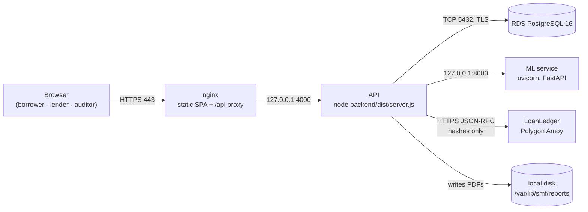

# Deployment guide

This is the path from a fresh EC2 instance to a running system: **Ubuntu 24.04 + RDS PostgreSQL + the
`LoanLedger` contract on Polygon Amoy + nginx with TLS**. Docker Compose is documented at the end as the
shorter alternative.

The guide is deliberately explicit about the two things people get wrong: the refresh cookie requires
HTTPS, and `npm run db:seed` must never run in production (it creates demo accounts with a published
password).

## 1. What gets deployed



Three systemd units on one host (`smf-api`, `smf-ml`), nginx in front, database off the host.

## 2. Assumptions and sizing

| Assumption | Value used below | Why |
| --- | --- | --- |
| Host | Ubuntu 24.04 LTS, `t3.small` (2 vCPU / 2 GB) | Node + Python + nginx on one box; the ML model is small |
| Database | RDS PostgreSQL 16, `db.t4g.micro`, private subnet | Off-host by default; encryption and backups managed |
| Domain | `finance.example.com` | Put your own in `WEB_ORIGIN`, the cookie, and CORS |
| Chain | Polygon Amoy (testnet, chain id 80002) | Free gas; `chainId` is checked against the network |
| Region | `eu-west-1` in the examples | Change consistently |

If you only want to demo: `t3.small` + RDS `db.t4g.micro` is roughly **$30/month**. Amoy costs nothing.

## 3. Database (RDS)

1. Create a PostgreSQL 16 instance, **not publicly accessible**, in the same VPC as the host. Enable
   storage encryption and automated backups (7 days is enough here).
2. Create two logins. The application does **not** need to own the schema, and should not:

```sql
CREATE ROLE smf_owner LOGIN PASSWORD '<owner-password>';
CREATE ROLE smf_app   LOGIN PASSWORD '<app-password>';

CREATE DATABASE secure_microfinance OWNER smf_owner;
\c secure_microfinance
GRANT CONNECT ON DATABASE secure_microfinance TO smf_app;
GRANT USAGE ON SCHEMA public TO smf_app;
ALTER DEFAULT PRIVILEGES FOR ROLE smf_owner IN SCHEMA public
  GRANT SELECT, INSERT, UPDATE, DELETE ON TABLES TO smf_app;
ALTER DEFAULT PRIVILEGES FOR ROLE smf_owner IN SCHEMA public
  GRANT USAGE, SELECT ON SEQUENCES TO smf_app;
```

3. Allow port 5432 only from the host's security group. `DATABASE_URL` must carry `?sslmode=require`.

`smf_app` deliberately has no `TRUNCATE` or `ALTER` rights: the audit-log triggers are in the schema, and
a compromised application login should not be able to disable them.

## 4. Host preparation

```bash
sudo adduser --system --group --home /opt/smf smf
sudo mkdir -p /var/lib/smf/reports /var/www/smf
sudo chown -R smf:smf /var/lib/smf

# Node 20 (the repo declares engines >=20) from NodeSource
curl -fsSL https://deb.nodesource.com/setup_20.x | sudo -E bash -
sudo apt-get install -y nodejs nginx postgresql-client jq fail2ban unattended-upgrades
sudo snap install --classic certbot && sudo ln -sf /snap/bin/certbot /usr/bin/certbot

sudo ufw default deny incoming
sudo ufw allow OpenSSH
sudo ufw allow 'Nginx Full'
sudo ufw enable
```

Then disable SSH password auth (`PasswordAuthentication no`) and reload sshd.

## 5. Code and dependencies

```bash
sudo -u smf -H bash
cd /opt/smf
git clone <your-repo> .
npm ci                     # one lockfile for all three workspaces
```

`npm ci` installs the toolchain (TypeScript, Vite, Hardhat) as well as the runtime dependencies. That is
required to build; it is not required to run. If image size matters, prune afterwards — but do it *after*
`npm run build`.

## 6. Configuration

```bash
cd /opt/smf
cp .env.example .env
chmod 600 .env
node -e "console.log(require('crypto').randomBytes(32).toString('hex'))"   # run four times
```

Fill in `.env`. The values that differ from the template:

```ini
NODE_ENV=production
API_PORT=4000
API_BASE_URL=https://finance.example.com
WEB_ORIGIN=https://finance.example.com

DATABASE_URL=postgresql://smf_app:<app-password>@smf-db.abc123.eu-west-1.rds.amazonaws.com:5432/secure_microfinance?sslmode=require

JWT_ACCESS_SECRET=<64 hex, different from the refresh secret>
JWT_REFRESH_SECRET=<64 hex>
FIELD_ENCRYPTION_KEY=<64 hex>
BLIND_INDEX_KEY=<64 hex>

CHAIN_MODE=amoy
AMOY_RPC_URL=https://rpc-amoy.polygon.technology
CHAIN_ID=80002
LEDGER_CONTRACT_ADDRESS=0x...            # from step 7
CHAIN_RECORDER_PRIVATE_KEY=0x...         # a dedicated wallet, see step 7

ML_SERVICE_URL=http://127.0.0.1:8000
REPORT_STORAGE_DIR=/var/lib/smf/reports
```

Notes that matter:

* `WEB_ORIGIN` has to be the **exact** browser origin. It drives CORS and it is the only origin the API
  will answer. A trailing slash will break it.
* Under `NODE_ENV=production` the refresh cookie is `Secure`, so **HTTPS is mandatory** — over plain HTTP
  the browser silently drops the cookie and every login "works" and then expires immediately.
* `FIELD_ENCRYPTION_KEY` and `BLIND_INDEX_KEY` are unrecoverable. Back them up separately from the
  database (a password manager or Secrets Manager), never in the same place as a `pg_dump`.
* The API validates this file at boot and refuses to start on a bad value. That is intended: a
  half-configured server is worse than a stopped one.

## 7. Smart contract on Amoy

Run this from the host (or from your workstation, then copy `contracts/deployments/amoy.json`). The
deployer key is the contract **owner**; the backend gets a different, recorder-only key.

```bash
# fund a fresh wallet with Amoy MATIC first (faucet), then:
export AMOY_DEPLOYER_PRIVATE_KEY=0x<owner-key>
export CHAIN_RECORDER_ADDRESS=0x<backend-recorder-address>   # optional: authorise in the same tx
npm --workspace contracts run deploy:amoy
```

The script writes `contracts/deployments/amoy.json` (network, address, deployer, block, tx hash) and
`LoanLedger.abi.json`, then prints the three lines to paste into `.env`. Copy
`LEDGER_CONTRACT_ADDRESS` into `.env` and `CHAIN_RECORDER_PRIVATE_KEY` for the recorder wallet.

Keys:

| Key | Where it lives | Power |
| --- | --- | --- |
| Owner | your workstation / hardware wallet | `setRecorder` only |
| Recorder | `.env` on the API host | append records and audit roots |

If the recorder key leaks, revoke it with `setRecorder(addr, false)` from the owner wallet and deploy a new
recorder. Records already written stay valid — they are immutable by design.

## 8. Schema

Migrations create tables and triggers, so they run as `smf_owner`; the API itself runs as `smf_app` and
has no DDL rights. Keep both URLs: only the owner one is used for this step.

```bash
cd /opt/smf
DATABASE_URL='postgresql://smf_owner:<owner-password>@<rds-host>:5432/secure_microfinance?sslmode=require' \
  node backend/dist/db/migrate.js
# or, before building: DATABASE_URL=... npm run db:migrate
```

A value already present in the environment wins over `.env` (dotenv does not override), which is why the
override above is enough. Expected output: `[migrate] applied 001_core_auth.sql … [migrate] up to date`.

Then confirm the separation actually holds:

```bash
# as the application login: no DDL
psql 'postgresql://smf_app:<app-password>@<rds-host>:5432/secure_microfinance?sslmode=require' \
  -c 'DROP TABLE audit_log;'
#   ERROR: must be owner of table audit_log

# as the owner: the append-only guard fires for everyone, owner included
psql '<owner url>' -c "UPDATE audit_log SET action = 'x' WHERE seq = 1;"
#   ERROR: audit_log is append-only; UPDATE is not permitted
```

**Do not run `npm run db:seed` or `db:reset`.** Both create the demo accounts documented in the README
(`Passw0rd!demo`) and `db:reset` drops the schema.

### The first auditor account

There is no self-service path to the `auditor` role, by design. Create the first one by hand, once:

```bash
HASH=$(node -e "console.log(require('bcryptjs').hashSync(process.argv[1], 12))" 'choose-a-strong-password')
psql "$DATABASE_URL" -c "
  INSERT INTO users (email, password_hash, role, full_name)
  VALUES ('auditor@example.com', '$HASH', 'auditor', 'Forensic Auditor');"
```

Be aware of what this does not do: the insert bypasses `recordAudit`, so the chain has no row for it
(the account's later logins are audited normally). A production build would put this behind an admin
endpoint with its own audit entry.

## 9. API service

```bash
cd /opt/smf
npm run build          # backend/dist + frontend/dist
npm run typecheck      # optional but cheap
```

Create `/etc/systemd/system/smf-api.service`:

```ini
[Unit]
Description=SecureMicrofinance API
After=network-online.target
Wants=network-online.target

[Service]
Type=simple
User=smf
Group=smf
WorkingDirectory=/opt/smf
EnvironmentFile=/opt/smf/.env
ExecStart=/usr/bin/node backend/dist/server.js
Restart=always
RestartSec=3
TimeoutStopSec=20
NoNewPrivileges=true
PrivateTmp=true
ProtectSystem=strict
ProtectHome=true
ReadWritePaths=/var/lib/smf
ProtectKernelTunables=true
ProtectControlGroups=true
RestrictAddressFamilies=AF_INET AF_INET6 AF_UNIX
MemoryMax=512M

[Install]
WantedBy=multi-user.target
```

```bash
sudo systemctl daemon-reload
sudo systemctl enable --now smf-api
curl -s http://127.0.0.1:4000/api/health
# {"status":"ok","service":"secure-microfinance-api","chainMode":"amoy", ...}
```

`ProtectSystem=strict` makes everything read-only except `ReadWritePaths` — if you forget that line,
agreements fail to render and approvals return `500`. That is the intended failure mode, not a bug.

## 10. ML service

```bash
cd /opt/smf/ml-service
python3 -m venv .venv
.venv/bin/pip install -r requirements.txt
sudo chown -R smf:smf /opt/smf/ml-service
sudo -u smf -H .venv/bin/python training/train.py && sudo -u smf -H .venv/bin/python training/train_anomaly.py
```

Training is optional: the service trains its shipped baseline on first start if the artifact is missing,
and reports `artifact: "trained-at-startup"` from `/health` so the difference is visible.

`/etc/systemd/system/smf-ml.service`:

```ini
[Unit]
Description=SecureMicrofinance ML scoring service
After=network-online.target

[Service]
Type=simple
User=smf
Group=smf
WorkingDirectory=/opt/smf/ml-service
Environment=PYTHONUNBUFFERED=1
ExecStart=/opt/smf/ml-service/.venv/bin/python -m uvicorn app.main:app --host 127.0.0.1 --port 8000 --workers 1
Restart=always
RestartSec=3
NoNewPrivileges=true
PrivateTmp=true
ProtectSystem=strict
ProtectHome=true
ReadWritePaths=/opt/smf/ml-service/model

[Install]
WantedBy=multi-user.target
```

```bash
sudo systemctl enable --now smf-ml
curl -s http://127.0.0.1:8000/health
```

Bound to `127.0.0.1` on purpose: it has no authentication, because nothing but this host should reach it.
If the service is down the API still scores — the deterministic fallback is labelled `model_source:
fallback` in every row it writes. An outage degrades the decision, it does not stop it.

## 11. Web client and TLS

```bash
cd /opt/smf
npm --workspace frontend run build
sudo rsync -a --delete frontend/dist/ /var/www/smf/
sudo chown -R www-data:www-data /var/www/smf
```

`/etc/nginx/sites-available/smf`:

```nginx
server {
    listen 80;
    server_name finance.example.com;
    return 301 https://$host$request_uri;
}

server {
    listen 443 ssl http2;
    server_name finance.example.com;

    ssl_certificate     /etc/letsencrypt/live/finance.example.com/fullchain.pem;
    ssl_certificate_key /etc/letsencrypt/live/finance.example.com/privkey.pem;

    add_header Strict-Transport-Security "max-age=31536000; includeSubDomains" always;
    add_header X-Content-Type-Options nosniff always;
    add_header X-Frame-Options DENY always;
    add_header Referrer-Policy no-referrer always;

    root /var/www/smf;
    client_max_body_size 1m;

    # Single origin: the SPA calls /api/v1, nginx forwards it to the API.
    location /api/ {
        proxy_pass http://127.0.0.1:4000;
        proxy_http_version 1.1;
        proxy_set_header Host $host;
        proxy_set_header X-Real-IP $remote_addr;
        proxy_set_header X-Forwarded-For $proxy_add_x_forwarded_for;
        proxy_set_header X-Forwarded-Proto $scheme;
        proxy_read_timeout 30s;
    }

    location /assets/ {
        expires 1y;
        add_header Cache-Control "public, immutable";
    }

    location / {
        try_files $uri $uri/ /index.html;
    }
}
```

```bash
sudo ln -s /etc/nginx/sites-available/smf /etc/nginx/sites-enabled/smf
sudo rm -f /etc/nginx/sites-enabled/default
sudo nginx -t && sudo systemctl reload nginx
sudo certbot --nginx -d finance.example.com
```

Single origin matters: the refresh cookie is `SameSite=Strict`, so a client on a different host from the
API would never send it. That is also why the Vite dev server proxies `/api`.

## 12. Scheduled checks

Two jobs keep the evidence meaningful. Both need a login, so create a dedicated auditor account for the
first one (never use a human's).

`/usr/local/bin/smf-integrity-check` (mode 700, owned by root, credentials in `/etc/smf/auditor.env`):

```bash
#!/bin/bash
set -euo pipefail
source /etc/smf/auditor.env
TOKEN=$(curl -sf -X POST https://finance.example.com/api/v1/auth/login \
  -H 'content-type: application/json' \
  -d "{\"email\":\"$SMF_AUDITOR_EMAIL\",\"password\":\"$SMF_AUDITOR_PASSWORD\"}" \
  | jq -r .accessToken)
curl -sf -X POST https://finance.example.com/api/v1/integrity/check \
  -H "authorization: Bearer $TOKEN" -H 'content-type: application/json' \
  -d '{"scope":"all"}' | tee -a /var/log/smf-integrity.jsonl
```

```
# /etc/cron.d/smf-integrity
17 3 * * *  root  /usr/local/bin/smf-integrity-check
```

Every run is itself written to the audit chain (`integrity.check_run`), and an all-scope run also covers
the loan ledgers. A `result` of `tampered` in that JSONL file is the alarm the whole design exists for.

Anchoring the chain head on-chain is a lender-authenticated call, not a background job in this prototype:

```bash
curl -X POST https://finance.example.com/api/v1/ledger/audit-anchor -H "authorization: Bearer $LENDER_TOKEN"
```

Do it after each business day you care about. Without anchors, tampering is still *detectable* from the
hash chain; with anchors, a database operator can no longer recompute the chain without also forging a
public transaction.

## 13. Backups and restore

```bash
# nightly, 30-day retention, compressed
pg_dump -Fc "$DATABASE_URL" -f /var/backups/smf-$(date +%F).dump
tar -czf /var/backups/smf-files-$(date +%F).tar.gz -C /var/lib/smf reports
```

Ship both to S3 with versioning and object lock. Two things to remember:

* The **database and the file archive belong together**. A restored `documents` row whose PDF is missing
  is a `404` on the agreement, permanently.
* A restore is not done until `POST /api/v1/integrity/check {"scope":"all"}` returns `ok` against the
  restored copy. Practise it once on a scratch database; the first real restore should not be the first
  attempt.

Restore drill:

```bash
createdb smf_restore
pg_restore -d smf_restore /var/backups/smf-2026-11-01.dump
tar -xzf /var/backups/smf-files-2026-11-01.tar.gz -C /tmp/smf-restore
# point a throwaway API at smf_restore and /tmp/smf-restore, then run the integrity check
```

## 14. Monitoring

| Signal | Where | Alarm on |
| --- | --- | --- |
| API alive | `GET /api/health` | 2 consecutive failures |
| ML alive | `GET :8000/health` | anything but `200` with `model_loaded: true` |
| Chain configured | `GET /api/v1/ledger/status` (`enabled`, `live`) | `live: false` while `CHAIN_MODE=amoy` |
| Integrity | nightly JSONL above | `result != "ok"` |
| Auth anomalies | `audit_log` | `auth.refresh_reuse_detected`, `auth.login_failed` bursts |
| Document tampering | `audit_log` | any `document.integrity_violation` |
| Disk | `/var/lib/smf`, `/var/log` | 80% |

`journalctl -u smf-api -f` is the log. The API logs no PII: request ids, actions and reasons only.

## 15. Hardening checklist

| # | Check | Verify |
| --- | --- | --- |
| 1 | `.env` is `600` and not in git | `stat -c '%a' .env`; `git check-ignore .env` |
| 2 | Four independent 32-byte secrets | `grep -E 'SECRET\|KEY' .env` — no repeats, no placeholders |
| 3 | `NODE_ENV=production` | Cookie is `Secure`; check `Set-Cookie` in devtools |
| 4 | `WEB_ORIGIN` is the https origin | A request from another origin is rejected |
| 5 | HTTPS only, HSTS on | `curl -I http://…` redirects; `strict-transport-security` present |
| 6 | RDS is not publicly accessible | `sslmode=require` and a private security group |
| 7 | App login has no DDL rights | `psql` as `smf_app`: `DROP TABLE audit_log;` must fail |
| 8 | Audit triggers fire | `UPDATE audit_log …` as `smf_app` must raise |
| 9 | Owner key not on the host | Only `CHAIN_RECORDER_PRIVATE_KEY` is in `.env` |
| 10 | ML bound to loopback | `ss -ltnp \| grep 8000` shows `127.0.0.1` |
| 11 | Demo data absent | `SELECT count(*) FROM users;` — no `@smf.demo` |
| 12 | Backups restore | The drill in §13 has been run at least once |
| 13 | Nightly integrity job exists | `/etc/cron.d/smf-integrity` and a JSONL line from last night |

## 16. Docker Compose alternative

Shorter path, if you accept containers:

```bash
cp .env.example .env      # same values as §6, except DATABASE_URL can point at the compose postgres
export PUBLIC_WEB_ORIGIN=https://finance.example.com
docker compose up -d --build
docker compose ps
curl -s http://127.0.0.1:4000/api/health
```

What the compose file does for you:

* `api` runs `backend/docker-entrypoint.sh`, which applies migrations (idempotent) and then starts the
  server. Set `RUN_MIGRATIONS=false` when you run more than one replica or apply migrations as a release
  step.
* `storage:/data` holds agreements and exports; `REPORT_STORAGE_DIR=/data/reports` inside the image. Keep
  that volume — it is the signed evidence.
* `web` is nginx serving the built SPA and proxying `/api` to `api:4000`, so the browser sees one origin.
* `WEB_ORIGIN` comes from `PUBLIC_WEB_ORIGIN`, not from `WEB_ORIGIN`, because compose interpolates `.env`
  automatically and `.env` normally still holds the dev value.

To use RDS instead of the bundled `postgres` service, delete that service and set `DATABASE_URL` in `.env`
to the RDS URL. The API waits for nothing in that case, so check `/api/health` yourself.

## 17. Rollback

* **Application**: keep the previous `backend/dist` and `/var/www/smf` as dated tarballs. Deploy by
  swapping the directory and `systemctl restart smf-api`. There is no state in the process.
* **Schema**: migrations are forward-only and there are no down-migrations. A rollback is therefore "roll
  the app back to a version that understands the current schema"; never run `db:reset` against production.
* **Chain**: you cannot roll back a ledger. Deploy a new `LoanLedger` and point
  `LEDGER_CONTRACT_ADDRESS` at it if the recorder key is compromised; old records remain verifiable under
  the old address, so keep a note of both.

## 18. Troubleshooting

| Symptom | Likely cause | Fix |
| --- | --- | --- |
| API exits at boot with `Invalid environment configuration` | A missing/invalid `.env` value (the message names the field) | Fix the field; keys must be 64 hex chars |
| Login "succeeds" then the session vanishes | Cookie is `Secure` on plain HTTP, or `WEB_ORIGIN` mismatch | Serve over HTTPS; correct `WEB_ORIGIN` |
| `CORS: Origin not allowed` | Origin is not in the allow-list | Update `WEB_ORIGIN`; the allow-list also accepts `localhost:5173` for dev |
| `503 CHAIN_UNAVAILABLE` | `LEDGER_CONTRACT_ADDRESS` empty or `CHAIN_MODE=off` | Complete §7 and restart |
| Every recent payment shows `unanchored` | Chain unreachable when the payment cleared | `GET /api/v1/ledger/status`; anchor later — the record is still valid |
| Approvals fail with `500` | `ProtectSystem=strict` without `ReadWritePaths=/var/lib/smf` | Add the path, `daemon-reload`, restart |
| `/health` of the ML service returns `503 model not loaded` | Artifact missing and training failed | Check the unit's journal; run `training/train.py` by hand |
| `audit_log is append-only; UPDATE is not permitted` | Something tried to modify evidence | That is the control working. Investigate what did |
| `docker compose` cannot build | Build context is the repo root | Run compose from the repo root, not from `backend/` |
