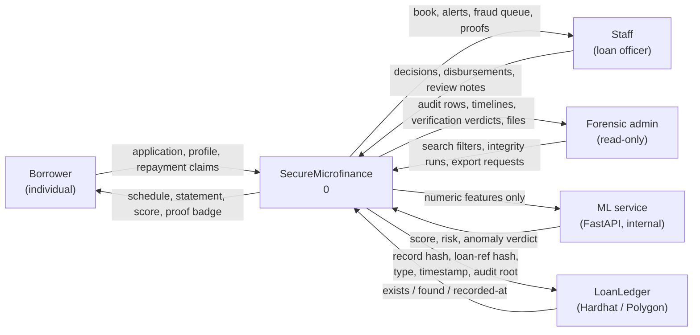
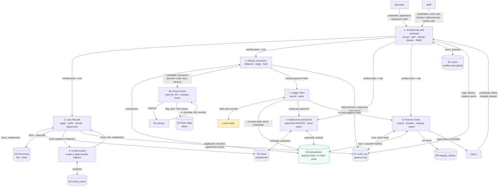
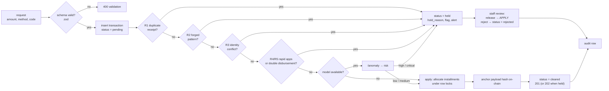

# Data flow diagrams

Three views, each answering a different question: **who talks to the system** (context), **what happens
inside** (level 1), and **where does personal data go** (classification). The classification table is the
important one: the whole design is an argument about the one boundary that must never be crossed.

## Level 0 — context

Nothing external ever reaches the chain directly: only the API's recorder wallet signs. The ML service is an
internal component — it sees numbers derived from the loan, never identity fields.

## Level 1 — processes and stores

### Decomposition of process 3 (the money path)

`H` is the pivot of the whole module: the claim is recorded, the money has not moved, and only a human can
turn one into the other.

## Trust boundaries

| # | Boundary | Crossing | Control |
| --- | --- | --- | --- |
| B1 | Browser → API | Everything a user types | TLS, helmet, CORS allow-list, zod, rate limits, JWT + RBAC |
| B2 | API → PostgreSQL | SQL and parameters | Parameterised queries, least-privilege DB role, encryption of PII columns, append-only triggers |
| B3 | API → file store | Generated PDFs | Server-side rendering only, SHA-256 recorded per document, download audited |
| B4 | API → ML service | Derived numeric features | No identifiers sent; 3-second timeout; failure falls back deterministically |
| B5 | API → blockchain | **Hashes only** | Recorder allow-list on-chain; no update/delete functions; no PII in the payload |
| B6 | Admin → API | Read queries and export requests | Admin-only routes, every read audited, exports embed their own verification state |
| B7 | DBA → database | Direct SQL | Guard triggers block UPDATE/DELETE/TRUNCATE on `audit_log`; the hash chain exposes anyone who disables them |

## Data classification and where each item is allowed to go

| Data | Classification | PostgreSQL | API response | ML service | Ledger | Audit log |
| --- | --- | --- | --- | --- | --- | --- |
| Password | secret | bcrypt hash only | never | never | never | never |
| Refresh token | secret | SHA-256 only | httpOnly cookie | never | never | never |
| National ID, phone, DOB, address | personal (sensitive) | AES-256-GCM ciphertext + HMAC blind index | masked (`2345***89`) | never | never | field names only, never values |
| Guarantor name, phone | personal | ciphertext | masked | never | never | never |
| Full name, email | personal | plaintext (operational need) | to the counterparty and auditors | never | never | yes (actor name resolved at read time) |
| Loan amount, rate, schedule | financial | plaintext cents | to the two parties and auditors | **yes** (aggregated) | **no** (only a hash) | yes |
| Payment reference (M-Pesa code) | financial | plaintext + normalised | to the two parties and auditors | no | no | yes, inside `detail` |
| IP address, user agent | technical | plaintext | only to the admin | no | no | yes |
| Record hash, chain root | evidence | `char(64)` | yes | no | **yes** | yes (as `after_hash`) |
| Model risk score | derived | `numeric(5,4)` | yes | produces it | no | no (only the flag) |
| Fraud flag + reason | derived | jsonb | to the lender and admin | no | no | yes |

The chain column is the design's central claim: **every row before it may be rich; the chain may only ever
contain hashes and timestamps.** A public ledger that listed amounts would let anyone graph a borrower's
credit history — which, for a customer of an informal lender, is a safety problem, not just a privacy one.

## Retention

* `audit_log` is never deleted; there is no code path that would do it, and no role has the privilege.
* `refresh_tokens` accumulate as revoked rows: cheap, and they are the evidence for reuse detection.
* Documents are kept for the life of the loan plus whatever the lender's jurisdiction requires; a deletion
  would be an audited action in a real deployment (this prototype has no delete path at all).
* `integrity_checks` keeps every run; the history is how an admin shows the record was verified *then*, not
  only now.
