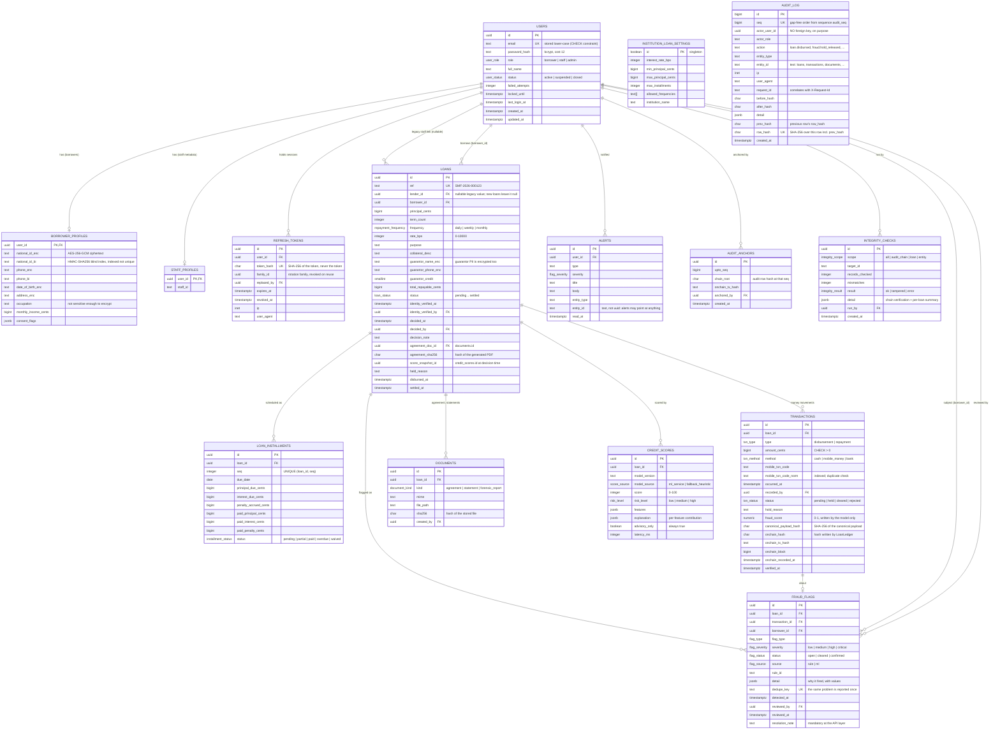

# Entity-relationship model

Fifteen tables in five groups: identity, lending, money, detection, and evidence. The model follows three
rules that explain most of its shape:

1. **Personal data is encrypted in place** (`*_enc`) and searchable only through a blind index (`*_bi`).
2. **Money is integer cents**, never a float; a schedule row and a payment row are separate facts.
3. **Evidence is append-only.** `audit_log` has no update path, and `actor_user_id` is deliberately *not* a
   foreign key so that deleting or suspending an account can never damage the trail.

## Reading the diagram

**Identity group.** `users` is the only table with a credential. Borrower and staff profiles are separate
one-to-one tables because their fields have nothing in common. Institution-wide terms live in the singleton
`institution_loan_settings` row, rather than in staff profiles.

**Why `*_bi` is indexed but not unique.** A duplicate national ID or phone number is a *fraud signal*, not a
database error. A unique constraint would reject the second account and hide the problem; the blind index lets
the identity-conflict rule find it and raise a `critical` flag while both accounts keep working.

**Lending group.** `loans` holds both the request (what the borrower asked for) and the outcome (rate, total,
status, who verified, who decided). The schedule lives in `loan_installments`; it is generated at application
time and regenerated on approval, so a rejected application still shows what it would have cost.

**Money group.** `transactions` is the only table where money moves, and it is deliberately small. It carries
three hashes with three different jobs:

| Column | Written when | Answers |
| --- | --- | --- |
| `canonical_payload_hash` | the payment is created | is this row still what it was? |
| `onchain_hash` | the ledger accepted the hash | did the ledger see it? |
| `onchain_tx_hash` | same write | which transaction proves it? |

**Detection group.** `fraud_flags.dedupe_key` is unique so re-running a scan cannot produce five copies of one
problem. `detail` is JSON because every rule explains itself differently — a reused receipt cites the other
loan, the model cites feature values — and the reviewer must be able to read the reason, not just the verdict.

**Evidence group.** `audit_log` is the spine. Its `row_hash` covers `prev_hash`, so the rows form a chain: edit
row 12 and rows 13…n no longer link, *and* row 12 no longer matches its own content. `integrity_checks` stores
what each run saw so a later reader can tell "verified on 3 Nov" from "verified now". `audit_anchors` records
where a chain root was written on-chain, which is what lets an admin say the log existed in that state at
that time even if the whole database were later replaced.

## Enumerated values

| Type | Values |
| --- | --- |
| `user_role` | `borrower`, `staff`, `admin` |
| `user_status` | `active`, `suspended`, `closed` |
| `loan_status` | `pending`, `under_review`, `approved`, `rejected`, `held`, `disbursed`, `active`, `settled`, `defaulted`, `cancelled` |
| `repayment_frequency` | `daily`, `weekly`, `monthly` |
| `installment_status` | `pending`, `partial`, `paid`, `overdue`, `waived` |
| `txn_type` / `txn_method` / `txn_status` | `disbursement`/`repayment` · `cash`/`mobile_money`/`bank` · `pending`/`held`/`cleared`/`rejected` |
| `risk_level` | `low`, `medium`, `high` |
| `score_source` | `ml_service`, `fallback_heuristic` |
| `flag_type` | `duplicate_txn_code`, `malformed_reference`, `identity_conflict`, `rapid_applications`, `ml_anomaly`, `duplicate_disbursement`, `hash_mismatch` |
| `flag_severity` / `flag_status` / `flag_source` | `low`…`critical` · `open`/`cleared`/`confirmed` · `rule`/`ml` |
| `integrity_scope` / `integrity_result` | `all`/`loan`/`entity`/`audit_chain` · `ok`/`tampered`/`error` |

## Constraints worth knowing

* `users_email_lowercase` — the API lower-cases emails; the schema enforces it, so two accounts cannot differ
  only by case.
* `loans_distinct_parties` — historical staff and borrower IDs cannot be equal; new loan rows use a null
  legacy staff link.
* `transactions_mobile_code_consistent` — a `mobile_money` payment must carry a reference; `cash` need not.
* All money columns are `CHECK (… >= 0)` or `> 0`; `fraud_score` is constrained to 0–1, so a bug that writes
  `7.5` fails at the database rather than in a report.
* `UNIQUE (loan_id, seq)` on installments and `UNIQUE (dedupe_key)` on flags are the two idempotency anchors of
  the system: a schedule cannot have two "installment 3"s and a problem cannot be reported twice.
